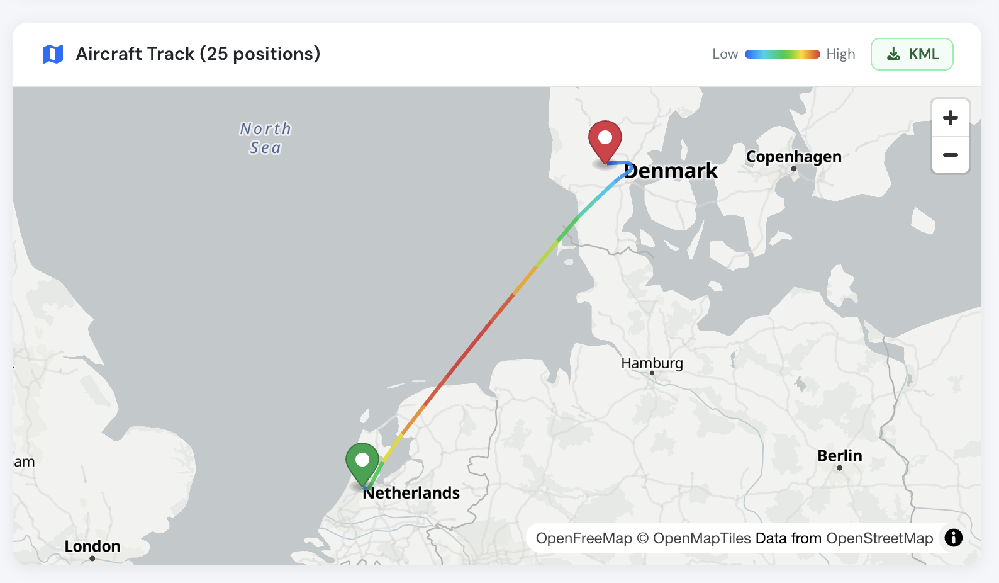

# ADSB surveillance

Flylogs collects ADS-B data about your aircraft from public and commercial ADS-B networks (OpenSky Network and Flightradar24). It uses that data in three places:

* a **live map** of your fleet,
* the **track of every confirmed flight**,
* a **check on the flight form**, before you save, so you can compare your times with what ADS-B recorded.

ADS-B data comes from third-party receiver networks. Flylogs cannot guarantee that it is available or accurate, so always check it against your own navigation records.

### Requirements

* **Flight tracks and the flight form check:** any paid plan (Club, Premium or Unlimited).
* **Live fleet map:** [Flylogs Premium](https://www.flylogs.com/static/pricing) or Unlimited, and the aircraft's **ADS-B HEX** code entered in its properties page.
* The aircraft must be active in Flylogs and must not be a simulator.
* The aircraft must transmit ADS-B positions (ADS-B out). Some aircraft with a Mode S transponder do not send their position, and these cannot be tracked. Coverage at low altitude also depends on the receivers near your airfield.

Flight tracks are found by the aircraft **registration**, so the HEX code is not needed for them. If the HEX code is missing or wrong, Flylogs fills it in from the ADS-B data the first time it finds one of the aircraft's flights.

### Track of a confirmed flight

When you confirm a flight, Flylogs looks up its ADS-B track in the background. Confirming never waits for this.

* The track usually appears on the flight page **within 15 minutes of on-blocks**. While the search is running, the flight page says so and refreshes on its own.
* If several ADS-B flights fall within your block times, all of them are joined into one track. This happens, for example, with circuits that include full-stop landings.
* If nothing is found, Flylogs tries again after 1 hour and after 6 hours. After that, the flight page shows that no ADS-B track was found for this flight.
* Changing the flight's times or aircraft starts a new search.
* ADS-B history is available for flights from **April 2024** onwards.

The flight page also shows where the track came from (for example Flightradar24 or OpenSky Network). Flights imported from **Spidertracks** use the track from that import.

<figure><figcaption></figcaption></figure>

### Check a flight before saving it

On the flight form, once the aircraft, off-blocks and on-blocks times are filled in, press **Find on ADS-B**:

1. Flylogs lists each ADS-B flight of that aircraft within your block times, with its takeoff and landing times and airports.
2. **Use these times** fills in the **Takeoff** and **Landing** fields from ADS-B. It also fills the departure and landing airfields if you have not entered them yet.
3. **Show track** draws the recorded track on a small map, so you can check that it is your flight.

The search only runs when you press the button. Whatever it finds is kept, so when you confirm the flight its track appears straight away.

### Live fleet map

On your Manager home page, a small moving map shows where your aircraft are. Click an aircraft to see its details. On each aircraft's details page, a moving map shows the route of an aircraft that is flying now.

Aircraft that are flying are updated about every minute. Aircraft with a dispatched flight or a booking in progress are checked every 2 minutes, so a takeoff shows up quickly. Other aircraft that have flown in the last 3 days are checked every 10 minutes.

### Is ADS-B working for my aircraft?

The aircraft details page shows an **ADS-B tracking** line. It tells you how many of the aircraft's recent flights have a track and when the aircraft was last seen. If no track has been found for any of its recent flights, the line says so. In that case the aircraft probably does not transmit ADS-B positions: check the transponder installation with your maintenance organisation.
