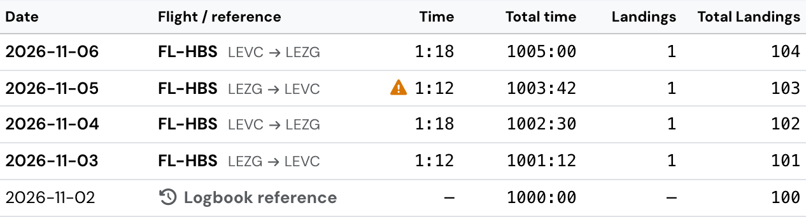
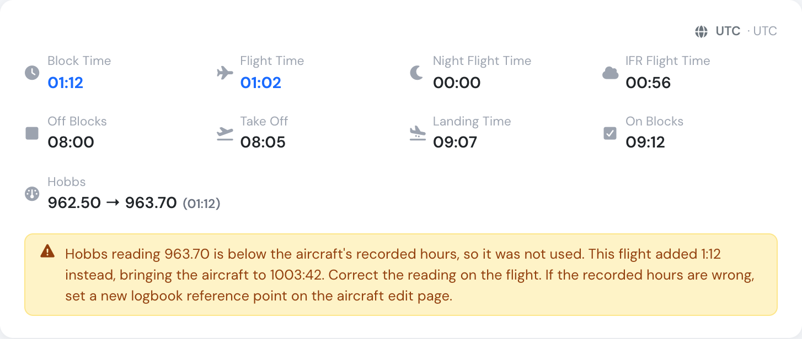
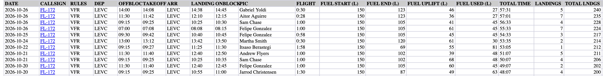

# Aircraft Logbook

Every aircraft in Flylogs keeps an automatic, read-only audit trail of its cumulative flight hours and landings. This is the **Aircraft Logbook**, made up of individual **aircraft log** entries.

You can find it on the aircraft detail page, under the **Logbook** tab.

### What is an aircraft log entry?

Each aircraft log entry is a snapshot of the aircraft's total flight time and landings at a point in time. Entries are never edited or deleted — they form a permanent history of how the aircraft's total time has progressed.

There are three types of aircraft log entries:

| Type | Created | What it means |
|---|---|---|
| **Setup / Logbook reference** | Manually, when the aircraft is created (or via "Reset aircraft hours") | Establishes the aircraft's baseline hours and landings, e.g. "this aircraft has 1234.5 hours and 567 landings as of today" |
| **Flight** | Automatically, every time a pilot saves a completed flight | Records the flight's block time and landings, and the aircraft's new cumulative totals after that flight |
| **Maintenance** | Automatically, when a maintenance job affects aircraft totals (e.g. an overhaul or component replacement) | Adjusts the aircraft's hours/landings to reflect the maintenance event |

You never create Flight or Maintenance entries by hand — they appear automatically as flights are flown and maintenance is recorded.

### What you see in the Logbook tab

For each row in the logbook table:

* **Date** — when the log entry was created, shown in your company's timezone and date/time format.
* **Flight reference** — for Flight-type entries, a link to the flight (callsign and route, e.g. `ABC123 KJFK → KLAX`). For Setup entries, a "Logbook reference" badge is shown instead.
* **Time** — the time this flight added, measured on the aircraft's [hours clock](#which-clock-counts-the-hours) (only for Flight-type entries).
* **Total time** — the aircraft's cumulative flight hours after this entry. This column is always filled in.

Landings and cumulative landings are tracked the same way, alongside hours.

Hovering a row shows extra detail: flight rules (IFR/VFR) and PIC for flights, or the logbook reference timestamp for Setup entries.

### Which clock counts the hours

**Hours counted from**, next to **Total Hours** at the top of the aircraft page, shows what the aircraft's hours follow: flight time, block time, tach time or Hobbs time. Everyone who can open the aircraft sees it. To change it, edit the aircraft and pick another **Maintenance time based on** option. The same value is also listed in the **Details** card.

<figure><figcaption>
Hours counted from sits next to the aircraft's total.
</figcaption></figure>

An aircraft can record a Hobbs or tach meter on every flight without counting its hours on that meter. If **Hours counted from** shows **Block Time**, for example, the Hobbs readings are stored on the flights, but the hours add up block time and will drift away from the Hobbs on the aircraft.

To make the hours follow the meter, do both of these in one save on the aircraft edit page:

1. Set **Maintenance time based on** to the meter.
2. Use **Reset aircraft hours** to set the hours to the latest meter reading, dated after the last flight landed.

Do both, because changing the clock alone keeps the hours where they are, and a Hobbs reading lower than those hours is not used (see below).

### When a Hobbs reading is not used

On an aircraft counted on Hobbs time, the Hobbs end reading of each flight becomes the aircraft's hours. As a safeguard, a reading **lower than the recorded hours** is not used, so a mistyped value cannot wind the hours back. The flight adds its own time instead: the difference between its Hobbs start and end readings.

Flylogs now shows when this has happened, to everyone who can see the logbook or the flight:

* **In the logbook**, a warning triangle appears on that flight's **Time** column. Hover over it to read the explanation.
* **On the flight page**, the same explanation appears under the Hobbs reading.

<figure><figcaption>
The flight of 5 November has a warning: its Hobbs reading was not used.
</figcaption></figure>

<figure><figcaption>
The flight page gives the reading, what the flight added, and the aircraft's hours after it.
</figcaption></figure>

To clear the warning, do one of these:

* **The reading is wrong:** correct it on the flight. The logbook is recalculated when you save.
* **The recorded hours are wrong:** use **Reset aircraft hours** on the aircraft edit page (staff/admin roles).

### Downloading the logbook

Use the **Download** button on the Logbook tab to export the full logbook as an Excel file, with the same columns as the on-screen table.

The export also carries each flight's meter readings, but only for the meters the aircraft is set up to record (**Hobbs** and/or **Tach** on the aircraft edit page):

* **Tach start / Tach end / Tach time** — for aircraft that record a tachometer.
* **Hobbs start / Hobbs end / Hobbs time** — for aircraft that record a Hobbs meter.

Readings are exported exactly as they are entered on the flight (two decimals) and the **time** column is the difference between the two readings, in decimal hours. It is left blank when either reading is missing. An aircraft with no meters configured exports the same columns as before.

For aircraft that track fuel, four fuel columns follow the meters, with the units in the header:

* **Fuel start / Fuel end** — fuel on board at engine start and shutdown, in the aircraft's gauge unit.
* **Fuel uplift** — the flight's own uplift plus every uplift recorded after its [legs](../flights/flight-legs.md#fuel), in the uplift unit.
* **Fuel used** — start + uplifts between legs − end, in the uplift unit. Blank when the start or end reading is missing, or when the units cannot be converted because the aircraft has no fuel type.

<figure><figcaption>
The fuel columns in the logbook export, between FLIGHT and TOTAL TIME.
</figcaption></figure>

### Setting up initial hours

When you [create a new aircraft](create-your-aircraft.md), you enter its current flight time and landings — this becomes the first Setup log entry.

If the aircraft's totals ever need correcting later (for example after a data entry mistake), staff/admin users can use the **Reset aircraft hours** button on the aircraft edit page. This creates a new log entry with the corrected totals; it does not alter or remove previous entries.

### Entering an old (backdated) flight

Flight log entries are placed in the logbook by the flight's date, not by the order in which you save them. If you save a flight dated earlier than flights you've already logged for that aircraft, Flylogs automatically recalculates the cumulative totals for that flight and every later entry, so the **Total time** and **Total landings** columns stay correct and in chronological order.

What this means in practice:

* **Final totals stay accurate.** Even if you log flights out of order, the logbook ends up consistent — nothing is silently left wrong.
* **It can be slow.** On an aircraft with a long flight history, saving one backdated flight forces a recalculation of every log entry after it. The save may take noticeably longer than logging a normal, current-dated flight.
* **No warning is shown.** Flylogs does not currently warn you that a flight is out of chronological order, or tell you how many later entries will be recalculated — it just happens silently on save.
* **The logbook block window can be bypassed by admins.** Companies can set how many days back a flight can be dated (`flights_block_days`). Regular pilots are blocked from entering flights older than this window, but Company Administrators, Operations Managers and Compliance & Safety Managers are exempt and can enter flights from any date in the past.

**Recommendation:** only enter backdated flights when necessary (e.g. importing historical data or correcting a missed entry), and avoid doing so on aircraft with very large flight histories during busy operational periods, since the recalculation runs synchronously when you save.

### Aircraft log vs. maintenance jobs

The aircraft logbook is not the same as the **Maintenance** tab:

* The **Maintenance** tab tracks actual maintenance work orders/jobs (open, completed, history).
* The **Logbook** tab tracks the resulting changes to the aircraft's cumulative hours and landings.

A completed maintenance job that adds hours (e.g. an engine overhaul) will produce a Maintenance-type entry in the logbook reflecting the aircraft's new totals — but the job itself lives in the Maintenance tab.

### Who can see and create log entries

* **Viewing** the logbook is available to anyone with access to the aircraft.
* **Creating** Setup or Maintenance entries manually (via aircraft creation or "Reset aircraft hours") is restricted to staff/admin roles.
* Flight entries are created automatically for any pilot saving a flight — no special permission needed.
