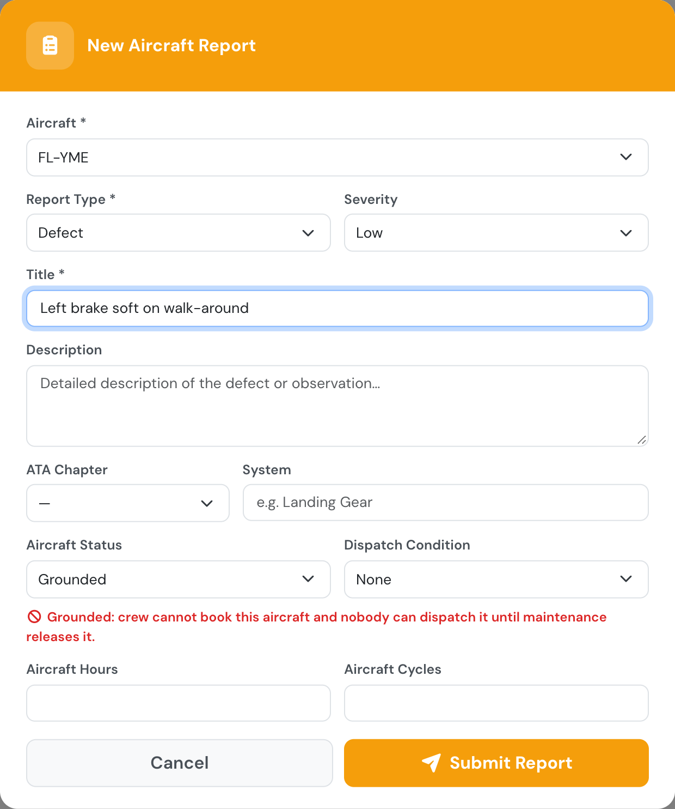
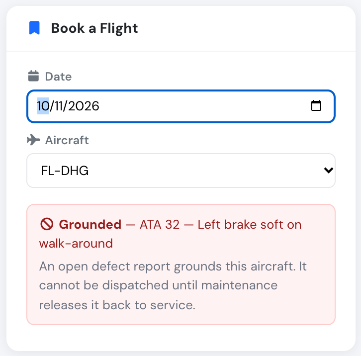
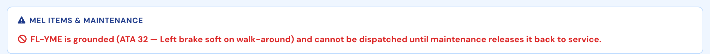
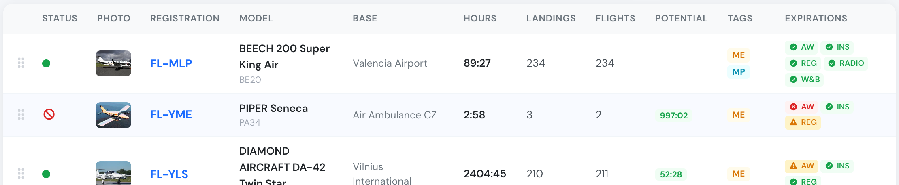
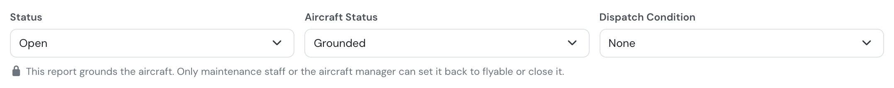
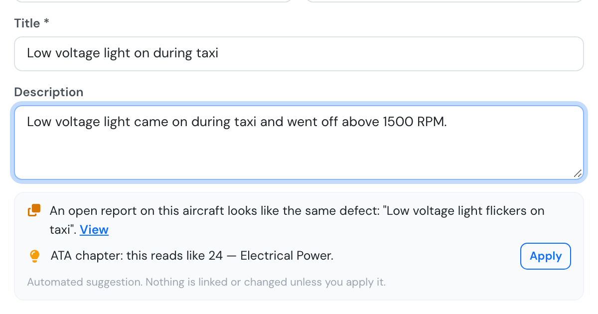

# Aircraft reports

An **aircraft report** records something about the state of an aircraft: a defect, an
informational note, a maintenance action, a servicing entry, or a **MEL** / **CDL** item.
Every report carries the severity, the ATA chapter, the dispatch condition and whether
the aircraft is left **flyable** or **grounded**.


The two report types formerly called **Observation** and **Restriction** no longer exist.
Existing Observation reports became **Information** reports, and existing Restriction
reports became **Defect** reports, automatically and once only.


Filing a report notifies the company's managers and maintenance staff by message.

## Reporting a defect without a flight

A defect does not need a flight. Found something on the walk-around, on a parked
aircraft, or with no flight planned at all? Use **Report defect**. You find it:

* on the **Flights** page, next to *Log flight* (you pick the aircraft in the form),
* on a booking: in the booking pop-up on the schedule and on the booking page,
* in the **dispatch** window, under *Found a defect on the walk-around?*,
* on the aircraft page.

<figure><figcaption>
Report defect sits next to Log Flight, so no flight is needed.
</figcaption></figure>

Every user can file a defect this way, including pilots and students. No block or flight
times are asked for. You can still file a report from a logged flight, as before. Managers
and maintenance staff also have **Aircraft → Reports**.

<figure><figcaption>
Choosing Grounded tells you straight away what it will do.
</figcaption></figure>

## Grounding an aircraft

Set **Aircraft status** (or **Dispatch condition**) to **Grounded** when the aircraft must
not fly. While at least one open report grounds it:

* **Pilots, instructors and students cannot book it.** The slot finder shows no slots
  and says why, and a booking attempt is refused.

  <figure><figcaption>
Book a Flight names the report that grounds the aircraft.
</figcaption></figure>

* **Nobody can dispatch it**, managers included. The dispatch window says which report
  grounds the aircraft.

  <figure><figcaption>
The dispatch window refuses a grounded aircraft for everybody.
</figcaption></figure>

* **Company Administrators, Operations Managers, Compliance & Safety Managers, Chief
  Pilots, Mechanics and the aircraft's managers can still book it**, with a warning.
  This way they can plan the flights that follow the repair. Those flights cannot be
  dispatched until the aircraft is released either.
* Bookings already on the aircraft are **not cancelled**. The message managers receive
  when the aircraft is grounded lists them, so they can decide what to do.
* The fleet list shows a red "no entry" icon next to the aircraft, and the
  aircraft page shows a **Grounded** badge.

  <figure><figcaption>
A grounded aircraft in the fleet list. Hover the icon to see why.
</figcaption></figure>

A *Deferred* report that is marked Grounded still grounds the aircraft.

### Releasing the aircraft

The aircraft is back in service when no open report grounds it any more. That happens
when its reports are set back to **Flyable**, are **closed**, or are closed automatically
when the CRS of their maintenance job is signed.

Only **Company Administrators, Operations Managers, Compliance & Safety Managers,
Mechanics and the aircraft's managers** can release a grounded aircraft. Anyone who
can file a report can ground one. A pilot can take an aircraft out of service, but only
maintenance can put it back.

<figure><figcaption>
For everyone else the Flyable and Closed choices are locked.
</figcaption></figure>

## Hints while you write a defect



Once the title and description say enough, the report form may show:

* **ATA chapter** — the chapter the defect reads like, with an **Apply** button. Nothing is filled in until you click it.
* **Already reported?** — when an open report on the same aircraft looks like the same defect, with a link to it. You can still file yours; it may add something the first one missed.
* **Maintenance may already be on it** — when an open maintenance job on the same aircraft looks like it covers the defect.

<figure><figcaption>
An open report already describes the same light, and the ATA chapter is ready to apply.
</figcaption></figure>

These are automated suggestions. They never link your report to a job (that stays a maintenance decision, see below) and they appear only while you are online. Anyone who can file an aircraft report sees them.

## Reports and maintenance jobs

Not every defect grounds the aircraft. A blown navigation light is not required for
VFR flight; an inoperative ADF is not required unless you are navigating on
instruments. Reports like these pile up while the aircraft keeps flying and get fixed
together at the next scheduled visit.

Flylogs supports exactly that: **one maintenance job can clear several aircraft
reports**. A report belongs to at most one job, a job can hold as many reports as you
like, and each of those reports can be worked through as many work orders as the job
needs.

When the job's **CRS** is signed, **every report attached to it is closed
automatically**, with the date and the signing user recorded.

### Three ways to group reports

**From the report** — open the report and choose:

* **Open maintenance job** to create a new job for it, or
* **Add to existing job** to attach it to a job already open for that aircraft.

**From the report list** — tick the reports you want (Aircraft → Reports), then use
**New maintenance job** or **Add to existing job** in the bar that appears. The
selection is confined to a single aircraft: a maintenance job belongs to one airframe,
so picking a report from a different aircraft starts a fresh selection.

**From the job** — open the maintenance job and use **Add reports** in the *Aircraft
Reports* card. The picker lists only open or deferred reports of that aircraft that
are not yet on another job.

To take a report back out, use **Detach from job** — either on the report itself or on
the row in the job's *Aircraft Reports* card. The report stays open and can be grouped
somewhere else.


Attaching and detaching are only possible **before the CRS is signed**. Once a job is
signed, its certificate covers a fixed set of reports and the list is frozen.


## Closing a report

A report can be closed in two ways:

* **Automatically**, when the maintenance job it is attached to has its CRS signed.
* **Manually**, with the **Close report** button on the report. Use **Reopen** if it
  was closed by mistake.

You never fill in a closing date. Flylogs records who closed the report and when, from
the action itself. Reopening a report clears that record.

Reports that are still outstanding can also be parked as **Deferred**, with a
reference (MEL / CDL number) and a deferral date, while the aircraft keeps operating
under that condition.

## MEL and CDL items

A report of type **MEL** or **CDL** is a special case: it carries its own category,
computed rectification deadline, releaser and operational limitations, and an **expired**
one is a hard block on flight dispatch. See [MEL / CDL items](mel-cdl-items.md) for the
full picture, including the exact rectification intervals and who may raise, release,
extend or close one.

## Who can do what

| Action | Who |
|--------|-----|
| File a report, view reports | Any user of a company on a **premium** or **unlimited** plan |
| Ground an aircraft (mark a report Grounded) | Anyone who can file a report |
| Release a grounded aircraft (set it back to Flyable, or close its report) | Company Administrators, Operations Managers, Compliance & Safety Managers and Mechanics, or a manager of the aircraft |
| Book a grounded aircraft (with a warning) | Company Administrators, Operations Managers, Compliance & Safety Managers, Chief Pilots and Mechanics, or a manager of the aircraft. Nobody can dispatch it |
| Close / reopen a report, edit management fields | Company Administrators, Operations Managers, Compliance & Safety Managers and Mechanics |
| Attach / detach reports to a maintenance job | Company Administrators, Operations Managers, Compliance & Safety Managers and Mechanics, or the user the aircraft is assigned to |
| Raise a MEL/CDL item | Company Administrators, Operations Managers, Compliance & Safety Managers and Mechanics, or the aircraft's assigned pilot |
| Edit, extend or close a MEL/CDL item | Company Administrators, Operations Managers, Compliance & Safety Managers and Mechanics only — the assigned-pilot exception does not apply |
| Be the releaser on a MEL/CDL item | Company Administrators, Operations Managers, Compliance & Safety Managers and Mechanics, or the requesting user themselves — never a Student Pilot |

Aircraft reports are part of the maintenance module and require a **premium** or
**unlimited** subscription plan.
