# Inventory

The inventory tracking system is designed to help you manage and monitor the status, lifecycle, and requirements of your maintenance warehouse items. It enables efficient tracking of stock levels, predicts future needs, and facilitates seamless communication and work organization with your engineering team.

<figure>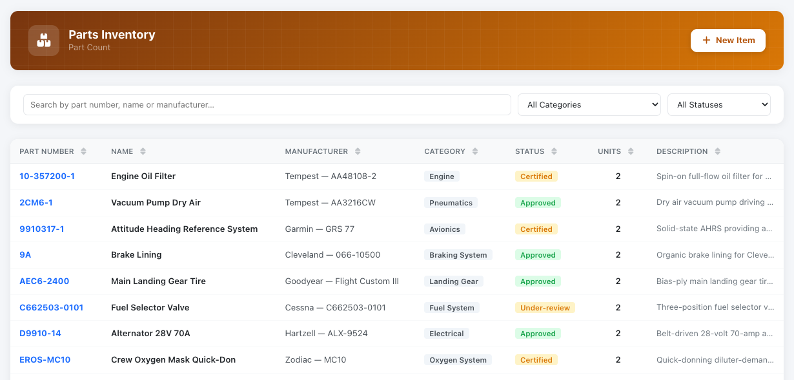<figcaption></figcaption></figure>

The system displays all part numbers in your catalog, and you can add the numbers available in your stock. These serial numbers can be linked to a specific company base, work order, or aircraft. This functionality allows you to track the location and status of each serial number, ensuring complete visibility and control over your inventory.

### The inventory list



The inventory list shows one row per part:

| Column | What it shows |
|--------|---------------|
| **Part Number** | The part number |
| **Name of part** | The part's name |
| **Manufacturer** | Manufacturer and model |
| **ATA Chapter** | The ATA chapter set on the part |
| **Certification** | The release document the part comes with: EASA Form 1, FAA 8130-3, Certificate of Conformity… (see [Certification](#certification)) |
| **Units (entered / purchased)** | Every unit you have recorded for the part |
| **Units fitted or installed** | Units whose status is *Installed* (fitted to an aircraft) |
| **Units of available stock** | Units whose status is *Available*: the stock you can still issue from stores. Shown in red when it reaches 0 |
| **Notes** | Your notes on the part |

Units in other statuses (Ordered, Received, Removed, Overhauled, Retired…) count towards *Units (entered / purchased)* only. Click any column header to sort by it.

<figure>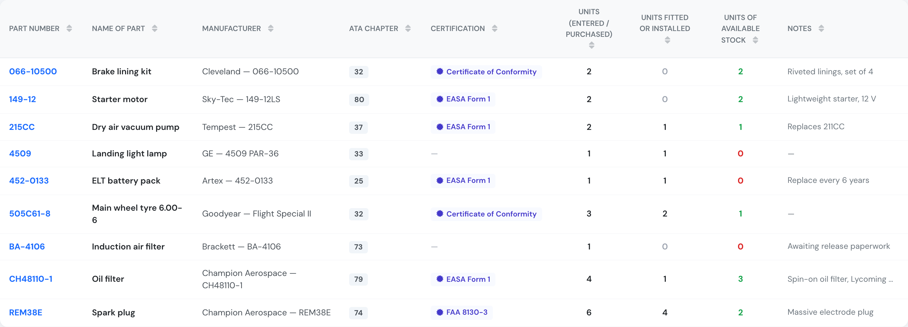<figcaption>
The inventory list
</figcaption></figure>

### Stock counts

When you fit a unit to an aircraft, open the part, click the unit and pick the **Aircraft**: a unit that was *Available* becomes **Installed** automatically (you can also set the status yourself). Add the **Installation Date** and save. The unit moves from *Units of available stock* to *Units fitted or installed*, so the list always shows how much stock is left.

<figure>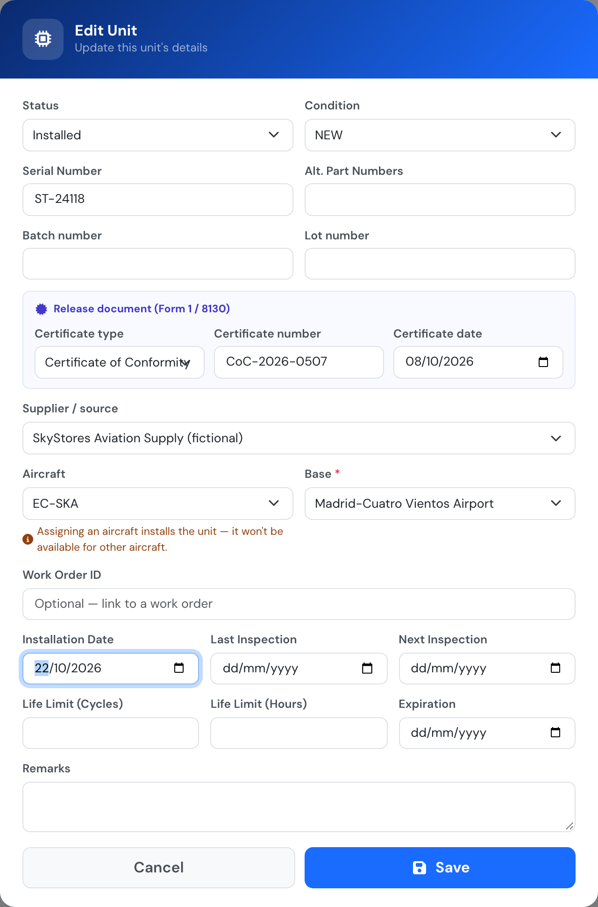<figcaption>
Installing a unit on an aircraft
</figcaption></figure>

The part page shows the same counts above its units, and each installed unit shows its aircraft and installation date.

<figure>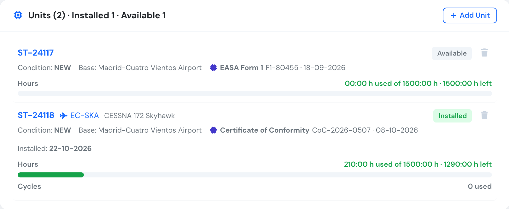<figcaption>
Units of a part after one was installed
</figcaption></figure>

### Adding several identical units

Parts you hold in numbers without individual serial numbers — spark plugs, oil filters, seals — don't need to be entered one by one. On the part page click **Add Unit**, choose **Multiple units**, type the **Quantity** and fill in the details they share (batch number, release document, supplier, base…). Flylogs adds that many units to stock in one go, and the stock counts go up by the same number.

<figure>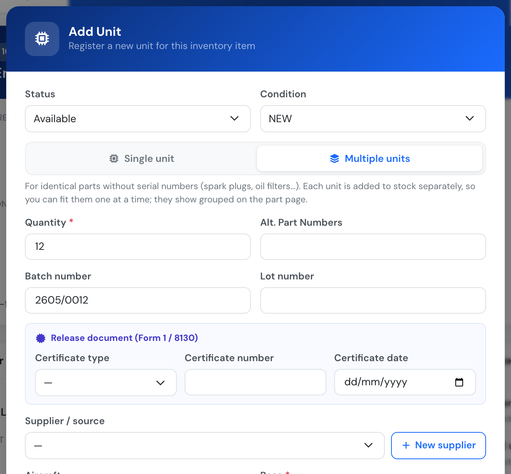<figcaption>
Adding 12 identical units
</figcaption></figure>

Each unit is still kept on its own, so you can fit them to aircraft one at a time and the counts stay exact. On the part page identical units are folded into one line ("12 identical units"); click it to see them and open any one of them. Adding them shows as a single line in the **Change History**. Choose **Single unit** for a part with a serial number.

<figure>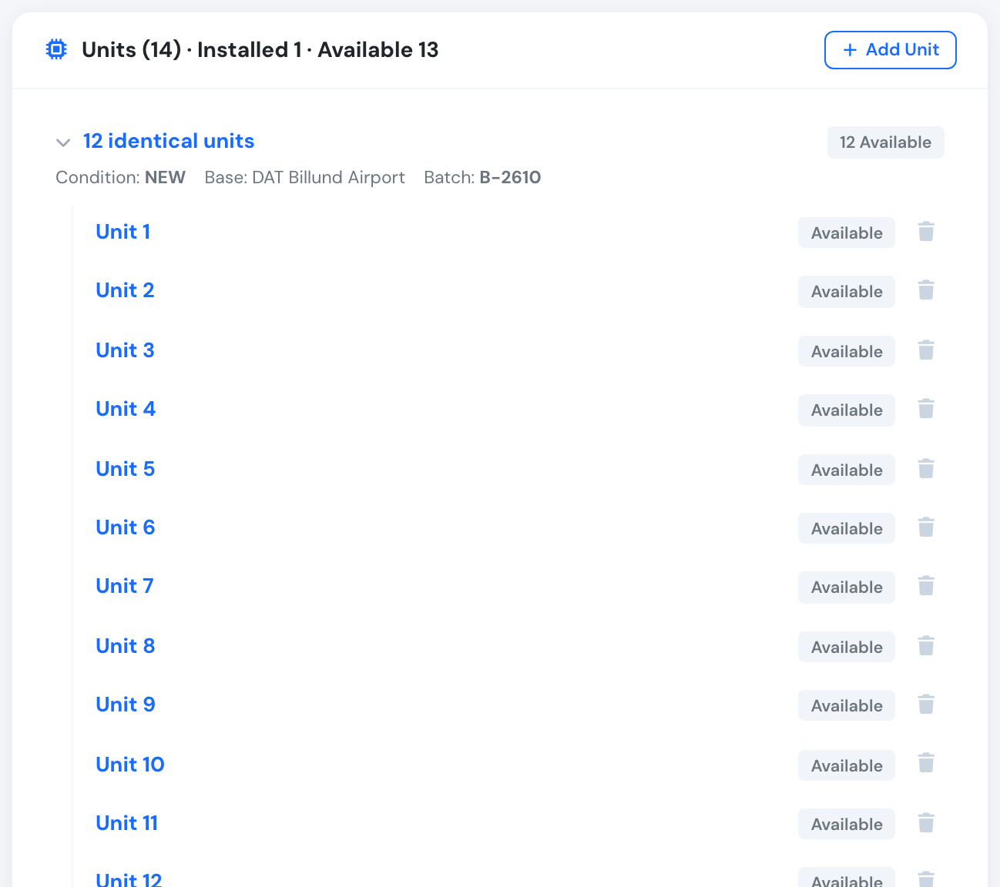<figcaption>
Identical units on the part page
</figcaption></figure>

### Life of a unit

When a unit has a **Life Limit (Hours)** or **Life Limit (Cycles)**, the part page shows how much of it is used and how much is left, as text and as a bar:

* **Green** while less than 75 % of the limit is used
* **Amber** from 75 %
* **Red** from 90 %, and when the limit is exceeded (the text then says by how much)

<figure>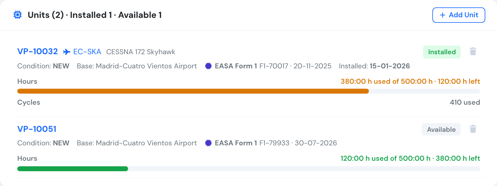<figcaption>
Hours used and left, on an installed unit and on a spare
</figcaption></figure>

<figure>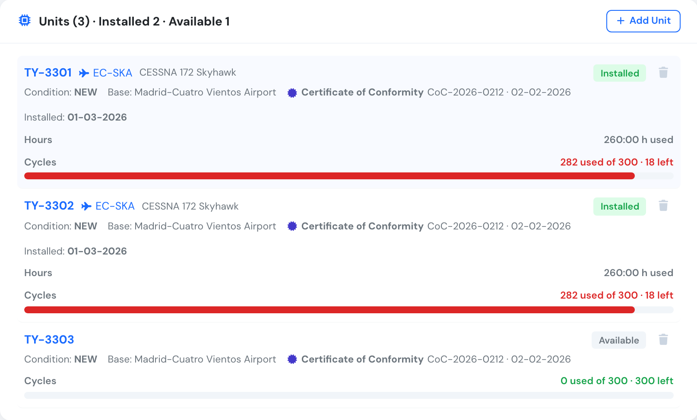<figcaption>
Cycles close to the limit show in red
</figcaption></figure>

Life is counted from the aircraft's own hours and landings, so you never type them in by hand:

* When a unit is **installed** (you pick the aircraft), Flylogs records the aircraft's **hours and cycles at installation**. If you set a past **Installation Date**, it takes the aircraft's figures at the end of that day.
* While the unit is installed, the hours and cycles the aircraft flies count towards the unit's life.
* When the unit is **removed** (you clear the aircraft, or change the status from *Installed*), the time it flew on that aircraft is added to its **Hours used before** and **Cycles used before**, so it keeps counting if it is refitted later, on the same aircraft or another one.

For a used or overhauled part, enter the life it had already used in **Hours used before** and **Cycles used before** when you add it. If the aircraft figures at installation need correcting, edit the unit and change **Aircraft hours at installation** or **Aircraft cycles at installation**. Units that were installed before life tracking existed show a note until you enter them.

### Installed parts on the aircraft page

The aircraft page has an **Installed parts** card listing every unit installed on that aircraft, with:

* the part, its part number, the unit's serial number and the ATA chapter
* its **release document** (the unit's certificate type and number, or the part's certification when the unit has none)
* its **installation date**
* its **life left** in hours and cycles, with the same colour-coded bars as the part page
* its **expiration**, if it has one: amber within 30 days, red once expired

Parts that need attention come first: expired, or with red or amber life, then the rest by ATA chapter. Click a part to open it. The card is shown to users who can see maintenance, on plans that include it, and only when the aircraft has installed parts.

<figure>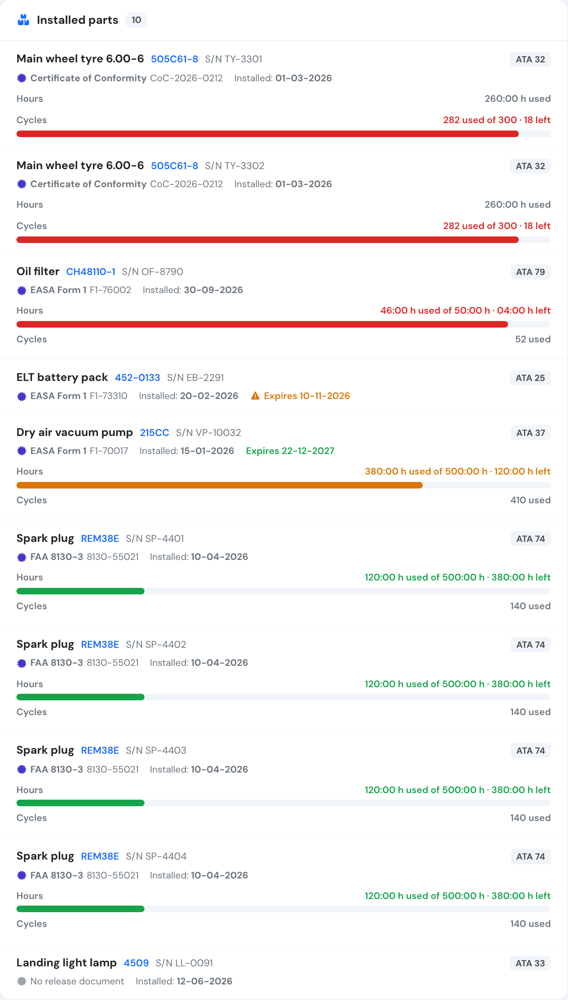<figcaption>
Installed parts on the aircraft page
</figcaption></figure>

### Change history

The **Change History** on the part page lists everything that happened to the part and to each of its units, newest first: units added, edited, **installed**, **removed** and deleted, with who did it and when. Installations and removals also show the aircraft and its hours and cycles at that moment. A deleted unit keeps its history, under its serial number.

<figure>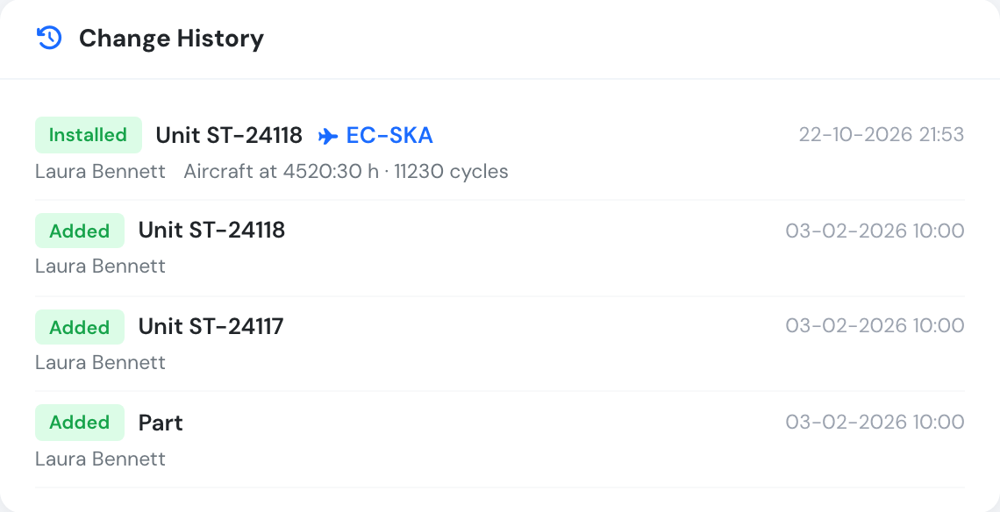<figcaption>
Part and unit history
</figcaption></figure>

### Certification

Each part records the **Certification** it comes with: EASA Form 1, FAA 8130-3, JAA Form 1, TCCA Form 24-0078, ANAC SEGVOO 003, **Certificate of Conformity** (common for parts bought from distributors rather than the manufacturer) or Other. Set it with **Edit** on the part page. It is shown in the list, and you can filter the list by it.

<figure>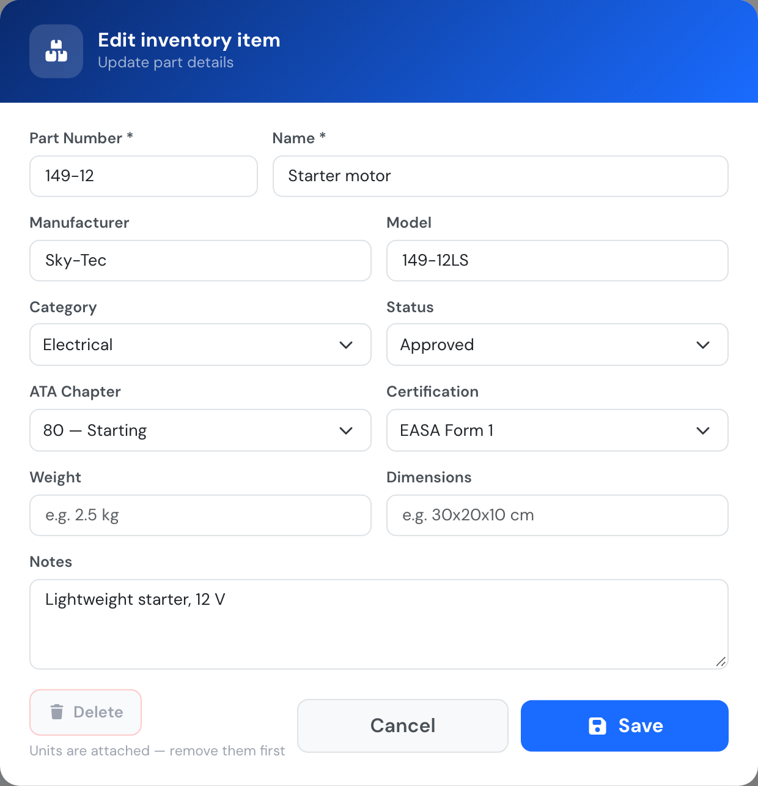<figcaption>
A part's ATA chapter and certification
</figcaption></figure>

Each unit also keeps its own release document, with the certificate number and date, because units of the same part can come from different sources. When you add a unit, its certificate type starts as the part's certification.

The part's **Status** (Approved, Pending, Quarantined, Rejected, Expired…) is still kept on the part page and in the part form, and you can filter the list by it.

### Searching

The search box above the list finds parts by part number, name, manufacturer, model, ATA chapter, certification or notes, and by the serial, batch, lot or certificate number of any of their units. Use **Filters** to narrow the list by category, status or certification.

<figure>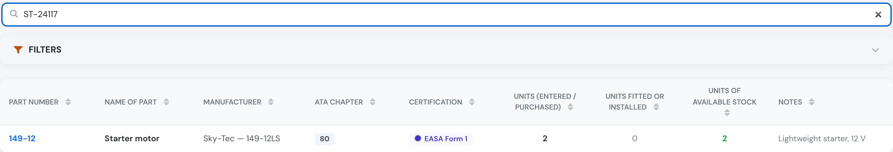<figcaption>
Finding a part from a unit's serial number
</figcaption></figure>

### Where parts are kept

Every unit has a **Base**: the place where it is stored. Use it to record where your stock is, and the units of the same part can sit at different bases. The [stock schedule export](#exporting-the-stock-schedule) has a **Stock location** column that lists the available units per base, for example *Main base (3)*. For the exact shelf or box within a base, use the part's **Notes**, which are shown in the list.

### Suppliers

Open **Aircraft → Suppliers**, or the **Suppliers** button on the inventory list, to manage the companies you buy parts from. For each supplier you can record the contact person, email, phone, website, address, VAT number, **your own account number** with them and free notes. Suppliers added here appear in the supplier list of every part and unit.

<figure>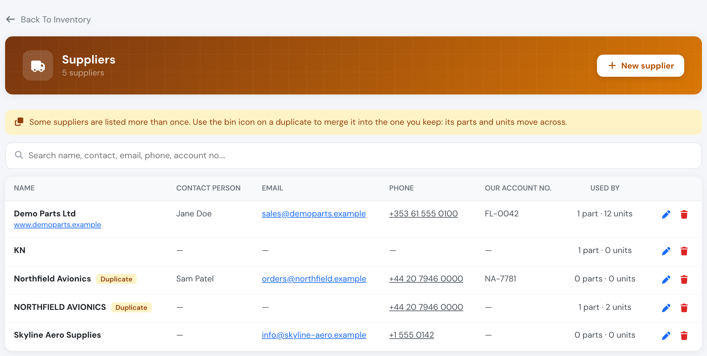<figcaption>
The supplier list
</figcaption></figure>

Click **New supplier** to add one, or the pencil to edit it. You can also add a supplier without leaving a part or unit form: **New supplier** next to the supplier list opens the same form and selects the supplier once it is saved. Each supplier name can only exist once, regardless of capitals or spacing. On a part page, click the supplier's name — the part's or a unit's — to open its details; managers and mechanics can edit them there.

<figure>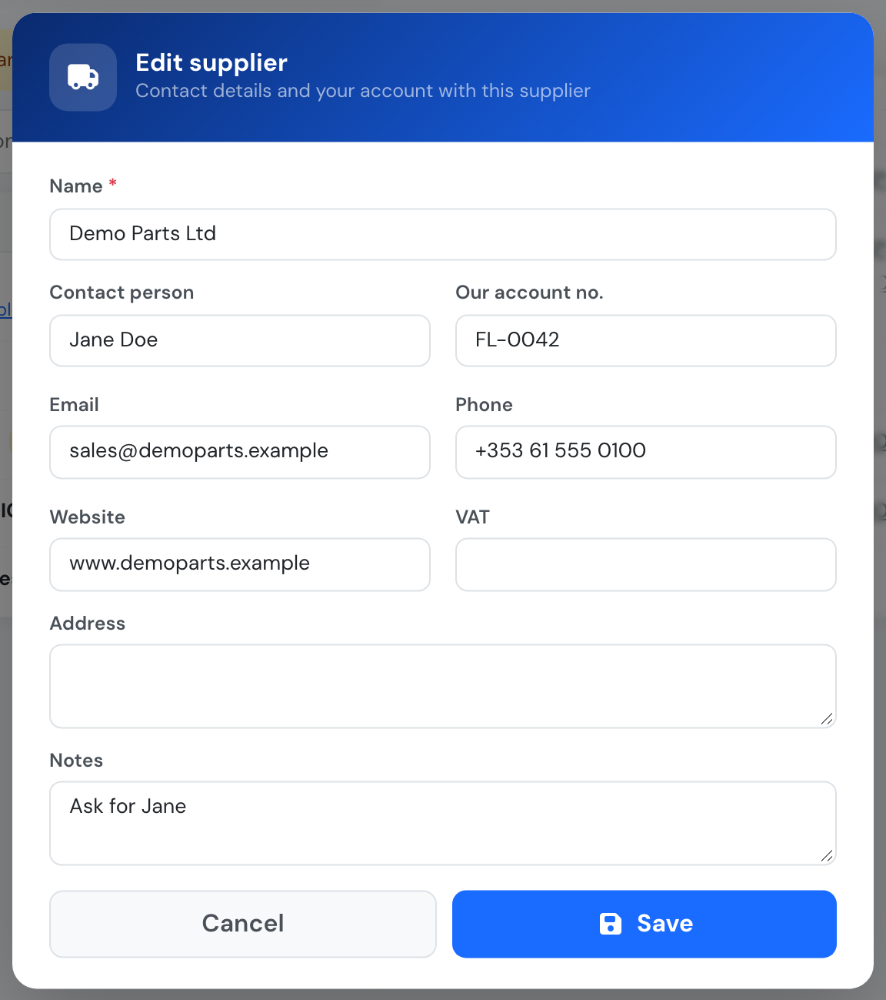<figcaption>
Supplier details
</figcaption></figure>

**Duplicates.** Suppliers listed more than once are marked **Duplicate**. Click the bin on the one you want to remove and choose the supplier to keep: all its parts and units move to it, and any details the kept supplier is missing (email, phone, account number…) are copied over — the kept supplier's own details are never overwritten. A supplier that no part or unit uses is simply deleted.

<figure>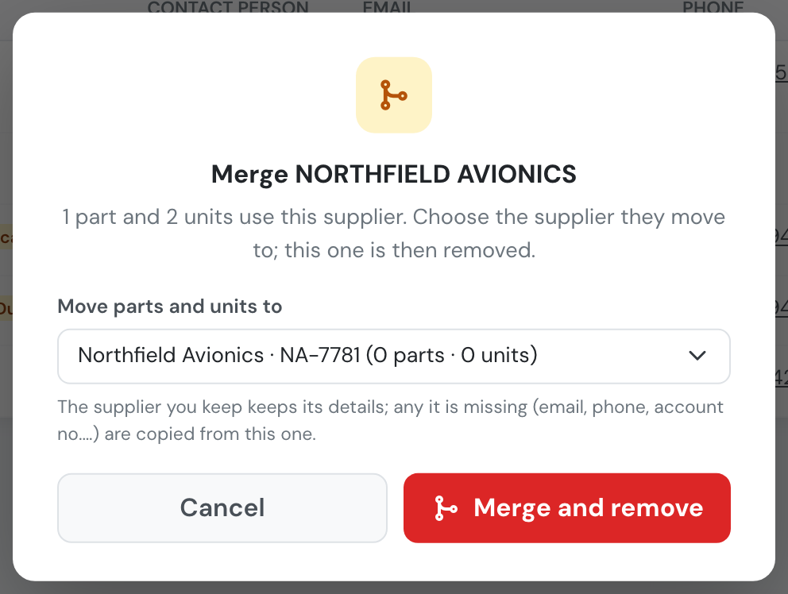<figcaption>
Merging a duplicate supplier
</figcaption></figure>

Managers and mechanics can add, edit and merge suppliers; auditors can see the list.

### Exporting the stock schedule

To share your stock with the maintenance team or other members who don't use Flylogs, click **Export** on the inventory list and choose **Excel (.xlsx)** or **PDF**. The file contains the parts currently shown — the same search, filters and sort order — with the list's columns plus **Stock location** and **Supplier**, and the total units, units installed and units in stock.

<figure>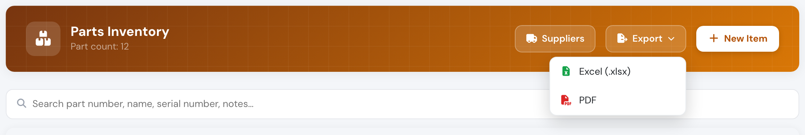<figcaption>
Exporting the inventory
</figcaption></figure>

<figure>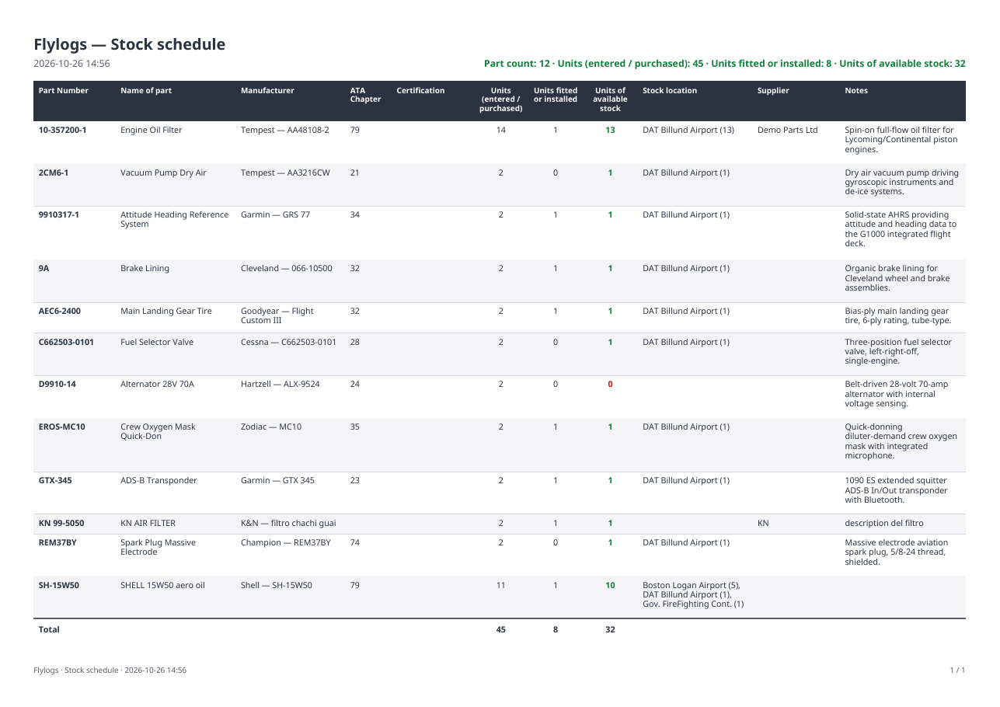<figcaption>
The stock schedule as PDF
</figcaption></figure>

The Excel file has a filter on every column, so the team can sort and filter it further.

### Part details

For each inventory item, you can see all details, as well as provider information and available serials in your warehouse.

&#x20;

<figure>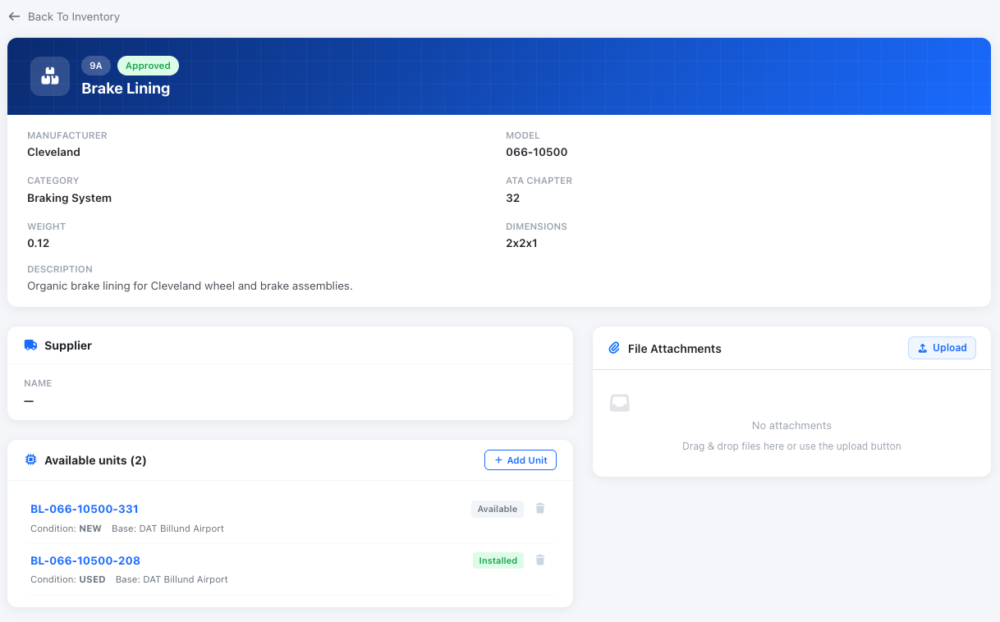<figcaption>
Inventory Part details
</figcaption></figure>

