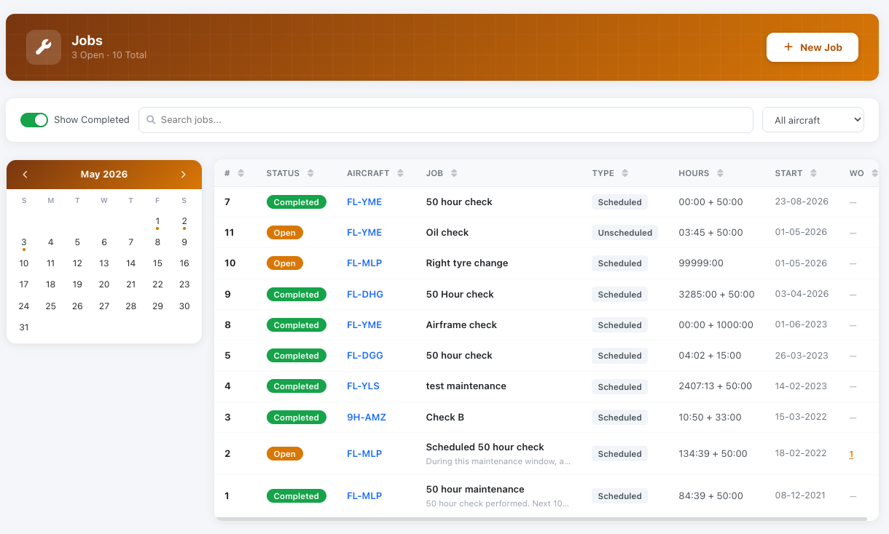
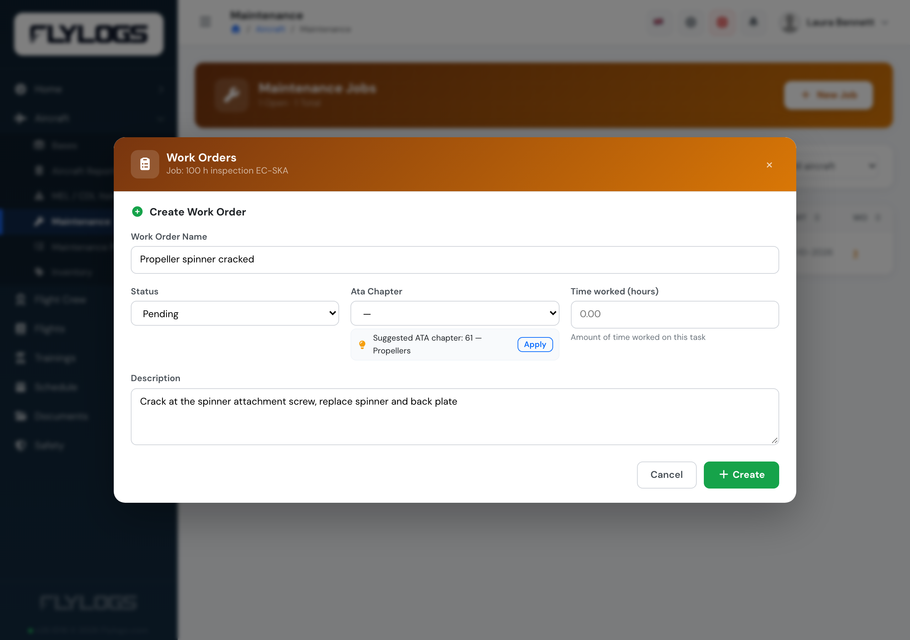
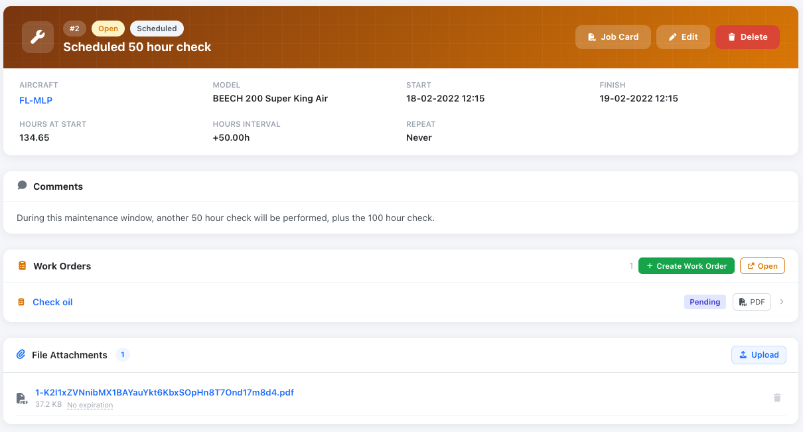

# Workorders

Work orders are essential documents used to manage and track maintenance tasks on an aircraft. They outline the specific work to be performed, assign responsibilities, and ensure compliance with regulatory and operational standards. Work orders help streamline maintenance workflows by providing clear instructions, tracking progress, and maintaining a detailed record of completed tasks.

Aircraft maintenance tasks may have associated multiple work orders. Each work order includes key details such as its name, description, assigned technician, supervising user, scheduled dates, expiration, and more. Additionally, work orders can include attached files, inventory items for part replacements, and comments.

<figure><figcaption></figcaption></figure>

### ATA chapter suggestion

When you create or edit a work order, Flylogs suggests the ATA chapter from its name and description once they say enough. Press **Apply** to select it. Nothing is selected until you click it, and the suggestion appears only while you are online.

<figure><figcaption>
A cracked propeller spinner, suggested under ATA 61 — Propellers.
</figcaption></figure>

The same suggestion appears on each work order of a [maintenance plan](maintenance-plans.md#creating-plan-actions) action, and when you file an [aircraft report](aircraft-reports.md#hints-while-you-write-a-defect).

Once a work order is created, Flylogs automatically records all modifications throughout its lifespan. This ensures a complete audit trail, allowing you to track every change, including who made it and when.

The ability to attach inventory items to work orders enables precise tracking of parts and consumables—monitoring their usage, location, and installation history. Since Flylogs maintains a record of every installed part on each aircraft, you can easily review the components installed on any aircraft by navigating to its profile.

<figure><figcaption>
Work order details page with Inventory items and attached PDF document.
</figcaption></figure>
