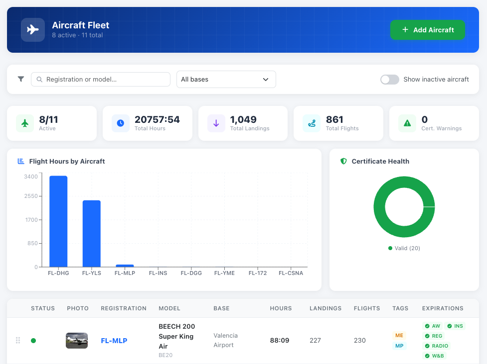
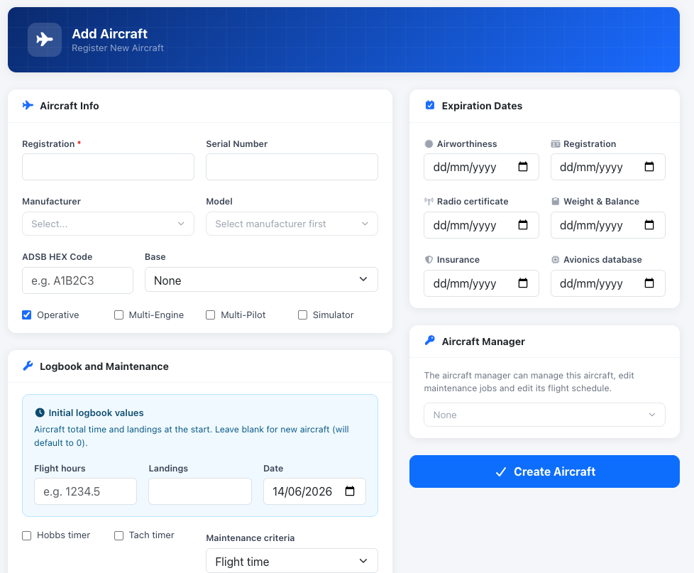
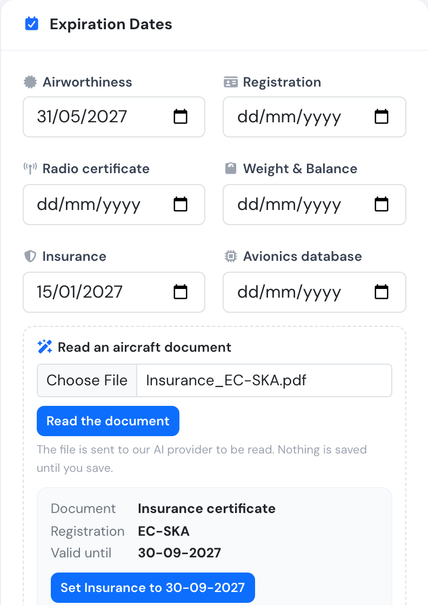
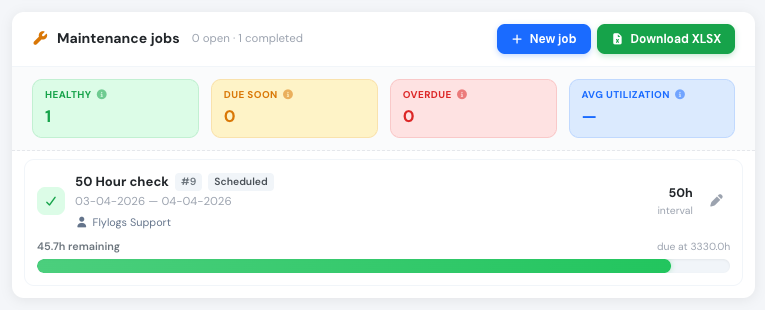
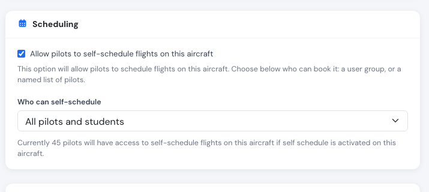
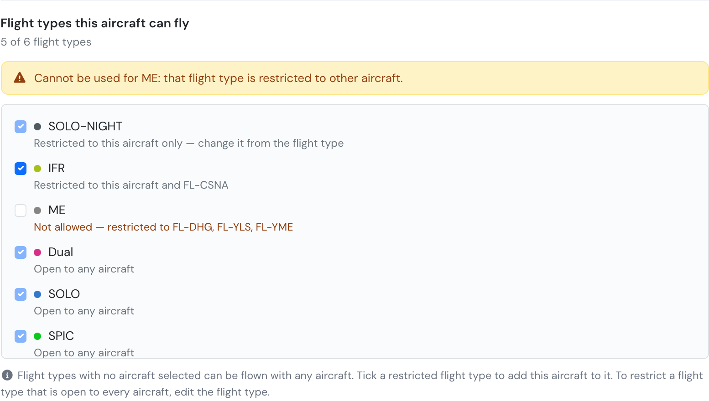

# Create your aircraft

Adding aircraft into your company account is a very fast process.

Navigate to the Aircraft section of your account, and click on the blue button that says Create new Aircraft on the right hand side.

In order to start you will first need the following details about the aircraft you want to create:

* Aircraft registration
* Aircraft manufacturer and model
* Current aircraft flight time

 

**Optional details:**

* Airworthiness and insurance certificate expiration dates
* Aircraft ADSB HEX code
* Aircraft rental price
* Authorized pilots
* Aircraft documents

### Create a Aircraft page

The main form is divided in 4 sections:

* Aircraft general information.
* Aircraft expiration dates.
* Aircraft logbook and maintenance.
* Aircraft permissions, rentals and billing settings.

**Note that** Flylogs allows you to create not only aircraft, but also simulators.

Simulator time will be separated in pilot logbooks but management is unified in this single form.

 

### Reading an aircraft document

When you edit an aircraft, under **Expiration Dates** you can attach a scan or PDF of an aircraft document and press **Read the document**. Flylogs recognises a certificate of registration, an airworthiness review certificate (ARC), a certificate of airworthiness, an insurance certificate, a radio licence or a weighing report. It shows the dates printed on it and offers to set the matching expiry date, for example **Set Insurance to 30-09-2027**. Nothing changes until you press it, and nothing is saved until you press **Save Aircraft**.

<figure><figcaption>
An insurance certificate read, ready to set the insurance expiry.
</figcaption></figure>

If the registration printed on the document isn't this aircraft's, Flylogs warns you. For a weighing report, apply the empty mass and arm on the [Mass & Balance](mass-and-balance.md#reading-a-weighing-report) page.

The document is sent to our AI processor to be read, only when you press the button. The same people who can edit the aircraft can use it: staff editors and the aircraft's managers.

### Aircraft ADSB location tracking

On paid plans, Flylogs looks up the ADS-B track of every confirmed flight of the aircraft, using its registration. You can also check what ADS-B recorded from the flight form before you save the flight. If you also enter the ADS-B-out hex code, Premium and Unlimited accounts show the aircraft on the live fleet map. Tracks are useful for flight tracking and debriefing.

See [ADSB surveillance](adsb-surveillance.md) for the details.

### Aircraft Maintenance records

Aircraft logbooks are fully automatic and thus, the aircraft maintenance tracking.

You will only need to enter the flight time of the aircraft at the time of creating, and the maintenances as the CRS (Certificate release to service) are signed.

You can schedule future maintenance windows just by specifying a future date.

***

### Aircraft permissions, rental and billing

You can control who is allowed to fly each aircraft through the **Aircraft Attributions** on each pilot's profile. By default a pilot has no attributions, which means they are allowed on every aircraft. Attributing specific aircraft to a pilot restricts them to those aircraft.

Additionally, in the **Scheduling** box you can allow pilots to self-schedule flights on the aircraft. When you enable it, a **Who can self-schedule** dropdown lets you choose the access level:

* **All pilots and students** (default) — every Student Pilot and above.
* **Certified pilots** — Pilot and above; Student Pilots excluded.
* **Only instructors** — Flight Instructor and above.

A live counter under the dropdown shows how many pilots would have self-schedule access for the selected mode.


**This toggle is the only switch for self-booking.** There is no company-wide equivalent: the Schedule company settings shape self-bookings (slot length, daily cap, documents) but never enable or disable them, and turning off **All pilots see schedule** hides the master schedule without stopping a single booking. If pilots should not be scheduling their own flights, **Self-Schedule** must be off on **every** aircraft.


<figure><figcaption>
Scheduling settings on the aircraft edit page.
</figcaption></figure>

***

### Which flight types an aircraft can fly

Under **Scheduling** on the aircraft edit page there is a **Flight types this aircraft can fly** card. It shows the [aircraft restriction set on each flight type](../flights/flight-types.md#aircraft) from the aircraft's point of view: every flight type in the company, and whether this aircraft may be used for it. It is the same answer the flight form and the Schedule Manager give, so when an aircraft cannot be picked for a flight type, this is the place to look.

<figure><figcaption>
FL-172 can fly five of the six flight types. <em>ME</em> is restricted to the twins, so FL-172 cannot be used for it.
</figcaption></figure>

Each flight type shows one of these lines under its name:

| Line under the flight type | What it means | Can you change it here? |
|---|---|---|
| **Open to any aircraft** | The flight type has no aircraft selected, so every aircraft can fly it. | No — to restrict it, edit the flight type. |
| **Restricted to this aircraft and …** | The flight type is limited to a list of aircraft, and this one is on it. | Yes — untick to take this aircraft off the list. |
| **Not allowed — restricted to …** (amber) | The flight type is limited to other aircraft. This aircraft cannot be used for it. | Yes — tick to add this aircraft to the list. |
| **Restricted to this aircraft only** | This is the only aircraft on the flight type's list. | No — edit the flight type. |

When one or more flight types are not allowed, a yellow note at the top of the card names them, so you don't need to scroll the list to find the one that is blocking a flight.

Some boxes are locked on purpose. Ticking or unticking them here would change the flight type for the **whole fleet**:

* Restricting an open flight type from one aircraft would limit it to that aircraft only and take it away from every other aircraft.
* Removing the last aircraft from a flight type would leave its list empty, and an empty list means **any aircraft**, not none.

To make those changes, open the [flight type](../flights/flight-types.md#aircraft) and choose the aircraft that may fly it. Everything else is excluded.

Your aircraft can also be configured for rental individually. You can specify different rental rates for different services. This rates at the same time, can also be customized for each pilot later on.

Flylogs will automatically calculate the correct amount to be billed based on the flight information. Billing by block time, flight time, tach time or Hobbs time can be configured. Tach and Hobbs billing charge the difference between the start and end meter readings entered on each flight, so the aircraft must have the matching timer enabled (Flylogs switches the Hobbs timer on for you when you pick Hobbs billing); a flight missing either reading is not auto-billed. On these aircraft the flight form therefore requires both readings and never estimates the end reading from the block time: the pilot enters what the meter shows. For example, tach start 1250.0 and tach end 1251.4 bill 1.4 hours at the aircraft's rate, whatever the booking length or block time.

<figure><figcaption>
1.4 hours of tach time, billed at the aircraft's hourly rate.
</figcaption></figure>

Flylogs will automatically suggest the billing price based on the aircraft configuration, flight information and pilot customized price (if any).  &#x20;

These are default settings, and if wanted, the price and the person to be billed can be edited before billing.
