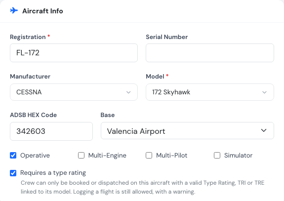
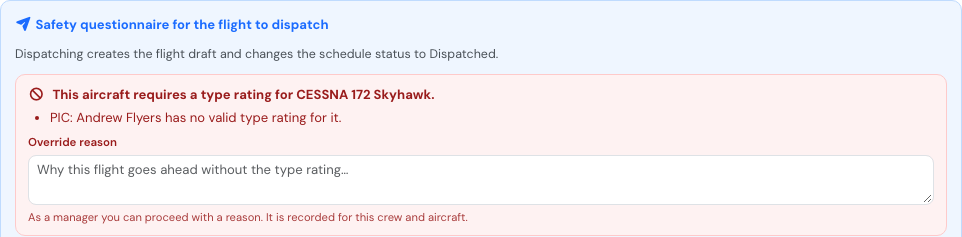

# Type rating requirement

Some aircraft can only be flown by pilots who hold a type rating for that model. Switch on **Requires a type rating** on the aircraft and Flylogs checks the crew every time the aircraft is booked or dispatched.

The check uses the aircraft models linked to each pilot's Type Rating, TRI and TRE certificates. Before you switch it on, make sure those certificates name the aircraft they cover: see [Type ratings: aircraft covered](../crew-management/document-and-certificates.md#type-ratings-aircraft-covered).

### Switching it on

Open the aircraft, press **Edit** and tick **Requires a type rating** under **Aircraft Info**. It is off for every aircraft until you switch it on.

<figure><figcaption>
The setting on the aircraft edit page.
</figcaption></figure>

When you save, Flylogs lists the active pilots of your company who hold no valid type rating linked to this model today. They can no longer be booked or dispatched on the aircraft until their certificates are updated, so check the list before you leave the page.

The aircraft list shows a **TR** tag on every aircraft that requires a type rating, and the aircraft page shows the setting under **Details**.

**Who can change it:** the Company Administrator, Operations Manager, Compliance & Safety Manager, Chief Pilot and Mechanic, the same people who can activate or retire the aircraft. An [aircraft manager](aircraft-manager.md) cannot change it.

### Who is covered

A crew member is covered when they hold a **Type Rating**, **TRI Certificate** or **TRE Certificate** that:

* is linked to the aircraft's model,
* is valid on the day of the flight (issued before it, not expired),
* has not been revoked.

Which seats are checked:

| Seat | Checked |
|---|---|
| PIC | Always |
| SIC | Only on a multi-pilot aircraft |
| Supervisor | Never |

**Training flights.** A student without the type rating is covered when someone else on board (the PIC, the SIC or the supervisor) holds a valid TRI or TRE for the model. That is how a type rating is trained for and tested.

### Where it applies

| When | What happens |
|---|---|
| Booking the aircraft (schedule edit page, self-booking, repeats, copy week, Auto Pilot) | The booking is refused with the name of the crew member and the model. The schedule form shows the problem under the aircraft before you save. |
| Editing a booking | Checked again only when the aircraft, the crew or the day changes. Bookings made before the setting was switched on are never blocked by an edit that changes nothing else, and a booking can always be cancelled. |
| Dispatching the flight | Checked again on the day of the flight, because a rating can expire between booking and flight. The dispatch box shows the problem before you fill it in. |
| Logging a flight | **Never refused.** The flight has already happened, so it is saved and the save message warns that the crew had no valid type rating. |
| Self-booking | Aircraft the pilot is not rated on are shown as **type rating required** and cannot be picked. Students are not judged here: they fly with an instructor, and when Flylogs picks the instructor for a student booking it only picks one rated on the aircraft. |
| Auto Pilot | Students without the rating are only paired with a rated instructor, and pilots without it are not placed on the aircraft. |

<figure><figcaption>
At dispatch: the PIC's TRI has expired, and a manager can enter a reason to proceed.
</figcaption></figure>

### Proceeding anyway (managers)

The Company Administrator, the Operations Manager and the Compliance & Safety Manager can book or dispatch anyway by entering an **override reason** (for example, a renewal check flight already approved by the authority). The reason is recorded with their name, for that booking and that exact aircraft and crew. If the aircraft or any crew member changes later, the override no longer applies and a new reason is needed.

Everybody else, including the Chief Pilot and Flight Instructors, cannot proceed without a valid type rating: change the crew, or update the pilot's certificates.

Plans: all.
