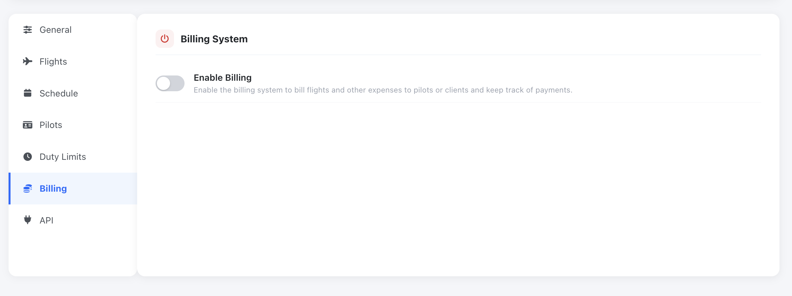
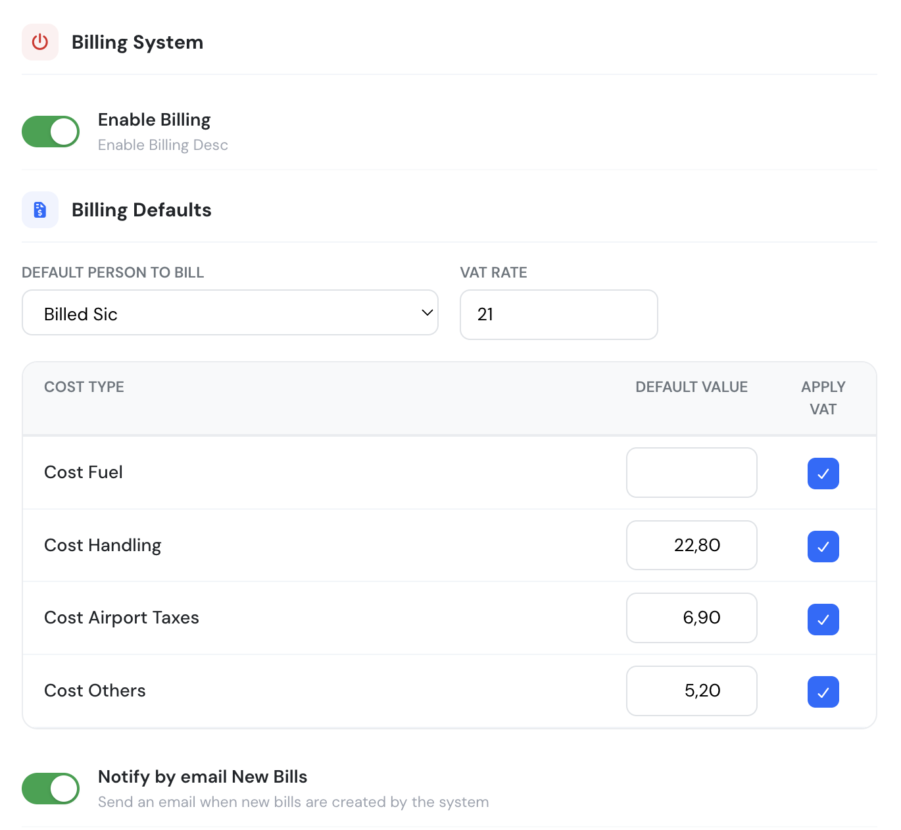

# Billing Rates

Before you can start billing your flights, you will need to do some setup in your new Flylogs account.

If you navigate to your account Billing Settings page, you will find a button to configure your billing settings.

<figure><figcaption>
Click on Configure Billing to enable your billing system.
</figcaption></figure>

In this window you can, Enable the billing system, select who is the default crew member to be billed, and specify different default expenses that should be added to each invoice that the system creates automatically for you.

You can also specify your Value-added tax if any.

<figure><figcaption></figcaption></figure>

### Creating Billing rates

Once your basics are set, you can start creating billing rates. You can create as many as you wish, and each one, can be associate with one aircraft or more.

If you wish that a rate could be used as Hour Building package or prepaid package, do not forget to check the box on the beggining of the form.

### Custom prices for a pilot

Besides the aircraft rates, you can give a pilot a **custom hourly price for a specific aircraft**. Open the pilot's profile and use the **Aircraft Rental Prices** card: type a price next to an aircraft to set it, or clear the field to go back to the aircraft rate.

A custom price has priority over everything else when a flight is billed to that pilot: it replaces the aircraft's default rate and also a rate selected on the flight. The bill stores the resulting hourly price but no rate. Because it silently overrides your rates, review these prices regularly if a pilot's flights are billed at an unexpected amount.

**Who can see and change them:** users with the role Company Administrator, Operations Manager, Compliance & Safety Manager, Human Resources Manager or Financial Manager (`user_group_id` 130 or lower). The pilot must have billing enabled. Other roles do not see the card.

#### Price change history

Every time a custom price is added, changed or removed, Flylogs records **who** made the change, **when**, for which aircraft, and the **old and new price**. The history is shown at the bottom of the same **Aircraft Rental Prices** card in the pilot's profile, newest first (the latest 100 changes).

* The history starts on the day this feature was released. Earlier changes were not recorded and cannot be recovered; for those only the date of the last save was known.
* A row with "none (aircraft rate)" on the left means a custom price was added; on the right it means the custom price was removed and the aircraft rate applies again.
* Saving the card without changing any value does not add entries.

