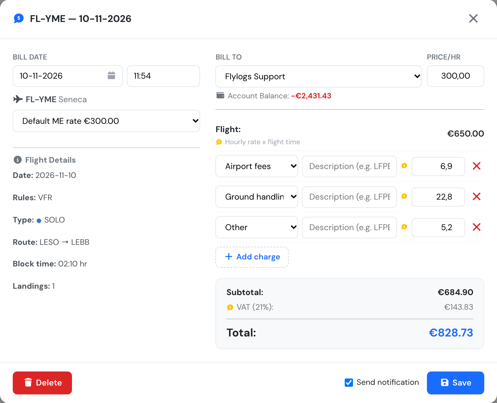
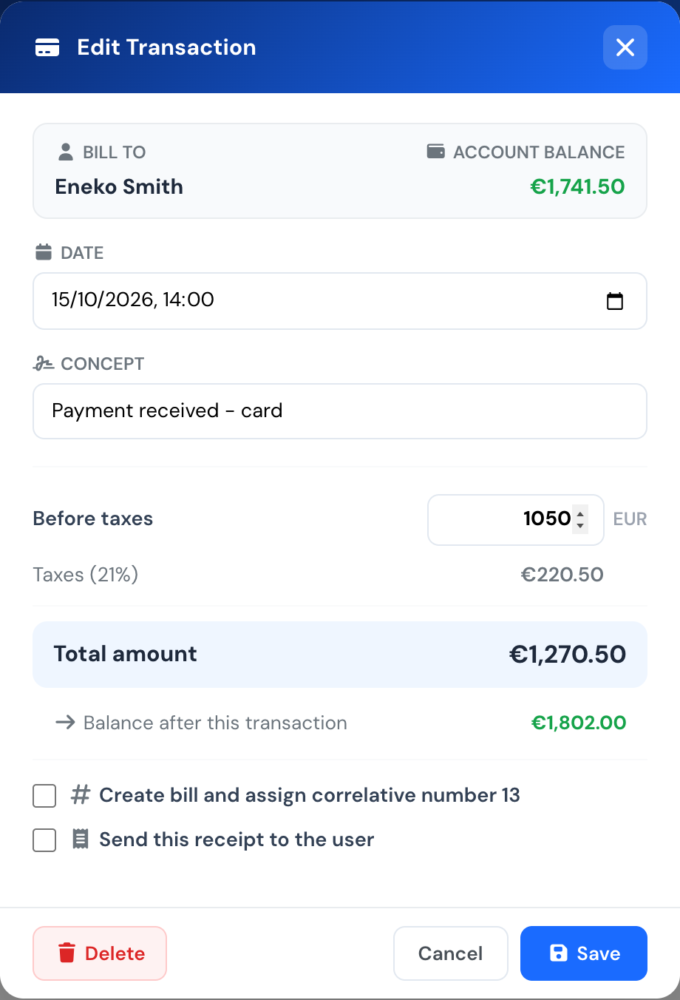
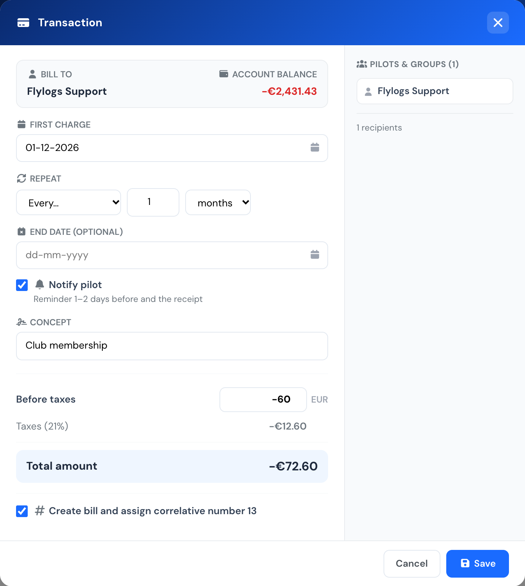
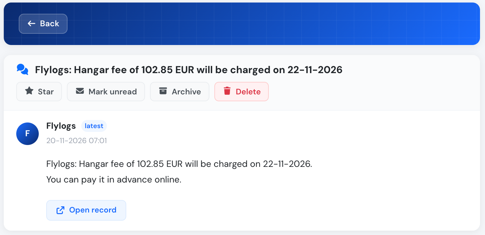
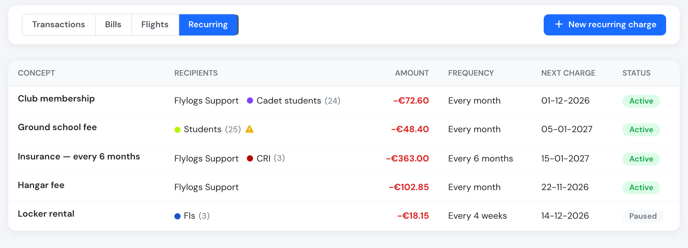
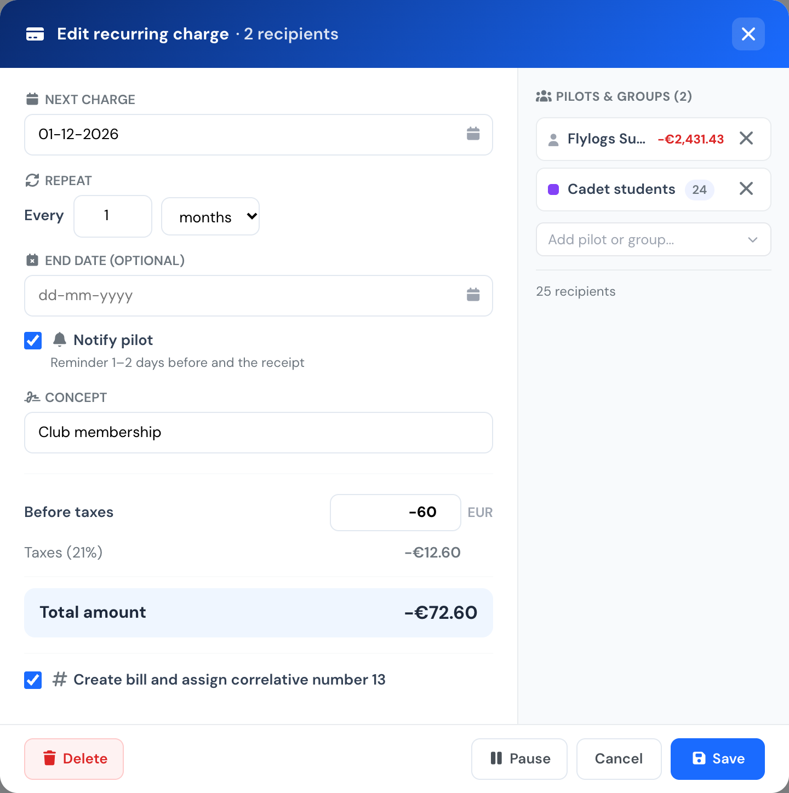

# Billing setup

Flylogs can create bills for your flights as soon as they are recorded in the system. You can adjust the billing settings for your entire company, and even set different rates for each pilot or aircraft.

#### Steps to setup your aircraft for automatic billing

In general terms, you will need to specify general billing settings for your company and activate the billing on each aircraft you want to have automatic billing.&#x20;

1. Setup company wide billing settings
2. Enter the billing rates and packages to use later.
3. Enable billing on each one of your aircraft and associate billing rates to each one.
4. Customize billing rates as neccesary for each pilot. You may also activate/deactivate billing availability for each pilot if neccesary.

Once you have performed this basic setup, you will be able to manually bill any flight.

### Manual billing

Within your flights section, you will find the billing list. This list, is a quick view of all your flights with basic flight information and billing status.

By clicking in any of the rows, you will open the manual flight billing window wich will allow you to easily select the desired billed person, rate and extra expenses.

<figure><figcaption>
Flight billing list
</figcaption></figure>

At the bottom of the flight billing window, **Send notification** (ticked by default) emails the receipt to the billed person when you save. Untick it to save the bill without emailing anyone. This choice applies to that save only.

<figure><figcaption>
Flight billing window: Send notification next to Save
</figcaption></figure>

### Automatic Billing

Automatic billing runs as soon as the flight is confirmed, for aircraft that have billing and automatic billing switched on. The bill appears in the billing list right away.

The bill will be issued to the selected pilot or the default billed pilot set in your company billing settings.

Flylogs will automatically multiply the flight, block, tach or Hobbs time (whichever billing criteria the aircraft is configured with) by the first rate that you specify in the aircraft configuration.

The bill will appear in your flight billing list and also in the flight it self.

This bill can be still edited or deleted if needed by you or any other billing manager you may have created.

The process takes into consideration all billing rates, company settings and available user packages as displayed in the following schema:

<figure><figcaption>
Automatic billing process schema
</figcaption></figure>

1. If there was no specific BILL TO person in the flight, the system will use your company settings to determine who is the flight crew to be selected.
2. Flylogs will check if the BILL TO user has any available packages, and if these, are valid for the aircraft used in the flight.
   1. If there are packages available, these will be used in order of purchase.
   2. Otherwise, default user/aircraft billing rates will be used combined with company extra expenses and taxes.
3. Last, the receipt is emailed to the billed person's confirmed email address. The same happens when the bill is recalculated after the flight is edited.

### Pilot balance in the transaction window

When you create or edit a manual transaction for a single pilot, the top of the window shows who is billed (**Bill to**) and that pilot's current **Account Balance**. Once you change the amount or the date, a **Balance after this transaction** line under the total shows what the balance will be once you save. A positive amount (a payment received) increases the balance, a negative amount (a charge) reduces it. Transactions dated in the future do not count towards today's balance, so they do not change this figure.

When a transaction goes to several pilots at once, each pilot's balance is shown next to their name in the recipients list. Pilot groups show no balance.

<figure><figcaption>
Edit Transaction: billed pilot, current balance and balance after saving
</figcaption></figure>

The transaction window is available to managers who can edit billing, from the manager **Bills** page and from a pilot's **Billing** tab.

### Recurring transactions

Some charges come back every month or every few weeks: club membership, hangar fee, insurance. Instead of creating each one by hand, set it up once as a **recurring transaction** and Flylogs posts it for you on every due date.

Recurring transactions are available to managers who can edit billing, on the **Club, Premium and Unlimited** plans (they need the billing system). Pilots see each charge on their own balance, like any other transaction.

#### Create one

1. In the manager **Bills** page, click **Add Transaction** and choose the pilots and/or pilot groups to charge.
2. In **Repeat**, choose **Every…**, then a number (1 to 24) of **weeks** or **months**. Leave it on **Does not repeat** for a normal, one-off transaction.
3. Set the **First charge** date and, if the charge should stop by itself, an **End date**.
4. Fill in the concept and enter the amount as a charge, with a minus sign (for example `-60` for a 60 EUR charge before taxes), as in any other transaction.
5. Leave **Notify pilot** on if the pilot should get a reminder and the receipt (see below), then click **Save**.

<figure><figcaption>
Add Transaction with Repeat set to every month.
</figcaption></figure>

If the first charge date is today, the first charge is posted as soon as you save. Otherwise it is posted on its date.

#### What each charge looks like

Every charge is posted as a normal manual transaction in the pilot's account, with a bill number when **Create bill and assign correlative number** is ticked. In the transactions list it is marked with a recurring icon, so you can tell it from the ones you create by hand.

* **Pilots and groups.** You can pick pilots, pilot groups, or both. A group is read again on each due date, so the charge goes to whoever is a member of the group that day: pilots who join the group later are charged from then on, and pilots who left are not. A pilot who is in two of the chosen groups, or who is chosen directly and also through a group, is charged once. Only pilots with billing enabled are charged. A group whose end date has passed charges nobody, and the list shows a warning icon next to it.
* **End of the month.** A charge that starts on the 31st is posted on the last day of shorter months (the 28th or 29th in February) and goes back to the 31st when the month allows it.
* **Missed runs.** If a charge could not be posted on its date, it is still posted once if the delay is up to 7 days. Older missed dates are skipped, and the charge continues from the next date. While billing is turned off for your company, nothing is posted.

#### Reminders and receipts

With **Notify pilot** on, each pilot receives a reminder (inbox message, email and push notification) between 24 and 48 hours before the charge is posted, and the receipt when it is posted. The reminder is never sent earlier than 48 hours before, and a charge that is created, or moved to a new date, less than 24 hours before its date gets no reminder for that date. With **Notify pilot** off, the pilot receives neither.

When your company takes [card payments](online-payments.md), the reminder and the receipt include a **Pay now** link that opens the payment window, so the pilot can pay in advance or right away.

<figure><figcaption>
The reminder as it appears in the pilot's inbox.
</figcaption></figure>

#### Manage them: the Recurring view

In the manager **Bills** page, the **Recurring** view lists all your recurring transactions: the concept, the recipients (pilots and groups with their number of members), the amount including taxes, how often it repeats, the date of the next charge, and its status:

* **Active**: it will be posted on the next charge date.
* **Paused**: it is not posted until you resume it.
* **Ended**: it passed its end date and will not be posted again.

<figure><figcaption>
The Recurring view in Billing.
</figcaption></figure>

Click a row to open it. You can change the concept, the amount, how often it repeats, the next charge date (it must be after the last charge already posted), the end date, **Notify pilot**, and the pilots and groups. Changes apply to the charges that have not been posted yet; the transactions already posted keep their values.

<figure><figcaption>
Editing a recurring charge, with Pause and Delete.
</figcaption></figure>

* **Pause** stops the charge without losing it. **Resume** starts it again from the next date: the period it was paused is never charged afterwards.
* **Delete** removes the schedule. The transactions it already posted stay in the pilots' accounts.
* An **ended** charge can only be viewed or deleted. To charge again, create a new recurring transaction.

### Bill numbers and receipts

Every bill, whether it comes from a flight or from a manual transaction, receives a **bill number**. Flight bills and manual bills each have their own consecutive sequence within your company. By default the sequence never restarts; if your company enables **Restart bill numbers every year** in its billing settings, numbering starts again at 1 every 1 January and bills show the year first, for example `2026/1`.

* Bills created before this change keep the number they already had. Some older numbers repeat across different years, because the old numbering restarted every January 1st.
* Older bills that never had a number can be numbered by editing them and ticking **Create bill and assign correlative number**.
* Bills are numbered in the order they are saved, not by their date. A bill saved today with a past date gets today's next number.

When you create or edit a manual transaction there are two independent checkboxes:

* **Create bill and assign correlative number** (checked by default): the label shows the number the bill will receive, for example `505`, or `2026/505` when numbering restarts every year. The transaction receives that number when it is saved. Unchecked, the transaction is recorded without a number; if the bill already had one, the number is removed. The checkbox shows the current state when you edit a bill, so an older bill without a number appears unchecked: tick it and save to give it the next number.
* **Send this receipt to the user** (unchecked by default): the user is notified and receives a link to the receipt. Unchecked, the transaction is recorded but the user is not notified.

One does not depend on the other: you can number a bill without notifying the user, or notify the user of a bill without number.

Automatic flight billing is not affected by this checkbox: automatic flight bills and prepaid package purchases always email the receipt.

### Transactions, bills and flights lists

In the manager **Bills** page, the filter at the top separates your records into three lists:

* **Transactions:** manual transactions saved **without** a bill number.
* **Bills:** manual transactions that **have** a bill number.
* **Flights:** bills generated from flights. These always have a bill number.

Moving a transaction between **Transactions** and **Bills** is done by editing it and ticking or unticking **Create bill and assign correlative number**. The date filter covers the current year by default (1 January to 31 December), and each list is sorted by creation date, newest first.

### How the number is shown on the bill

The bill page and its PDF show the number with a prefix and the year of the bill: **R2026/505** for a manual receipt (no flight) and **F2026/1509** for a bill of a flight. The year is the one stored with the number when your company restarts numbering every year, otherwise the year of the bill date. A bill without a number shows no number.
