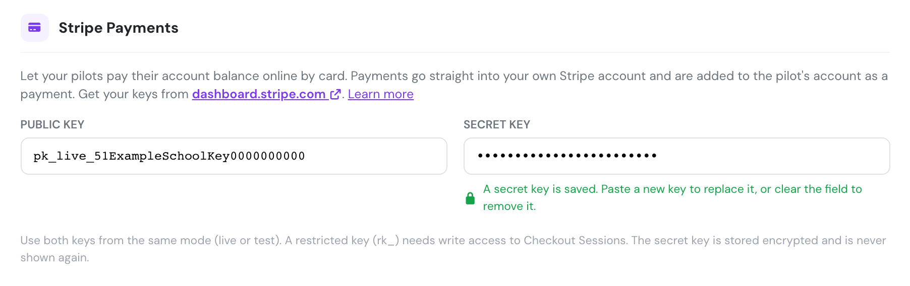
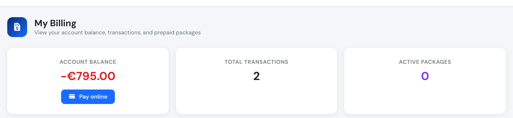
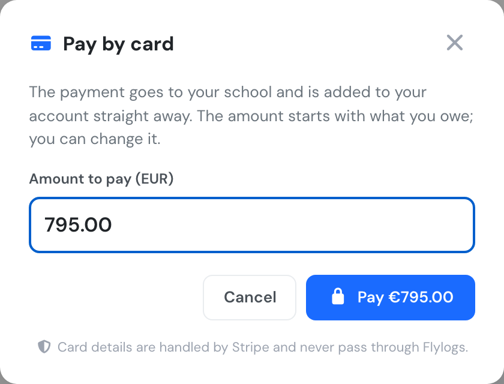
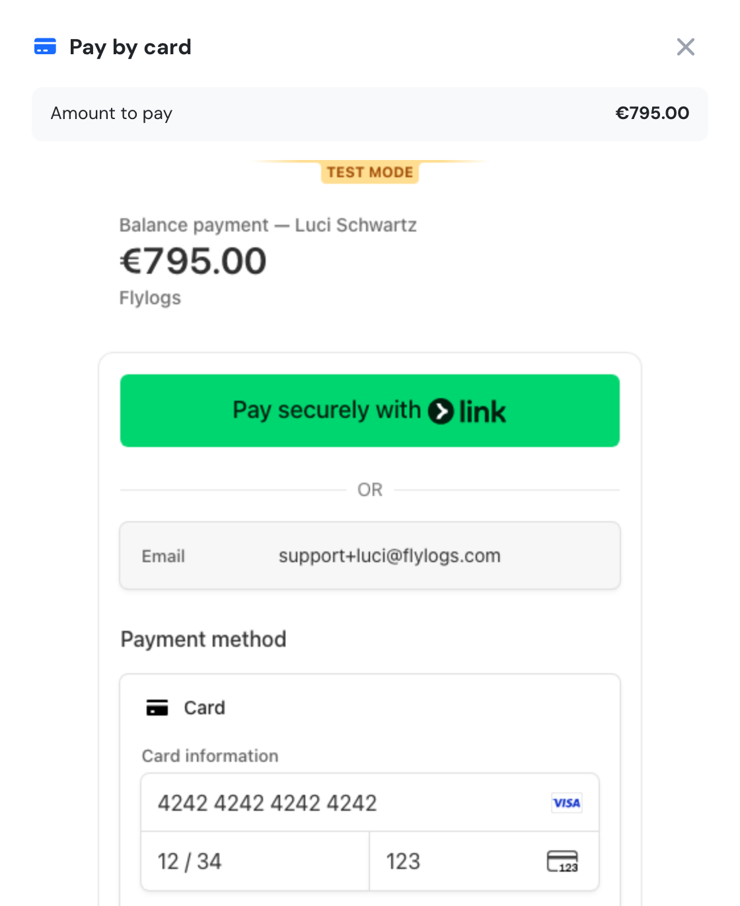
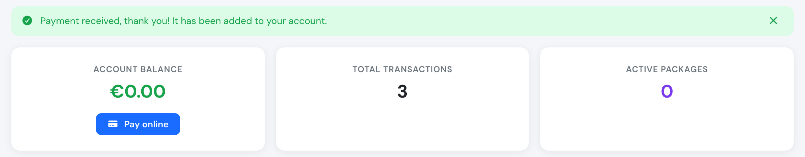

# Online payments

Pilots can pay their account balance by card from **My Billing**. The money goes straight into your company's own [Stripe](https://stripe.com) account, and Flylogs adds the payment to the pilot's account as soon as Stripe confirms it. Nobody has to record the payment by hand.

Card details are entered in Stripe's own payment form and never pass through Flylogs.


Online payments need the [billing system](introduction.md), which is available on **Club, Premium and Unlimited** plans. They also need your own Stripe account: Flylogs does not collect money on your behalf.


## Setting it up

1. If your company does not have a Stripe account yet, [create one](https://dashboard.stripe.com/register) and add the bank account Stripe pays out to.
2. In Stripe, open [Developers → API keys](https://dashboard.stripe.com/apikeys) and copy the **Publishable key** (`pk_live_…`) and the **Secret key** (`sk_live_…`).
3. In Flylogs, go to **Company → Settings → Billing**, check that **Enable billing** is on, and scroll to **Stripe Payments**.
4. Paste the publishable key into **Public key** and the secret key into **Secret key**, then click **Save**.

<figure><figcaption>
Company → Settings → Billing → Stripe Payments, with both keys saved.
</figcaption></figure>

When you save, Flylogs checks the keys with Stripe. The save is refused, with a message saying why, if:

* a field holds something that is not a Stripe key (the public key must start with `pk_`, the secret key with `sk_` or `rk_`),
* one key is a **live** key and the other a **test** key,
* Stripe does not accept the secret key, for example because it has been rolled or deleted.

The secret key is stored encrypted and is never shown again. Afterwards the field shows dots and the message *A secret key is saved*. Paste a new key to replace it, or clear the field and save to remove it. Removing either key turns online payments off.


Never type a password into these fields. Older versions of this page let some browsers autofill the manager's Flylogs login into the key fields. Flylogs now rejects anything that is not a Stripe key, and values saved that way have been removed. If your pilots no longer see **Pay online**, enter your Stripe keys again.


### Restricted keys

Instead of the secret key you can use a [restricted key](https://docs.stripe.com/keys#limit-access) (`rk_live_…`) that can only do what Flylogs needs. Give it **Write** access to **Checkout Sessions** and leave everything else as **None**.

### Testing first

To try the whole flow without real money, use the keys from Stripe's test mode (`pk_test_…` and `sk_test_…`) and pay with the card number `4242 4242 4242 4242`, any future expiry date and any CVC. When you are done, replace them with your live keys.

## How pilots pay

Once the keys are saved, every pilot whose own billing is enabled sees a **Pay online** button under their account balance in **My Billing**.

<figure><figcaption>
My Billing with the Pay online button.
</figcaption></figure>

1. The pilot clicks **Pay online**. The amount starts as what they owe. They can change it, for example to pay part of it or to add credit for future flights.

<figure><figcaption>
Choosing the amount.
</figcaption></figure>

2. They click **Pay** and enter their card in Stripe's form, which opens in the same window. Cards and the wallets built on them (Apple Pay, Google Pay, Link) are accepted.

<figure><figcaption>
Stripe's card form (shown here in test mode).
</figcaption></figure>

3. When the payment goes through, the window closes and the balance updates straight away.

<figure><figcaption>
Payment received and added to the balance.
</figcaption></figure>

The payment appears in the pilot's transactions as **Stripe payment**, with a bill number and receipt, like a payment you record yourself. It credits exactly the amount charged: no VAT is added on top. If **Email notification on new bills** is on, the pilot also gets the receipt by email. The Company Administrator and the Financial Manager get an inbox message for every payment received.

If a pilot pays and closes the page before coming back to Flylogs, the payment is still recorded: Flylogs checks your Stripe account every hour and adds any paid balance payment it has not recorded yet.

## Who can pay online

* **Pilots and students** whose billing is enabled on their pilot profile. Billing must also be enabled for the company.
* The button is hidden when the company has no valid pair of keys, when billing is off, and on the Free plan.
* **External auditors** cannot pay online.

A pilot can only pay into their own account, and only in the company's currency.

## Refunds and disputes

Refunds and disputes are handled in your Stripe dashboard. Flylogs does not reverse the payment for you: if you refund a pilot, add a matching negative transaction to their account in Flylogs.
