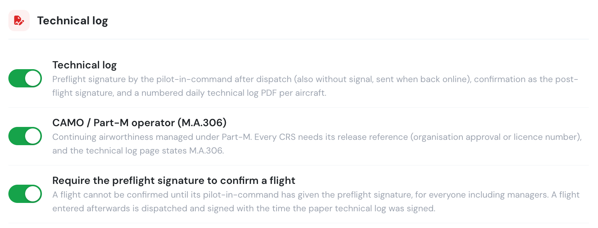
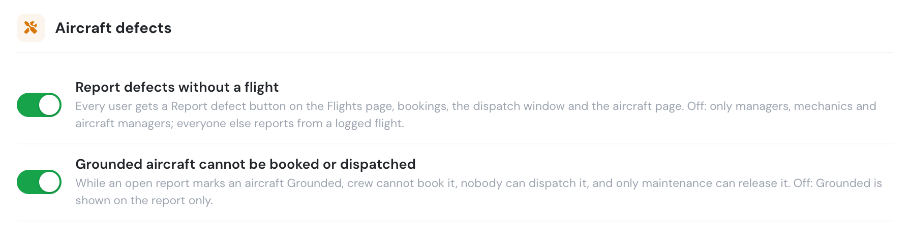
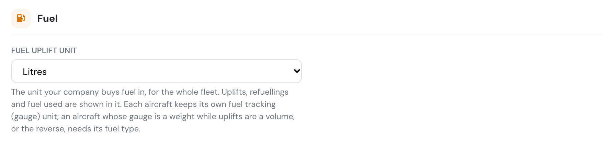
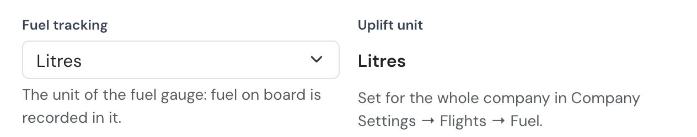

# Aircraft

The **Aircraft** tab holds the settings about your fleet itself rather than the flights flown on it.

### Technical log

* **Technical log** turns on the [technical log](../../aircraft/technical-log.md). It adds three things:
  * the pilot-in-command's preflight signature after dispatch;
  * the flight confirmation as the post-flight signature;
  * a numbered daily technical log PDF per aircraft.

  Off by default.
* **CAMO / Part-M operator (M.A.306)** applies when your aircraft's continuing airworthiness is managed under Part-M, by a CAMO or by your own approved organisation. Every CRS must then carry its **release reference**: the approval number of the maintenance organisation or the licence number of the certifying staff. The technical log page states it. This option can only be switched on while the technical log is on.
* **Require the preflight signature to confirm a flight**: no flight can be confirmed until its pilot-in-command has given the [preflight signature](../../aircraft/technical-log.md#preflight-signature). It applies to everyone, Company Administrators and managers included, and to flights confirmed offline when the device syncs. A flight entered afterwards must be dispatched and signed first, with the time the paper technical log was signed. Off by default; it can only be switched on while the technical log is on.

<figure><figcaption>
Settings → Aircraft → Technical log.
</figcaption></figure>

If your **Auto delete flight files** setting ([Flights](flights.md#logbook-settings) tab) keeps files for less than 36 months, a warning appears here. EASA asks for technical log records to be kept for 36 months after the last entry (M.A.306(c)).

### Aircraft defects

Two switches decide how your company handles defects reported on an aircraft. Both are **on** by default. They only appear on plans that include the maintenance module.

<figure><figcaption>Aircraft defects</figcaption></figure>

* **Report defects without a flight** — every user gets a **Report defect** button on the Flights page, on bookings, in the dispatch window and on the aircraft page, and can report a defect without logging a flight. Switched off, only Company Administrators, Operations Managers, Compliance & Safety Managers, Chief Pilots, Mechanics and the aircraft's managers can. Everyone else reports defects from a logged flight of that aircraft.
* **Grounded aircraft cannot be booked or dispatched** — while an open report marks an aircraft **Grounded**, pilots, instructors and students cannot book it or log a flight on it, nobody can dispatch it, and only maintenance staff or the aircraft's managers can release it. Switched off, Grounded is shown on the report only: the aircraft can still be booked, dispatched and logged, and anyone who can edit the report can set it back to Flyable.

See [Aircraft reports](../../aircraft/aircraft-maintenance/aircraft-reports.md) for the full rules.

### Fuel

**Fuel uplift unit** is the unit your company buys fuel in, for the whole fleet: litres, US gallons, imperial gallons, kilograms or pounds. Fuel uplifted on flights and after legs, refuellings on **Billing → Fuel & Excise**, and fuel used are all in this unit. Leave it on **Same as each aircraft's fuel tracking unit** when every aircraft is refuelled in the unit its gauge reads.

<figure><figcaption>Fuel uplift unit</figcaption></figure>

Each aircraft keeps its own **fuel tracking** unit, the unit its gauge reads, and its edit form shows the company's uplift unit next to it.

<figure><figcaption>The aircraft form shows the company's uplift unit</figcaption></figure>

When an aircraft's gauge is a weight and the uplift unit a volume (or the reverse), set that aircraft's **fuel type** so Flylogs can convert between them. Changing the uplift unit does not change refuellings already recorded.
