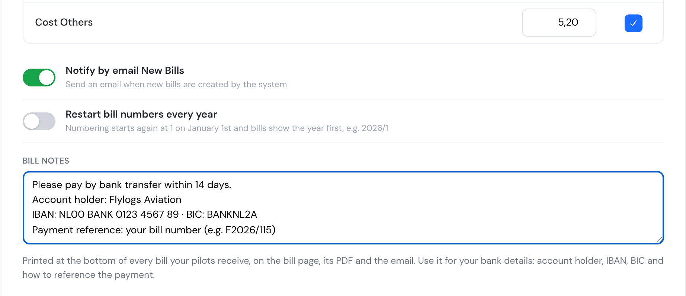
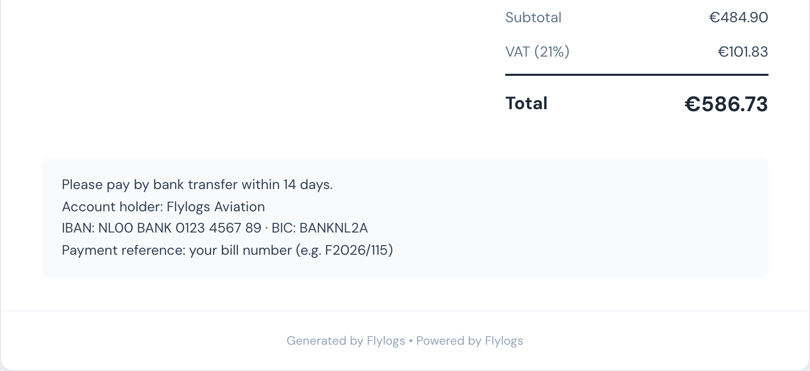
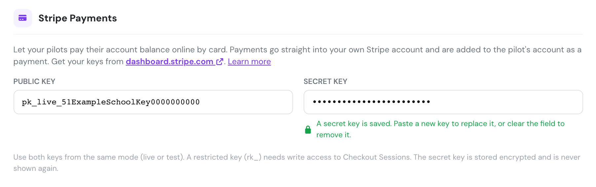

# Billing

The Billing tab switches on the Flylogs [billing system](../../billing/introduction.md) and holds its company-wide defaults.


Billing is available on **Club, Premium and Unlimited** plans. On the Free plan the tab is disabled.


### Billing system

* **Enable billing** — the master switch. When on, Flylogs generates a bill for every confirmed flight, tracks pilot and client account balances, and unlocks the rest of this tab plus the billing pages across the app. When off, no bills are created and all billing screens are hidden.
* **Block pilots without credit** — pilots whose account credit is zero or negative cannot self-book flights. They see an "insufficient balance" warning instead of the booking form. Only shown while billing is enabled.

### Billing defaults

* **Default person to bill** — who receives the bill generated by a flight: the **client** attached to the flight, the **PIC** or the **SIC**. You can always change the billed person on each individual bill; this only sets the default.
* **VAT rate** — the tax percentage applied to billed items.
* **Default cost values** — for each extra cost type (**fuel**, **handling**, **airport taxes**, **others**) you can set a default amount that is pre-filled on new flight bills, and tick whether VAT applies to that cost type.
* **Notify by email new bills** — when enabled, the billed person receives an email each time the system creates a bill for them.
* **Bill notes** — free text printed at the bottom of every bill your company issues to pilots and clients. Use it for your bank details: account holder, IBAN, BIC and how to reference the payment. See [Bill notes](#bill-notes) below.

### Bill notes

Pilots and clients who pay by bank transfer need to know where to send the money. Type it once in **Bill notes** and it appears on every bill:

* on the bill page, at the bottom under the totals,
* in the PDF downloaded from that page,
* in the new-bill email, under **Payment information**.

The text is printed exactly as you type it, line breaks included, and up to 2,000 characters. It applies to every bill, old and new, as soon as you save, because bills show the current text and do not keep a copy. If you change your bank account, bills already issued show the new details. Leave the field empty and nothing is printed.

Like the rest of this page, only company managers can edit the field. Pilots and clients see the text on their own bills but cannot change it.

A good bill note answers the questions customers usually ask before paying:

```
Please pay by bank transfer within 14 days.
Account holder: Your Flight School B.V.
IBAN: NL00 BANK 0123 4567 89 · BIC: BANKNL2A
Payment reference: your bill number (e.g. F2026/115)
```

<figure><figcaption><p>Bill notes in Company → Settings → Billing.</p></figcaption></figure>

<figure><figcaption><p>The same text at the bottom of every bill.</p></figcaption></figure>

Every bill already carries your company name, logo, address, VAT number and its own bill number (for example `F2026/115`), so customers can use the bill number as the transfer reference.

### Billing rates

Rates define **what an hour of flight costs**. Each rate has a name, an hourly price and the list of aircraft it applies to; when a flight on one of those aircraft is confirmed, the flight time is charged at the rate's hourly price.

* Create a rate with **New rate**, or click an existing row to edit or delete it.
* An aircraft can appear in several rates (for example a standard rate and a discounted package rate).
* **Prepaid package rate** marks the rate as part of a prepaid hours package — see [Prepaid packages](../../billing/prepaid-packages.md).

For the full picture of how rates, packages and balances interact, read [Billing Rates](../../billing/billing-rates.md).

### Stripe payments

Connect your own Stripe account to let pilots pay their account balance online by card, without leaving Flylogs. The money goes straight into your Stripe account.

* **Public key** (`pk_live_…` or `pk_test_…`) and **Secret key** (`sk_…`, or a restricted `rk_…` key with write access to Checkout Sessions). Copy both from your [Stripe dashboard](https://dashboard.stripe.com/apikeys), and use two keys from the same mode (live or test).
* Flylogs checks the keys with Stripe when you save. If either one is not a Stripe key, the two do not match, or Stripe rejects the secret key, the save is refused with a message.
* The secret key is stored encrypted and never shown again. The field shows dots once a key is saved. Paste a new key to replace it, or clear the field to remove it.
* Payments are added to the pilot's account balance automatically, as a numbered receipt with no VAT added.

<figure><figcaption><p>Stripe Payments with both keys saved.</p></figcaption></figure>

See [Online payments](../../billing/online-payments.md) for the full setup and the pilot-facing flow.
