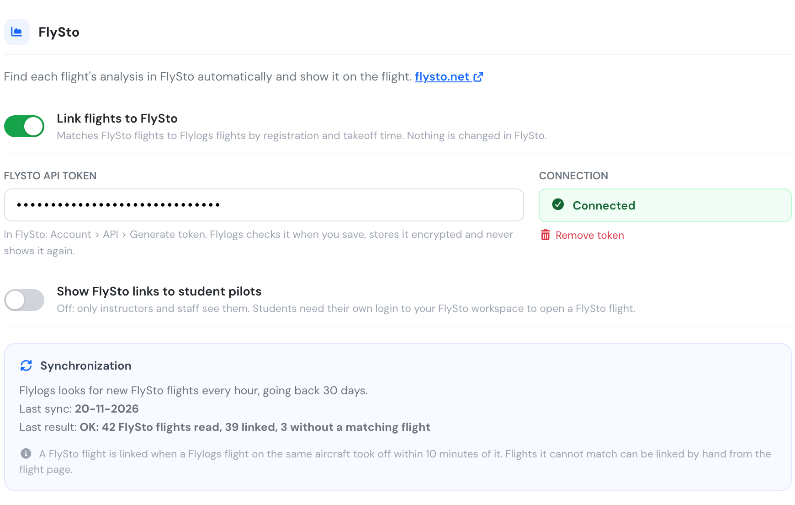

# Integrations

The Integrations tab connects Flylogs to other services your company uses. **Airbly** and **Fleet Manager** (formerly Spidertracks) import flights from your aircraft tracking hardware, so they are not typed by hand. **FlySto** finds each flight's data analysis and links it to the flight in Flylogs.

All three integrations are **one-way**: Flylogs only reads data from the other service. Nothing is ever sent from Flylogs back to it.


Integrations are available only on the **Premium** and **Unlimited** plans. On the Free and Club plans the tab shows an upgrade notice instead of the settings, and the import does not run even if a key was set on a previous plan. When a company moves to a plan without integrations (for example when a Premium subscription expires and the company returns to Free), Airbly, Spidertracks and FlySto are switched off automatically. The saved Airbly key, the Spidertracks connection and the FlySto token are kept, so after upgrading again you only need to switch the integration back on.


Only a company **manager** can connect or disconnect an integration — the Company Settings page is restricted to manager-level user types.

To export your Flylogs data to Dropbox or Google Drive, see [Cloud storage](cloud-storage.md) — that lives on its own settings tab.

## How the imports work

Airbly and Fleet Manager follow the same rules (FlySto works differently, see [FlySto](#flysto) below):

* Once connected and enabled, Flylogs checks the service **every 15 minutes** and imports any new completed flights.
* Each flight is imported **once** — re-running never creates duplicates, even if the service updates a flight later.
* Imported flights are saved as **drafts**. They do **not** count toward your logbooks, pilot currency, or aircraft maintenance until a user reviews and confirms them. This gives you a chance to check the data and fill in anything the service does not provide.
* Aircraft are matched by **tail number / registration**. The aircraft must already exist in your Flylogs company and be **active** — if no active aircraft with that registration is found, the import skips all flights for that asset.

The **Synchronization** panel shows the time of the last sync (in your company time zone and format) and a short summary of the last run.


If flights from a particular aircraft are not appearing, check that the aircraft is registered in Flylogs with the same tail number as in the tracking service, and that its **Active** flag is on.


### Reviewing imported flights

Imported flights appear in your **Flights** list as drafts. Open each one, check the details, set the pilot and flight type if needed, and confirm it into the logbooks. Only then does it count toward currency and maintenance.

## Airbly

[Airbly](https://airbly.com) is a panel-mounted aircraft monitor that automatically records each flight your aircraft makes. If your company uses Airbly, Flylogs can pull those flight logs straight into your account, so flights show up without anyone typing them in.

### Connecting your Airbly account

1. Log in to your Airbly web app and copy your **group key** from your Group settings. This is a read-only key that lets Flylogs read your assets and flight logs.
2. In Flylogs, open **Company Settings → Integrations**.
3. Paste the key into **Airbly group key**.
4. Turn on **Enable Airbly import**.

That's it. Flylogs stores your key **encrypted** and never shows it again — the field displays dots once a key is saved. To replace it, just paste a new key over the dots; leaving the dots untouched keeps the existing key.

The **Connection** indicator shows whether a key is currently stored.

### What gets imported from Airbly

| Flight field | From Airbly |
| --- | --- |
| Aircraft | Matched by tail number (registration) |
| Date, take-off and landing times | Flight start/stop times |
| Departure and arrival airports | Airbly route |
| Flight time | Airbly usage |
| Landings | Airbly usage |
| Pilot in command | Matched to a Flylogs user (see below) |

Hobbs and Tach readings are not provided by Airbly, so those fields stay empty on imported flights.

#### Pilot matching

If the Airbly flight includes a crew member, Flylogs tries to match them to a user in your company — first by **email**, then by **full name**. When no match is found, the flight is still imported, just with the pilot field left blank for you to fill in during review.

### Disconnecting Airbly

To stop importing, turn off **Enable Airbly import**. Your stored key remains so you can re-enable it later; to remove the key entirely, paste a blank value over the dots and save.

## Fleet Manager (formerly Spidertracks)

[Fleet Manager](https://spidertracks.com), formerly **Spidertracks**, is an aircraft tracking system (Spider devices and the Aviator app) that records each flight your aircraft makes. If your organisation uses Fleet Manager, Flylogs can pull those flight logs straight into your account.

### Connecting your Fleet Manager account

Fleet Manager uses a secure **OAuth** sign-in — you never paste a key or token into Flylogs. You simply authorise Flylogs from your own Fleet Manager login.

1. In Flylogs, open **Company Settings → Integrations** and find the **Fleet Manager** section.
2. Click **Connect Fleet Manager**. You are sent to Fleet Manager to sign in.
3. Sign in and choose the organisation you want to connect, then approve the access request.
4. Fleet Manager sends you back to Flylogs. The **Account** indicator now shows **Connected**.

You can also start the connection from the Fleet Manager integration centre — in that case Fleet Manager sends you to Flylogs to sign in and approve, and back again when it is done.

Flylogs stores the access it was granted **encrypted** and refreshes it automatically.


Each Fleet Manager connection is scoped to a **single organisation**. If you operate more than one Fleet Manager organisation, connect from the one whose flights you want in this Flylogs company.


### What gets imported from Fleet Manager

| Flight field | From Fleet Manager |
| --- | --- |
| Aircraft | Matched by tail number (registration) |
| Date, take-off and landing times | Flight departure/arrival times |
| Departure and arrival airports | Fleet Manager route, when available |
| Flight time | Departure → arrival, or the reported duration |
| Track points | Stored on the flight for map replay |

Hobbs and Tach readings are not provided by Fleet Manager, so those fields stay empty on imported flights. Crew is left blank for you to set during review.

### Disconnecting Fleet Manager

Either turn off **Enable Fleet Manager import** (keeps the connection so you can re-enable it) or click **Disconnect** (revokes the stored access entirely; you will need to reconnect via Fleet Manager to use it again).

## FlySto

[FlySto](https://www.flysto.net) turns the data your avionics record (for example a Garmin G1000 SD card) into a flight analysis: ground track, altitude and speed profiles, takeoffs, approaches with scores, and flags. Schools use it to debrief training flights.

With FlySto connected, Flylogs finds the FlySto analysis of each flight by itself and puts an **Open in FlySto** button on the flight. Nobody has to copy links between the two. FlySto does **not** import flights: your flights are still logged in Flylogs as usual, and Flylogs only adds a link to the matching FlySto flight.

<figure><figcaption>
FlySto in Company Settings → Integrations.
</figcaption></figure>

### Connecting your FlySto account

1. In FlySto, open **Account → API** and click **Generate token**. Copy the token.
2. In Flylogs, open **Company Settings → Integrations** and find the **FlySto** section.
3. Paste the token into **FlySto API token** and turn on **Link flights to FlySto**.
4. Click **Save**.

When you save, Flylogs checks the token with FlySto. If FlySto does not accept it, nothing is saved and you see a message asking you to copy it again. If it is accepted, Flylogs stores it **encrypted**, never shows it again (the field displays dots), and links the last 30 days of flights straight away.

To replace the token, paste a new one over the dots. To remove it, click **Remove token** and save; this also switches the integration off.


The token belongs to the FlySto user who generated it, and Flylogs sees only the aircraft that user can see in FlySto. Generate it from an account that has your whole fleet, such as your organisation's FlySto workspace. If that person later leaves, generate a new token from another account.


### How flights are matched

Every hour, Flylogs reads the FlySto flights of the last 30 days and links each one to its Flylogs flight:

* **Same aircraft**: the registration in FlySto must match an aircraft in your Flylogs company. Dashes, spaces and capitals are ignored, so `S5-ABC` matches `s5abc`.
* **Same takeoff**: the Flylogs flight must have taken off within **10 minutes** of the takeoff FlySto recorded. When a flight has no takeoff time, the off-blocks time is compared with FlySto's "Brakes off" instead.
* Cancelled and deleted flights are never matched.
* If two Flylogs flights fit equally well (for example, the same flight was logged twice), nothing is linked, so a flight never shows another flight's analysis.

The number of landings is not used: FlySto counts every touchdown of a circuit, and it often differs from what was logged.

A FlySto flight usually appears only once someone uploads the avionics data, sometimes days after the flight. Flylogs keeps looking for it every hour for 30 days, so the link appears on its own once the data is in FlySto. A flight that is not matched can always be linked by hand from the flight page.

The **Synchronization** panel shows when Flylogs last checked and how many FlySto flights it read and linked. If FlySto stops accepting the token, the last result says so; generate a new token and paste it in.

### Who sees the FlySto link

The link opens your school's FlySto account, so it only works for people with a login to it. By default, **instructors and staff** see FlySto links and **student pilots** do not. If your students have their own logins to your FlySto workspace, turn on **Show FlySto links to student pilots**.

See [Flight analysis](../../flights/flight-analysis.md) for how the link looks on a flight and how to add or remove links by hand.
