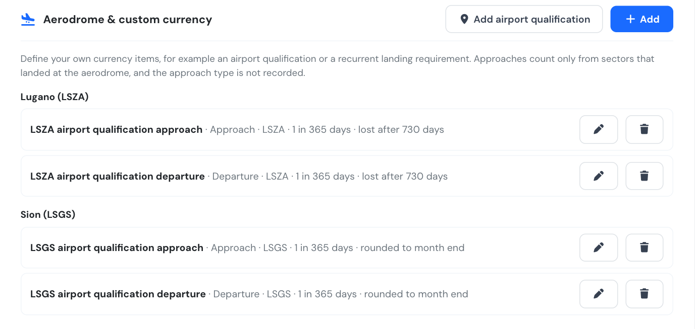
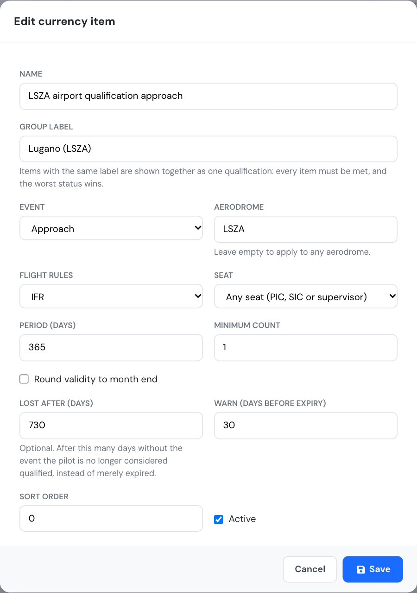
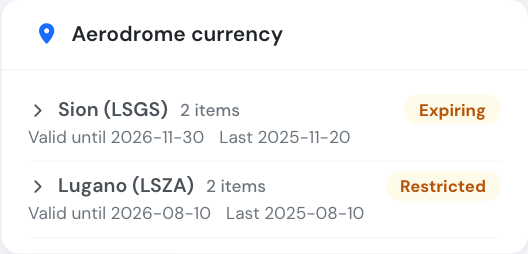
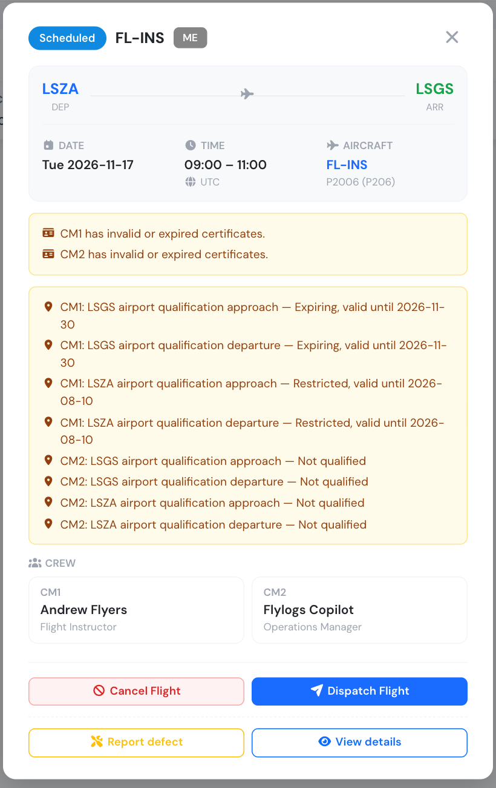

# Pilots

The Pilots tab defines what your company considers a *current* pilot and how strictly Flylogs enforces pilot documentation.

### Currency requirements

Flylogs tracks three independent currency levels, from most strict (Level 1) to least strict (Level 3). Each level is a rule of the form:

> Within the last **N days**, the pilot must have logged at least **X flight time** and **Y landings**.

For each level you configure:

* **Within last days** — the look-back period (Level 1 must be the shortest, e.g. 30 days; Level 3 the longest, e.g. 365 days).
* **Min flight time** — required block time within the period.
* **Min landings** — required landings within the period.

Flylogs evaluates the three levels continuously against each pilot's logbook and shows the result on the pilot profile and the currency dashboards — separately for **day**, **night** and **IFR** flying. See [Pilot currency checks](../../crew-management/pilot-currency-checks.md) for how pilots and managers read these indicators.

* **Block pilots that do not meet established currency** — turns the currency indicators into a gate. It is off by default and the rules are:
  * **Only the PIC is judged.** A pilot fails currency when one of your three currency levels above is not met, or when an [aerodrome currency item](#aerodrome-and-custom-currency) for the aerodromes of the booking or flight is **Expired**, **Lost** or **Not qualified**. **Expiring** and **Restricted** only warn and never block. Items count only on Premium and Unlimited; the three levels count on every plan.
  * **Scheduling:** a booking is refused when its PIC fails currency. For a future booking the question is whether the PIC is current **today**; for a booking in the past it is judged at the booking start. Managers are refused too. Editing an existing booking is checked only when the PIC, the supervisor, the start time or the aerodromes change.
  * **Flight confirmation:** confirming a flight is refused when its PIC failed currency at the flight's off-blocks time. Staff roles from Company Administrator to Flight Dispatcher can still confirm a flight that already took place; Chief Pilots and crew cannot. A flight confirmed offline is checked when it syncs; if it is refused, the pilot is told and the flight stays unconfirmed for a manager to confirm.
  * **Requalification:** a booking or flight with an **instructor as supervisor** is never blocked, so a lapsed pilot can fly again to regain currency.
  * **Student self-booking:** instructors who are not current are skipped, so the student's booking waits for a current instructor instead of being refused.
  * The refusal names the pilot and every requirement that failed, for example *"cannot be PIC: currency not met (90 days: 1 of 3 landings; LSGS airport qualification approach: expired)"*.

### Aerodrome and custom currency



Besides the three fixed levels, you can define your own currency items, evaluated automatically from the flight log. The typical use is an **aerodrome qualification** at a demanding airport. This is on the same tab (**Flight Crew** in the app) under **Aerodrome & custom currency**.


Available on the **Premium and Unlimited** plans, trial included. Only Company Managers with access to Company Settings (user groups 100, 105 and 110) can create, edit and delete items. Pilots see only their own status.


#### How an item works

Each item counts one kind of event in the pilot's confirmed flights and asks for a minimum number of them within a period:

* **Event:** *Approach* and *Landing* count sectors that **landed** at the aerodrome (a Landing counts every landing logged on the sector); *Departure* counts sectors that **departed** from it; *Sector* counts either.
* **Aerodrome:** the ICAO code. Leave it empty to count any aerodrome.
* **Flight rules** (any, IFR or VFR), **Seat** (any seat, PIC or SIC), **Period (days)** and **Minimum count**.
* **Round validity to month end:** the validity runs to the last day of that month.
* **Lost after (days):** optional. Between the end of the period and this many days after the qualifying event, the item is **Restricted** instead of Expired; after it, **Lost**. It must be greater than the period.
* **Warn (days before expiry):** how long before the validity ends the item turns **Expiring** and the pilot is emailed.
* **Group label:** items with the same label form one qualification: every item in it must be met, and the worst status wins.


What Flylogs records limits what it can count. **Missed approaches are not recorded**, so an approach counts only from a sector that landed at the aerodrome. The **approach type** is not recorded either (name the item "LSGS IGS approach" yourself). Every crew seat earns the credit: PIC, SIC and supervisor or instructor. Only confirmed flights count, and the last 2,000 days are searched.


#### Example: Sion (LSGS)

At least one IGS approach into and one IFR departure from Sion within any 12 months, valid to the end of that month. Click **Add airport qualification**, enter `LSGS` and **Create**. Two items are created, an IFR *Approach* and an IFR *Departure*, each 365 days, 1 event, rounded to month end, grouped as the aerodrome. A pilot who lands IFR at Sion on 20 November has an approach valid until 30 November the next year.

#### Example: Lugano (LSZA)

At least one IFR approach and one IFR departure within 12 months. From 12 to 24 months the first approaches are flown at increased minima, and after 24 months the qualification is lost. Add the preset for `LSZA`, then edit both items and set **Lost after (days)** to `730`. Between 12 and 24 months the pilot shows **Restricted**, after 24 months **Lost**.

#### Statuses

| Status | Meaning | Blocks when blocking is on |
| --- | --- | --- |
| Valid | Requirement met with time to spare | No |
| Expiring | Valid, but within the warning days of its end | No |
| Restricted | Past validity but inside *Lost after* | No |
| Expired | Past validity, no *Lost after* set | Yes |
| Lost | Past the *Lost after* limit | Yes |
| Not qualified | Fewer than the minimum number of events on record | Yes |

In a group the worst status wins, and the group is valid until its earliest item ends.

#### Where it appears

* The **Aerodrome currency** card on the pilot's profile and on the pilot's home page.

* A **warning in the booking** for every crew member whose item for the booking's departure or landing aerodrome is not valid. Items for other aerodromes never appear. The warning does not stop the booking unless you switched on **Block pilots that do not meet established currency**.

* The crew readiness chips of the training **Approvals** page.
* An **email** to the pilot (once per item and validity date) when an item starts to expire, if the user is flagged as a pilot, is active, has a confirmed email address and has alerts enabled.

You can create up to 50 items per company. See the [Currency items API](../../API/reference/currency-items.md) to read and manage them from your own systems.

### Documentation compliance

These switches control how pilot certificates (licence, ratings, medical) affect daily operations. Certificates themselves are managed on each pilot profile — see [Documents & Certificates](../../crew-management/document-and-certificates.md).

* **Allow pilots to edit their certificates** — whether pilots can add and update their own certificates and flight documentation. Disable it if you want only managers to maintain crew records (common in AOC operations where the CAMO/crew office owns the paperwork).
* **Require pilot documentation** — marks documentation as mandatory: pilots with missing or expired documents have limited flight capabilities and both the pilot and the schedulers see prominent warnings.
* **Block pilots without certificates** — the strictest option: pilots without a valid licence, rating and medical cannot be scheduled as PIC nor log flights. Combined with *Require pilot documentation*, scheduling a non-compliant pilot as PIC is rejected outright for non-staff users.


The self-booking widget has its own related switch — **Allow self-booking without valid documents** — on the [Schedule tab](schedule.md#self-scheduling). *Block pilots without certificates* covers manager scheduling and flight dispatch; the Schedule tab switch covers self-booking, and decides only whether a pilot with invalid documents can go through with a booking (the warning is shown either way). It has an effect only while *Require pilot documentation* here is on.

