# Custom forms



Custom forms let you rebuild the forms you keep on paper or in Word — a course application form, a checklist, a declaration — inside Flylogs. You build a form once; every copy filled in from it is kept as a signed record, attached to the person (and course) it is about.


Custom forms are available on the **Premium** and **Unlimited** plans. If your company moves to a plan without forms, nothing is deleted: filled copies stay readable, and forms simply stop being required anywhere.


## Who can do what

| Action | Who |
| --- | --- |
| Build, publish, archive and delete forms; see every response; send forms to people; reopen a signed copy; delete any draft copy; waive a mandatory form | Flylogs Administrator, Company Administrator, Operations Manager, Compliance & Safety Manager (user groups 1, 100, 105, 110) |
| Fill in and sign a form | Whoever the form says fills it in (see below) |
| See a filled copy | Managers, the person it is about, whoever filled or signed it, and the user groups you add as viewers. When the form is filled by *selected user groups*, the person it is about sees it only once every part is signed |

Managers find **Forms** under **Home** in the main menu. Every user finds the forms they have to fill under **My forms**, in the menu that opens from their name at the top right.

## Starting from a template

The **Start from a template** panel, on the right of **Home → Forms**, holds ready-made forms. Click one and the builder opens with its fields, who fills it and what it is attached to already set up. Change anything you like: nothing is saved until you press **Save**, so you can open a template just to look at it and leave.

<figure>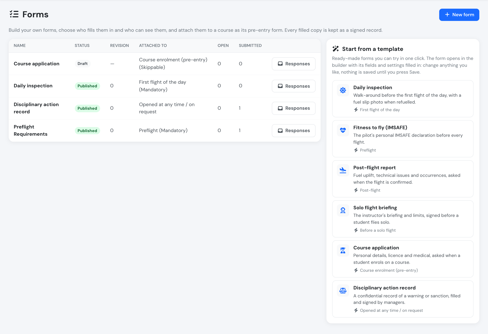<figcaption>
Home → Forms: your forms on the left, the templates on the right.
</figcaption></figure>

| Template | What it holds | Set up as |
| --- | --- | --- |
| Daily inspection | Walk-around checks, a fuel slip photo shown only when the aircraft was refuelled, and a defect description shown only when a defect was found | First flight of the day, mandatory, filled by the PIC |
| Fitness to fly (IMSAFE) | The pilot's personal declaration: illness, medication, stress, alcohol, fatigue, eating | Preflight, mandatory, filled by the PIC |
| Post-flight report | Fuel uplifted, technical issues and occurrences to report to safety | Post-flight, skippable, filled by the PIC |
| Solo flight briefing | Weather and NOTAMs, aircraft, authorised exercise and limits, student fit to fly | Before a solo flight, mandatory, filled by the instructor / supervisor |
| Course application | Personal details, licence held, total flight time, medical certificate and a declaration | Course enrolment, skippable, filled by the student or on their behalf |
| Disciplinary action record | The person concerned (a person field that sets who the record is about), what happened, the action taken (verbal, written or final warning, suspension), corrective action, review date and the person's statement | Not attached to anything; filled by managers and signed with their password |

The template's text appears in your language. Once saved, the form is yours like any other: the template is not linked to it, and later changes to the templates never touch your forms.

<figure>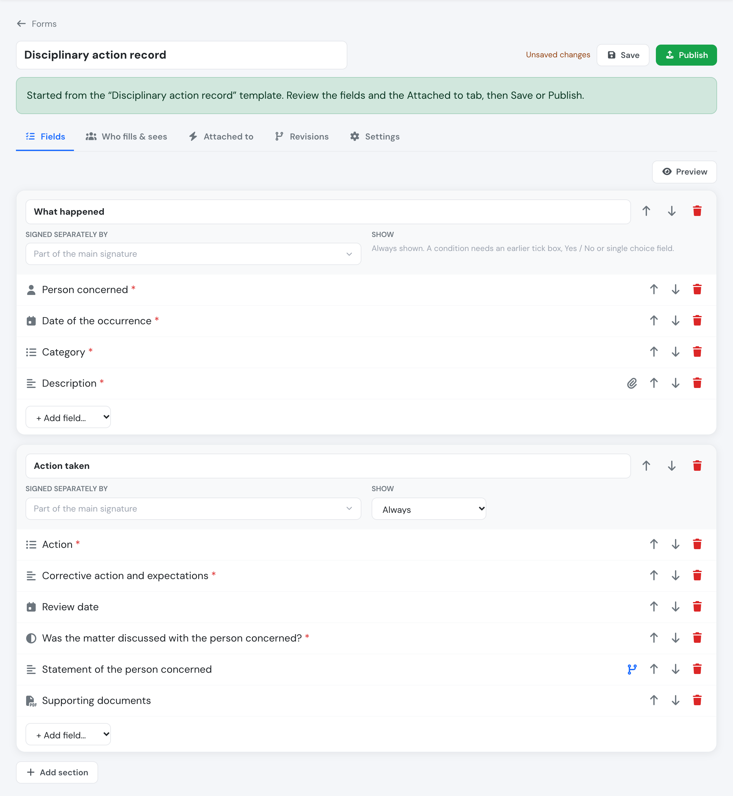<figcaption>
The Disciplinary action record template opened in the builder, ready to review and save.
</figcaption></figure>


A template attached to flights as **mandatory** blocks dispatch from the moment you publish it. Check the **Attached to** tab before you press **Publish**, and switch it to **Skippable** or narrow it to some aircraft if you want to try it out first.


## Building a form

Open **Home → Forms → New form** (or start from a template), give it a name, then add sections and fields on the **Fields** tab.

### Field types

| Type | Answer |
| --- | --- |
| Text block | No answer — a paragraph of instructions or regulation text |
| Tick box | Ticked or not |
| Yes / No | Yes or No |
| Single choice | One of the options you list |
| Short text / Long text | Free text |
| Number | A number, optionally with a unit (e.g. *hours*) and entered as *hh:mm* |
| Date | A date, in your company's date format |
| Date and time | A date and time, in your company's time zone and format |
| Photo | One or more photos (the phone camera opens on mobile) |
| PDF | One or more PDF files |
| Person | Someone from your company, chosen from a list (see below) |

Each field can be **required** or optional. A field's label can be a whole paragraph, so regulation wording can be quoted word for word.

Tick **Allow evidence files** on a field to let people attach a photo or PDF next to their answer — for example a licence scan next to "Holds a PPL(A)? Yes". The evidence belongs to that row, not to the whole form.

There are no calculated fields: a figure such as the minimum training hours after credits is typed by the person responsible, and Flylogs keeps exactly what they typed.

### Person fields and who the form is about

A **Person** field is a dropdown of your company's active users. Under **Who appears in the list**, pick the user groups it offers (for example only students, or only instructors); leave it empty to list everyone.

Tick **This is who the form is about** on a person field when the form is a record about someone, such as a disciplinary record or an assessment. The person chosen there becomes the person the copy is about: they appear in the **Person** column of the responses, and they can read the copy under **My forms** once it is signed. That field is always required and always shown, and a form can have only one. Only managers and the groups that fill the form in can choose someone other than themselves.

<figure>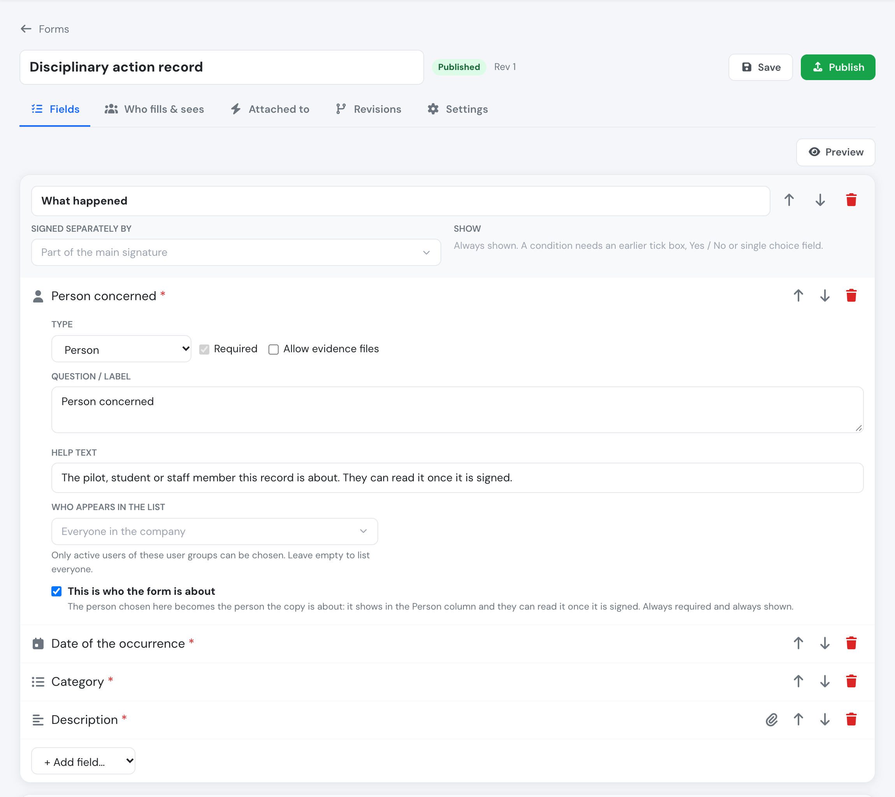<figcaption>
A person field set as the person the form is about.
</figcaption></figure>

Whoever fills the form picks the person from the list, typing part of the name to find them:

<figure>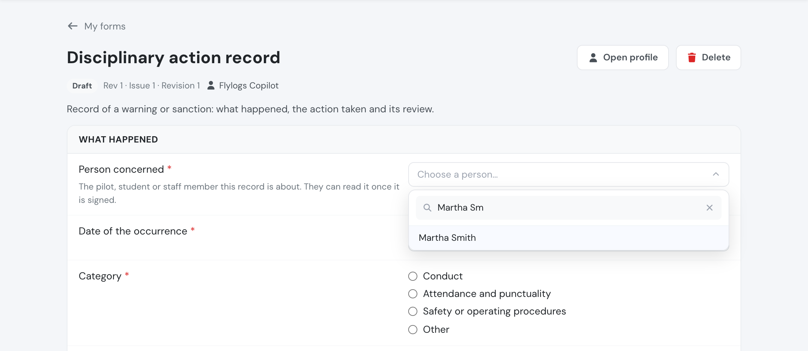<figcaption>
Choosing the person while filling in the form.
</figcaption></figure>

Other person fields (a witness, the other crew member) just record who was chosen.

### Showing a field only when needed

Every field and every section has a **Show** setting. By default it is always shown. You can choose to show it only when an **earlier** tick box, Yes / No or single-choice field has a given answer.

Example: *Refuel performed?* (Yes / No) → *Fuel slip photo*, shown only if the answer is **Yes**. A hidden field is never required, and whatever was entered in it is discarded when the answer above changes.

<figure>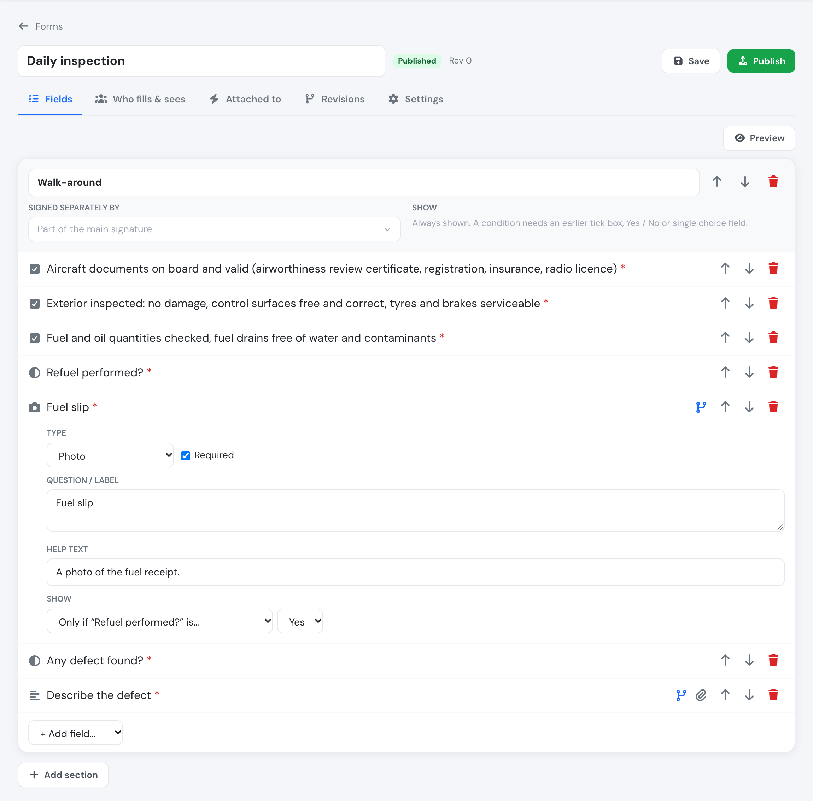<figcaption>
A daily inspection on the Fields tab: the fuel slip photo is shown only if the refuel answer is Yes.
</figcaption></figure>

### Sections signed by someone else

A section can be **signed separately** by chosen user groups — for example an English-proficiency row assessed by a CTKI, while the Head of Training signs the rest. That section can only be filled and signed by those groups; nobody else (not even a manager) can sign it for them. The form is complete only when every section shown has been signed.

## Who fills it in, who sees it

On the **Who fills & sees** tab:

* **Who fills it in**
  * *The person the form is about* — each person fills and signs their own copy.
  * *Selected user groups, on someone's behalf* — e.g. the Head of Training fills in a candidate's enrolment form.
  * *Either*.

  Managers can always fill in the main part of a form on someone's behalf, so a missing person never blocks a process.
* **Who can see filled copies** — add user groups beyond managers, signers and the person concerned. Use this to keep personal data (dates of birth, licence numbers) to the people who need it.
* **Who can open it at any time** — these groups find the form under *My forms → Available* and can start one whenever they need.

## Revisions

Editing a form never changes copies already filled in. Your edits are kept as a draft until you press **Publish**: the draft then becomes the next numbered revision (the first is revision 0). Every filled copy names the revision it was filled on, with its fingerprint.

On the **Revisions** tab you can add your own labels — *Issue*, *Revision*, *Effective date* — so the form carries the same references as your manual or syllabus. Older revisions can be viewed at any time.

## Signing

Filling in is saved as you type. When a section is complete, press **Sign**. If **Sign with password** is on (Settings tab), the signer re-enters their password, as for course approvals. Either way, each signature records who signed, when, and a fingerprint of the answers signed. Signed answers can no longer be changed.

<figure>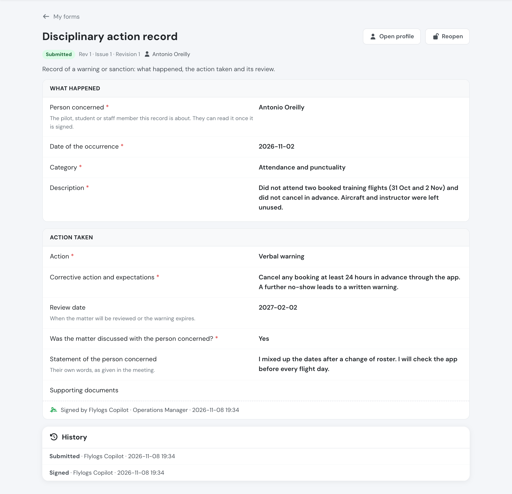<figcaption>
A signed copy: the answers, the revision it was filled on, the person it is about and the signature.
</figcaption></figure>

A manager can **reopen** a signed copy with a reason: its signatures are voided, the answers it held are kept in the history, and it must be signed again.

A **draft** (a copy started but not every part signed yet) can be deleted with its answers and files: by the person who started it, as long as nobody has signed any part of it yet, and by managers at any time — from the copy itself or from the **Delete** button on its row in **Forms → Responses**. Requested, submitted, skipped and waived copies cannot be deleted.

## Sending a form to people

From **Forms → Responses → Request**, choose people and/or pilot groups, an optional due date and a note. Each person gets their own copy and a notification; anyone who already has an open copy of that form is not asked again. Overdue copies are shown in red to them and to you.

## Filling in a form for someone

Some forms are about a person but are filled in by you, not by them — a disciplinary record, an assessment, an interview note. There are two ways to start one:

* open the form from **My forms → Available** and choose the person in its *who the form is about* field (see [Person fields](#person-fields-and-who-the-form-is-about)), or
* from **Forms → Responses**, press **Fill in for someone**, choose the person and press **Start**. The copy opens for you to fill in and sign, with its *who the form is about* field already set to that person.

<figure>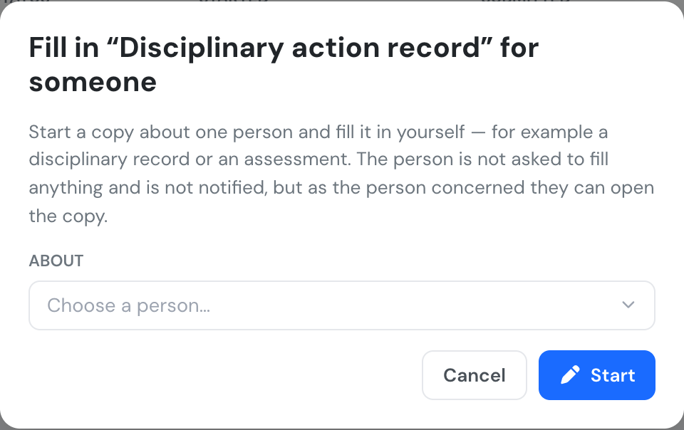<figcaption>
Start a copy about one person and fill it in yourself.
</figcaption></figure>

Unlike **Request**, the person is not asked to fill anything and gets no notification. As the person the form is about, they can still read it: once it is signed, the copy appears under their **My forms**, like any form about them. If they already have an open copy of that form, it is opened instead of a second one.

Who can: managers (user groups 1, 100, 105, 110) and the groups the form names under *Who fills it in*. The form must be published.

## Course pre-entry forms

On the **Attached to** tab, attach the form to **course enrolment**, for all courses or only the ones you pick, as:

* **Mandatory** — the student cannot be enrolled until the form is complete and signed, or a manager **waives** it with a reason. When a student applies to such a course, the application always waits for a manager, even if the course normally accepts applications automatically.
* **Skippable** — the form is offered at enrolment and can be skipped. Skips are recorded.

When you enrol a single student, the course's pre-entry forms appear in the enrol window: fill them in there, and **Enrol** becomes available once the mandatory ones are signed. When you enrol several students at once, those without their forms are not enrolled and are listed with the forms they are missing. In the **Approvals** queue, the form icon on an application opens its pre-entry forms.

The student's enrolment page shows their pre-entry forms and their signed copies.

## Flight forms

On the **Attached to** tab you can also attach a form to flights:

| Attached to | Asked | Can be limited to |
| --- | --- | --- |
| **Preflight** | in the dispatch window of a booking or flight, and when a new flight is entered online | flight types, aircraft |
| **First flight of the day** | the same places, once per aircraft per day: whoever fills it, it covers that aircraft for the rest of the day | aircraft |
| **Before a solo flight** | the same places, for flights on a training mission that needs a mission authorisation | courses |
| **Post-flight** | in the confirm window | flight types, aircraft |
| **Booking creation** | when someone books a flight for themselves | flight types, aircraft |

<figure>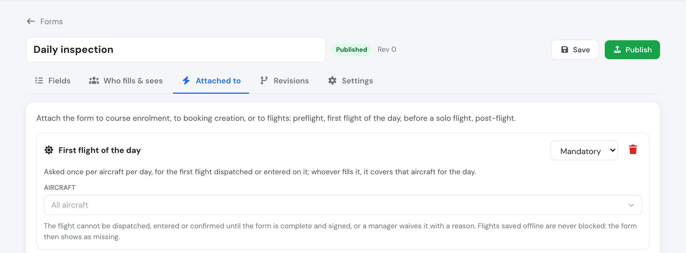<figcaption>
A form attached to the first flight of the day, as mandatory.
</figcaption></figure>

**Who fills it**: on *Who fills & sees*, choose the crew member — PIC (default), SIC, instructor / supervisor, or any crew member. Managers and the form's filling groups can always fill it on the crew's behalf.

<figure>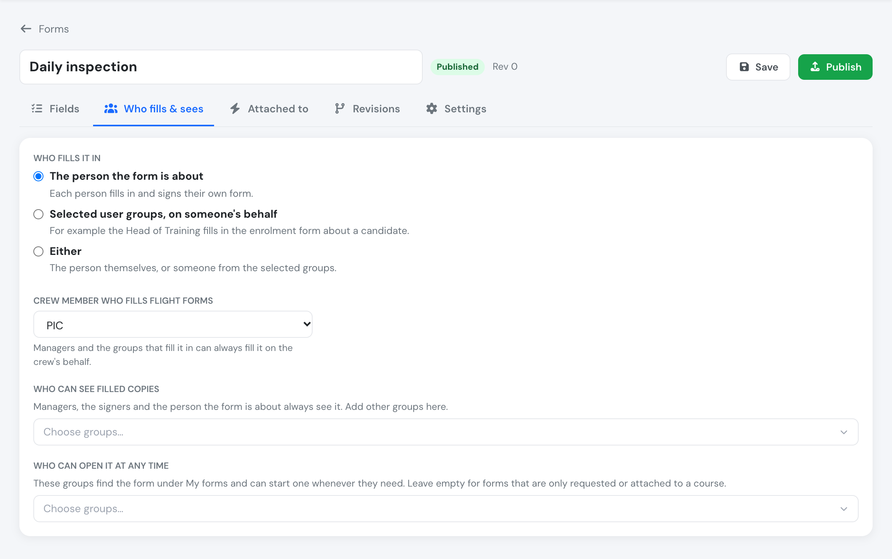<figcaption>
Who fills &amp; sees for a flight form: the PIC fills it in.
</figcaption></figure>

**Mandatory** flight forms block the step until they are signed or a manager waives them with a reason: the **Dispatch** button, saving a new flight, or **Confirm**. **Skippable** ones are offered and can be skipped.

<figure>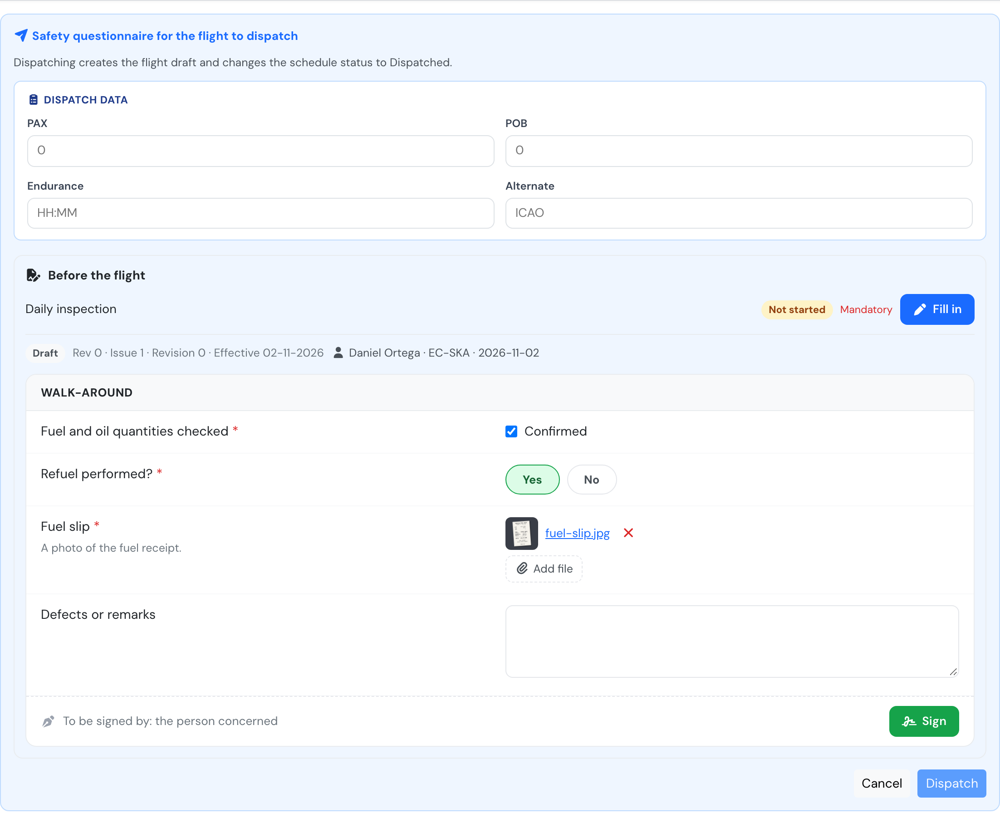<figcaption>
The pilot fills in and signs the daily inspection in the dispatch window. Dispatch stays off until every mandatory form is signed.
</figcaption></figure>

What is never blocked:

* flights saved **offline** — the forms are offered on the device (see below) but saving is never held up;
* flights already confirmed, imported flights and flights recorded from ADS-B;
* bookings made by staff for someone else, bookings created by Auto Pilot and copied weeks.

A form filled before the flight exists (for a new flight or a booking) is attached to the flight once it is saved or dispatched. The flight page lists its preflight and post-flight forms. The same form can be both preflight and post-flight: each is a separate copy.

### Booking forms

A form attached to **booking creation** is asked when a pilot or student books a flight for themselves — from self-booking, or from the schedule when they are on the booking's crew. A **mandatory** booking form must be signed before the booking is made; a **skippable** one can be skipped.

One copy covers everything booked in the same go: a booking repeated over several dates or a trip with several legs asks for the form once. The signed copy is attached to the booking and, once dispatched, to its flight.

### Filling flight forms offline

The app keeps a copy of your company's flight forms on the device, so preflight and post-flight forms can be filled in without signal:

* entering a **new flight offline**, the preflight forms that apply are offered before it is saved. You can fill them now or save the flight and fill them later;
* **confirming offline**, the post-flight forms are shown in the confirm window.

Answers, photos and PDFs stay on the device and are signed there. When the device is back online the flight is sent first, then its forms, then its confirmation, so the confirmation finds its forms already signed. The history of each copy notes that it was signed offline and when.

A form that is signed **with a password** can be filled offline but is signed once you are back online. Forms *before a solo flight* are only offered online.

If a mandatory post-flight form is still missing when an offline confirmation syncs, the confirmation is refused with the form named. The flight stays a draft; fill the form and confirm again online.

Forms for exams, first login, document downloads and certificates will be added in later releases.

## Responses

**Forms → Responses** lists every copy of a form: who it is about, its status, when it was started, submitted and due, and which required answers are still missing. The **Related to** column links to the record each copy belongs to: the flight, the booking, the student's enrolment (or the course, for a pre-entry form filled before enrolment) or the person. The same link is at the top of each filled copy.

Who gets the link: flights and bookings link for everyone who can see the copy, and the flight or booking page still applies its own access. Enrolment, course and person pages link for managers (`user_group_id` ≤ 110); a student also gets a link to their own enrolment. Filter by status or name, open any copy, or export the list to Excel (one column per field).

<figure>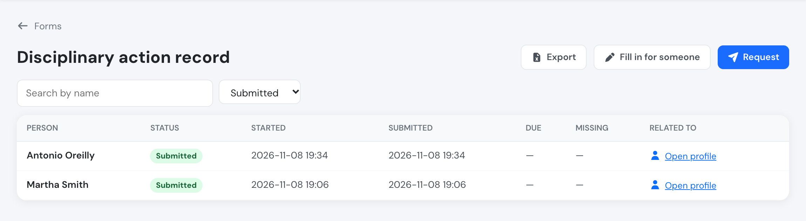<figcaption>
Responses of a form: status, dates and the record each copy belongs to.
</figcaption></figure>

| Status | Meaning |
| --- | --- |
| Requested | Sent to someone, not started yet |
| Draft | Started, not every part signed yet |
| Submitted | Every part signed |
| Skipped | A skippable pre-entry form was skipped |
| Waived | A manager waived a mandatory form, with a reason |

## Forms on a person's page

In **Flight Crew**, open a person and go to the **Manager Area** tab. The **Forms** box has two lists:

* **Filled in by this person**: copies they signed a part of, or started themselves. A form only sent to them appears here once they sign it.
* **Forms naming this person**: copies where a *Person* field names them, for example a disciplinary record about them or a report that lists them as a witness. Under each copy you see which field names them.

<figure>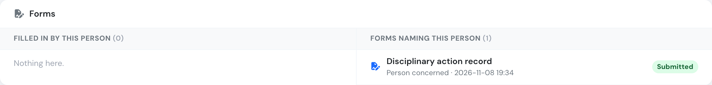<figcaption>
A disciplinary record that names this pilot as the person concerned.
</figcaption></figure>

Click a copy to open it. The box lists only the copies you are allowed to see: managers (user groups 1, 100, 105 and 110) see them all, and other groups with access to the Manager Area see the copies their own access lets them open. The box appears only on plans that include custom forms.

## Forms on the dashboard

Every dashboard has a **Forms** widget with the five copies changed most recently. Click one to open it.

* Managers (user groups 1, 100, 105 and 110) see the latest copies from the whole company. **View more** opens **Home → Forms**.
* Everyone else sees the copies they filled in, signed or are about, plus copies of forms their group fills in or can view. A copy that still has a part for them to fill in is marked **To fill in**. **View more** opens **My forms**.

<figure>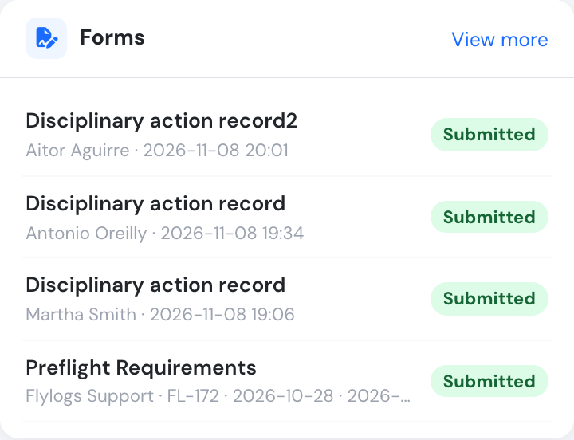<figcaption>
The Forms widget on a manager's dashboard.
</figcaption></figure>

The widget is hidden when there is nothing to show, and on plans that do not include custom forms.

## Retention

You can set how many months filled copies should be kept (Settings tab). The period is stored and shown with the form; automatic deletion is not active yet.

## Archiving and deleting

**Archive** a form you no longer use: it can no longer be started or requested, and it stops being required for enrolment. Filled copies stay. A form can only be **deleted** while nobody has filled it in or been asked to.
