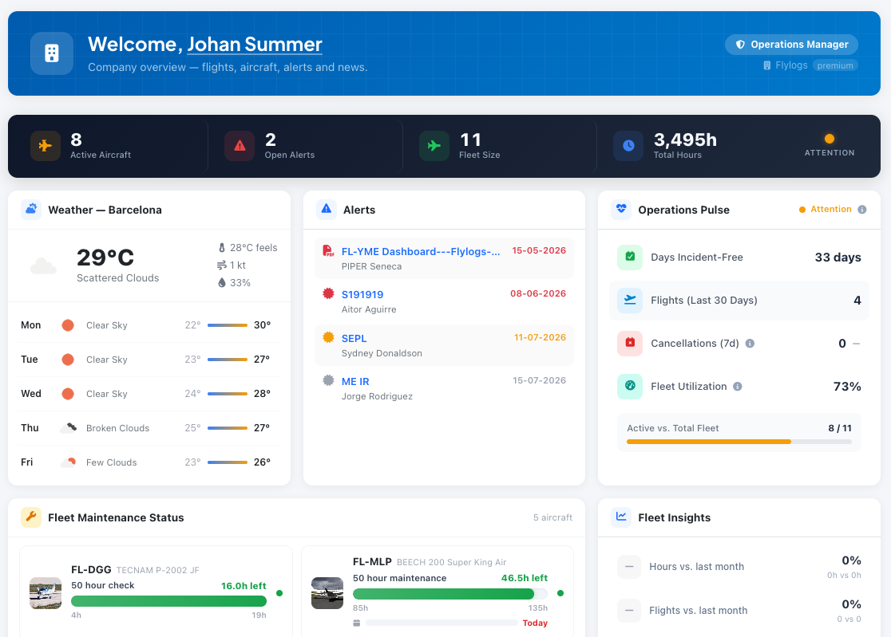
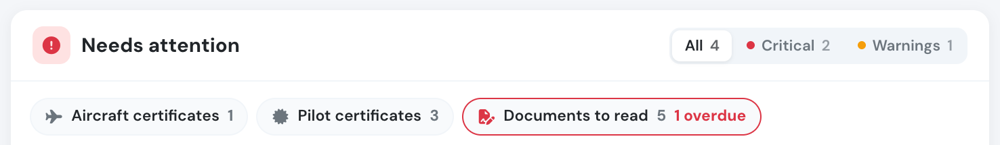
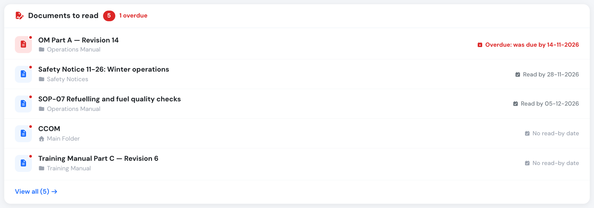
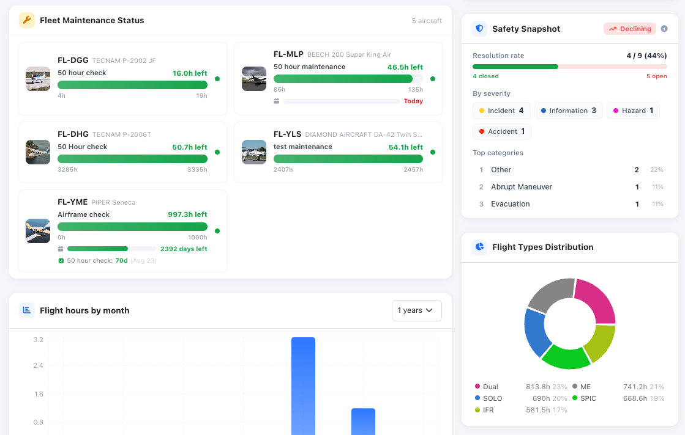
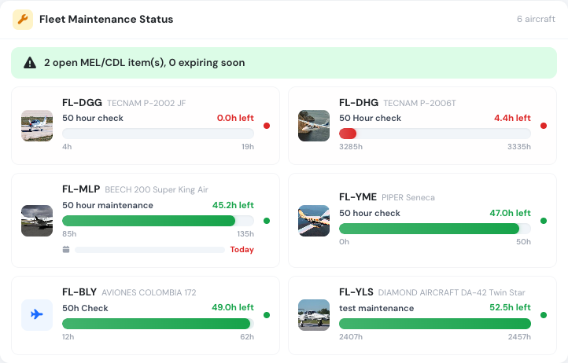

# Your Flylogs dashboard

The Flylogs dashboard is a dynamic environment that will change over time to show you the most important data right at the first screen you see when you log in.

 

Each user type has a different dashboard, pilots dashboard are more focused on flight availability and flight schedule.

Student dashboards are optimized to display training calendar, company news and upcoming classes, exams and flights.

Every dashboard also tells you which company documents you still have to read (see [Documents to read](#documents-to-read)).

***

### Documents to read

When you owe a read receipt for one or more documents of the [Document Library](../documents/document-library.md#documents-you-need-to-read), your dashboard says so as soon as you log in:

* **Company Administrators**, **Operations Managers** and **Trainings Managers** get a **Documents to read** chip in the **Needs attention** card, with the count and how many are overdue. It opens the Document Library, which leads with the list.

<figure><figcaption>
The chip is outlined in red while a document is overdue.
</figcaption></figure>

* **Every other user group** — pilots, student pilots, instructors, cabin crew, dispatchers and the other staff roles — gets a **Documents to read** card right under the welcome banner. It lists the first five documents, overdue first, each with its folder and read-by date; select one to open it, or **View all** to open the Document Library.

<figure><figcaption>
Overdue first, then by read-by date.
</figcaption></figure>

A document counts when it requires a read receipt, it is addressed to you (your user group, or you by name), the receipt is requested from you and you have not opened its current version. Nothing is shown when you have nothing to read. The chip and the card only ever show your own documents, whatever your user group.

***

### Dashboard evolution

As you enter more data in Flylogs, the dashboard continues to change and show you more relevant information. 

* Flight time history for 1,2,3,5 and 10 years back.
* Aircraft maintenances,&#x20;
* Live aircraft ADSB location
* Aircraft certificate expiration dates,&#x20;
* Pilot duty and flight overtimes,
* Pilot medical and License expirations 

***

### Fleet Maintenance Status

The **Fleet Maintenance Status** card lists each active aircraft with maintenance data: the last signed maintenance, the hours left before the next one, and the hours reading at which it is due. Where they apply, it also shows the landings and days left, and any open MEL / CDL items. Aircraft closest to their next maintenance come first, and selecting a row opens the aircraft.

<figure><figcaption>
Hours left before the next maintenance on each aircraft
</figcaption></figure>

The card needs a plan that includes maintenance. It appears on the home page of **Company Administrators**, **Operations Managers**, **Compliance & Safety Managers**, **Human Resources Managers**, **Trainings Managers**, **Flight Dispatchers**, **Chief Pilots**, **Flight Instructors**, **Mechanics**, **Captains** and **Pilots**. On a Captain's or Pilot's home page, the card is hidden when no aircraft has maintenance data and no MEL / CDL item is open. **Student Pilots** do not get it.

***

### Alerts

The **Alerts** widget on your dashboard surfaces everything about to expire across your operation — aircraft certificates (insurance, airworthiness, registration, weight & balance, radio, avionics), scheduled maintenance, uploaded aircraft documents, company documents, and pilot certificates. Each item is colour-coded: red for already expired, amber for expiring within a month, grey for expiring within three months.

Use the **View all** link in the widget header to open the dedicated **Alerts page**, where you can filter the full list by:

* **Date range** — narrow to a specific window, or reach further ahead / into the past than the widget's default three-month horizon.
* **Type** — aircraft certificates, maintenance, aircraft documents, company documents, or pilot certificates.
* **User** — show a single person's alerts (their pilot certificates plus documents for aircraft they own).

Filters are remembered in the page address, so you can bookmark or share a filtered view.

**Who sees what:** company managers see alerts across the whole company. Flight instructors and other non-managers see only their own aircraft documents and the certificates of themselves and their supervised students — selecting another user never reveals that person's certificates.
