# Document & Certificates

Flylogs offers a feature called "My Certificates" which is a system to track and remind users about their important documents and certificates. This system is part of the [**Pilot Documentation Control System (PDCS)**](document-and-certificate-requirements.md) and it is available on each user's personal details edit page.&#x20;

Using "My Certificates", users can create various types of documents, attach files, and set deadlines for expiration.

"My Certificates" is on the home dashboard of **every user**, whatever their role and whether they fly or not: managers, the safety, HR, finance, training and crew-scheduling managers, dispatchers, instructors, pilots, cabin crew and mechanics. Staff who don't fly keep their own trainings and ratings there too. The "pilot documents required" warning is shown only to users who fly.

Managers can also keep these certificates up to date for other people. For flight crew, open the profile under **Flight Crew** and go to the **Qualifications** tab. For dispatchers, mechanics and other staff, open the profile under **Home > Staff** (available to the Company Administrator, Operations, Compliance & Safety and HR managers): its **Certificates** section lets them view, add, edit and delete that person's certificates and attach the document. Only management roles up to Chief Pilot can edit someone else's certificates; everyone else manages only their own.

### Certificate types

Besides licences, class and type ratings, medicals, language proficiency, IDs and passports, you can file:

| Type | What it is | Expiry |
|---|---|---|
| MCC Certificate | Multi-crew cooperation course (FCL.735) | None |
| AUPRT Certificate | Advanced upset prevention and recovery training (FCL.745.A) | None |
| TRI Certificate | Type rating instructor | Filled in 3 years after the issue date; change it if your certificate says otherwise |
| CRI Certificate | Class rating instructor | Filled in 3 years after the issue date; change it if your certificate says otherwise |
| IRI Certificate | Instrument rating instructor | Filled in 3 years after the issue date; change it if your certificate says otherwise |
| SFI Certificate | Synthetic flight instructor | Filled in 3 years after the issue date; change it if your certificate says otherwise |
| MCCI Certificate | Multi-crew cooperation instructor | Filled in 3 years after the issue date; change it if your certificate says otherwise |
| TRE Certificate | Type rating examiner | The date printed on the certificate |
| FE Certificate | Flight examiner | The date printed on the certificate |
| CRE Certificate | Class rating examiner | The date printed on the certificate |
| IRE Certificate | Instrument rating examiner | The date printed on the certificate |
| SFE Certificate | Synthetic flight examiner | The date printed on the certificate |

Instructor and examiner certificates don't count as the pilot's class or type rating in the licence, rating and medical check. A flight type or a course can require any of them like any other certificate.

> Flylogs will send automatic expiration warnings, both to the user and the company managers.



<figure><figcaption>
Quick view of My certificates available to any Flylogs user.
</figcaption></figure>

### Reading the document for you



When you attach a PDF or a photo of the certificate (JPEG, PNG or WebP, up to 10 MB), press **Read the document**. Flylogs reads it and shows what it found: the certificate type, a short description, the issue date and the expiration date. Press **Apply to the form** to copy them into the form, check them against the document, and save as usual.

<figure>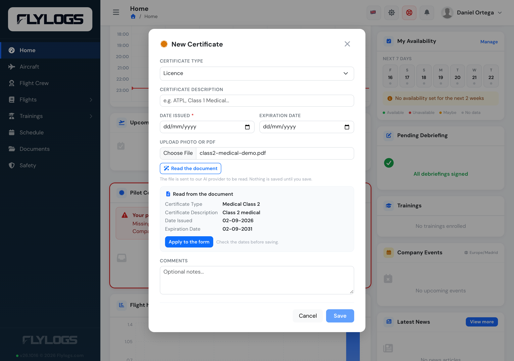<figcaption>
A Class 2 medical read from its PDF, ready to apply.
</figcaption></figure>

* **Nothing is saved until you press Save.** The reading only fills in the form, and you can change every field before saving.
* If you already picked a certificate type, Flylogs reads the matching entry. This helps with licences, which list several ratings, each with its own dates.
* A pilot licence usually has no expiry date of its own. The validity dates printed next to its ratings belong to the ratings, so add each rating as its own certificate.
* Flylogs warns you when the document is marked as a **specimen** or not valid, and when the name on it does not match the person whose profile you are filing it on.
* The button appears only while you are online, and anyone who can add the certificate can use it.


To be read, the document is sent to our AI processor, and Flylogs asks the processor not to store it. Medical certificates contain health data: if you would rather not send them, type the dates by hand as before. The file is only sent when you press **Read the document**.


### Type ratings: aircraft covered



A type rating applies to specific aircraft types, and so do the TRI and TRE certificates built on it. When you add or edit a **Type Rating**, **TRI Certificate** or **TRE Certificate**, the **Aircraft covered** section lets you choose the aircraft models it covers. One rating can cover several models: an A320 family rating covers the A319, A320 and A321.

* The models your company flies are listed under **Your fleet**. Click one to add it.
* For any other model, choose the manufacturer, then the model. You can add models from several manufacturers.
* Remove a model with its ×.

<figure>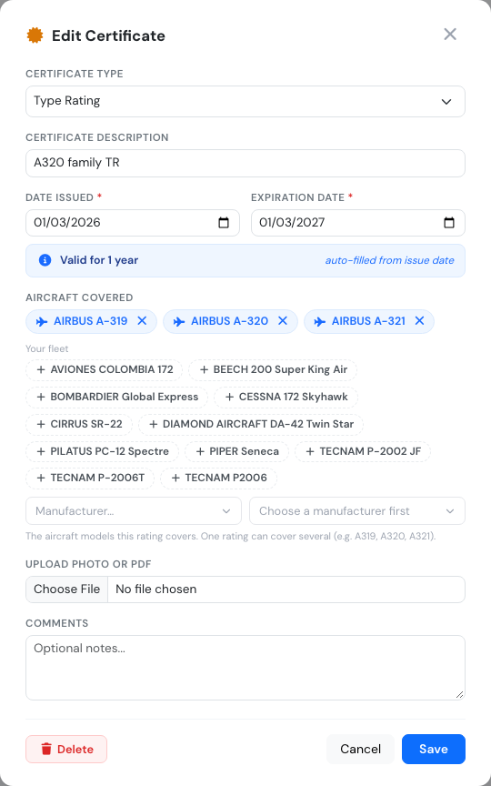<figcaption>
An A320 family type rating covering the A319, A320 and A321.
</figcaption></figure>

The models appear under the certificate in the certificate list:

<figure>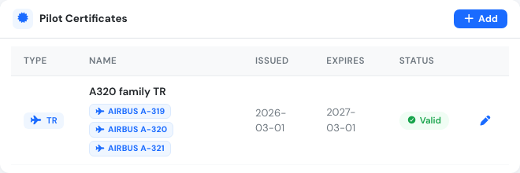<figcaption>
The aircraft covered, listed under the type rating.
</figcaption></figure>

Other certificate types don't carry aircraft models. If you change a type rating to another type, its models are removed when you save. Deleting the certificate deletes its models too.

**Who can change them:** the same people who can edit the certificate. Anyone who can see the certificate list also sees the models.

An aircraft can [require a type rating](../aircraft/type-rating-requirement.md). Its crew is then checked against these links when the aircraft is booked or dispatched, so keep them up to date.

When an instructor flies a training mission, Flylogs keeps a copy of their certificates on the student's mission record. For a TRI, TRE or type rating, that copy now includes the aircraft covered on the day.

### Medical limitations



A medical certificate can carry one or more **limitations**: correction for vision, valid by day only, valid only without passengers, and so on. Flylogs records them with the medical, so whoever dispatches the pilot's flights can see them.

When you add or edit a medical, the **Limitations** section lists the ones on file. Add another with **Add a limitation…**, or remove one with its ×. Limitations whose wording matters (SSL, TML, OAL) get a field for the text written on the certificate.

If you use **Read the document**, Flylogs also reads the limitations printed on the medical, written as codes or in words, and lists them with the rest of what it read.

<figure>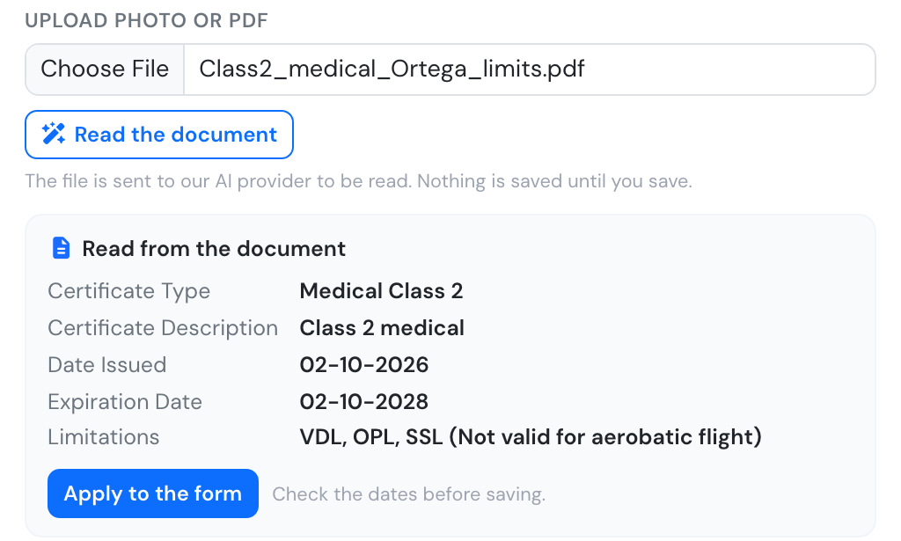<figcaption>
What was read from the medical, including its three limitations.
</figcaption></figure>

**Apply to the form** adds them to the form. As always, nothing is saved until you press **Save**.

<figure>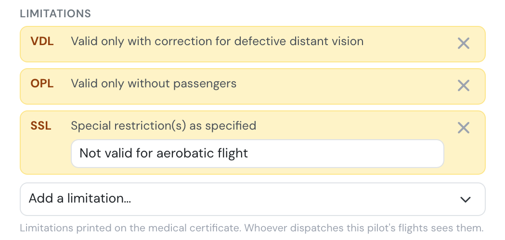<figcaption>
After Apply: each limitation with its meaning, and SSL with the wording from the certificate.
</figcaption></figure>

Saved limitations appear under the medical in the certificate list. Hover over a code to see its meaning.

<figure>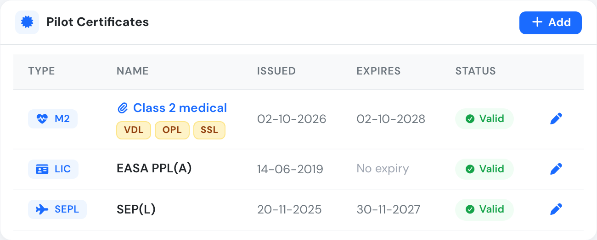<figcaption>
The limitation codes under the medical in the certificate list.
</figcaption></figure>

Whoever dispatches a flight the pilot crews sees the limitations too, with a warning when the flight goes against one:

<figure>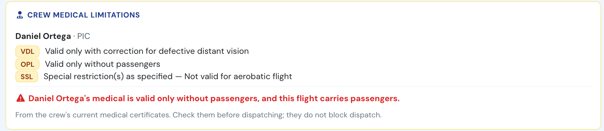<figcaption>
At dispatch: the PIC's medical is valid only without passengers, and the flight carries two.
</figcaption></figure>

Limitations belong to the medical they are printed on. When the pilot files a renewed medical and the old one expires, the old limitations stop applying, and the new medical brings its own. Deleting a medical deletes its limitations.

The codes are the ones in EASA AMC2 MED.B.001:

| Code | Limitation |
|---|---|
| TML | Limited period of validity of the medical certificate |
| VDL | Valid only with correction for defective distant vision |
| VML | Valid only with correction for defective distant, intermediate and near vision |
| VNL | Valid only with correction for defective near vision |
| CCL | Correction by means of contact lenses |
| VCL | Valid by day only |
| RXO | Specialist ophthalmological examination(s) |
| SIC | Specific medical examination(s) |
| HAL | Valid only when hearing aids are worn |
| APL | Valid only with approved prosthesis |
| AHL | Valid only with approved hand controls |
| OML | Valid only as, or with, a qualified co-pilot |
| OCL | Valid only as a qualified co-pilot |
| OSL | Valid only with a safety pilot and in aircraft with dual controls |
| OPL | Valid only without passengers |
| ORL | Valid only with a safety pilot if passengers are carried |
| OAL | Restricted to demonstrated aircraft type |
| SSL | Special restriction(s) as specified |

**Who sees them:**

* **In the certificate list:** the pilot, plus Flight Instructors, the Chief Pilot and managers of the company (user group 170 and below), who can also edit them. Colleagues who open the pilot's profile read-only see the certificates but not the limitations.
* **At dispatch:** the crew of that flight (PIC, SIC, supervisor) and staff who can dispatch any flight (user group 150 and below). RXO and SIC are follow-up examinations, so they are not shown at dispatch. See [Flight Dispatch Function](../schedules/flight-dispatch-function.md#crew-medical-limitations).

**Who can change them:** the same people who can edit the certificate.

### Licences: ratings and language proficiency

A pilot licence lists several ratings and endorsements, each with its own validity: class or type ratings, instrument, instructor and night ratings, and language proficiency. When you read a licence with **Read the document**, Flylogs lists them under **Ratings on this licence**:

* a rating you already have on file is **updated** with the new validity (useful after a revalidation, when the examiner has signed a new entry on the licence). Its previous validity is kept in the [certificate history](#renewals-and-certificate-history) as a renewal;
* a rating you don't have yet is added as a **new certificate**.

Untick any line you don't want, then press **Add or update certificates**. They are saved straight away, one certificate each. The licence itself is still filed with the form's **Save**.

<figure>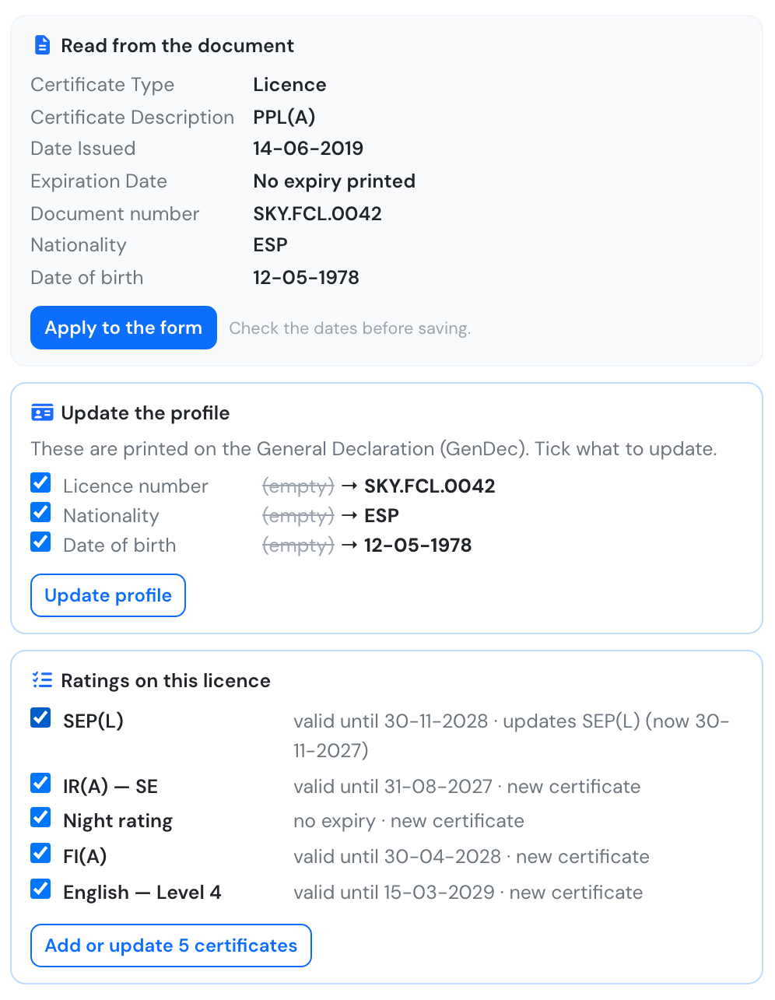<figcaption>
A licence read: profile details to update, and its five ratings, one already on file.
</figcaption></figure>

**Language proficiency** is a certificate type of its own. Its name holds the language and level (for example *English — Level 4*) and its expiry is the one on the licence. Under EASA FCL.055, level 4 is valid for 4 years and level 5 for 6 years, and level 6 does not expire. It doesn't count towards the licence, rating and medical checks, but a flight type can require it like any other certificate.

### Passport, ID and licence details for the GenDec

When the document read is a passport, an ID card or a licence, Flylogs also offers to **update the profile** with what the [General Declaration (GenDec)](../flights/flight-records.md#gendec-export) prints for the crew: the passport or ID number, the licence number, the nationality (as the three-letter code passports use, such as ESP or GBR) and the date of birth. Only the fields that differ from the profile are listed, each with its current value. Untick what you don't want and press **Update profile**.

Who can update what is the same as in the profile forms:

* on **your own profile**: nationality, date of birth and licence number. The passport number only for user group 150 and below (managers and the Chief Pilot);
* on **someone else's profile**: user groups 150 and below.

### Renewals and certificate history

A certificate stays one entry, but Flylogs keeps what it was before every change. When the issue date, expiry date, type, description, status, comments, medical limitations or aircraft covered change, the previous values are kept as a **revision** of the same certificate, together with:

* what each field was and what it became;
* the files that were attached at that moment;
* who made the change and when.

Deleting a certificate keeps its last state, and its files, the same way. History starts with the first change made after November 2026: values overwritten before then cannot be recovered.

#### Renewal or correction

When you change the dates of a certificate already on file, the form asks what the change is:

* **A renewal or revalidation**: the previous period was genuine. It is kept and still counts as valid for the dates it covered (see [Certificates on a date](#certificates-on-a-date)).
* **A correction of a typing mistake**: the previous dates were wrong. They are kept on record but never count as valid.

Flylogs pre-selects the answer from the dates: a later expiry, or a later issue date without an earlier expiry, is a renewal; anything else is a correction. Change it if it is wrong. Ratings updated from a licence reading are saved as renewals when their expiry moves later.

<figure>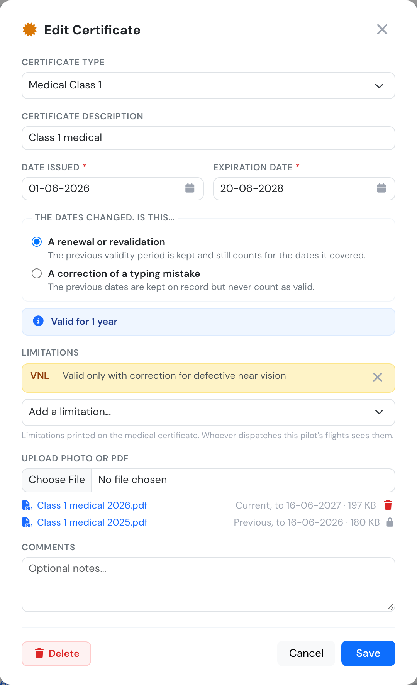<figcaption>
A medical renewed: the dates changed, so the form asks whether it is a renewal or a correction. The file of the previous period is locked.
</figcaption></figure>

#### Files and the period they belong to

Every file attached to a certificate is kept, not only the newest one. When a certificate has more than one, the list shows a files button (<i class="fa fa-paperclip"></i>) with their number, next to the history button. It opens the files newest first, the current one marked, each labelled with what it evidences:

* **Current, to** the expiry: the file belongs to the certificate as it is now.
* **Previous, to** the expiry: the file belongs to an earlier validity period.
* **Uploaded** the date, **period not recorded**: the file was attached before certificate history began (November 2026), so Flylogs does not know which period it was filed against and does not claim one. Its upload date is shown instead.

<figure>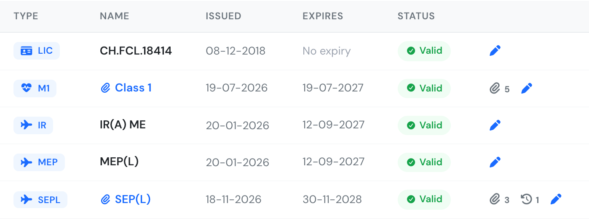<figcaption>
The certificate list: Class 1 has five files, SEP(L) three files and one earlier revision.
</figcaption></figure>

<figure>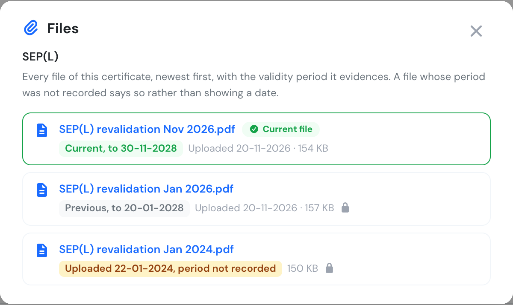<figcaption>
The files of a revalidated SEP(L): the current file, the file of the previous period, and an older file whose period was not recorded.
</figcaption></figure>

Files of a previous validity period are records, so they are locked (<i class="fa fa-lock"></i>) and **cannot be deleted** by anyone. A file attached during the current validity period can be deleted, for example when it was attached to the wrong certificate.

Files whose period was not recorded can be deleted unless your company keeps them: a manager turns on **Keep certificate files whose period was not recorded** in the company settings, [Flight Crew tab](../company-management/company-settings/pilots.md#documentation-compliance). With it on, they are locked like the files of a previous period.

##### Entering the period of an older file

If you know which period an older file covers (you hold the paper, for example), you can enter it. Open the certificate with the edit button, find the file marked **period not recorded** and press **Set period**. Enter the issue and expiry dates the file evidences and **Save** the certificate.

<figure>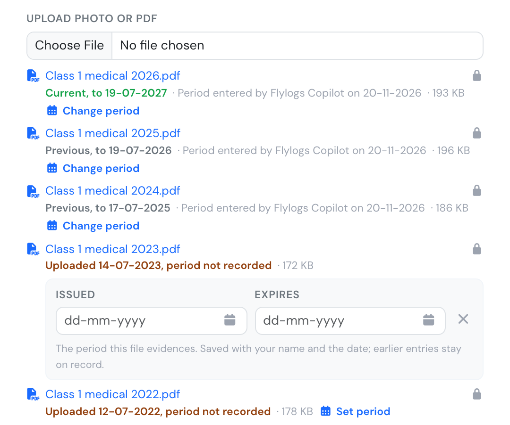<figcaption>
Edit Certificate: three files with a period entered, one being entered, and one still not recorded.
</figcaption></figure>

The file is then labelled **Current** when the dates you entered are the certificate's dates now, otherwise **Previous**, and shows who entered the period and when. To fix a mistake press **Change period**: the new entry replaces the label, and the earlier one stays on record. **Clear period** sets the file back to not recorded. Entering a period does not change whether the file can be deleted.

Only files attached before certificate history began can have their period entered. The period of a file attached since then is recorded automatically and cannot be changed. Anyone who can edit the certificate can enter periods: the certificate holder, and user groups 170 and below (managers, Chief Pilot, Flight Instructors).

#### Viewing the history

A certificate with earlier revisions shows a history button (<i class="fa fa-clock-rotate-left"></i>) with the number of revisions. It opens them newest first: the validity each one had, whether it was replaced by a renewal, corrected, edited or deleted, the old and new value of each field, its files, who changed it and when.

<figure>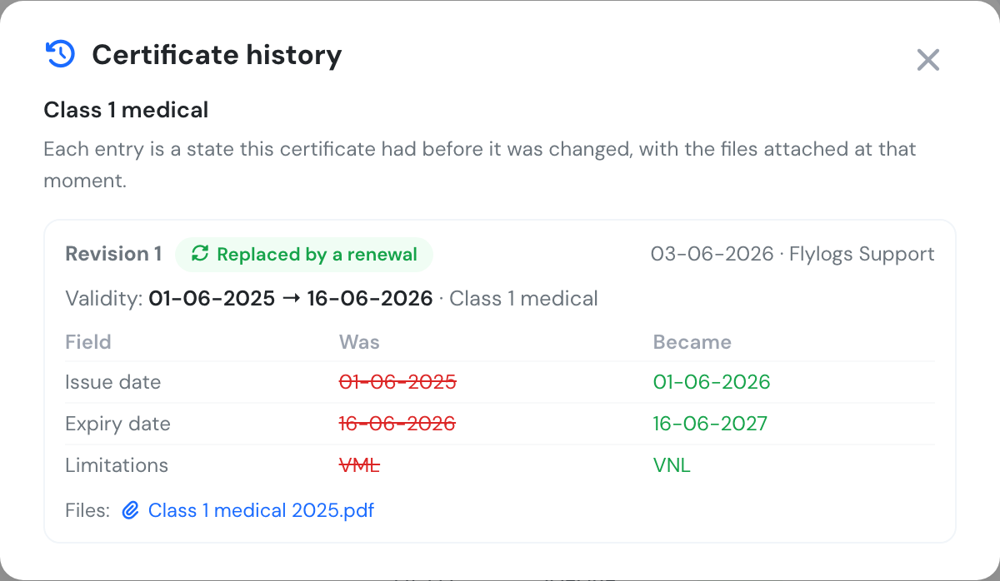<figcaption>
The previous period of a Class 1 medical: replaced by a renewal on 3 June 2026, with the file filed against it.
</figcaption></figure>

**Who sees it:** everyone who can see the certificate. Medical limitations in the history follow the same rule as on the certificate: only the certificate holder and user groups 170 and below (managers, Chief Pilot, Flight Instructors). External auditors (group 250) see the history but cannot open the files.

### Automatic Alerting

Flylogs highlights documents in orange and starts emailing the user when the document's expiration date approaches. How early depends on the type of document:

* Medical certificates (any class, including LAPL): 45 days.
* Licences, ratings (class, type, IR, night, FI and the rest), language proficiency, instructor and examiner certificates, and training certificates: 90 days.
* IDs: 6 months.
* Passports: 1 year.

Once inside that window, a reminder email goes out **every two weeks** (on the 1st and the 16th of the month). If the document is not renewed in time, the reminders carry on for **one month after it expired**, now saying it has expired, and then stop.

<figure>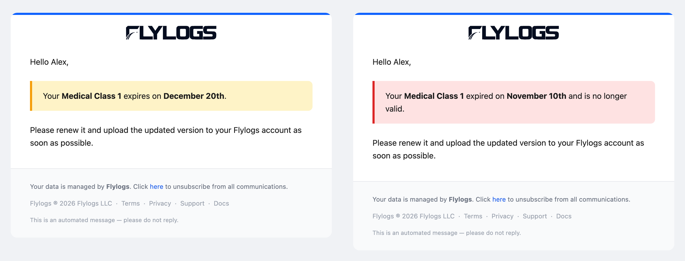<figcaption>
The reminder before expiry (left) and after it (right).
</figcaption></figure>

Reminders stop as soon as the user **renews the document**, whether by editing its expiration date or by uploading the new certificate as a new document: a newer medical of any class replaces the old one, a class rating, IR, FI or other single rating is replaced by a newer one of the same kind, and a type rating, licence or training certificate by a newer one with the same name. Documents without an expiry date (logbook, MCC, AUPRT, other documents) and revoked documents are never reminded. The user must have a confirmed email address and alerts turned on in their notification preferences.

### Who can edit whose documents

Company managers, the Chief Pilot and Flight Instructors can add and edit documents on any user of their company. Captains, pilots, students, cabin crew, specialists and mechanics only manage their own — they can open a colleague's profile, but the documents are read-only there (external auditors are read-only everywhere). Company administrators can also turn off *Allow pilots to edit their own certificates* in the company settings, leaving document filing to managers only.

> A document always stays on the profile it belongs to. Editing someone else's document never moves it to the editor's profile.

### Manager alert and audit tools

Company managers have an overall view of all documents and upcoming expirations. On top of that, company administrators can activate extra settings in the company settings to block users without the proper licence/rating/medical from flight schedules.

<figure><figcaption>
Manager home page
</figcaption></figure>

### Pilot audit tool

All company managers have access to the pilot audit tool (**Flight Crew > Audit**) which allows a quick view of all pilot certificates and training courses: how many people have expired certificates or certificates expiring within 45 days, which types have expired, how recently each person flew, and per person the certificates with their expiry and the active training courses.

<figure>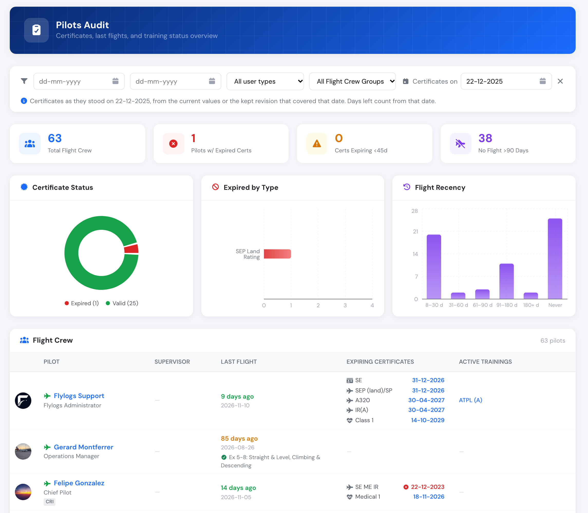<figcaption>
The pilot audit tool, here showing certificates as they stood on 22 December 2025.
</figcaption></figure>

#### Certificates on a date

Pick a day in **Certificates on** to see each person's certificates as they stood on that day, for example to show an inspector what a student held on a past date. For each certificate Flylogs takes the current values when they covered that day, otherwise the kept revision that did. A revision replaced as a **correction** never counts. Expiry colours and remaining days are counted from the chosen day, and a certificate that had already expired by then is shown in red. A small history icon marks a value taken from a revision, and a certificate deleted since is struck through. Clear the date (<i class="fa fa-xmark"></i>) to go back to today.

The list of people is still today's (active users of the company), and the dates come from the certificates themselves, not from when they were entered: a medical filed today with last year's issue date counts for last year.

<figure>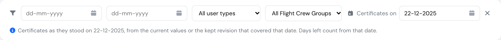<figcaption>
Certificates on 22 December 2025.
</figcaption></figure>

<figure><figcaption>
On that day the Class 1 medical was the previous period, valid to 16 June 2026 (history icon).
</figcaption></figure>

The same answer is available per person in the API: `GET /pilots/certificates/{userId}.json?on=YYYY-MM-DD` (see the [Pilots API](../API/pilots.md)).
