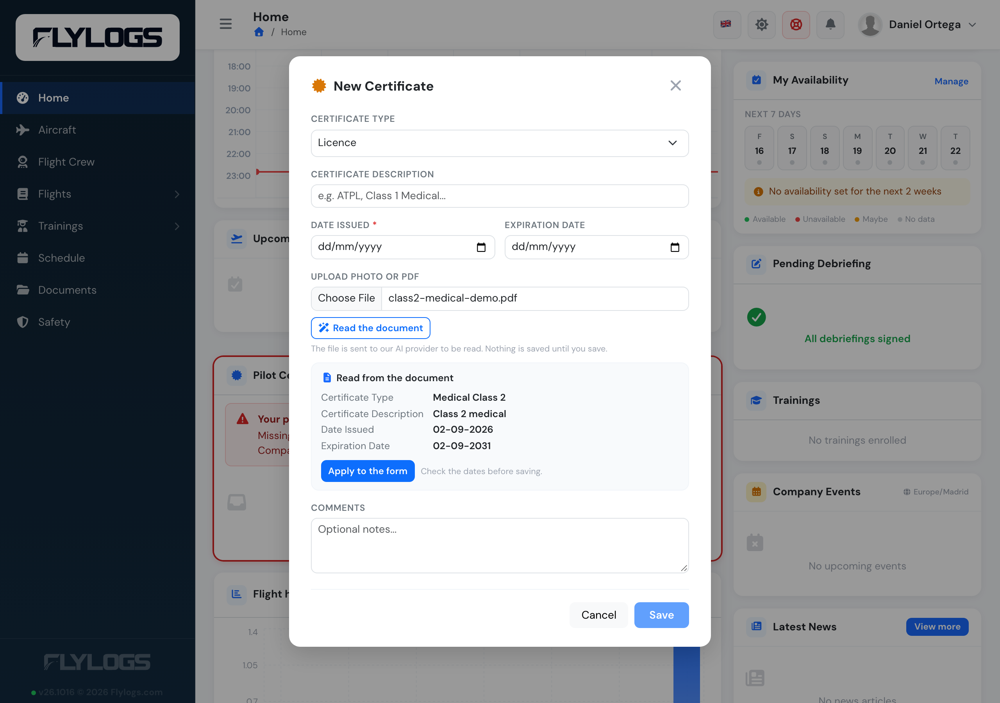
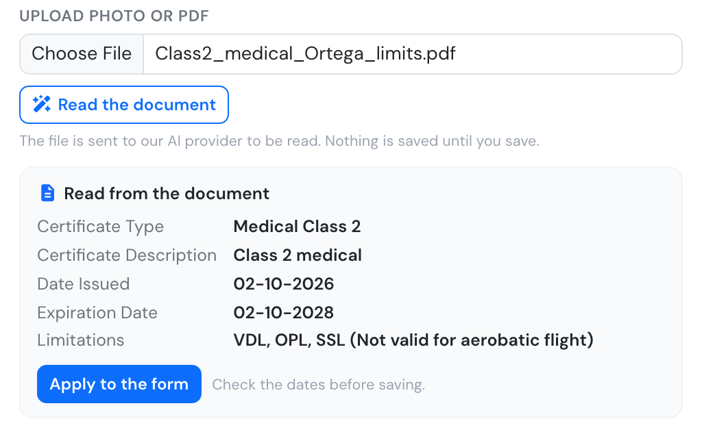
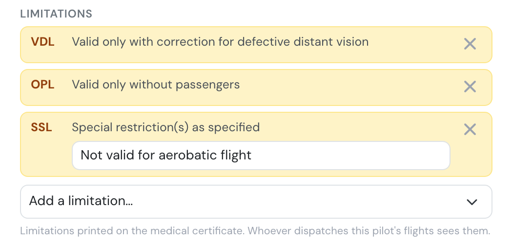
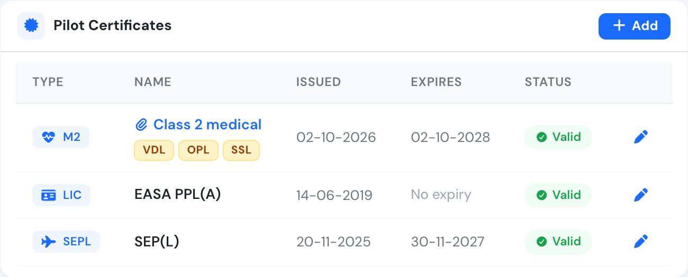
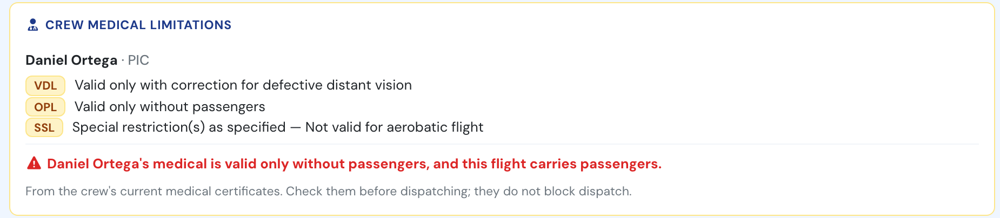
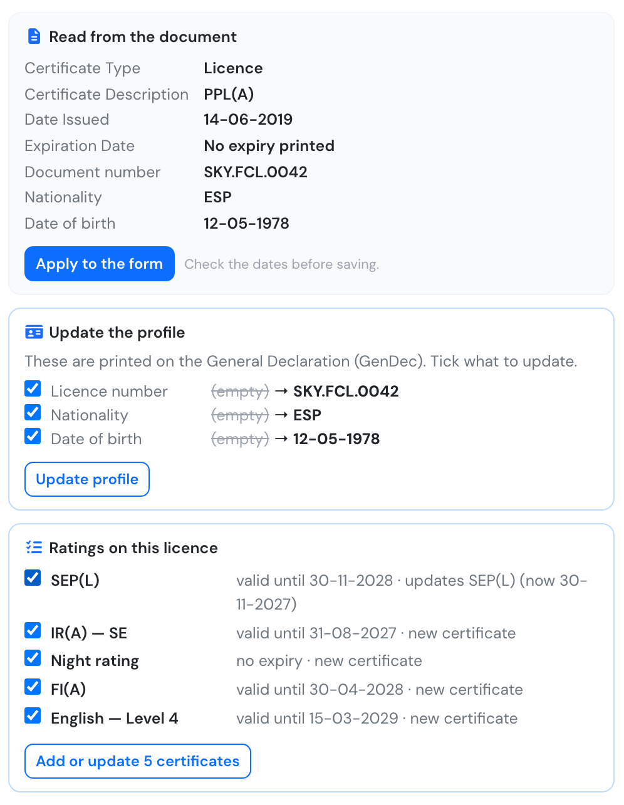

# Document & Certificates

Flylogs offers a feature called "My Certificates" which is a system to track and remind users about their important documents and certificates. This system is part of the [**Pilot Documentation Control System (PDCS)**](document-and-certificate-requirements.md) and it is available on each user's personal details edit page.&#x20;

Using "My Certificates", users can create various types of documents, attach files, and set deadlines for expiration.

> Flylogs will send automatic expiration warnings, both to the user and the company managers.



<figure><figcaption>
Quick view of My certificates available to any Flylogs user.
</figcaption></figure>

### Reading the document for you



When you attach a PDF or a photo of the certificate (JPEG, PNG or WebP, up to 10 MB), press **Read the document**. Flylogs reads it and shows what it found: the certificate type, a short description, the issue date and the expiration date. Press **Apply to the form** to copy them into the form, check them against the document, and save as usual.

<figure><figcaption>
A Class 2 medical read from its PDF, ready to apply.
</figcaption></figure>

* **Nothing is saved until you press Save.** The reading only fills in the form, and you can change every field before saving.
* If you already picked a certificate type, Flylogs reads the matching entry. This helps with licences, which list several ratings, each with its own dates.
* A pilot licence usually has no expiry date of its own. The validity dates printed next to its ratings belong to the ratings, so add each rating as its own certificate.
* Flylogs warns you when the document is marked as a **specimen** or not valid, and when the name on it does not match the person whose profile you are filing it on.
* The button appears only while you are online, and anyone who can add the certificate can use it.


To be read, the document is sent to our AI provider, and Flylogs asks the provider not to store it. Medical certificates contain health data: if you would rather not send them, type the dates by hand as before. The file is only sent when you press **Read the document**.


### Medical limitations



A medical certificate can carry one or more **limitations**: correction for vision, valid by day only, valid only without passengers, and so on. Flylogs records them with the medical, so whoever dispatches the pilot's flights can see them.

When you add or edit a medical, the **Limitations** section lists the ones on file. Add another with **Add a limitation…**, or remove one with its ×. Limitations whose wording matters (SSL, TML, OAL) get a field for the text written on the certificate.

If you use **Read the document**, Flylogs also reads the limitations printed on the medical, written as codes or in words, and lists them with the rest of what it read.

<figure><figcaption>
What was read from the medical, including its three limitations.
</figcaption></figure>

**Apply to the form** adds them to the form. As always, nothing is saved until you press **Save**.

<figure><figcaption>
After Apply: each limitation with its meaning, and SSL with the wording from the certificate.
</figcaption></figure>

Saved limitations appear under the medical in the certificate list. Hover over a code to see its meaning.

<figure><figcaption>
The limitation codes under the medical in the certificate list.
</figcaption></figure>

Whoever dispatches a flight the pilot crews sees the limitations too, with a warning when the flight goes against one:

<figure><figcaption>
At dispatch: the PIC's medical is valid only without passengers, and the flight carries two.
</figcaption></figure>

Limitations belong to the medical they are printed on. When the pilot files a renewed medical and the old one expires, the old limitations stop applying, and the new medical brings its own. Deleting a medical deletes its limitations.

The codes are the ones in EASA AMC2 MED.B.001:

| Code | Limitation |
|---|---|
| TML | Limited period of validity of the medical certificate |
| VDL | Valid only with correction for defective distant vision |
| VML | Valid only with correction for defective distant, intermediate and near vision |
| VNL | Valid only with correction for defective near vision |
| CCL | Correction by means of contact lenses |
| VCL | Valid by day only |
| RXO | Specialist ophthalmological examination(s) |
| SIC | Specific medical examination(s) |
| HAL | Valid only when hearing aids are worn |
| APL | Valid only with approved prosthesis |
| AHL | Valid only with approved hand controls |
| OML | Valid only as, or with, a qualified co-pilot |
| OCL | Valid only as a qualified co-pilot |
| OSL | Valid only with a safety pilot and in aircraft with dual controls |
| OPL | Valid only without passengers |
| ORL | Valid only with a safety pilot if passengers are carried |
| OAL | Restricted to demonstrated aircraft type |
| SSL | Special restriction(s) as specified |

**Who sees them:**

* **In the certificate list:** the pilot, plus Flight Instructors, the Chief Pilot and managers of the company (user group 170 and below), who can also edit them. Colleagues who open the pilot's profile read-only see the certificates but not the limitations.
* **At dispatch:** the crew of that flight (PIC, SIC, supervisor) and staff who can dispatch any flight (user group 150 and below). RXO and SIC are follow-up examinations, so they are not shown at dispatch. See [Flight Dispatch Function](../schedules/flight-dispatch-function.md#crew-medical-limitations).

**Who can change them:** the same people who can edit the certificate.

### Licences: ratings and language proficiency

A pilot licence lists several ratings and endorsements, each with its own validity: class or type ratings, instrument, instructor and night ratings, and language proficiency. When you read a licence with **Read the document**, Flylogs lists them under **Ratings on this licence**:

* a rating you already have on file is **updated** with the new validity (useful after a revalidation, when the examiner has signed a new entry on the licence);
* a rating you don't have yet is added as a **new certificate**.

Untick any line you don't want, then press **Add or update certificates**. They are saved straight away, one certificate each. The licence itself is still filed with the form's **Save**.

<figure><figcaption>
A licence read: profile details to update, and its five ratings, one already on file.
</figcaption></figure>

**Language proficiency** is a certificate type of its own. Its name holds the language and level (for example *English — Level 4*) and its expiry is the one on the licence. Under EASA FCL.055, level 4 is valid for 4 years and level 5 for 6 years, and level 6 does not expire. It doesn't count towards the licence, rating and medical checks, but a flight type can require it like any other certificate.

### Passport, ID and licence details for the GenDec

When the document read is a passport, an ID card or a licence, Flylogs also offers to **update the profile** with what the [General Declaration (GenDec)](../flights/flight-records.md#gendec-export) prints for the crew: the passport or ID number, the licence number, the nationality (as the three-letter code passports use, such as ESP or GBR) and the date of birth. Only the fields that differ from the profile are listed, each with its current value. Untick what you don't want and press **Update profile**.

Who can update what is the same as in the profile forms:

* on **your own profile**: nationality, date of birth and licence number. The passport number only for user group 150 and below (managers and the Chief Pilot);
* on **someone else's profile**: user groups 150 and below.

### Automatic Alerting

Flylogs will mark highlight documents in orange and will start sending automatic alerts to the user's email address when the document's expiration date approaches. The alert threshold is different depending on the type of doc:

* Ratings and licences; 90 days.
* Medical certificates: 45 days.
* IDs; 180 days.
* Passports; 365 days.

When this thresholds for expiration are reached, the document is highlighted in orange and reminder emails are sent to the user once a month or every 15 days if the expiration is within 45 days.

### Who can edit whose documents

Company managers, the Chief Pilot and Flight Instructors can add and edit documents on any user of their company. Captains, pilots, students, cabin crew, specialists and mechanics only manage their own — they can open a colleague's profile, but the documents are read-only there (external auditors are read-only everywhere). Company administrators can also turn off *Allow pilots to edit their own certificates* in the company settings, leaving document filing to managers only.

> A document always stays on the profile it belongs to. Editing someone else's document never moves it to the editor's profile.

### Manager alert and audit tools

Company managers have an overall view of all documents and upcoming expirations. On top of that, company administrators can activate extra settings in the company settings to block users without the proper licence/rating/medical from flight schedules.

<figure><figcaption>
Manager home page
</figcaption></figure>

### Pilot audit tool

All company managers have access to the pilot audit tool which allows a quick view of all pilot certificates and training courses.

<figure><figcaption></figcaption></figure>
