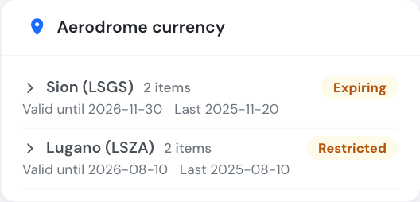

# Pilot currency checks

Flylogs aims to give you the safety and compliance tools you need for your daily operations. This tools should be easy and accesible without much trouble.\
For that reason, we have placed the typical pilot currency checker by default in the pilot profile page, to be visible effortless.


Every pilot profile page has a small widget on the left side, with the amount of flight hours, duty times and currency checker below.


This currency checker is just a total time and landings counter performed by this pilot in the time ranges you define.

You will always see number number of **BLOCK TIME HOURS** and **landings/approaches** performed as PIC, COPIC or DUAL in the following environments:

* VFR flights
* IFR flights
* Night

### Currency Configuration

Accessing your company settings with a Company Manager account, you will find the Pilot Currency Configuration parameters that allow you to enter the desired number of days.

By default the system will be set for 30 and 90 days as it is the most common requirement.

Change the number of days and it will automatically be applied. Now if you navigate to any pilot, the new currency check days will be displayed.

<figure><figcaption></figcaption></figure>

### Aerodrome and custom currency items

On Premium and Unlimited plans the pilot profile and the pilot's home page also show an **Aerodrome currency** card, for the airport qualifications and other items your company defined in [Company Settings](../company-management/company-settings/pilots.md#aerodrome-and-custom-currency). Each qualification shows a status badge, the date it is valid until and the date of the last qualifying flight. Open a qualification to see its items. Pilots see only their own card.

| Status | What it means |
| --- | --- |
| **Valid** | The requirement is met. |
| **Expiring** | Still valid, but ends within the warning period. The pilot is emailed. |
| **Restricted** | Past its validity but not yet lost, for example Lugano between 12 and 24 months (increased minima). |
| **Expired** | Past its validity. |
| **Lost** | Past the "lost after" limit: the qualification must be regained. |
| **Not qualified** | No (or too few) qualifying flights on record. |

When a booking touches an aerodrome with an item that is not valid, the booking shows a warning for that crew member. If your company turned on **Block pilots that do not meet established currency**, Expired, Lost and Not qualified items for the booking's aerodromes also stop that pilot being scheduled or confirmed as PIC (an instructor as supervisor allows a requalification flight).
