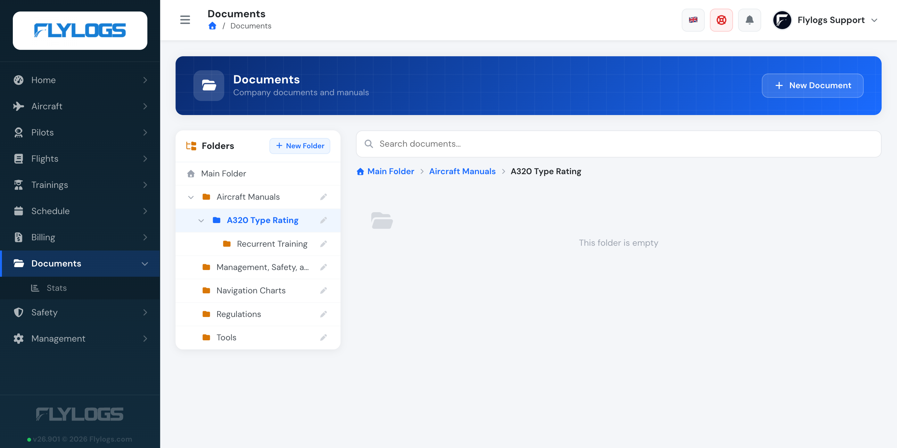
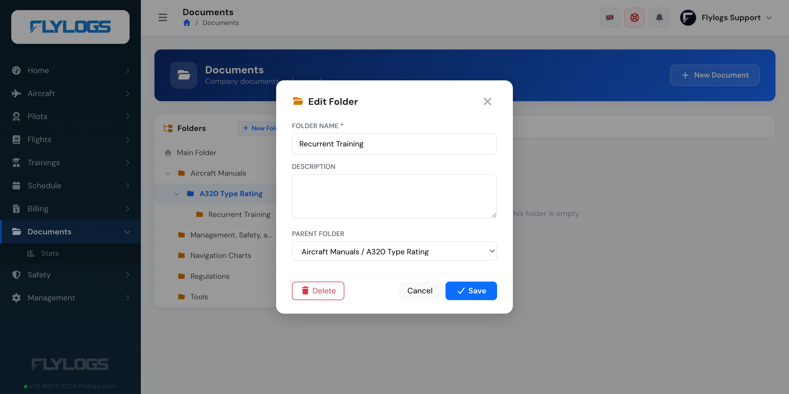
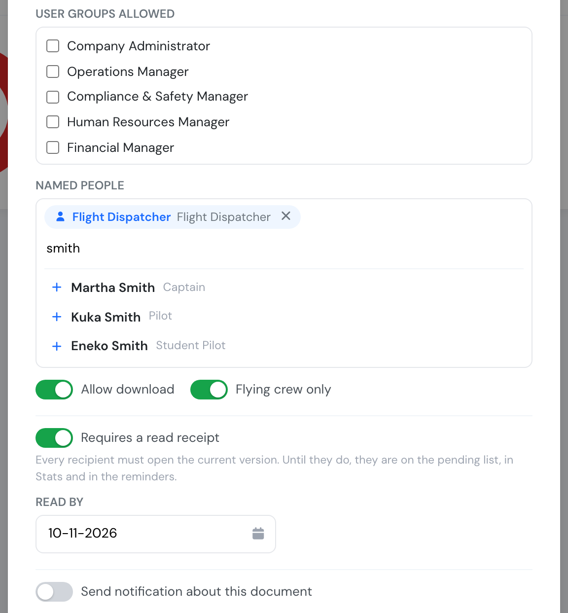
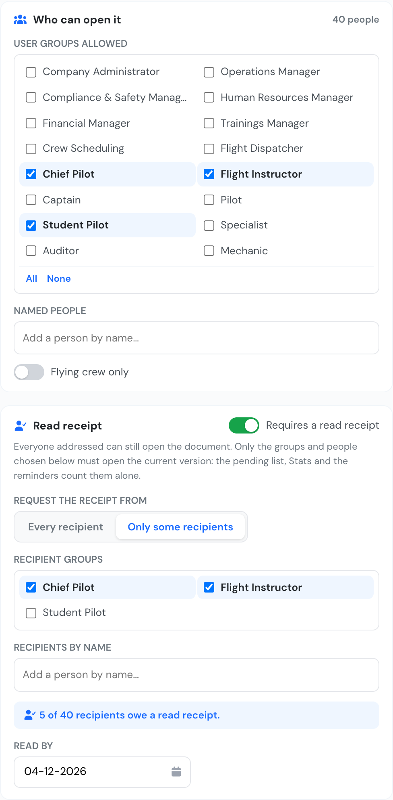

# Document Library

Discover all about the [Document Library here](https://flylogs.com/features/aeronautical-documentation)!

Flylogs Company Document Library is an embedded system in your Flylogs account that lets you store company manuals and other files and share them with the rest of your company.

The main features of the system are:

* Group level access privileges, plus named people
* Read receipts with an optional read-by date, and reminders
* File version control
* Download registry
* File folders

### How the index page works

The index page is the entry point of the library. It lists the documents and subfolders inside the current folder, with the **Main Folder** shown by default. Click any folder card to open it, or use the search box to look up a document by name across the whole library.

Each row shows the document name, description, latest version uploader and creation date. A quick download button is offered for the current version.

### File folders

For better organization, you can create folders for your documents, and folders can contain subfolders — up to 4 levels deep in total. Each document belongs to exactly one folder, at any level of the tree.

The sidebar shows the full folder tree. Folders with subfolders get an expand/collapse arrow, and the breadcrumb above the document list always shows the full path from the Main Folder down to wherever you're browsing.

Use folders and subfolders to separate operational manuals, training material, forms, etc. — for example an "Aircraft Manuals" folder holding one subfolder per aircraft type. The same access rules apply regardless of where in the tree a document lives.

> Publishing, editing and deleting documents, as well as creating, renaming, moving and deleting folders, is available to users in **group level 150 or lower** (administrators and managers, up to and including the Chief Pilot). Other users can browse and open folders and read the documents their group is authorized for, but won't see the publishing or folder management controls.

#### Creating and moving folders

Clicking **New Folder** creates the new folder inside whichever folder you're currently browsing — click into a folder first to create a subfolder there, or stay on the Main Folder to create a new top-level folder.

Editing a folder also lets you move it elsewhere in the tree via the **Parent folder** field, without touching the documents inside it.

A folder can't be moved into itself or into one of its own subfolders, and a move that would push it past the 4-level depth limit is not allowed.

#### Deleting a folder

Deleting a folder removes it and every subfolder nested inside it. Documents are never deleted this way — any document found anywhere in the deleted branch is moved to the Main Folder, where it stays fully accessible. A folder with subfolders shows a warning to that effect before you confirm.

#### Folder limit by plan

The number of **top-level** folders you can create depends on your company's subscription plan. Subfolders don't count against this limit — once you're at the cap, you can still organize further by nesting subfolders inside your existing folders.

| Plan | Top-level folders |
|------|---------|
| Free | 3 |
| Club Essentials | Unlimited |
| Premium | Unlimited |
| Unlimited | Unlimited |

On the Free plan, once you reach 3 top-level folders the **New Folder** button is disabled while browsing the Main Folder. Delete an existing top-level folder or upgrade your plan to add more. All paid plans have no folder limit.

### Group level access privileges

For each document you publish you choose who can access it: **user groups**, **named people**, or both. Permissions are evaluated when the index page is rendered, so users only see documents addressed to them.

* Users outside the recipient groups, and not named on the document, will not see it at all in the index.
* Documents marked as `flying_only` are hidden from non-pilots of the recipient groups. A person named on the document always sees it.
* Document owners always see their own documents in the index, regardless of the recipient list.
* Top-level company administrators (group level 105 or below) see every document in the company.

This filtering is applied **before pagination**, so search results and folder counts always reflect what the current user is allowed to see.

#### Named people

Under **Named people** on the New Document and Edit Document forms, type a name and pick the person from the list. Use it for an instruction meant for a few specific people, so it is not published to a whole group. A document needs at least one user group or one named person. Named people are notified, can open the document and owe a read receipt exactly like group members.

### Read receipts and read-by date

Each document says whether it **Requires a read receipt** (on by default, and on for every document published before this setting existed).

* **On** — every recipient must open the current version, or only some of them if you choose so under **Request the receipt from** (below). Until they do, they are on the document's pending list, in [Document Stats](document-stats.md) and in the reminders, and they see the document marked **Unread**.
* **Off** — for reference material such as aircraft manuals, posters or textbooks. Recipients can still open it, but nobody is asked for a receipt: the document stays out of the pending list, the Stats figures and the reminders.

A document that requires a receipt can also have a **Read by** date. Once that day has passed, every recipient who has not opened the current version is **overdue**: the document list, the document page and the Stats page show it in red. Publishing a new version resets everyone to unread, so set a new read-by date when you upload it.

#### Request the receipt from some recipients only

The recipients decide who can **open** a document. **Request the receipt from** decides who must **acknowledge** it, so a document can be open to many people and acknowledged by a few. A typical case: a standard operating procedure every student pilot must be able to read, where the receipt only matters from the instructors and the post holders.

When **Requires a read receipt** is on, choose under **Request the receipt from**:

* **Every recipient** — the default, and how every document published before this option behaves.
* **Only some recipients** — then tick the **Recipient groups** and add the **Recipients by name** the receipt is requested from. Only the groups and people already chosen as recipients are offered.

The form shows how many people owe a receipt, for example *5 of 40 recipients owe a read receipt*, so you can check the choice before saving.

<figure><figcaption>
Student Pilot, Chief Pilot and Flight Instructor can open the procedure; only the Chief Pilots and Flight Instructors owe a receipt.
</figcaption></figure>

Everyone addressed keeps opening the document as before, and their reads are still recorded in the download registry. Only the people the receipt is requested from:

* are on the document's pending list and counted in [Document Stats](document-stats.md);
* receive the reminders, manual and automatic;
* see the document marked **Unread** and its read-by date;
* are told the read-by date in the new-version notification (every recipient is still notified).

On the document page, managers see who the receipt is requested from next to the read-by date.

To chase the people who have not read a document, see [Manager tools → Reminders](manager-tools.md#reminders).

### File version control

Each time you update a published document you can publish the new version. Flylogs keeps old versions listed underneath the latest one, so they stay available for anyone with access to the document.

Every new version renews the cycle: every recipient needs to open the file again, and the download registry is reset for the new version.

### File size limit

Files up to **2 GB** can be attached anywhere in Flylogs — documents, flights, safety reports, maintenance jobs and the rest.

Large files upload directly to secure cloud storage, so they are not limited by the app server. A progress percentage is shown while a file is transferring. Very large files need a stable connection for the whole upload: if it is interrupted, it restarts rather than resuming.
