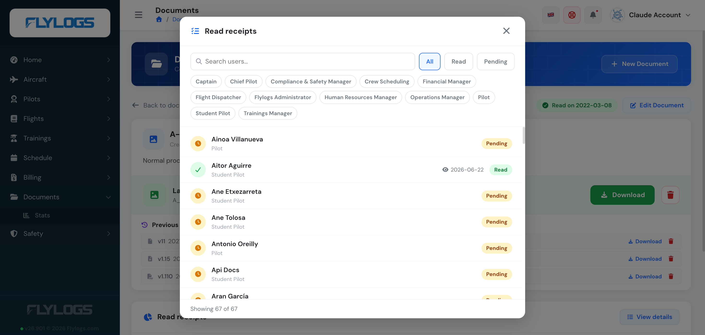
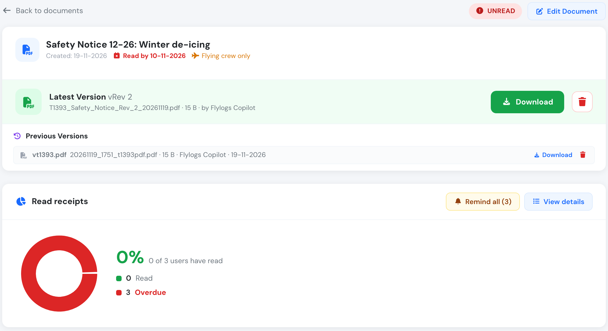
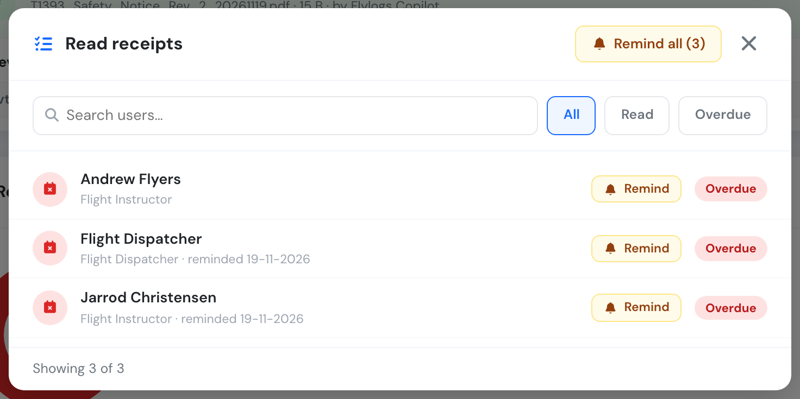

# Manager tools



Company managers have access to extra data on top of the regular document view, designed to help track who has read each document and to audit compliance with company publications.

> Manager tools are available to users in **group level 150 or lower** (administrators and managers). Pilots and other regular members do not see them.

### Download registry

For each document, managers can see the full read history of the current version — filterable by name and by user group, and split into **Read** vs **Pending** — including:

* User name and group
* Read date

Re-downloads by the same user are not duplicated — the registry reflects unique readers per version, which is the figure that matters for compliance.

### Pending users

Together with the download list, the view page shows a **Pending users** list — the recipients who have not yet opened the current version. The list is built from the document's recipient groups (pilots only, on a `Flying crew only` document) and its named people, minus the users that already opened it, excluding inactive and deleted accounts.

A document that does not **require a read receipt** has no pending list: the panel only says how many people opened it. See [Read receipts and read-by date](document-library.md#read-receipts-and-read-by-date).

### Read-by date and overdue receipts

When the document has a **Read by** date and that day has passed (on the company calendar), every receipt still pending is **Overdue**. The document page shows the date in red, the chart and the pending list label the unread users as overdue, and the [Document Stats](document-stats.md) page counts them.

### Reminders

The read receipts panel has a **Remind all** button, and the **View details** list has a **Remind** button next to each person who has not read the current version.

* A reminder is a Flylogs message (in-app, push and e-mail) with a link straight to the document and, when there is one, its read-by date.
* **Remind all** asks for confirmation first, and goes to everybody pending.
* Anyone already reminded about the same document in the **last 12 hours** is skipped, so pressing the button twice does not chase the same person twice. The confirmation says how many were sent and how many were skipped.
* Each pending person shows when they were last reminded.

Reminders are available to the same users who see the pending list (**group level 150 or lower**) and only on documents that require a read receipt.

For a reminder that goes out on its own, switch on **Remind unread documents on the 1st and 16th** in [Company Settings → General](../company-management/company-settings/general.md#document-library): twice a month, each person who still has documents to read gets one message listing them all, overdue first.

### Version reset

Publishing a new version clears the download registry and the comments for that document. From that moment, the **Pending users** list shows every recipient again and the cycle restarts. When you upload the new version from **Edit Document**, check the **Read by** date at the same time: an old date would make every receipt overdue straight away.

This guarantees that "downloaded" always refers to the current publication, never to an older one.

### Cross-company visibility

Because manager tools are tied to the company scope, managers see download data only for documents owned by their own company. There is no cross-company visibility, even for users that belong to multiple companies.

> Looking for the company-wide compliance dashboard across all documents? See [Document Stats](document-stats.md).
