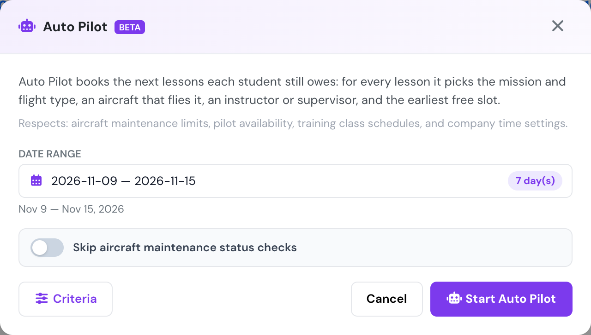
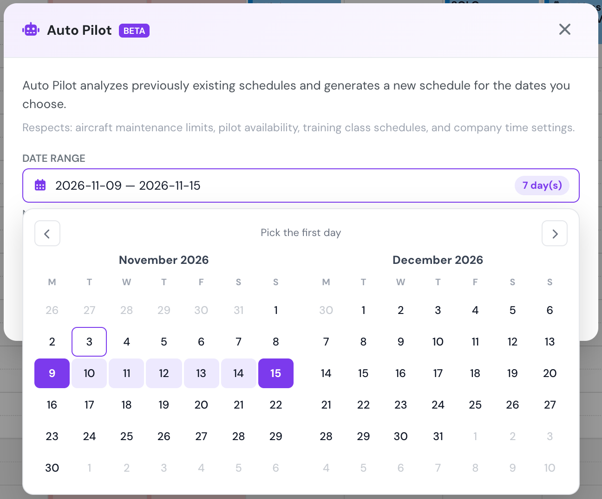
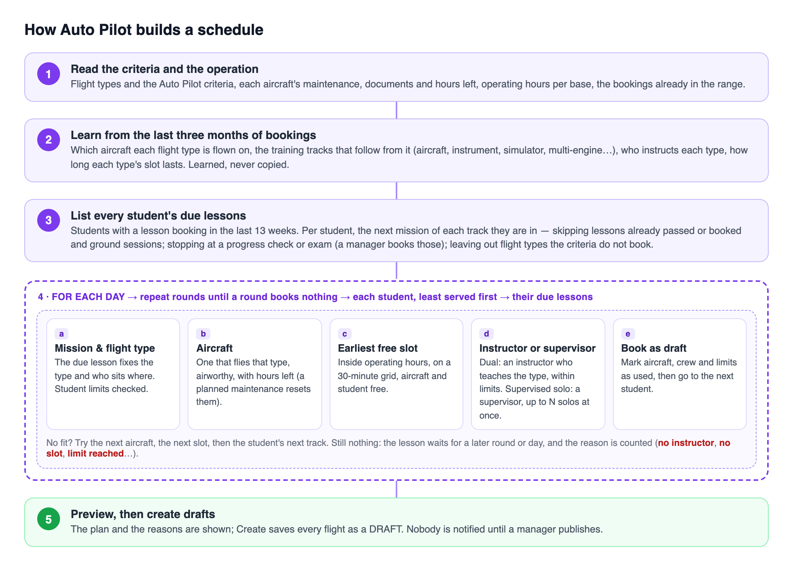
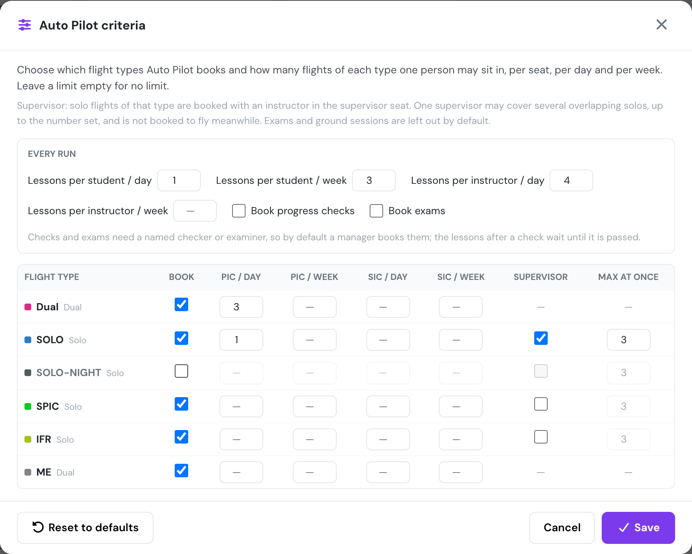

# Auto Pilot

Auto Pilot drafts a schedule for a date range you choose. It starts from the lessons each student still has to fly. For every lesson it chooses the mission and flight type, then an aircraft that flies it, then an instructor or supervisor, then the earliest free slot. Your [criteria](#criteria) set the limits at every step. Everything it creates is a **DRAFT**. Nobody is notified until you publish.

Open it from the **Schedule Manager** → **Actions** → **Auto Pilot**. It is available to managers and schedulers (user groups up to 140).

<figure><figcaption>
The Auto Pilot window opens on next week.
</figcaption></figure>

**Date range.** Pick the first and last day in the calendar. Any span up to 62 days works: one day, a long weekend, a fortnight. The window opens on next week. Weeks start on the **Start of week** set in [Company Settings → General](../company-management/company-settings/general.md), both here and in the calendar.

<figure><figcaption>
Choosing the range. Weeks start on the company's first day of the week.
</figcaption></figure>

## How Auto Pilot builds a schedule

<figure><figcaption>
The order Auto Pilot follows for every run.
</figcaption></figure>

Auto Pilot runs these steps in order:

1. **Read the criteria and the operation.** It reads your flight types and the Auto Pilot [criteria](#criteria). For each aircraft it reads the maintenance jobs, the documents and the hours left before maintenance. It also reads the operating hours of each base and the bookings already in the range. Existing bookings are never moved.
2. **Learn from the last three months of bookings.** From your real bookings (drafts and cancellations are ignored) it learns:
   * which aircraft each flight type is flown on;
   * the training **tracks** that follow from that;
   * who instructs each flight type;
   * how long a slot of each flight type usually lasts.

   Past weeks are only learned from. They are not copied into the new range.
3. **List every student's due lessons.** The students are everyone who had a lesson booking in the last 13 weeks. For each student, Auto Pilot takes the next mission of every track they are in. Missions are skipped when they are already passed or already booked, when they are ground sessions, or when their flight type is not booked by the criteria. A student's track stops at a progress check or an exam (see [Checks and exams](#checks-and-exams)).
4. **Book the lessons, day by day.** For each day of the range, Auto Pilot works in rounds. In every round, each student gets at most one lesson. Students who have been booked least in this run come first, then those who flew longest ago. For each lesson the student is due, it tries:
   1. **Mission and flight type.** The lesson sets the flight type and who sits where: the instructor as PIC and the student as SIC, the student as PIC with the instructor beside them, or the student alone. The student's daily, weekly and per-type limits are checked here.
   2. **Aircraft.** An aircraft that flies that flight type, is airworthy, has no maintenance in the way and still has hours left. A maintenance already on the schedule resets the hours. Aircraft with fewer hours booked in this run are tried first, so the work is spread across the fleet.
   3. **Earliest free slot.** Inside the base's operating hours, on a 30-minute grid. The aircraft and the student must both be free, and the student must be available (see [Who counts as available](#who-counts-as-available)).
   4. **Instructor or supervisor.** A dual lesson needs an instructor who has taught that flight type, is free, and is within their limits. Instructors who already fly that aircraft are preferred. A solo of a flight type set to **Supervisor** needs a supervisor (see [Supervision](#supervision)).
   5. **Book it as a draft.** The aircraft, crew and limits are marked as used, and Auto Pilot moves on to the next student.

   When nothing fits, Auto Pilot tries the next aircraft, the next slot, then the student's lesson on another track. If none of those works, the lesson waits for a later round or day. The build log ends with the reasons lessons were left unbooked, for example "no instructor free" or "student daily/weekly limit".
5. **Preview, then create.** You review the plan. **Create** saves every flight as a draft.

An operation where no student owes a lesson, such as a non-training operator, keeps the earlier behaviour. Auto Pilot copies the recurring pattern of the last four weeks and fills the free time on each aircraft.

### Who counts as available

Auto Pilot follows the **Require confirmed availability** setting in [Company Settings → Schedule](../company-management/company-settings/schedule.md):

* **Off (the default).** A student or instructor is available unless they are marked **Unavailable** or **Maybe** for the slot, are already booked, are on an OFF or REST day in the base roster, or are teaching a class. They do not need to enter an availability for the slot.
* **On.** Only people who entered **Available** or **Always** for the whole slot, or who are on DUTY or STANDBY in the base roster, are booked.

In both cases nobody is booked with expired licences, medicals or ratings, or without a valid type rating for an aircraft that requires one.

## What Auto Pilot books

**Lessons students still owe.** For each student, Auto Pilot reads their active training courses and picks the next lesson they have not completed and that is not already booked. A syllabus often runs several phases side by side, for example aircraft lessons, instrument lessons, simulator sessions and multi-engine lessons. Auto Pilot treats each of these as a separate **track**. A student can be given their next simulator session and their next aircraft lesson in the same week. Finishing a simulator session does not hold back their flying lessons.

* A track the student has not started yet only opens once everything listed before it in the course is done. A new student is not given the multi-engine phase on day one.
* A **solo** lesson is never booked while a dual lesson before it is still owed (for example the pre-solo check), even if that dual lesson is already booked.
* Lessons the student has moved past are not booked again. These are lessons listed earlier in the same track that were never logged, for example an opening ground session.
* A student who has not had a lesson booking for 13 weeks is not planned. Book their next lesson by hand once and Auto Pilot picks them up from then on.

### Checks and exams

Flight schools often give a progress check the same flight type as the lessons around it, so the flight type alone cannot say what is a check. Auto Pilot reads each mission's name and course and sorts it into one of these:

* **Lesson** — booked by Auto Pilot.
* **Progress check** — a stage check, phase test, evaluation or pre-solo check. Examples: "Prueba parcial", "EJ 14: Verificación previa al vuelo solo", "EX 9: Progress test".
* **Exam** — a skill test or check ride.
* **Ground** — never flown, so never booked.

The sorting is done by Flylogs AI from the mission name, in any language. When the AI is not sure, a fixed list of keywords decides. Each mission is sorted once and the result is stored, so later runs do not ask again. A mission that is renamed is sorted again.

By default Auto Pilot books neither progress checks nor exams, because they need a named checker or examiner. A manager books them. While a student still owes a check, the lessons after it in that track wait. Turn on **Book progress checks** or **Book exams** in the criteria to let Auto Pilot book them as ordinary lessons.

**Where each flight type is flown.** Auto Pilot learns from your last three months of bookings which aircraft each flight type is really flown on. For example, simulator sessions on the simulator, multi-engine lessons on the twins and instrument lessons on the IFR aircraft. It only places a lesson on those aircraft, or on another aircraft of the same model. This is in addition to any [aircraft restriction set on the flight type](../flights/flight-types.md#aircraft). Drafts and cancelled bookings are not learned from. The build log lists what was learned.

**Crew.** A dual lesson is booked with an instructor in the instructor seat. Auto Pilot picks someone who has taught that flight type before, preferring an instructor who already flies that aircraft. If no instructor is free, the slot stays open.

## Criteria

Press **Criteria** in the Auto Pilot window.

**Every run** sets the limits that apply across all flight types:

| Setting | Default | What it does |
| --- | --- | --- |
| **Lessons per student / day** | 1 | The most lessons one student gets in a day. |
| **Lessons per student / week** | 3 | The most lessons one student gets from Monday to Sunday, or from the **Start of week** your company uses. |
| **Lessons per instructor / day** | 4 | The most lessons one instructor teaches in a day. |
| **Lessons per instructor / week** | no limit | The same per week. |
| **Book progress checks**, **Book exams** | off | Let Auto Pilot book them itself (see [Checks and exams](#checks-and-exams)). |

The defaults come from a real school's schedule. 95% of its student days had one lesson, and 98% of its student weeks had three or fewer.

Then, per flight type:

<figure><figcaption>
Example criteria: an instructor flies at most 3 Dual lessons a day, a student 1 solo a day, solos get a supervisor who covers up to 3 at once, and night solos are left to the schedulers.
</figcaption></figure>

Next to each flight type, the window shows how Auto Pilot reads it from the flight type's seats: **Dual** (one seat logs instruction given, such as FI, or instruction received, such as dual), **Solo** (no instructor on board), **Exam** (an examiner seat) or **Ground** (no seat logs flight time).

| Setting | What it does |
| --- | --- |
| **Book** | Whether Auto Pilot may book this flight type at all. Exams (a flight type with an examiner seat) and ground sessions (no seat logs flight time) are off by default. |
| **PIC / day**, **PIC / week** | How many flights of this type one person may be PIC of per day and per week (Monday to Sunday). Empty = no limit. For example, set DM to 3 per day for the PIC (the instructor). |
| **SIC / day**, **SIC / week** | The same for the SIC seat. |
| **Supervisor** | Only for solo flight types. Solo flights of this type are booked with an instructor in the **supervisor** seat. |
| **Max at once** | How many overlapping solo flights one supervisor may cover. |

Limits also count the bookings already on the schedule in the same day and week, not only the ones Auto Pilot creates.

### Supervision

One instructor may supervise several solo flights that overlap, up to **Max at once**. While supervising, they are not booked to fly a lesson at the same time. When you set a supervisor by hand on an existing solo booking, Auto Pilot sees it and can add more overlapping solos for that instructor, up to the limit. If no instructor is free to supervise, the solo is not booked.

The criteria are saved for the whole company, so every manager running Auto Pilot uses the same ones. **Reset to defaults** turns every setting back to its default. Every flight type is booked unless it is an exam or ground session, with no limits and no supervisor. The run-wide limits go back to the defaults in the table above.

## Maintenance

Auto Pilot never books an aircraft that is grounded, inside a maintenance window, or whose airworthiness, insurance, registration, radio licence, weight and balance or avionics document has expired.

**Hours left before maintenance.** Auto Pilot keeps each aircraft within the flight hours left before its next maintenance. If that maintenance is already on the schedule, Auto Pilot assumes the hours start again from the job's finish and that a new CRS is signed at it. It keeps booking the aircraft after the maintenance, instead of dropping it for the rest of the range once the hours run out. The hours available after the job are the hours set on that job, or otherwise the same interval as the last completed one.

**Skip aircraft maintenance status checks** only relaxes the hours check. It never makes a grounded aircraft bookable.

## Reviewing the result

The preview lists every planned flight with its flight type, crew and supervisor. **Download PDF** exports it. The build log above the preview says how many students owed lessons, how many got at least one, and why the rest were left unbooked. Press **Create** to save the drafts, then review and publish them from the Schedule Manager.
