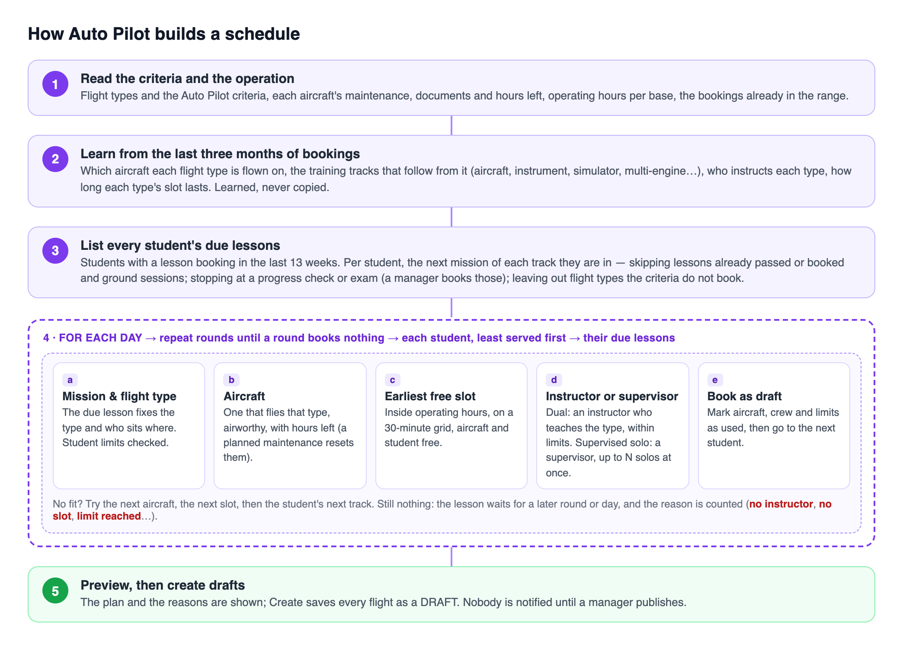
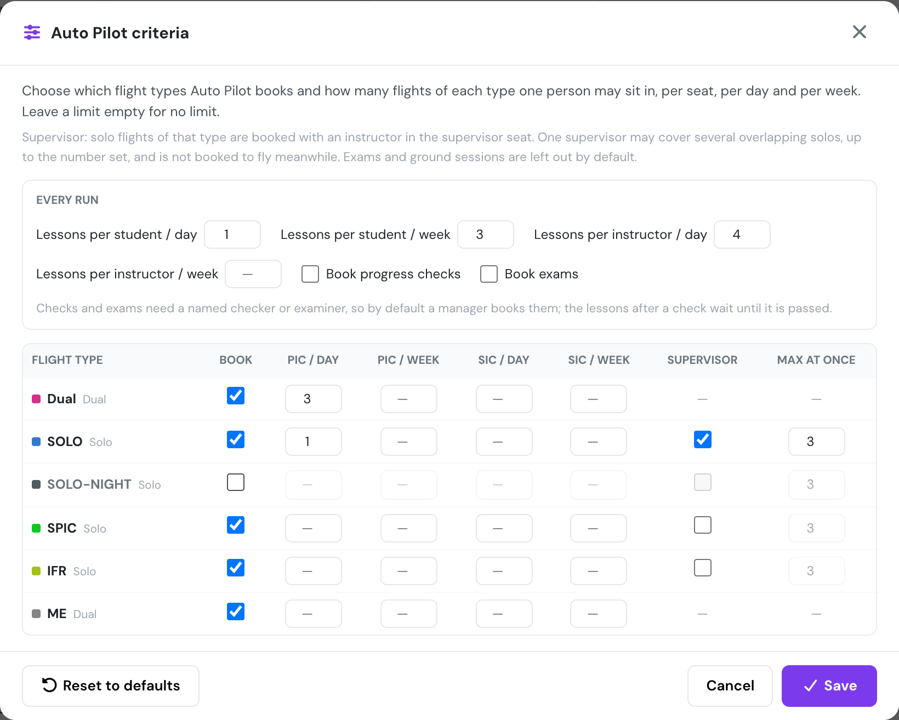
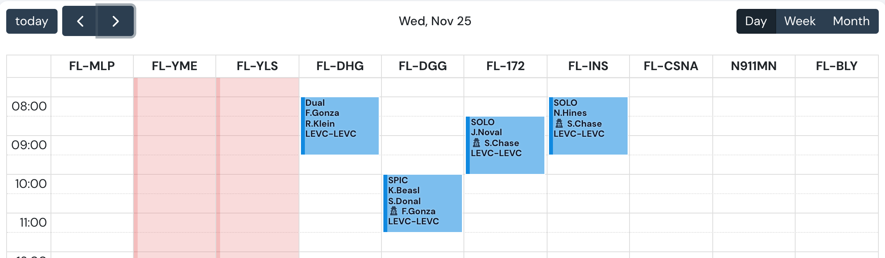

# Auto Pilot criteria and supervisors

**November 2026** · Schedules

Auto Pilot now plans from your students' training instead of copying past weeks. For each student it takes the next lesson of every phase they are in. It then finds an aircraft that flies the lesson, an instructor, and the earliest free slot. Progress checks and exams are left for a manager to book. A new **Criteria** window sets per flight type how many flights one person may fly per day and per week, and whether solo flights get a supervising instructor. The schedule calendar now shows that supervisor on each booking.

***

### What changed in Auto Pilot

**Lesson first.** The old Auto Pilot copied your last four weeks of bookings and tried to fit lessons into the copied slots. Whatever those weeks held came back, including exams and one-off flights, and students only got their real next lessons when a copied slot happened to suit them. Now every run starts from the lessons each student still owes. For each lesson Auto Pilot picks the mission and flight type, an aircraft, an instructor or supervisor, and the earliest free slot, in that order and within your criteria. Past bookings are only used to learn facts: which aircraft a flight type is flown on, who teaches it, and how long its slot lasts.

<figure><figcaption>
The order Auto Pilot follows.
</figcaption></figure>

**Parallel phases.** A course such as an ATPL runs aircraft lessons, instrument lessons, simulator sessions and multi-engine lessons side by side. Auto Pilot used to read the course as one straight line. A student who had finished a simulator session was then only ever offered simulator sessions, and their pending aircraft and instrument lessons were never booked. Now each student gets the next lesson in every phase they have started, so a week can mix SIM, SPIC, IFR, DM and ME lessons the way your own schedule does.

**The right aircraft.** Auto Pilot learns from your bookings which aircraft each flight type is flown on, for example simulator sessions on the simulator, multi-engine on the twins and instrument lessons on the IFR aircraft. It only places lessons there.

**Checks and exams left to you.** Flylogs AI reads each mission's name and recognises progress checks ("Prueba parcial", pre-solo checks), exams and ground sessions, even when they share a flight type with ordinary lessons. By default Auto Pilot books none of them, and the lessons after a check wait until it is passed. Flight types with an examiner seat are left out too.

**Planned maintenance.** When an aircraft is close to its maintenance hours and the maintenance is already on the schedule, Auto Pilot keeps booking it after the maintenance instead of leaving it empty for the rest of the range.

***

### Criteria

<figure><figcaption>
The Criteria window, opened from Auto Pilot.
</figcaption></figure>

Set run-wide limits: lessons per student and per instructor, per day and per week, and whether progress checks and exams may be booked. Then, per flight type, choose whether Auto Pilot books it, the most flights one person may fly as PIC or SIC per day and per week, and for solo types whether a supervisor is added and how many overlapping solos one supervisor may cover. The criteria are saved for the whole company.

***

### Supervisors on the calendar

<figure><figcaption>
Two solo flights supervised by the same instructor at the same time.
</figcaption></figure>

Every booking with a supervisor now shows them on the calendar block behind a 🕵 icon. On a flight with no SIC, the supervisor takes the SIC's line, because they are directly supervising the PIC.

***

### Same week everywhere

Auto Pilot and **Clear Week** now use the same date range calendar. Both open on a week that starts on the **Start of week** set in Company Settings → General, and so does the schedule calendar.

[Read the Auto Pilot manual →](../../schedules/auto-pilot.md)
