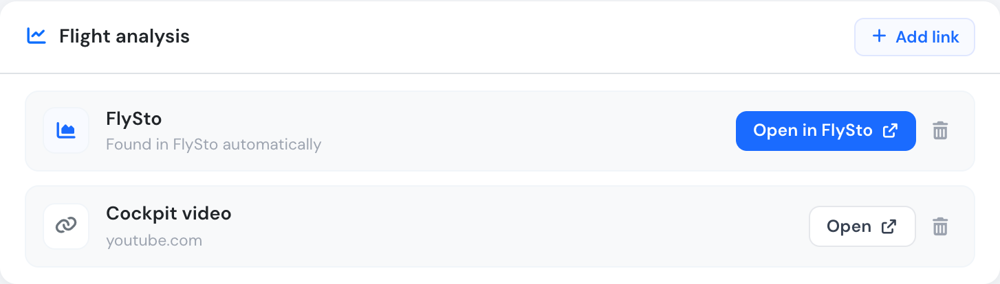
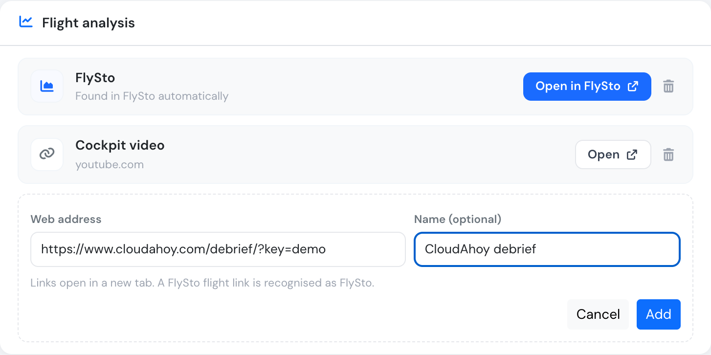

# Flight analysis

The **Flight analysis** card on a flight holds links to where the flight is analysed or debriefed: its FlySto analysis, a CloudAhoy debrief, a cockpit video, or any other page. Each link opens in a new tab, so the instructor and the student can go from the flight record straight to the debrief.

<figure><figcaption>
A flight with its FlySto analysis and a video.
</figcaption></figure>

The card sits on the flight page, below the training missions, where the flight is debriefed.

## FlySto links

When your company has connected FlySto (see [Integrations](../company-management/company-settings/integrations.md#flysto)), Flylogs finds the FlySto analysis of each flight by itself. The link shows **Found in FlySto automatically** and an **Open in FlySto** button. It usually appears within an hour of the avionics data being uploaded to FlySto.

FlySto pages need a login to your school's FlySto account. Student pilots see FlySto links only when your company has turned on **Show FlySto links to student pilots**; instructors and staff always see them.

## Adding a link by hand

Use this for a flight FlySto could not match, or for any other page about the flight.

1. Open the flight and find the **Flight analysis** card.
2. Click **Add link**.
3. Paste the full web address (it must start with `https://` or `http://`).
4. Optionally give it a name, such as *CloudAhoy debrief*. Without a name, the link shows the website's name.
5. Click **Add**.

<figure><figcaption>
Adding a CloudAhoy debrief to a flight.
</figcaption></figure>

If you paste the address of a FlySto flight (`https://www.flysto.net/logs/…`), Flylogs recognises it and shows it as a FlySto link. A FlySto flight can be linked to only one Flylogs flight: if it is already on another flight, remove it there first.

## Removing a link

Click the bin next to the link and confirm with **Remove**. A FlySto link you remove is not linked again by the hourly FlySto check, so you can remove a wrong match and add the right FlySto flight by hand.

## Who can add and remove links

| Who | Can add and remove links |
| --- | --- |
| Managers, operations and office staff, chief pilots and flight instructors | On any flight of the company |
| Pilots, student pilots and other crew | Only on flights they flew (as PIC, SIC or supervisor) or logged themselves |
| Everyone who can open the flight | Sees the links (FlySto links: see above for student pilots) |

Links by hand are available on every plan. Finding FlySto flights automatically needs the FlySto integration, which is part of the **Premium** and **Unlimited** plans.
