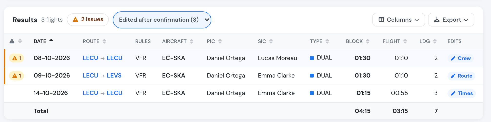

# Flight audit and reporting

### Logbooks

You may download all of your flight information in a logbook format, with the option to filter by dates, aircraft, crew, or type of flight.

The downloaded XLS Excel Spreadsheet will have the standard logbook format and can be downloaded from the following pages:

* Flights page
* Pilot profile pages
* Aircraft details pages

### Audit tool

To have a better understanding of your flight data, Flylogs has created a powerfull filtering page, in which you can view flights by:

* Date of confirmation
* Date of flight
* Date of last changes

Additional filters, allow you to get closer to your goal by filtering the following:

* Crew
* User that created the flight
* FI that supervised the flight
* Aircraft
* Flight type
* Base

#### How the Crew filter works

When you filter by **Crew**, a pilot is matched to a flight only in the role for which that flight earns them logged time, exactly as it appears in their logbook. Each flight type defines whether the PIC, SIC (co-pilot) and supervisor positions earn flight time:

* If a pilot flew a flight type as **PIC** and that type grants PIC time, the flight is included.
* If they flew it as **SIC** and that type grants SIC time, the flight is included.
* If they **supervised** a flight (e.g. a student's solo) and that type grants supervisor time, the flight is included.
* If a position does **not** earn time for that flight type, the flight is not shown under that pilot — matching what their logbook records.

This means the audit totals always match the pilot's logbook. To review flights specifically by the instructor who supervised them, use the **FI that supervised the flight** filter instead.

> **Note:** Draft flights are not included in audit results. A pilot can see their own drafts in their logbook, but drafts are excluded from the audit until they are confirmed.

The results display a summary of flight time, landing, aircraft and crew. Then, a complete list of all the flights is displayed alogn with some summary charts for better understanding of the search results:

<figure><figcaption></figcaption></figure>

#### Edits after confirmation

Every edit of a confirmed flight is logged with the reason the editor typed (see [Audit trails](audit-trails.md)). The **Edits** column shows what each edit was about, read from that reason and from the fields that changed:

| Badge | The edit changed |
|---|---|
| Times | Block, take-off or landing times, Hobbs, night or IFR time |
| Crew | PIC, SIC, student, instructor or supervisor |
| Aircraft | The aircraft |
| Route | Departure or arrival airfield, route, landings, fuel |
| Training | The training mission, exercises, grades or debriefing |
| Flight type | The flight type, flight rules, or how the time is classified |
| Billing | Bill-to, rate or price |
| Notes | Only remarks, comments or attachments |

Hover over a badge to see each edit's date and the reason exactly as typed. An edit whose reason says too little to sort shows as **Edited**.

Use the selector next to the results count to show only the flights **edited after confirmation**, or only those edited for one reason, for example every flight whose crew was changed after it was confirmed.

<figure><figcaption>
Flights edited after confirmation, with what each edit was about.
</figcaption></figure>

The sorting is automated and runs in the background, so a very recent edit can take up to an hour to get its badge. The logged edit itself, including who made it, when, and the reason typed, is never changed. You can turn the column on or off from **Columns**.
