# Flight legs



Some operations fly several short sorties inside one flight record: a skydiving aircraft flies lift after lift, a tug tows glider after glider, a survey aircraft flies run after run. **Legs** let you record each sortie in its own row, instead of typing them all into Remarks.

Each leg has the same, fixed columns, whatever the operation:

| Column | What goes in it |
|---|---|
| **#** | The leg number, 1, 2, 3… in the order you recorded them. |
| **Start / End** | When the sortie started and ended. Tap the green **Now** to stamp the start, the red **Now** to stamp the end. |
| **Airborne** | Worked out for you from Start and End. |
| **Altitude** | In feet (**ft**) or as a flight level (**FL**), for example the exit altitude of a lift. |
| **Persons** | The people for this leg, for example jumpers dropped. |
| **Uplift after this leg** | Fuel added after this leg, in your company's uplift unit (for example litres). Shown when the aircraft tracks fuel. |
| **Fuel on board, start / end** | The fuel gauge reading when the leg started and ended, in the aircraft's gauge unit (for example lbs). Optional. Shown when the aircraft tracks fuel. |
| **Fuel used** | Worked out for you from the fuel on board, never typed. See [Fuel](#fuel). |
| **Notes** | Anything else about this leg, for example "engine start, ITT 720 °C". |

Legs fill in parts of the flight for you: its times, block time and landings (see [Legs and the flight's times](#legs-and-the-flights-times)). You can still change any of them on the flight. Passengers stay as you enter them, and **Remarks** is still there for any other comments.

## Who can use legs

* Flight legs are available on every paid plan (**Club**, **Premium**, **Unlimited**) and during the **30-day trial**, for every type of company. They are not available on the **Free** plan.
* **Whoever can edit a flight can edit its legs.** No extra permission is needed:
  * Company Administrators, Operations Managers and Compliance & Safety Managers can always edit legs.
  * On a **draft, scheduled or dispatched** flight: users whose role has **Create flights**, if they are the flight's PIC or the person who logged it, or their role also has **Edit & delete flights**.
  * On a **confirmed** flight: users whose role has **Edit & delete flights**, or the flight's PIC or the person who logged it, for **12 hours** after off-blocks.

If your company moves to the Free plan, legs already recorded stay visible on the flight page, but they can no longer be added or changed.

## Adding legs

Legs have their own **Legs** card in the flight form, right above the flight times. If you don't use them, the card is a single line with a **+ Add leg** button and never gets in the way of saving a flight.

<figure>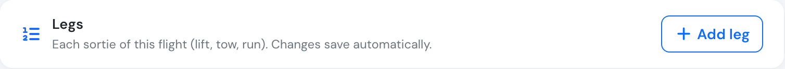<figcaption>
The Legs card on a flight with no legs yet.
</figcaption></figure>

1. Open the flight (or start a new one) and tap **+ Add leg**.
   * If the flight hasn't been saved yet, Flylogs saves it first. If something required is missing, the form shows what to complete and the leg is not added until the flight can be saved.
2. Tap the green **Now** next to **Start** when the sortie begins, and the red **Now** next to **End** when it's over. You can also type the times.
3. Fill in altitude (pick **ft** or **FL**), persons, fuel and notes as needed.

There is no Save button for legs: **every change is saved as you make it**, and a small message confirms it ("Leg 3 saved").

**The next leg repeats the last one.** A new leg starts with the previous leg's altitude, unit and persons, because most sorties of one flight look alike. Usually you only tap **Now** twice and correct the number of persons. Its **fuel on board at start** is filled in for you too: the previous leg's end plus the fuel uplifted after it (the first leg takes the flight's start fuel). Times, end fuel, uplift and notes always start empty.

The form is built for phones and tablets in the cockpit: large buttons and number keypads, so a leg takes a few seconds at each ground stop.

<figure>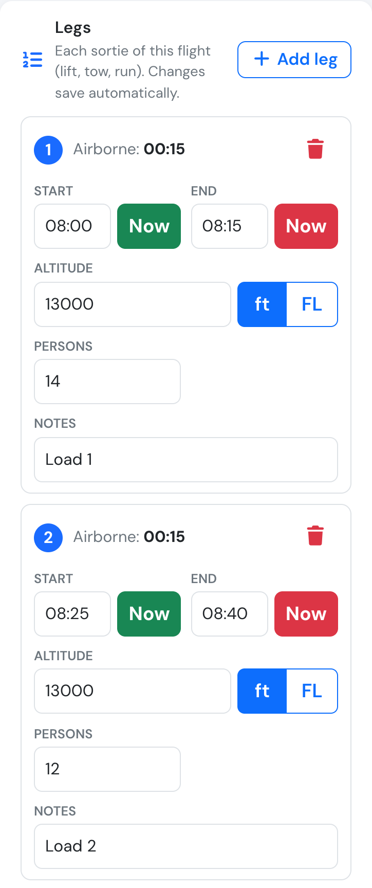<figcaption>
Two legs on a phone.
</figcaption></figure>

### Overlapping legs

A leg can't start before the leg above it has ended. If you enter a start time that does, the leg shows a warning, for example "Starts at 08:35, before leg 2 ends (08:40)", with a button to fix it: **End leg 2 at 08:35** sets the end of the leg above to this leg's start. You can also correct either time yourself; the warning goes away once the times no longer overlap.

If a leg starts even before the leg above it started, the legs are out of order: the warning asks you to check the times, with no automatic fix.

<figure>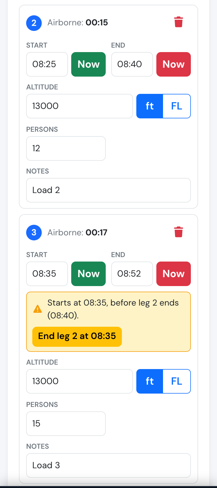<figcaption>
Leg 3 starts before leg 2 ends. One tap ends leg 2 at 08:35.
</figcaption></figure>

### Deleting a leg

Tap the bin icon on the leg. It disappears straight away and a message offers **Undo** for a few seconds; tap it to bring the leg back exactly as it was. The remaining legs are renumbered.

<figure>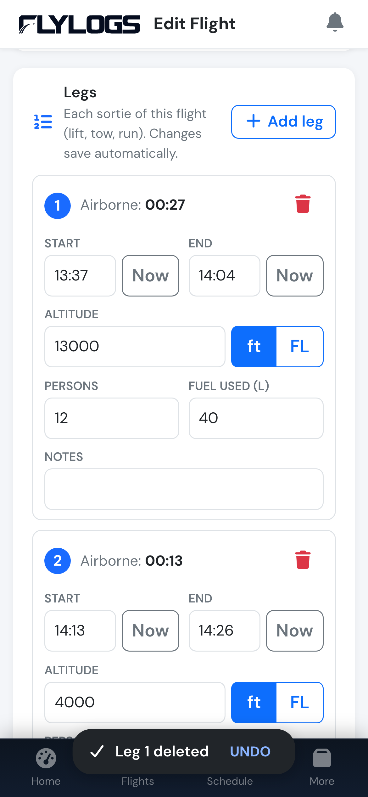<figcaption>
A deleted leg, with Undo.
</figcaption></figure>

### Legs and the flight's times

While you edit the flight, the legs fill in its times and landings. Remember to **Save** the flight to keep these changes (legs themselves save on their own).

* **Off-blocks and takeoff**, when empty, take the first leg's start. **Landing and on-blocks**, when empty, take the last leg's end. They keep following the legs until you type a time of your own.
* **Block time** becomes the total airborne time of the legs every time that total changes. The off-blocks and on-blocks times are not changed. A notice under the times tells you each time it happens.
* **Flight time** is never longer than the block time: if it is, it is set equal to the block time, and the notice says so.
* **Landings:** each leg added with **+ Add leg** counts one landing. The first leg is the flight's own landing, so a flight with 3 legs has 3 landings. Deleting a leg does not change the landings.

You can still change the block time, flight time and landings by hand at any time.

<figure>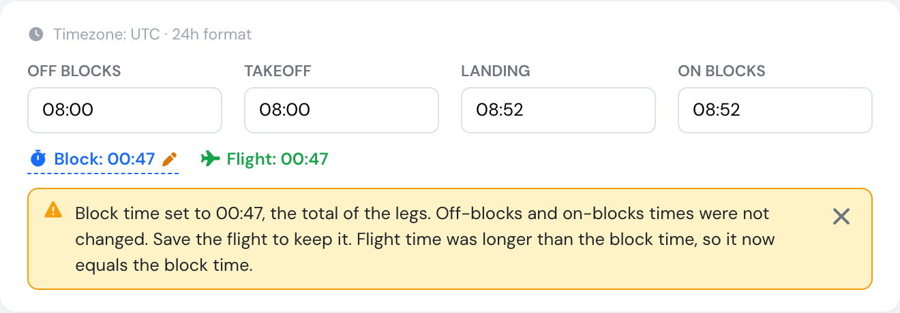<figcaption>
Times filled in from the legs, and the notice after block time was set to the legs' total.
</figcaption></figure>

Legs added through the API do not change the flight on their own; the times are filled in the next time someone edits the flight in Flylogs.

### Changing the flight date

If you change the flight's date after adding legs, the legs move with it: each keeps its clock time on the new date, and the change is saved straight away.

## Fuel

Pilots never type fuel used. They record what they read on the gauge and what they put in the tank, and Flylogs works out the rest:

> **Fuel used = fuel on board at start + fuel uplifted between legs − fuel on board at end**

* **Fuel on board at start / at end** are on the flight form, next to the fuel uplift. Read the gauge at engine start and at shutdown. They are in the aircraft's **gauge unit**.
* **Uplift after this leg** is on each leg, in your company's **uplift unit**. Record every top-up between lifts on the leg it came after: "after leg 3, 400 litres".
* Fuel added **before the first leg** is part of the start fuel: read the gauge after refuelling. Fuel added after the last leg is outside the flight; it is still billed (see below) but not counted as used on this flight.
* If you leave the flight's start or end fuel empty, the first leg's start and the last leg's end are used instead.
* **Per leg:** fill in fuel on board at a leg's start and end, and that leg gets its own fuel used as well.

Fuel used is shown in the uplift unit, on the form while you type, on the flight page, in the PDF and in the logbook export.

<figure>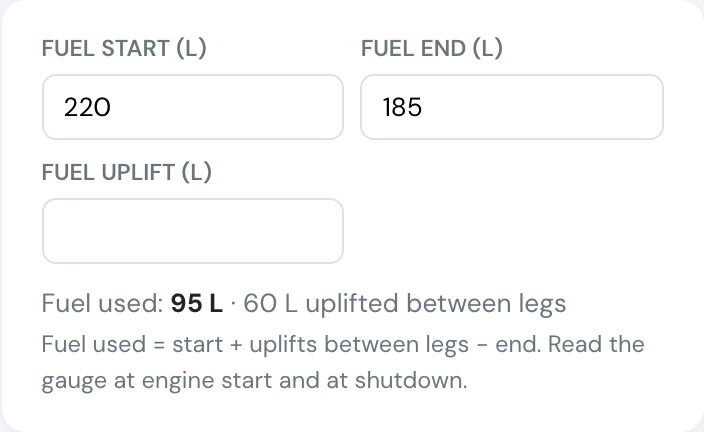<figcaption>
The fuel card on the flight form: gauge readings in pounds, fuel used worked out in litres.
</figcaption></figure>

<figure>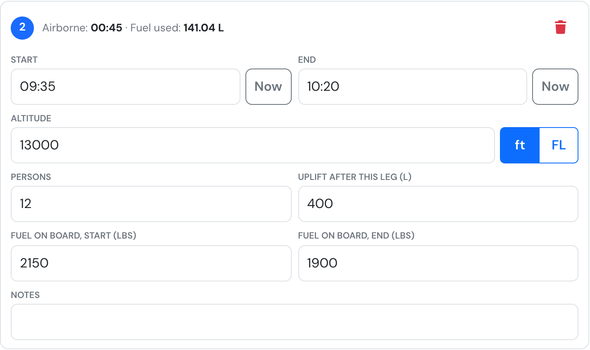<figcaption>
Leg 2: fuel on board at its start and end, and the 400 L uplifted after it. Its own fuel used is in the header.
</figcaption></figure>

### Gauge in pounds, refuelled in litres

Many turbine aircraft read fuel in pounds but buy it in litres. Two settings cover it:

* **Uplift unit**, once for the whole company (**Company Settings → Aircraft → Fuel**): the unit your company buys fuel in, for example **Litres**. Leave it on "Same as each aircraft's fuel tracking unit" when every aircraft is refuelled in the unit its gauge reads.
* **Fuel tracking**, on each aircraft (**Aircraft → Edit**, card **Logbook and Maintenance**): the gauge unit, for example **Pounds**. The aircraft form shows the company's uplift unit next to it.
* **Fuel type**, on each aircraft: required when the gauge unit and the uplift unit are a weight and a volume, because converting pounds to litres needs the fuel's density (Jet A-1 is 0.804 kg/l, AVGAS 0.72 kg/l). Without it Flylogs shows "Set the aircraft's fuel type" instead of a figure, never a guess.

Example: 1,500 lb at start, 400 l uplifted after leg 1, 1,100 lb at end, Jet A-1. The 400 lb burned from the tank are 181.4 kg, or 225.7 l, so fuel used is 225.7 + 400 = **625.7 l**.

### Statistics

Fuel used feeds the aircraft's **Consumption** chart: a month whose flights have fuel on board at start and end shows the fuel actually burned per block hour (a filled dot), and a month without readings keeps the estimate from uplifts, a 6-month average (a hollow dot). The [consumption check](../billing/fuel-and-excise.md) on Fuel & Excise uses measured burn the same way, and the [aircraft logbook export](../aircraft/aircraft-logbook.md#downloading-the-logbook) has fuel start, end, uplift and used per flight.

<figure>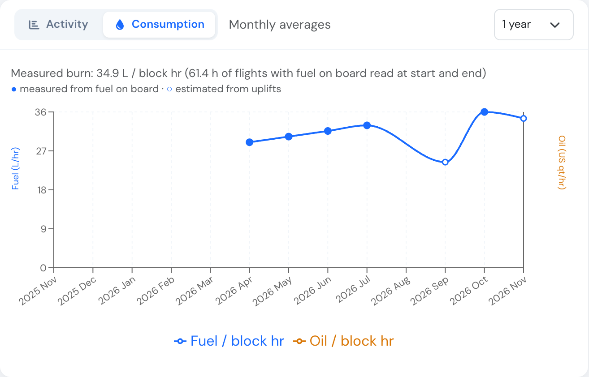<figcaption>
The Consumption tab on the aircraft page. Filled dots are measured from fuel on board, hollow dots estimated from uplifts.
</figcaption></figure>

### Billing

Every uplift after a leg is added to the flight's refuelling on **Billing → Fuel & Excise**, together with the flight's own fuel uplift, so nothing has to be typed twice. See [Fuel & Excise](../billing/fuel-and-excise.md).

## No signal

Legs work without a connection. The message then says "Leg 3 saved offline", and the leg is sent automatically as soon as the device is back online, together with any [offline flights](offline-flight-data.md). You can keep adding and changing legs in the meantime: only the latest version of each leg is sent.

> Queued legs belong to the signed-in user. Get back online before signing out, or the legs that have not been sent yet are discarded.

## On the flight page

The flight page shows a **Legs** table with every leg and the totals: number of legs, total airborne time, persons, fuel used and fuel uplifted. Under each leg's fuel used are its gauge readings (start → end) and the uplift after it. The flight's details show fuel on board at start and end, the uplifts and the flight's fuel used.

<figure>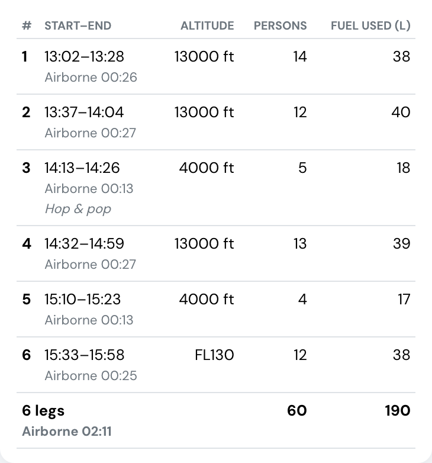<figcaption>
The Legs table on the flight page, with totals.
</figcaption></figure>

<figure>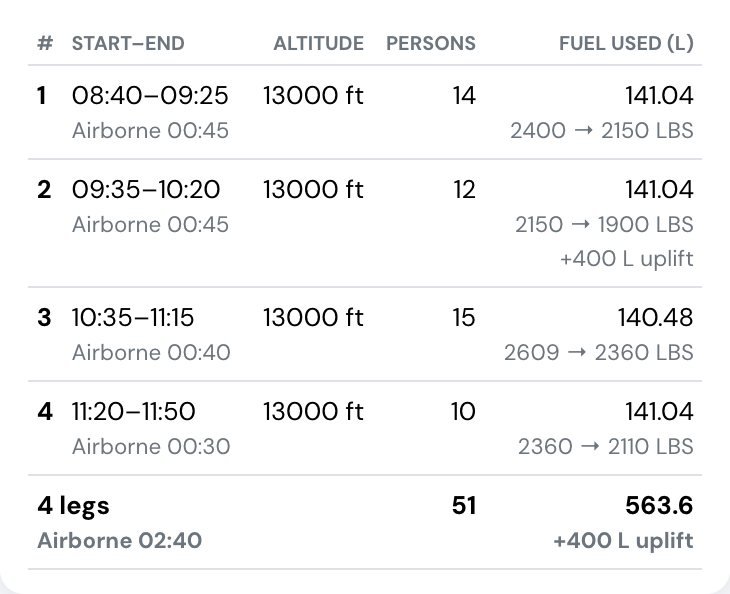<figcaption>
On an aircraft that tracks fuel, the Fuel used column carries each leg's gauge readings and the uplift after it.
</figcaption></figure>

<figure>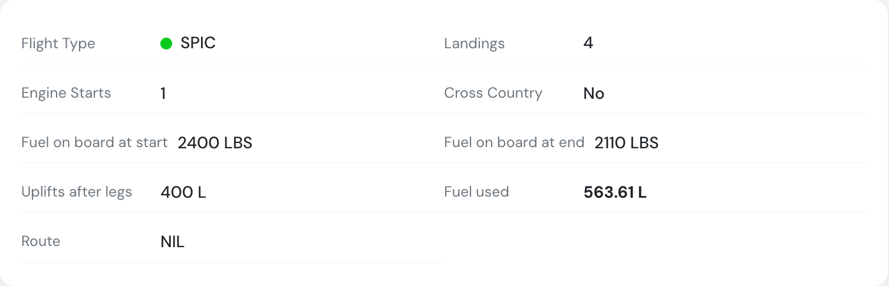<figcaption>
The flight's fuel in its details.
</figcaption></figure>

## Confirming the flight

When a flight has legs, the confirmation window is wider and lists every leg next to the flight's times: start and end, airborne time, altitude, persons and notes, with the totals underneath. Check them before you sign.

<figure>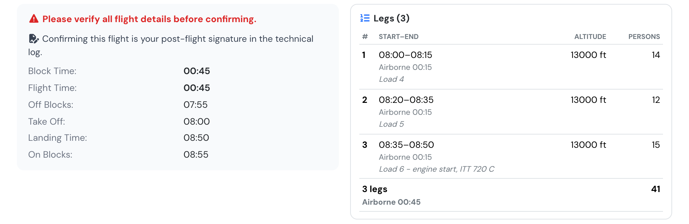<figcaption>
The confirmation window of a flight with 3 legs.
</figcaption></figure>

## In the PDF and the logbook export

* **Flight PDF** (Print on the flight page): legs are a **Legs** section with the same columns and totals (fuel start, fuel end, fuel used and uplift after each leg), before the remarks. The flight's fuel on board, uplifts and fuel used are in the aircraft and operations section.
* **Logbook export (XLS)** from the Flights list or Flights audit: when any exported flight has legs, the workbook gets two more sheets:
  * **Legs**: one row per leg with the flight's date, aircraft and PIC, its fuel on board at start and end, fuel used and uplift after it, and the fuel units.
  * **Legs by day**: for each date and aircraft, the number of flights and legs, total airborne time, persons, fuel uplifted after legs and the flights' fuel used. For a skydiving operation that is lifts, jumpers and fuel per day.

## Change history

Once a flight is **confirmed**, every leg added, changed or deleted is recorded in the flight's change history, for example "Leg 2 updated: altitude, persons". Changes you make within 30 minutes are grouped into a single entry.

_For developers: see [Flight legs in the API](../API/flight-legs.md)._
