# Flight Types

**Flight types** classify every flight by purpose (Training, Ferry, Rental, OPC…) and drive a surprising amount of the system: how logbook time is credited to each crew member, what the flight form pre-fills, whether a slot can be booked, and which certificates the crew must hold. Getting them right once means the rest of Flylogs behaves correctly for every flight of that kind.

Each flight type belongs to your company. A starter set is created automatically when you sign up (tailored to your operation — school, commercial, special operations), and you can add, edit, reorder or remove them at any time. Every starter type requires a **licence** and a **Class 1 medical** for the PIC seat; change that under [Required certificates](#required-certificates) if your operation needs something else.

## Where to configure

**Flights → Flight types.** Click **New Flight Type** to add one, or the pencil on a row to edit it — both open a **full page**, not a pop-up, so there is room for every setting and you can link straight to a type. Drag rows by the handle at the left to change their order.

<figure>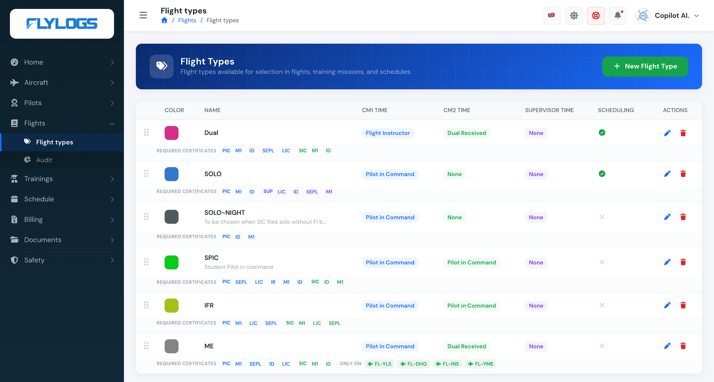<figcaption>
Each row shows the three seats' time classification, whether the type is offered on scheduling, and — in the grey strip below it — the certificates required per seat and the aircraft the type is restricted to. Here <em>ME</em> reads <strong>ONLY ON FL-YLS, FL-DHG, FL-INS, FL-YME</strong>, the four twins; every other type carries no aircraft tag, so it flies with the whole fleet.
</figcaption></figure>

Flight types live in the manager area, so pilots and students never see this page; which of your staff roles can open it is decided by your company's role permissions. Reordering is stricter than the rest: only **Company Administrators, Operations Managers and Compliance & Safety Managers** can do it, so a manager who can create and edit types may still be unable to drag them into a new order.

## Naming: the three seats

Flylogs has exactly **three crew seats** on a flight, and the flight type sets what each one logs. The labels differ between the flight types page and the flight form, which is worth knowing before you go looking for a field that seems to be missing:

| Seat | Flight types page | Flight form |
|------|-------------------|-------------|
| First crew member | **CM1 Time** / **CM1 Role** | **CM1** |
| Second crew member | **CM2 Time** / **CM2 Role** | **CM2** |
| Third, non-operating seat | **Supervisor Time** / **Supervisor Role** | **Supervisor**, **Examiner** or **Specialist** |

The third seat is renamed to match your operation, from your company type: **Examiner** for general aviation companies, **Specialist** for special-operations companies, and **Supervisor** everywhere else. It is the same field and the same `Supervisor Role` setting in all three cases.

<figure>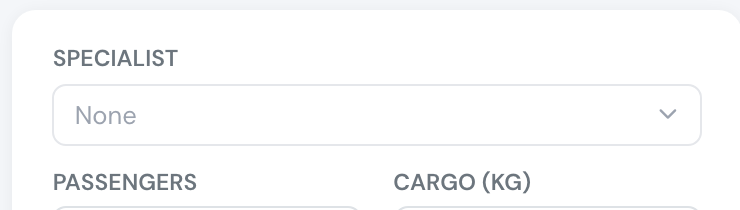<figcaption>
The third seat on the flight form — here labelled <em>Specialist</em>, because this is a special-operations company. It is the seat the flight type's <strong>Supervisor Role</strong> applies to.
</figcaption></figure>

## Options

<figure>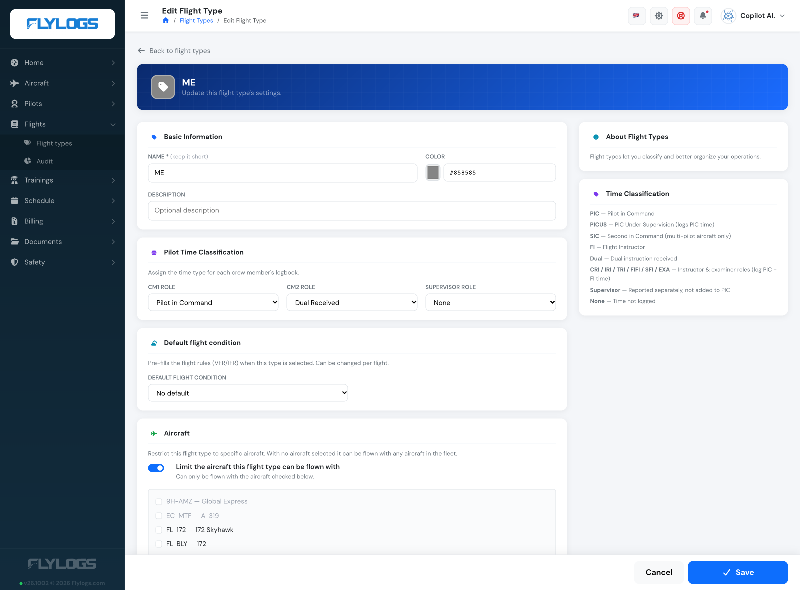<figcaption>
The flight type page. Each group of settings sits on its own card, so you can jump to the one you came for instead of reading down a single long form. The panel on the right stays in view and repeats what each time classification credits.
</figcaption></figure>

### Name

A short label shown wherever the flight type appears (flight form, schedule, logbook, reports). Keep it brief — it's rendered as a compact badge.

### Color

A colour used for the flight type's badge on the calendar, schedule and lists, so different operations are easy to tell apart at a glance. Pick one manually or let Flylogs derive it from the name.

### Description

Optional free text to remind managers what the type is for. Shown under the name in the flight types list.

### Pilot time classification

The most important setting. For each of the three seats — **CM1 Role**, **CM2 Role** and **Supervisor Role** — you choose *how the time flown on this flight type is credited to that person's logbook*:

| Value | Credits |
|-------|---------|
| **PIC** | Pilot in Command time |
| **PICUS** | Counts toward the pilot's **PIC** total; also reported separately |
| **SIC** | Second in Command time — **only credited on multi-pilot aircraft** |
| **FI** | Counts toward **PIC and FI** totals; also reported separately |
| **Dual** | Dual instruction received |
| **CRI / IRI / TRI / FIFI / SFI / EXA** | Instructor & examiner roles — count toward **PIC and FI** totals; each also reported separately |
| **Supervisor** | Reported separately only — **not** rolled into PIC or FI |
| **None** | Time is not logged for that seat |

So a **Training** type is typically CM1 = *FI* (the instructor logs PIC + FI time) and CM2 = *Dual* (the student logs dual received); a **Rental** type is CM1 = *PIC*, CM2 = *None*.

> **Multi-pilot only:** *SIC* time is credited only when the aircraft is marked multi-pilot. On single-pilot aircraft a seat set to SIC logs no time. (This preserves the behaviour of the retired *Copilot* classification.)

> **None still means "on the crew".** A classification of *None* stops the **logbook time** for that seat. It does not remove the person from the flight: they are still crew, the flight still appears in their records, and — see below — the flight still shapes their duty day.

### Time classification and duty

Time classification and **duty** are separate things, and this catches people out.

Whoever occupies **any** of the three seats on a confirmed flight gets that flight folded into their duty record for the day: their duty period is stretched to cover it, plus the before/after commute times from company settings. That happens **whatever the classification is, including *None***.

(Duty is only calculated automatically when *Auto complete duty records* is enabled in company settings; the sector count and FDP limits additionally need FTL enabled.)

So *None* on a seat means "log no hours for this person", never "ignore this person". Use it exactly when someone is responsible for a flight but must not accrue flight time from it.

### Example: supervising a solo flight

A student flies solo; an instructor on the ground is responsible for the flight. The instructor must pick up the duty, but must not log the student's hours.

Configure it like this:

* On the flight type (a *Solo* or *SPIC* type), set **Supervisor Role** to **None**.
* On the flight, put the student in **CM1** and the supervising instructor in the **third seat** — remember it is labelled *Examiner* on general-aviation companies and *Specialist* on special-operations ones. Leave **CM2** empty.

The instructor then gets the duty period for that day and no flight hours at all.

> **Do not put the supervising instructor in CM2.** A CM2 whose classification is anything other than *None* logs block time — including the *Supervisor* classification, which is reported on its own line but still counts as time flown. That is the usual reason a ground-based instructor ends up with hours they never flew.

**What the supervising instructor gets, and does not get:**

| | Supervised flight counts? |
|---|---|
| Logbook hours | No — *Supervisor Role* is *None* |
| Duty period, and the weekly / monthly duty totals | **Yes** |
| FDP (flight duty period) | Only if the supervision happened **before** a flight they themselves operated that day |
| Sectors, which shorten the maximum FDP | No — a flight watched from the ground is not a sector |
| The per-day **number of flights** in the activity-times report | No — that column counts the CM1 and CM2 seats only |

See [FTL Compliance & Forecast](../schedules/ftl-compliance-forecast.md) for how duty and FDP differ.

### Default flight condition

Optionally set **VFR** or **IFR** as the type's default. When a crew member picks this flight type on the flight form, the flight's **Rules** field is pre-filled with that value (you can still change it per flight). Leave it empty for no default.

### Aircraft

Some flight types only make sense on part of the fleet. A simulator type belongs on the simulators, a multi-engine type on the twins, a glider-tow type on the tug. The **Aircraft** card is where you say so.

<figure>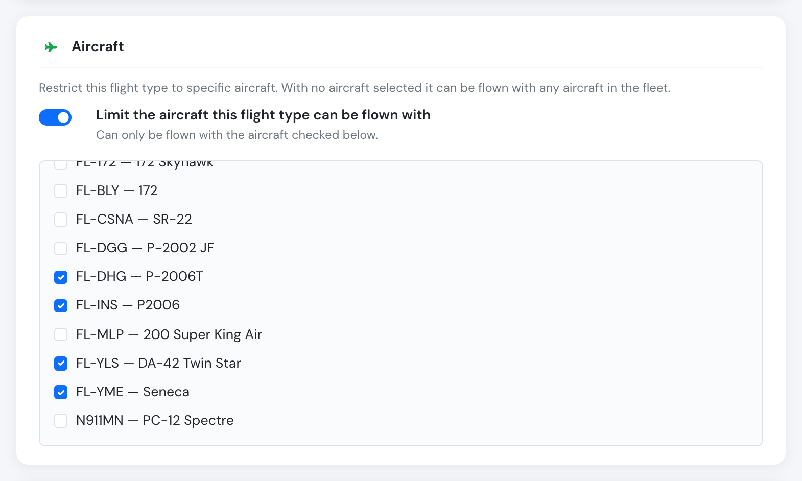<figcaption>
The <em>ME</em> flight type restricted to the four multi-engine aircraft. Inactive aircraft are listed in grey at the top of the list — they can still be ticked, and stay ticked while they are parked.
</figcaption></figure>

The rule has exactly two states:

| The list is… | The flight type… |
|--------------|------------------|
| **empty** (switch off) | can be flown with **any** aircraft in your fleet — this is the default, and how every existing flight type behaves |
| **has aircraft in it** | can **only** be flown with the aircraft you ticked |

An empty list is therefore never "no aircraft allowed", it is "no restriction" — the same convention as [pilot attributions](../crew-management/pilot-attributions.md). Turning the switch back off clears the list and reopens the type to the whole fleet.

Two consequences worth knowing before you tick anything:

* **Ticking everything is not the same as ticking nothing.** A type with the whole current fleet ticked is still a closed list, so an aircraft you buy next year will *not* be able to fly it until someone adds it. If what you mean is "anything", leave the switch off.
* **Parking an aircraft keeps it on the list.** Marking an aircraft inactive does not quietly widen the restriction — the link survives so the type still means what you set when the aircraft comes back. Deleting an aircraft does drop it.

Restricted aircraft show as green tags under the type in the flight types list, so the whole fleet mapping is readable at a glance without opening each type one by one.

#### Editing it from the aircraft instead

The same links can be edited from the other end, on the aircraft's own page — see [Which flight types an aircraft can fly](../aircraft/create-your-aircraft.md#which-flight-types-an-aircraft-can-fly). It is one relationship seen from two sides, so a change made there shows up here and vice versa.

#### Where the restriction is applied


Video walkthrough (1 min): restricting *ME* to the twins, then what the flight form and the Schedule Manager show.


**Flight form.** Once a restricted flight type is chosen, the aircraft picker greys out every aircraft that is not on the type's list, so they can no longer be picked. If the aircraft was chosen first — or an older flight is opened whose aircraft predates the restriction — both fields are outlined in red and a warning under the aircraft names the allowed aircraft: *"ME can only be flown with FL-YLS, FL-DHG, FL-INS, FL-YME."*

<figure>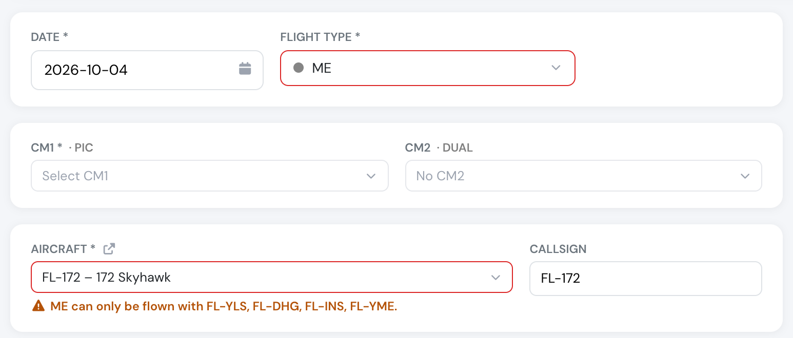<figcaption>
FL-172 was picked before the flight type. The warning names the aircraft <em>ME</em> may be flown with.
</figcaption></figure>

<figure>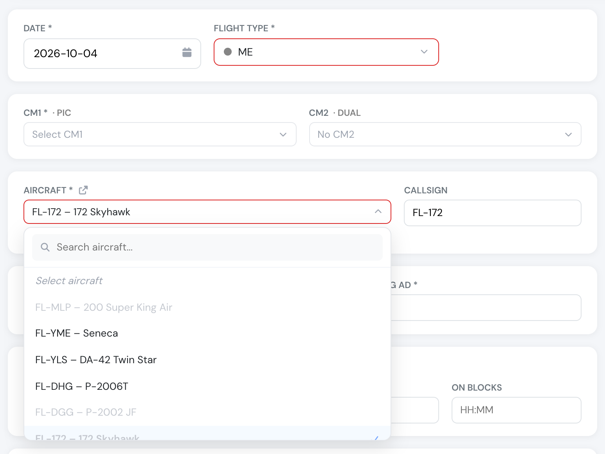<figcaption>
With <em>ME</em> selected, only the twins can be picked; the rest of the fleet stays visible but greyed out.
</figcaption></figure>

The warning never blocks the save and never clears the aircraft: a flight logged after the fact may legitimately predate the restriction.

**Schedule Manager.** When a booking's aircraft is not on its flight type's list, the booking form shows a caution above the buttons. It does not block the save, unlike the pilot attribution checks. See [Schedule Manager](../schedules/schedule-edit-page.md#validation-and-warnings).

<figure>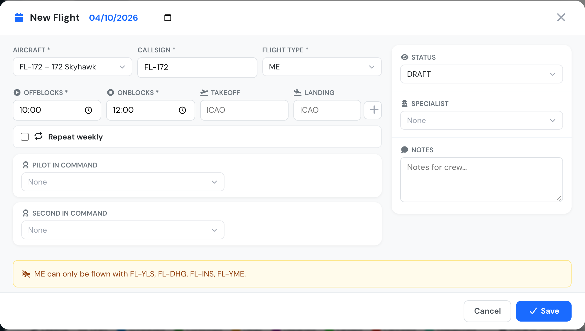<figcaption>
A booking of <em>ME</em> on FL-172 — the caution names the allowed aircraft.
</figcaption></figure>

**Auto Pilot.** When Auto Pilot fills the schedule, it never places a training mission on an aircraft its flight type is not allowed on — no simulator sessions on real aircraft, and no flight lessons on a simulator.

**API.** The restriction is not enforced by the API; see [Flight types API](../API/flight-types.md#aircraft-restriction-optional).

### Require Flight Risk Assessment (FRAT)

A switch in the **Pre-dispatch** card, off by default. When it is on, a crew member (PIC, SIC or Supervisor) dispatching a flight of this type must first complete the [Flight Risk Assessment (FRAT)](../schedules/flight-risk-assessment-frat.md); a high-risk result can only be dispatched by a Supervisor. Turn it on for the kinds of flying where you want a recorded go/no-go decision (for example solo, commercial or cross-country flights) and leave it off for the rest. A flight with no flight type never requires a FRAT. Only users who can manage flight types (Company Administrator and the managers allowed to edit flight types) can change it.

<figure>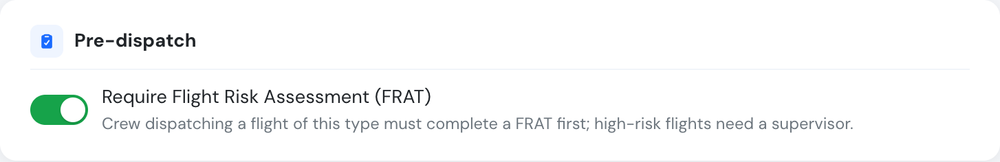<figcaption>
The <strong>Pre-dispatch</strong> card on the flight type form.
</figcaption></figure>

### Visibility — visible on self-booking

A toggle (shown as the **Scheduling** column in the list) that controls whether the flight type appears in the **self-booking / scheduling** flight-type picker. Turn it off for types that should only be used when logging a flight after the fact (e.g. Test or Ferry), and on for the everyday operations crew book themselves onto.

### Order

The position of the type in every flight-type list. Drag rows in the flight types page to set it — put your most-used types at the top.

### Required certificates

Define, **per seat** (*To act as PIC* / *To act as SIC* / *To act as Supervisor*, matching CM1 / CM2 / the third seat), which certificates a crew member must hold to occupy that seat on this flight type — for example a licence, Class 1 medical and single-engine rating for the PIC, but only a medical for a student in CM2. The three seats are independent, and a seat with no requirements imposes none. See [Document & Certificate Requirements](../crew-management/document-and-certificate-requirements.md) for how these are checked across the app.

<figure>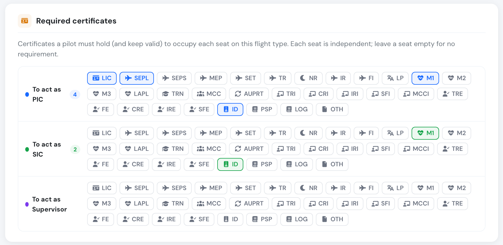<figcaption>
The <strong>Required certificates</strong> card on a <em>Dual</em> type. Click a chip to require that certificate for the seat; the counter next to each seat shows how many are selected. Here the instructor in CM1 needs four, the student in CM2 needs a Class 1 medical and an ID, and the third seat has no requirement.
</figcaption></figure>

Not sure what a chip stands for? Hover it. The tooltip gives the full name, what the certificate is for, and how it is checked: the crew member needs one on their profile, already issued and not expired. Medical chips also explain the medical rules below.

<figure>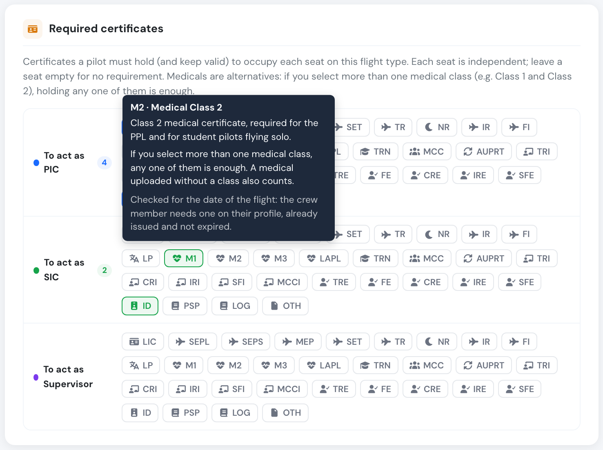<figcaption>
Hovering a chip explains the certificate. Here, <em>M2</em>: what it is, the medical rules, and how validity is checked.
</figcaption></figure>

#### How medicals are checked

Every other certificate you select for a seat is required on its own. Medicals follow two extra rules.

**A higher class also counts.** A seat that requires one medical accepts that medical or a higher one:

| Required | Accepted |
|----------|----------|
| Class 1 (*M1*) | Class 1 only |
| Class 2 (*M2*) | Class 2 or Class 1 |
| Class 3 (*M3*) | Class 3, Class 2 or Class 1 |
| LAPL (*LAPL*) | LAPL, Class 2 or Class 1 |

It never works the other way round: a Class 2 does not meet a Class 1 requirement.

**More than one selected means any one of them.** If you select *M1* and *M2* for the same seat, a crew member with either one passes, and the other is not listed as missing. Only when none of them is met are they listed.

A medical recorded without a class counts for any of them. When a crew member holds several medicals that count, the *expires before the flight* warning follows the one that expires last.

#### Checked at the date of the flight

Every crew check uses the flight's date and time, not today's: the schedule editor, the dispatch briefing, the flight form and the booking warnings. A medical that expires next month does not count for a flight after that, and a flight logged late is not flagged for a medical that has expired since.

<figure>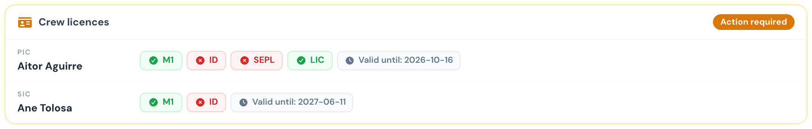<figcaption>
A booking on 5 July. Aitor's M1 runs until 16 October, so it counts.
</figcaption></figure>

<figure>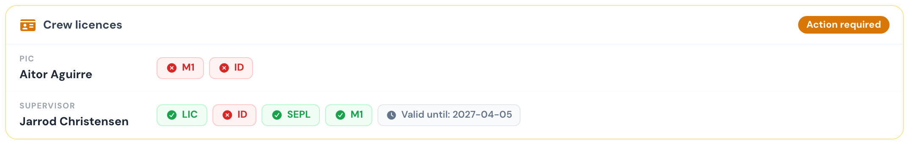<figcaption>
A booking on 4 November. The same M1 has expired by then, so it is red.
</figcaption></figure>

<figure>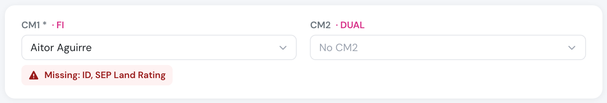<figcaption>
On the flight form, for a flight on 29 June. Only the certificates he did not hold that day are listed: the medical that has since expired is not.
</figcaption></figure>

<figure>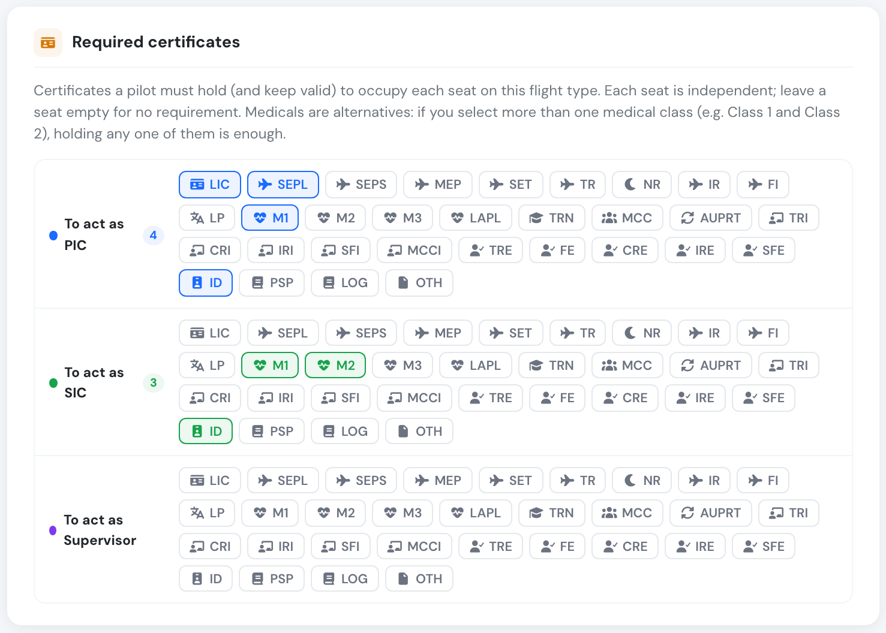<figcaption>
M1 and M2 both selected for the SIC seat: a student holding either medical meets the medical requirement. The ID is still required on its own.
</figcaption></figure>

<figure>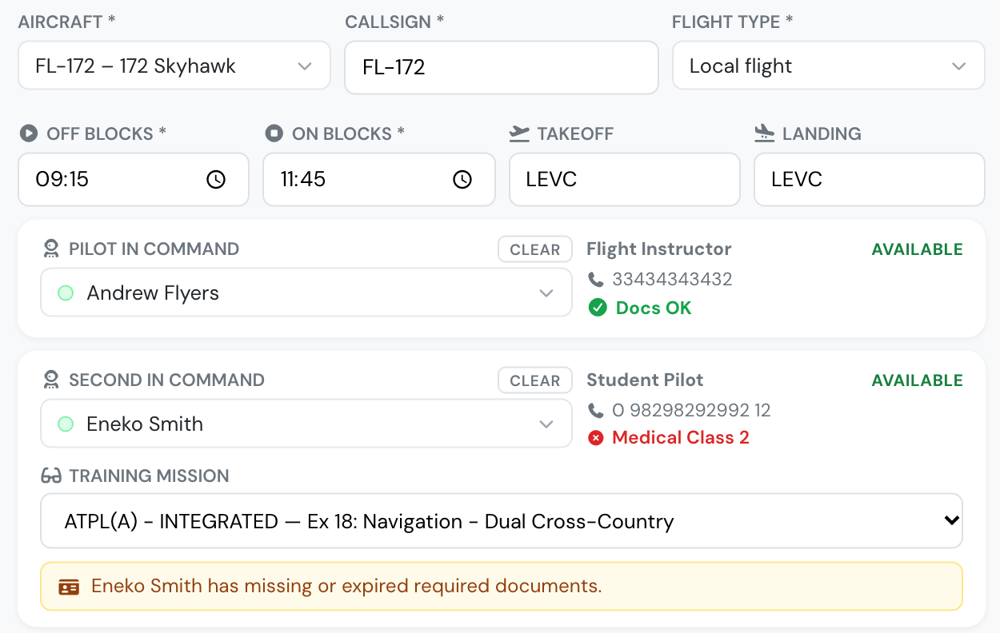<figcaption>
In the Schedule Manager. This type requires Class 3 for the PIC and Class 2 for the SIC. The PIC holds a Class 1, so <em>Docs OK</em>. The SIC holds only a Class 3, which is lower than the Class 2 required.
</figcaption></figure>

<figure>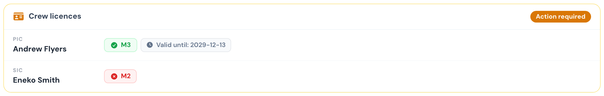<figcaption>
The same booking on the dispatch briefing. The flight form applies the same rules.
</figcaption></figure>

On the flight form, each crew member gets a badge under their name as soon as both the flight type and the person are chosen — green when they hold everything the seat requires, red with the list of missing or expired certificates otherwise. The badge is a warning only and never stops the flight from being saved.

<figure>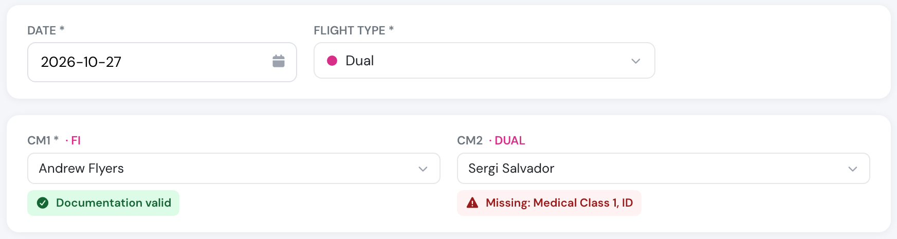<figcaption>
The same <em>Dual</em> type on the flight form. The instructor in CM1 meets every requirement; the student in CM2 is missing the Class 1 medical and the ID.
</figcaption></figure>

In the Schedule Manager, the booking form lists the same result on each crew card: *Docs OK*, or one line per missing or expired certificate, plus a caution naming the crew member. Validity is checked at the booking's date and time, not today's. When the flight type has no required certificates for a seat, that card shows *No docs required* instead of *Docs OK*, so a type without requirements is never mistaken for a passed check.

The **Flight types** list shows the same information at a glance: each seat's required certificates appear under that seat's time column, alternative medicals are merged into one chip such as *M1 / M2*, and a type with none says *No required certificates*. Hover any chip for its explanation.

<figure>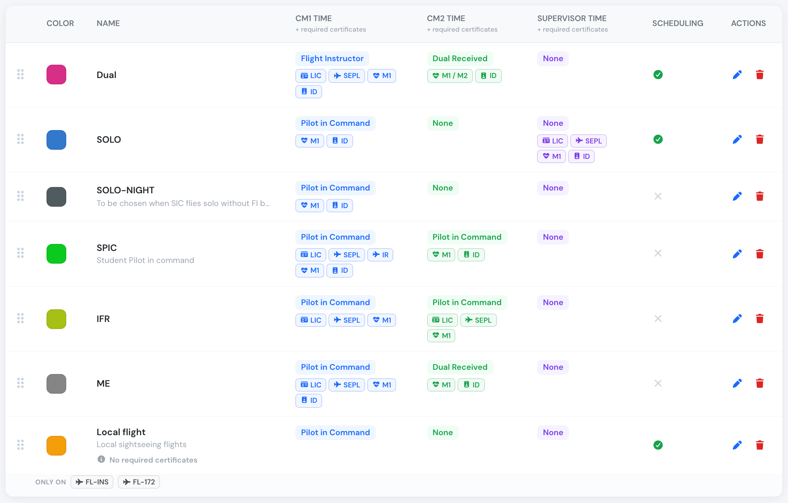<figcaption>
The <strong>Flight types</strong> list. Check here that the types you fly have requirements: <em>Local flight</em> has none, so its crew are not document-checked.
</figcaption></figure>

<figure>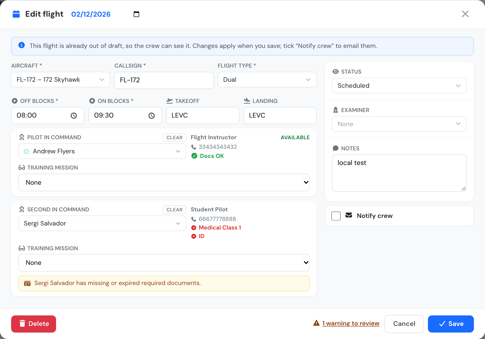<figcaption>
A <em>Dual</em> booking in the Schedule Manager. Each seat is checked against its own list, so the PIC card shows <em>Docs OK</em> while the SIC card lists the two certificates the student still needs.
</figcaption></figure>

<figure>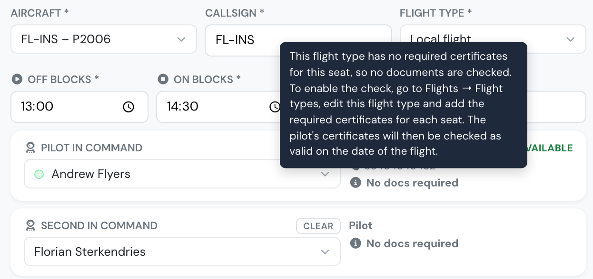<figcaption>
A <em>Local flight</em> type with no required certificates. Each crew card says <em>No docs required</em> instead of <em>Docs OK</em>; hover it to see how to switch the check on.
</figcaption></figure>

## How flight types affect the rest of Flylogs

### Flights

* **Classification & reports.** Every flight carries a flight type; it's how flights are grouped and filtered in logbooks, exports and statistics.
* **Logbook time.** The CM1 / CM2 / Supervisor classifications above decide exactly what time each crew member's logbook receives — and how it rolls up into their PIC / FI totals.
* **Duty and FDP.** Independently of the classification, everyone in any of the three seats on a confirmed flight gets that flight folded into their duty day and counted as an FDP sector.
* **Rules pre-fill.** Choosing the type on the flight form sets the flight's VFR/IFR rules from the type's default flight condition.
* **Aircraft.** A type restricted to specific aircraft can only be flown with those; an unrestricted type works with the whole fleet.
* **Crew documentation.** Under each selected CM1/CM2 on the flight form, a badge names any required certificate that person is missing or expired for that flight type. The seat's classification is also shown next to its label, so you can see at a glance what the seat will log.

### Schedules, dispatch & booking

* **Booking picker.** Only types with **Visible on self-booking** enabled can be chosen when booking a slot.
* **FRAT.** Dispatching a booking or flight of a type with **Require Flight Risk Assessment (FRAT)** on asks the crew member for a completed FRAT first.
* **Crew compliance.** When a manager assigns crew in the schedule editor, each crew card shows *Docs OK*, lists exactly which required certificates are missing/expired for that seat (and can block the save), or shows *No docs required* when the type sets none for that seat. The pre-flight **dispatch briefing** shows the same per-seat checklist. In **self-booking**, a flyer who doesn't meet the type's requirements is always warned, and is stopped from booking only when *Require pilot documentation* is on and *Allow self-booking without valid documents* is off. Validity is evaluated for the scheduled time, so a certificate that expires before the flight ends is flagged.

### Trainings

Training missions reference flight types, tying a syllabus exercise to the flight type (and therefore the time classification) used to fly it.

### Logbooks & reports

Because the time classification is set on the flight type, pilot totals, currency and statistics all derive from it — change a type's classification and future flights of that type log accordingly (past flights are unaffected).

On a pilot's page, *PICUS* and the instructor/examiner classes are added into the **PIC** total and also listed on their own line; *Supervisor* is only ever listed on its own line and is never added to PIC or FI.

## Deleting a flight type

Deleting is a soft delete: the type is hidden from new flights and schedules but existing flights that already reference it keep their classification and history. The delete dialog tells you how many flights currently use the type before you confirm.
