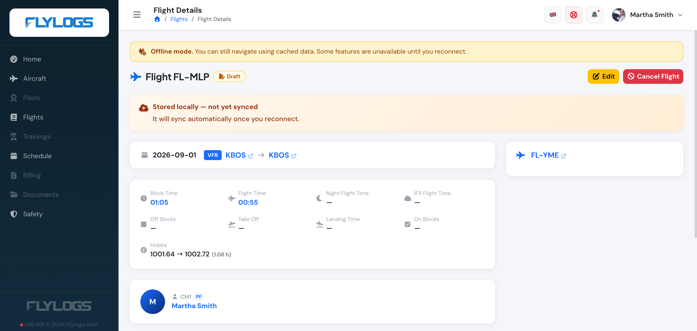

# Offline flight data

Flylogs lets you create and edit flights even when your device has no internet connection. The flight is stored locally in the browser, you keep working as if nothing changed, and the record syncs to the server automatically as soon as you are back online.

> **Why this matters:** flights are often logged immediately after engine shutdown, on a ramp, in a hangar, in a remote airfield or in an aircraft cabin where Wi-Fi and mobile data are unreliable. Offline support means your crews never have to wait for a signal to capture flight data.

## How it works

When you save a flight while offline, Flylogs:

1. Stores the full flight record in your browser using local IndexedDB storage.
2. Sends you straight to the flight view page so the data is there for you to inspect, just like a normal flight.
3. Shows an orange banner at the top of the flight view explaining that the flight has not yet been synchronised with Flylogs.
4. Queues the flight in a local outbox.
5. When your device comes back online, automatically posts the flight to the Flylogs server and replaces the local copy with the real, server-issued record.

You do not need to press anything to trigger the sync. It happens in the background the moment a connection is detected.

## The 48-hour storage window

Locally stored flights are kept for **48 hours** on your device. After that window the local copy is discarded automatically.

> **Don't let the window run out.** If you save a flight offline, make sure the device returns online at some point within the next 48 hours — even briefly — so the flight can sync. If the window expires before that, the locally stored data is lost.

## Creating a flight offline

The flight log form works normally without a connection. You can fill every field, select aircraft, PIC and SIC, enter times, route, remarks and so on. When you press **Save**:

- If your device is online, the flight is saved on the server immediately, as usual.
- If your device is offline, the flight is saved locally and the orange "Stored locally — not yet synced with Flylogs" banner appears on the view page.

The aircraft list, pilot list and flight type list are cached on your device the first time they are loaded online, so they remain available in the form when you go offline.

### What is not available while offline

A few sections of the form depend on live server data and are not available without a connection. In the flight log form a small notice replaces them while you are offline:

- **Training missions** — the list of missions associated with a pilot and training programme cannot be loaded without a connection. Add or edit missions once you are back online.

On the flight view page, the following sections are also hidden for locally-stored flights until the flight has been synced:

- **METAR weather reports**
- **ADS-B track and map**
- **Flight documents (attachments)**
- **Safety reports linked to the flight**

These will appear as soon as the flight has been synchronised and reloaded online.

## Editing a flight that is still pending sync

A flight that has been saved offline but has not yet been synced can be edited just like any other flight, both offline and online. Open the flight from the flight list (it will be in the **Pending Sync** group) and press **Edit**.

- If you edit it **offline**, your changes overwrite the local copy and remain queued for sync.
- If you edit it **online**, Flylogs first persists your changes locally, then attempts to send them to the server immediately. On success the locally stored copy is discarded and you are taken to the real flight record. On failure (server rejection, network drop mid-request) the flight stays in the pending queue and the orange banner remains in place.

## Confirming a flight offline

You can press **Confirm** on a draft while offline, or on a flight you logged offline that hasn't synced yet. The same conditions as online apply (all four times filled in and the landing in the past, block time, aircraft and PIC, and the **Confirm flights** permission).

Flylogs then:

1. Queues the confirmation on your device and shows a **Confirmation queued** banner on the flight.
2. Sends it once you are online — always **after** the flight itself has synced, so the server confirms the latest version of the flight.
3. Re-checks everything on the server at that moment, exactly as an online confirmation does.

Some checks can only be made by the server, so a queued confirmation can still be refused when it syncs — for example when another confirmed flight on the same aircraft overlaps it, the aircraft needs a Hobbs or tach reading the flight doesn't have, or your permissions changed. The flight then stays a **draft**, and Flylogs shows a notice with the reason and a link to the flight so you can fix it and confirm again.

> **Companies that require a password to confirm.** If your company asks for your password to confirm flights, the Confirm button stays disabled offline (and on a flight that hasn't synced yet): your password is never stored on the device. Confirm the flight once you are online and it has synced.

## The Flylogs NEO app on iPhone and iPad

In the iOS app, flights, confirmations and cancellations saved offline are also sent **in the background**: as soon as the device has a connection, they are uploaded even if the app is closed. You don't need to reopen the app.

If you close the app by swiping it away in the app switcher, iOS pauses these background uploads. Nothing is lost: they are sent the next time you open the app while online.

## Where to find pending-sync flights

On the **Flights** list page, locally-stored flights that have not yet been synced are grouped under a **Pending Sync** section at the top of the list. The count next to the section header tells you how many flights are waiting to be uploaded.

Each row links to the flight view page, where you can review the data and, if needed, edit the flight before it is sent to the server.

## Reliability notes

- The local copy lives in **this browser, on this device**. It is not shared between devices. If you log a flight offline on a tablet, that flight will only sync when that same tablet comes back online — it will not appear on another laptop until it has been synced to the server.
- Clearing your browser data, switching to a private/incognito window, or wiping the application from the device will delete pending flights before they have a chance to sync.
- A flight that fails to sync because the server rejected it (for example, validation errors) stays in the pending queue and the orange banner remains. Open the flight to review and correct the data.

## Frequently asked questions

**Will the sync happen if I close the browser tab?**
In a browser, the sync runs while the Flylogs tab is open. If you close the tab, sync will resume the next time you open Flylogs while online, as long as the 48-hour window has not expired. In the iOS app, the sync also runs with the app closed (see [The Flylogs NEO app on iPhone and iPad](#the-flylogs-neo-app-on-iphone-and-ipad)).

**Can I log a flight offline before I have ever logged into Flylogs on this device?**
No. The first login must happen online so your profile, company settings, aircraft list and pilot list are cached locally. Once you have logged in at least once on a device, that device can create flights offline.

**Can I confirm or cancel a flight offline?**
Yes. Confirming and cancelling are queued and applied automatically when you reconnect — confirmation after the flight itself has synced (see [Confirming a flight offline](#confirming-a-flight-offline)). Deleting a flight and confirming when your company requires the password still need a live connection.
