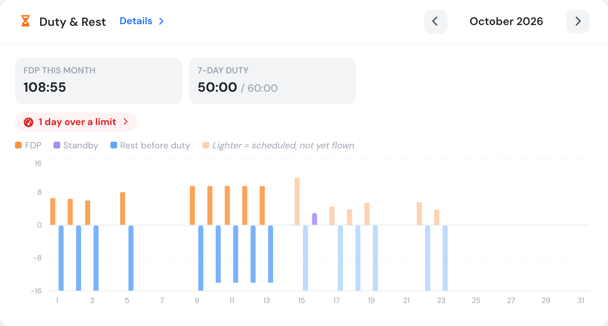
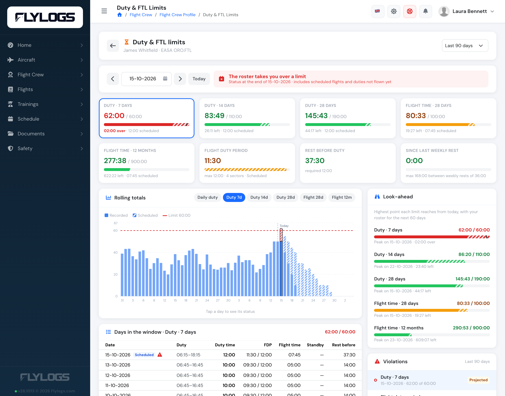
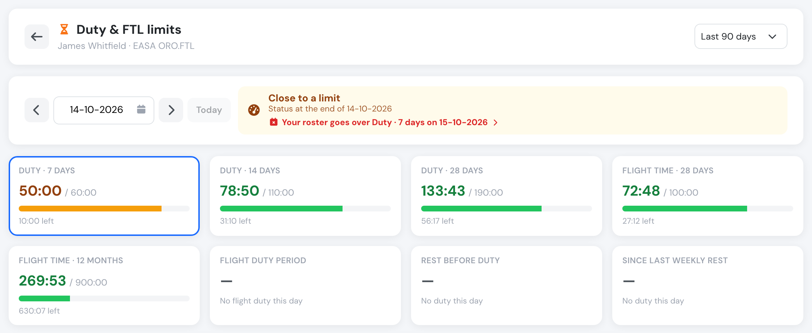
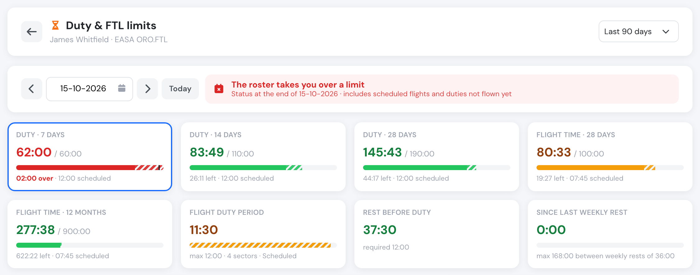
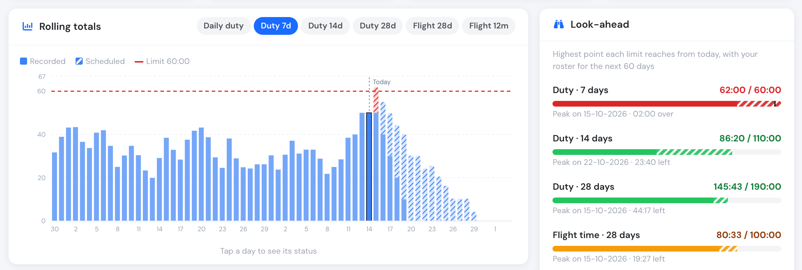
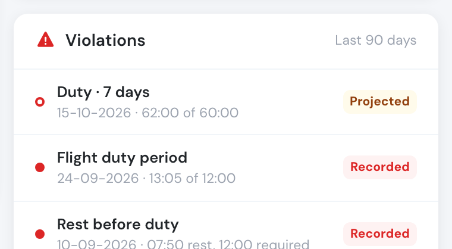
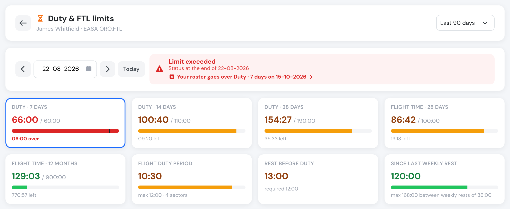
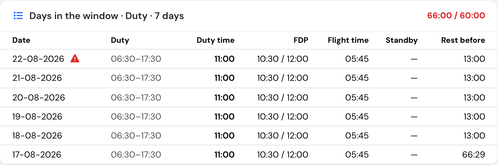
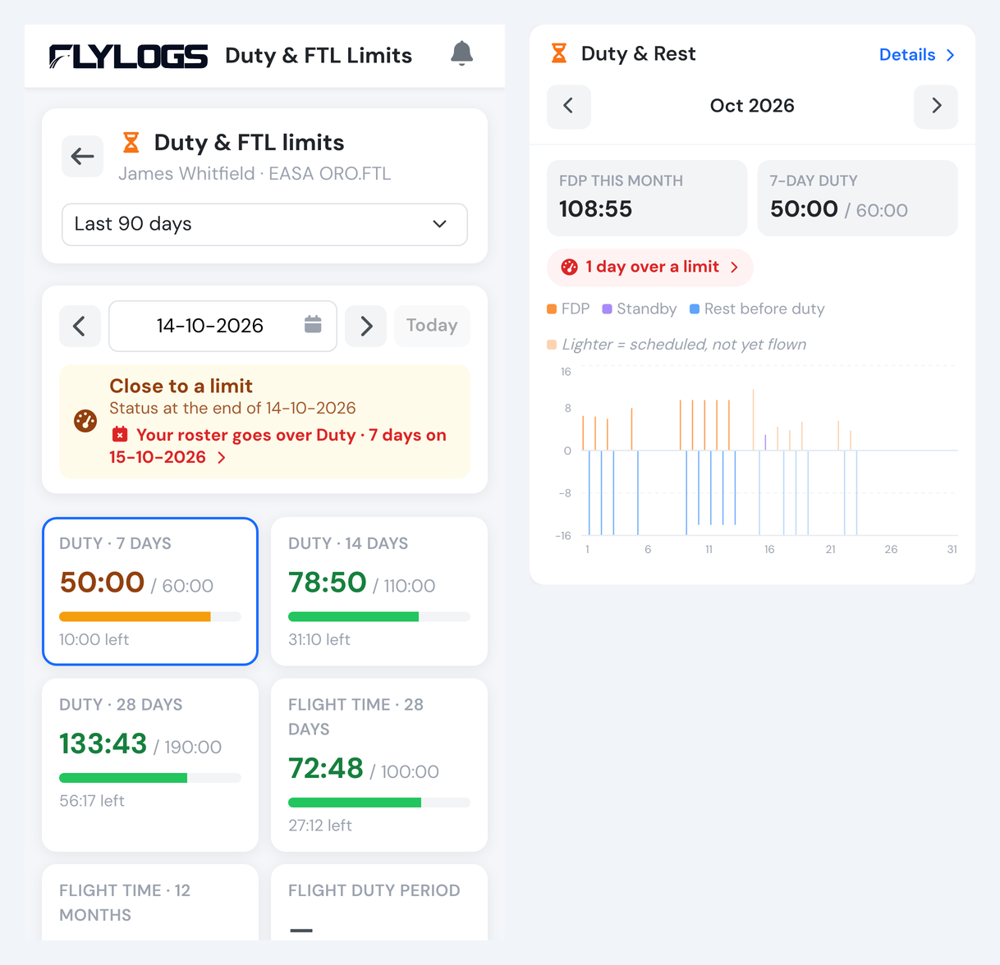

# Duty & FTL limits




The page and the **Duty & Rest** widget need a **Premium** or **Unlimited** subscription, with [FTL Compliance](ftl-compliance-forecast.md) switched on and an active FTL profile. Without them, the widget is not shown and the page says that FTL compliance is not active.


**Duty & FTL limits** shows a crew member where they stand against every flight time limitation of your FTL profile: cumulative duty over 7, 14 and 28 days, flight time over 28 days and 12 months, the flight duty period (FDP) of the day against its maximum, the rest before each duty, the time since the last weekly rest and, when your profile sets it, consecutive duty days.

It answers the questions a pilot asks before accepting a duty:

* **Am I legal today?** Every limit, as it stands at the end of today.
* **When did I break a limit, and by how much?** All violations of the period, each one opening the day it happened.
* **What was my 7-day duty three days ago?** Pick any day — every rolling window is evaluated as it stood at the end of that day.
* **How close will my roster take me?** Flights and duties scheduled but not flown yet are added on top of what is already recorded, so a pilot at 50 hours of duty in the last 7 days sees straight away that tomorrow's 12-hour day takes them to 62 hours.

---

## Opening the page

The **Duty & Rest** widget is on the **Flights** tab of the crew profile, and on the **Schedules** page. The whole widget opens the page:

* Click anywhere on the widget to open the page on today (or on the last day of the month shown).
* Click a day's bar to open the page on that day.
* Click a violation badge — **FDP violations**, **rest violations** or **days over a limit** — to open the page on the latest occurrence, scrolled to the list of violations.

<figure><figcaption>
The Duty &#x26; Rest widget. Bars are the FDP (up) and the rest before each duty (down); lighter bars are scheduled and not flown yet.
</figcaption></figure>

The widget shows the FDP flown in the month, the duty of the last 7 days against the limit, and badges for the days with an FDP over its maximum, a rest shorter than required, or any other limit exceeded. Use the arrows to move between months.

### Who can see it

| Who | What they see |
| --- | --- |
| **Crew** (Flight Instructor, Captain, Pilot, Student Pilot, Cabin Crew, Specialist, Auditor, Mechanic) | Their **own** figures only — on their profile, on the Schedules page and on the page itself. On a colleague's profile the widget is not shown. |
| **Managers** (every management group, including Chief Pilot) | The widget on any crew member's profile, and the page for any crew member of the organisation. |

The rule is enforced by the server: a crew member asking for someone else's figures receives their own.

<figure><figcaption>
A manager opens the same page for any crew member from their profile.
</figcaption></figure>

---

## The limits on a given day

At the top, pick a day with the date field, step a day back or forward with the arrows, or press **Today**. Every card shows the limit **as it stands at the end of that day**:

<figure><figcaption>
Today: 50 hours of duty in the last 7 days, close to the 60-hour limit. The banner warns that the roster goes over it tomorrow.
</figcaption></figure>

| Card | What it measures |
| --- | --- |
| **Duty · 7 / 14 / 28 days** | Duty of the 7, 14 or 28 days ending on the chosen day, against the cumulative limits of the profile (ORO.FTL.210: 60, 110 and 190 hours). |
| **Flight time · 28 days / 12 months** | Block time of the flights operated as PIC or SIC on real aircraft (simulators excluded), over 28 days and over the last 365 days. |
| **Flight duty period** | The FDP of the day — from report to the last on-blocks — against the maximum for that report time and number of sectors. |
| **Rest before duty** | The time between the end of the previous duty and the start of this one, against the required rest: the minimum of your profile, or the length of the preceding duty when that is longer. |
| **Since last weekly rest** | Time since the last weekly rest (for ORO.FTL, 36 hours including two local nights) ended, against the maximum allowed between two weekly rests (168 hours). |
| **Consecutive duty days** | Only when your profile sets a maximum. |

Each bar is green below 80 % of the limit, amber from 80 %, and red over it. The banner sums the day up: **Within all limits**, **Close to a limit**, **Limit exceeded**, or **The roster takes you over a limit** when only scheduled flights push a limit over.

### Recorded and scheduled

Days ahead combine what is already recorded with the roster: bookings not flown yet (as PIC, SIC or supervisor), rostered ground duty, and standby. The scheduled share of each bar is **striped**, and the card tells how much of the total is scheduled.

<figure><figcaption>
Tomorrow, with the roster: 50 hours recorded plus a 12-hour scheduled day give 62 hours, 2 hours over the 7-day limit.
</figcaption></figure>

When the chosen day is today or earlier and the roster ahead breaks a limit, the banner says which limit and on which day. Click it to jump there.

---

## Rolling totals and look-ahead

The chart draws the chosen rolling total for every day around the chosen day, with the limit as a dashed red line. Switch between **Daily duty**, **Duty 7d**, **Duty 14d**, **Duty 28d**, **Flight 28d** and **Flight 12m** — or click a limit card. Click any bar to move to that day.

**Look-ahead** lists, for each cumulative limit, the highest point it reaches from today with the roster of the next 60 days, the day it happens and how much margin is left. Click a line to open that day.

<figure><figcaption>
Recorded duty in solid blue, the roster striped. The look-ahead shows the 7-day duty peaking at 62:00 tomorrow.
</figcaption></figure>

---

## Violations of the past

Choose the period at the top right — last 30, 90, 180 or 365 days. **Violations** lists every limit exceeded in that period, newest first, marked **Recorded** (it happened) or **Projected** (only the roster takes it over). A cumulative limit that stays exceeded over several days while the window rolls is listed once, on the day it was first exceeded. Click a violation to open that day.

<figure><figcaption>
Recorded violations in red, projected ones outlined.
</figcaption></figure>

<figure><figcaption>
A past day: six 11-hour days took the 7-day duty to 66 hours.
</figcaption></figure>

### The days behind a number

**Days in the window** lists the days that make up the selected total — for **Duty · 7 days** on 22 August, the seven days from 16 to 22 August — with the duty times, duty, FDP and its maximum, flight time, standby and the rest before each duty. Scheduled days are tagged, and days with a violation carry a warning sign.

<figure><figcaption>
The six days behind the 66 hours.
</figcaption></figure>

---

## On a phone

On a phone the page stacks into one column, with the look-ahead right under the limit cards. The widget keeps the month on its own row and the key figures as two tiles.

<figure><figcaption>
The page and the widget on a phone.
</figcaption></figure>

---

## How the figures are counted

The page uses the same rules as the nightly FTL check and the crew readiness check on approvals, so they never disagree:

* **Duty** of a day is the duty period joined with the work times of the duty record (overlaps counted once), plus the standby fraction of your profile (25 % under ORO.FTL.230) of any standby not already covered by duty.
* **FDP** and its maximum are the values stored with each duty record. For days still on the roster they are projected from the bookings, including the commute before duty configured in [Duty Limits](../company-management/company-settings/duty-limits.md); a day with both flown and scheduled flights is recalculated with all its sectors.
* **Rest** is the time without duty: no rest records are needed. The weekly rest is searched in the 14 days before each duty.
* Figures for future days change as soon as the roster changes or the flights are logged.

Related: [FTL Compliance & Forecast](ftl-compliance-forecast.md) · [Duty and Flight time storage](../crew-management/duty-and-flight-time-storage.md) · API: [`GET /pilots/ftl_status`](../API/pilots.md#duty-and-ftl-limits).
