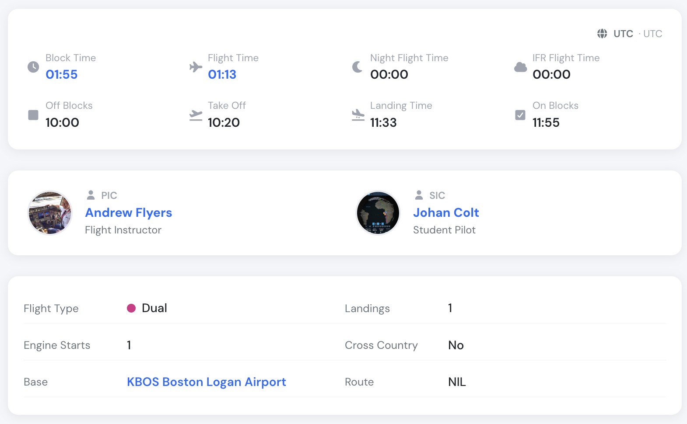

# Flight Dispatch Function

The **Flight Dispatch** feature allows operations staff to provide pilots with all necessary operational details before a flight.\
When a flight is dispatched, the system automatically creates a **Flight Draft** with the additional information entered, ensuring pilots have clear, accurate, and standardized pre-flight data.

This article explains how the feature works, what each screen shows, and how the information flows into the pilot-visible flight draft.

***

### Who can dispatch a flight?

The Dispatch button is visible in the Schedule Review page when **all three** conditions are met:

1. **Schedule status** — the record must be in **Scheduled** or **Confirmed** status and not yet have a linked flight.
2. **Full schedule access** — the user must have write access to schedules:
   - **Company Administrators and Operations Managers** (user group ≤ 140) always have full access.
   - **Flight Dispatchers, Chief Pilots and Flight Instructors** have full access only when the company setting **Allow FI schedule management** is enabled.
   - Pilots and Dispatchers (user groups above 170) can view the schedule but cannot dispatch.
3. **Flight creation permission** — the user's account must be active and allowed to create flights. Users in groups above 150 additionally require an active pilot profile.

| User type | Can dispatch? |
|---|---|
| Company Administrator / Operations Manager | Yes |
| Flight Instructor / Supervisor (FI management enabled) | Yes |
| Flight Instructor / Supervisor (FI management disabled) | No |
| Dispatcher / Pilot | No |

> If the Dispatch button is not visible for a user who should have access, check that **Allow FI schedule management** is enabled under Company Settings and that the user's account is active.

### **1. Opening the Dispatch Menu**

From the **Schedule** view, locate the flight you want to dispatch.\
Click the **SCHEDULED** button to open the actions dropdown.

<figure><figcaption></figcaption></figure>

In the dropdown, select **Dispatch Flight**.\
This opens the _Create Flight Draft_ window.

***

### **2. Creating the Flight Draft**

The **Create Flight Draft** pop-up allows you to specify operational details needed by pilots.\
These fields may include:

* **Departure and Arrival airports**
* **Callsign**
* **Flight type** (e.g., Commercial, Dual, etc.)
* **Passenger count**
* **Cargo weight**
* **Route**
* **Remarks** (e.g., special cargo, restrictions, operational notes)

<figure><figcaption></figcaption></figure>

Once all required fields are completed, click **Create Draft**.\
The system will generate a flight draft visible to the pilots assigned to the flight.

***

### **3. How the Flight Draft Appears to Pilots**

Once created, the draft becomes available in the pilot interface.\
All information entered during dispatch is automatically inserted into the draft, ensuring the flight crew receives clear and complete data.

The pilot view includes:

* Flight type
* Distance and number of landings
* Cross-country status
* Passengers & cargo
* Route
* A dedicated **Remarks** section containing any operational notes added during dispatch

<figure><figcaption></figcaption></figure>

This ensures pilots can review all important details immediately, without needing additional communication from operations.

***

### **Crew medical limitations**



When anyone on the crew (PIC, SIC or supervisor) has limitations on a medical that is valid on the day of the flight, the dispatch box lists them first, with their meaning. For example, VDL means "valid only with correction for defective distant vision" and OPL means "valid only without passengers". See [Medical limitations](../crew-management/document-and-certificates.md#medical-limitations).

<figure><figcaption>
The PIC's medical is valid only without passengers, and the flight carries two.
</figcaption></figure>

Flylogs also warns, in red, when the flight as entered goes against a limitation:

| Code | Warning when |
|---|---|
| OPL — valid only without passengers | PAX or the passenger list is above 0 |
| ORL — safety pilot if passengers are carried | passengers are carried and there is no second pilot on board |
| OCL — valid only as a qualified co-pilot | the pilot is the PIC |
| OML — valid only as, or with, a qualified co-pilot | the pilot is the PIC and the flight has no SIC |
| OSL — valid only with a safety pilot | there is no second pilot on board |

"On board" means the PIC and the SIC. A supervisor (for example, of a student solo) is not counted as on board.

Limitations **never block dispatch**. They make sure the person dispatching knows about them; the decision stays with them. RXO and SIC (follow-up examinations) are not shown here. Only limitations stored in Flylogs are shown, so keep the crew's medicals up to date.

**Who sees this box:** the same people who can dispatch the flight, which means its own crew (PIC, SIC, supervisor) and staff who can dispatch any flight (user group 150 and below).

***

### **Pre-dispatch gates: checklist & FRAT**

Two optional safety gates can be required before a flight is dispatched. Both are **off by default** and are enabled per company under **Company Settings → Flights → Pre-dispatch gates**. The feature is available on **Club, Premium and Unlimited** plans.

* **Pre-dispatch checklist** — a short acknowledgement checklist (weather, NOTAMs, aircraft status, crew documents, SOPs) that must be fully ticked before the **Dispatch** button is enabled. The checklist is an acknowledgement only and is not stored.
* **Flight Risk Assessment (FRAT)** — a crew member dispatching their own flight must complete a FAA-style PAVE risk questionnaire; high-risk flights require a Supervisor. See the dedicated [Flight Risk Assessment (FRAT)](flight-risk-assessment-frat.md) article for the full details.

***

### **NOTAMs ranked for your flight**



The booking's briefing and the flight page list the NOTAMs for the departure and arrival aerodromes. When you are online, Flylogs reads each one against the planned flight (aircraft, flight type, aerodromes and times) and orders the list so the ones that matter come first:

* **Affects flight** — e.g. a runway or aerodrome closure, an obstacle on the approach, no touch-and-goes during your slot.
* **Check** — worth a look before departure.
* NOTAMs it is very sure are irrelevant (an office-hours change, say) are folded behind **Show N likely not relevant** — never removed.

<figure><figcaption>
Departure and arrival NOTAMs in the booking briefing, most relevant first.
</figcaption></figure>

This is an automated reading to help you brief, not a replacement for it: **read every NOTAM before flight.**

### **Alternate aerodromes**

An alternate aerodrome is optional. Enter it in the **Alternate** field when you dispatch, or on the flight form itself, so a draft flight that was never booked can have one too. Two aerodromes fit in the field, separated by a space or a slash (for example `LEVS LEGT`).

Once an alternate is set, the booking briefing and the flight page show its weather (METAR and TAF) and NOTAMs next to the departure and arrival, and the **Wx & NOTAMS** PDF export on the flight page includes it. Alternate NOTAMs are shown in full and are not ranked, so read all of them.

### **Remarks**

1. If a schedule record is **published** and **dispatched** and the PIC is changed, the record will automatically be switched back to SCHEDULED and the associated flight will be unlinked.
2. If a PIC or SIC tries to dispatch the flight, the system will check for required pilot certificates, and if the user lacks any of the required certificates (medical, license, rating), Flylogs will reject the flight dispatch function.
3. If a PIC skips the Dispatch button entirely and logs the flight directly, Flylogs doesn't leave the schedule stranded: when that flight is **confirmed**, the system looks for the schedule it belongs to (same PIC, aircraft, and a time window overlapping the flight by up to 30 minutes) and links it automatically. See [Automatic schedule matching on confirm](../flights/audit-trails.md#automatic-schedule-matching-on-confirm) for the full details.

***

### **Summary**

The **Flight Dispatch** function streamlines communication between operations and flight crew by:

* Allowing dispatchers to add all relevant pre-flight information
* Automatically populating the pilot’s flight draft
* Reducing manual updates and potential communication delays
* Ensuring a standardized workflow for all flights

By using this feature for every dispatched flight, your team improves accuracy, operational clarity, and overall efficiency.
