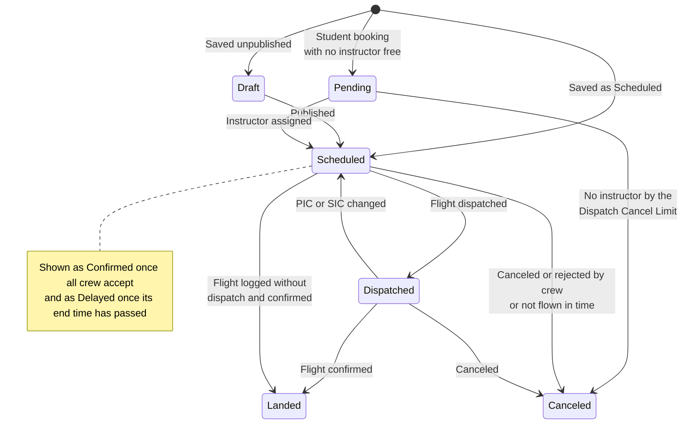
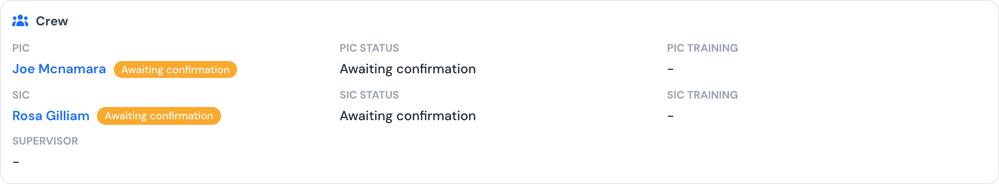

# Flight Schedule Records

Flylogs flight scheduling has been designed to fit precisely the needs of ATO organizations with or without multiple operational bases and multiple aircraft on each location. Schedule records or bookings may be created by the **company manager**, **roster manager**, **aircraft manager** or even directly by your **pilots** or **students**.

**Company Managers** and **Roster Managers** have a full access to al rostering options in all company aircraft. Aircraft managers have full access to the aircraft they manage, including maintenance records, logbooks and schedules.

**Pilot or Student self booking** is available on demand: it is switched on aircraft by aircraft (see [Self scheduling](self-scheduling.md)). Billing does not have to be enabled for it; when it is, you can also block pilots without enough credit from booking.

### Schedule Record Lifecycle

The diagram below shows how a booking moves between the statuses shown on the schedule.

* **Draft:** unpublished. Only visible to schedule management users.
* **Pending:** a student booked a flight and no instructor was free yet. Shown in yellow until an instructor is assigned.
* **Scheduled:** published and visible to the crew. It is shown as **Confirmed** once every crew member has accepted it, and as **Delayed** once its end time has passed without the flight being logged.
* **Dispatched:** the flight was dispatched. Changing the PIC or SIC sends it back to Scheduled.
* **Landed:** the flight was logged and confirmed.
* **Canceled:** canceled by the crew or a manager, rejected by a crew member, not flown in time, or still Pending when the Dispatch Cancel Limit was reached.

### Schedule Record Information

Each schedule record contains the following information and represents a scheduled flight, 1 flight.

* Published (check box that defines if the schedule record is visible by crew or not).
* Schedule start date and time
* Schedule end date and time
* Aircraft
* Crew: PIC, SIC and Supervisor or third crew member.
* Flight Rules
* Flight Type
* Flight Mission (See [Trainings - Flight training missions](../training-courses/flight-training.md))

### Crew Acceptance Status

Each crew slot (PIC and SIC) on a schedule record carries its own acceptance status, independent of the overall record status.

<figure><figcaption>
The Crew tab of a booking: each seat shows its own acceptance status.
</figcaption></figure>

| Status | Meaning |
|--------|---------|
| **Pending** | The crew member has been assigned but has not yet accepted the flight. |
| **Accepted** | The crew member has accepted (or was automatically accepted at creation). |
| **Rejected** | The crew member declined the flight. |
| **None** | No acceptance is requested: either the seat is empty, or the crew member was assigned without being asked to confirm. A seat in **None** does not hold the booking back. |

**How the status is set when a record is created:**

* **Captains and Pilots booking their own flight** (Book a Flight): the pilot is PIC with status **None**, as there is nothing to confirm. No SIC is assigned (**None**).
* **Student Pilots booking their own flight**: the student is SIC (**Accepted**). The Flight Instructor that Flylogs assigns as PIC is set to **Pending** and has to accept the flight. If no instructor is free, the booking is saved as **Pending** with no PIC until one is assigned (see [Self scheduling](self-scheduling.md#pending-bookings)).
* **Flight Instructors booking their own flight**: the FI is PIC (**Accepted**). If they name a SIC, the SIC is set to **Pending** and has to accept the flight.
* **Flights created by management on behalf of crew**: saved as **Draft**, the PIC and SIC (if assigned) are set to **Pending** and must accept the flight once it is published. Saved directly as **Scheduled**, the crew is set to **None** and no acceptance is requested.
* **Changing the PIC or SIC of an existing booking** sets that seat to **Pending**, so the new crew member has to accept it.


Crew members can accept all their pending flights at once from the **Upcoming Flights** panel on their home page, or individually from the schedule record.


### The Schedule record edit form

We have created a fast editing form (see screenshot below) that includes the management of all information related to each schedule record.

The form has a flight data information on the left side, and a supplemental information right side that changes dynamically depending on the aircraft and crew members selected for the flight.

The form has only 5 fields that are mandatory:

1. Flight type
2. Start time (Automatically populated from your click position on the calendar)
3. End time (Automatically populated from your click position on the calendar)
4. Callsign (Automatically populated with the Aircraft registration if left empty)
5. PIC


All other fields are optional. Note that additional fields may appear dynamically, like the flight mission, if the PIC or SIC are enrolled in a flight training with pending flight missions.


> You can directly choose to publish the new record as you create it if select in the status box "**SCHEDULED**".

<figure><figcaption></figcaption></figure>

### Multi-leg flights

When you create a new booking you can plan a route with intermediate stops. Fill in the takeoff and landing airfields, then click the **+** button next to **Landing** and enter the next stop. You can add up to **3 extra airfields** (4 legs in total).

The route is shown under the airport fields with one line per leg. Flylogs splits the offblocks–onblocks time equally between the legs; you can change the time at each intermediate stop. Use the **×** next to a leg to remove that stop.

When you save, Flylogs creates **one booking per leg**, back to back, with the same aircraft, callsign, flight type, crew, status and notes. Each leg is then an ordinary booking: it is dispatched, logged, edited and cancelled on its own, so every sector appears in the logbook.

### Repeating flights

When you create a new booking, tick **Repeat weekly** to repeat it on the days of the week you choose:

1. Tick the weekdays the flight repeats on. The day of the booking itself is always included.
2. Choose the **Until** date (inclusive). It is **required and has no default**: saving without it is refused and the field is highlighted. The form shows how many bookings will be created, and the confirmation lists every date before anything is created.

A repeating flight can also be multi-leg: the whole route is repeated on every selected day. One save creates at most **100 bookings**.

#### Editing or cancelling a repeating series

The bookings created by one repeat are **linked**. A multi-leg repeat creates one series **per leg** (leg 1 on every date, leg 2 on every date…), so a single leg can be changed without touching the others.

Open any booking of a series in the Schedule Manager: the form shows that it is part of a repeating series. When you save, cancel (set the status to *Canceled*) or delete it, Flylogs asks:

* **This booking only** — only this booking changes. On save it is detached from the series.
* **This and following** — the same change is applied to the later bookings of the series.

"Following" only reaches bookings that are later than this one, still in the future, not yet dispatched or flown, and not already canceled. Each keeps its own date; the times you set are applied in the company time zone, so 16:00 stays 16:00 across a daylight-saving change. Aircraft, crew, flight type, airfields, notes and (if you changed it) status are carried over. Crew notifications and training missions are not repeated. A booking that the server refuses (for example an aircraft clash) is listed afterwards and left as it was.

Bookings created before this feature are not linked and are still edited one by one.

Before creating anything, Flylogs checks every date against the schedule. A date where the aircraft or one of the crew members is already booked is skipped, and the confirmation lists the skipped dates. If the server refuses a leg (for example because of maintenance), the remaining legs of that day are not created and you get a summary of what was not created.


Multi-leg and repeat options are available in the **Schedule Manager** only, and only when creating a booking. Bookings of a repeat are linked: editing, cancelling or deleting one offers "this booking only" or "this and following" (see above). When **Notify crew** is ticked, the crew is notified once, for the first booking; a training mission selected in the form is assigned to the first booking only.

