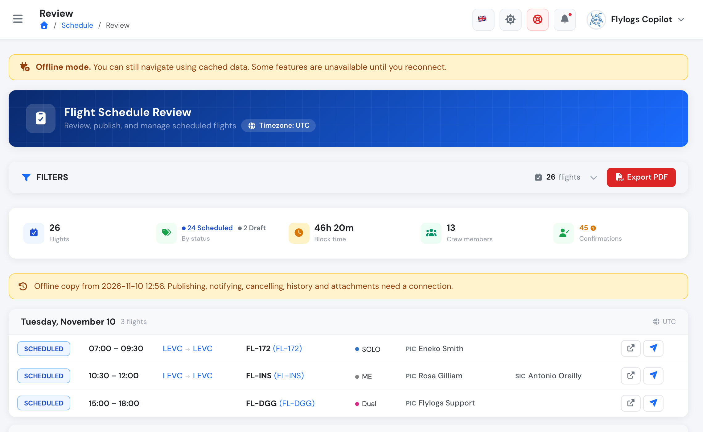
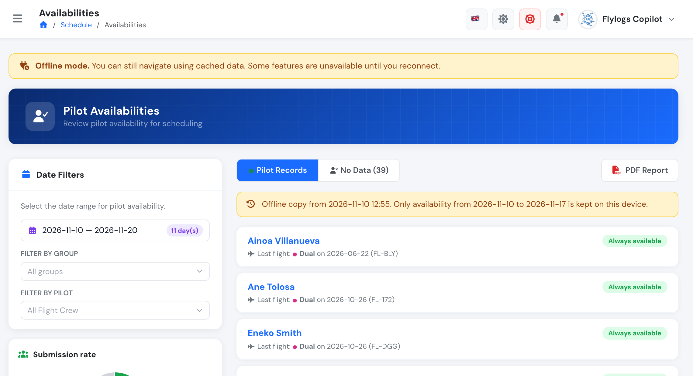
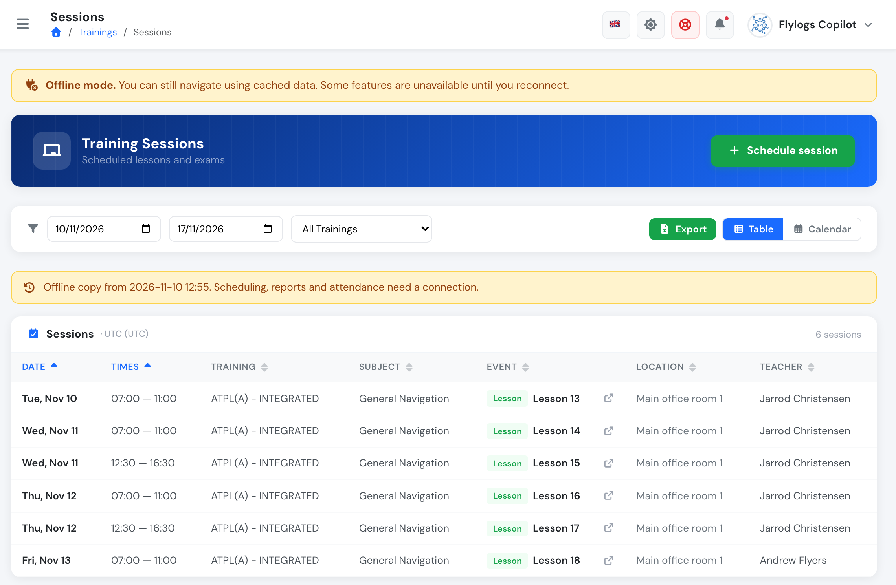
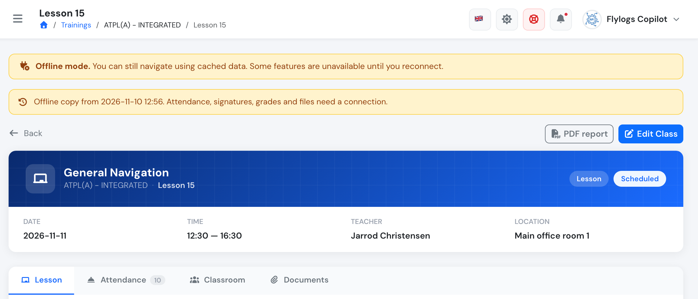

# Schedules and classes offline

Flylogs keeps the **next 7 days** of your schedule on your device, so you can still check them without a connection: on a flight, in a hangar or at an airfield with no signal. This covers flight bookings, pilot availability and training classes.

Everything here is **read-only** while you are offline. To create, change, publish or sign anything, you need a connection.

## What is kept on your device

| What | Kept for | Where you see it offline |
|---|---|---|
| Flight bookings | Today to 7 days ahead, plus each booking's own page | [Schedule Review page](schedule-review-page.md), the booking page, the dashboard "Upcoming Flights" widget |
| Pilot availability | Today to 7 days ahead | [Pilot availabilities](pilot-availability-records.md) |
| Training sessions (classes and exams) | Today to 7 days ahead | **Trainings › Sessions** |
| Class pages | Every session in those 7 days | The class page (lesson, attendance list, classroom, documents list) |
| Your own classes | From yesterday to 7 days ahead | The upcoming classes list on your **Trainings** page |

The 7 days are counted in your company's time zone, from today through the day 7 days from now.

## Who gets what

Flylogs only keeps what you can already open while online:

* **Bookings:** managers have them, and so do staff with read-only access to the Schedule Review page. Pilots get them too when the company shows them the master schedule.
* **Pilot availability:** the roles that can open the Pilot availabilities page.
* **Training sessions:** staff who see **Trainings › Sessions** (managers, chief pilots and auditors). The company plan must include Trainings.
* **Your own classes:** every user enrolled in or teaching a course, including students and instructors.

## How the copy stays up to date

You don't need to do anything. While Flylogs is open and online, it refreshes the copy in the background:

* when you log in or open the app,
* when the app comes back to the foreground,
* when the connection returns,
* every 15 minutes while it stays open.

Class pages are downloaded again when they are more than 6 hours old, and whenever you open one online. A new device starts with nothing stored: the first copy is made the first time you use Flylogs online with your account on it.

## Using it offline

When a page shows the stored copy, a yellow banner tells you so and shows when the copy was saved. Check that time: anything changed after it is not on your device.

<figure><figcaption>
Schedule Review page offline: the bookings of the next 7 days, with the time the copy was saved
</figcaption></figure>

The filters still work on the stored copy. If you ask for dates outside the 7 days, the banner says which dates are kept. Only those dates can be shown.

<figure><figcaption>
Pilot availabilities offline: the selected range goes past the 7 days kept on the device
</figcaption></figure>

### Training sessions

**Trainings › Sessions** lists the stored sessions in both the table and the calendar view. You can filter by date and by training.

<figure><figcaption>
Training Sessions offline: the sessions of the next 7 days
</figcaption></figure>

Open a session to see its class page: date, time, teacher, location, the lesson content and the attendance list as they were when the copy was saved.

<figure><figcaption>
A class page opened offline
</figcaption></figure>

## What needs a connection

* Creating, editing, publishing, notifying or cancelling bookings, and the booking history and attachments.
* Scheduling, editing or deleting sessions, and exporting the sessions report.
* Taking or signing attendance, grading, justifications, class work and exam openings.
* Opening or uploading files.
* Anything older than today or further ahead than 7 days. The exception is a page you opened recently online, which may still be on the device.

If you try to open something that was never stored, Flylogs says it is not available offline.

## Good to know

* The copy lives in **this browser, on this device**. It is not shared between devices.
* Logging out or switching company clears it.
* Clearing your browser data or using a private/incognito window also removes it.
* The copy does not expire while you are offline: it stays until Flylogs can refresh it. Always check the time on the banner.
* Flights and safety reports can also be **created** offline and synced later. See [Offline flight data](../flights/offline-flight-data.md) and [Offline safety reports](../sms/offline-safety-reports.md).
