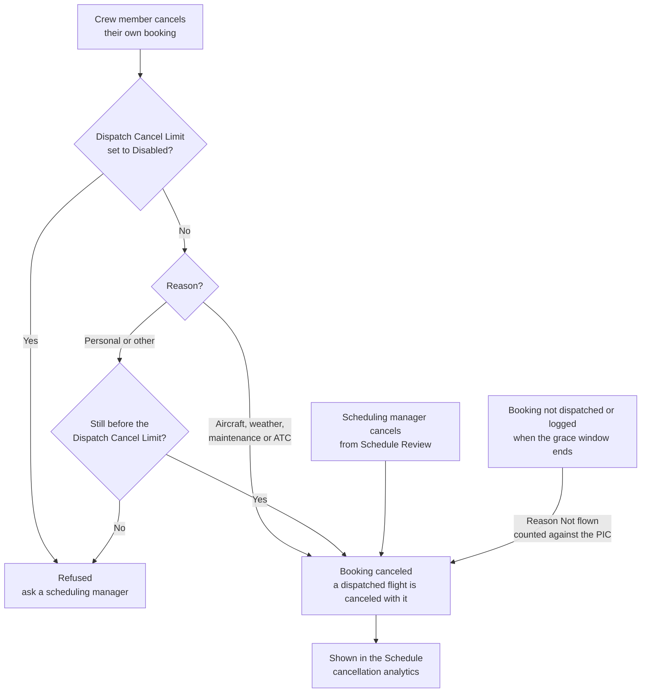
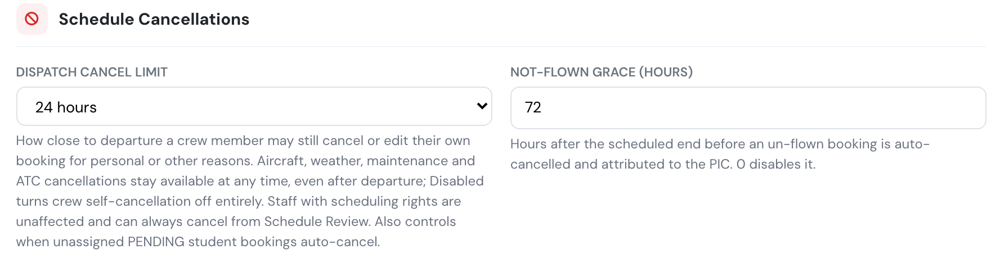
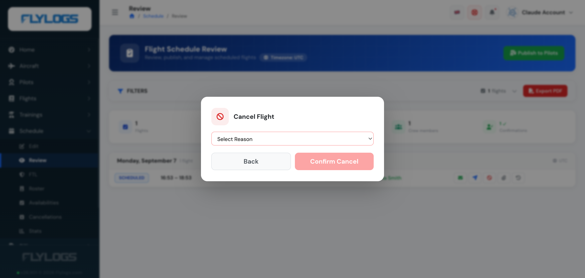
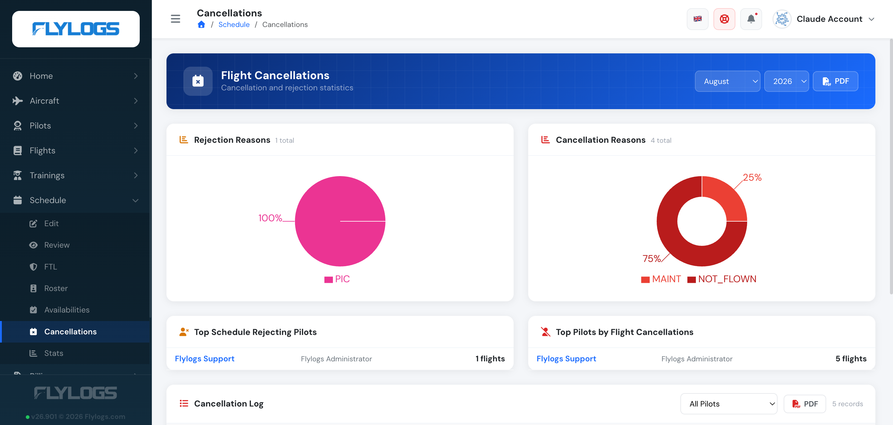
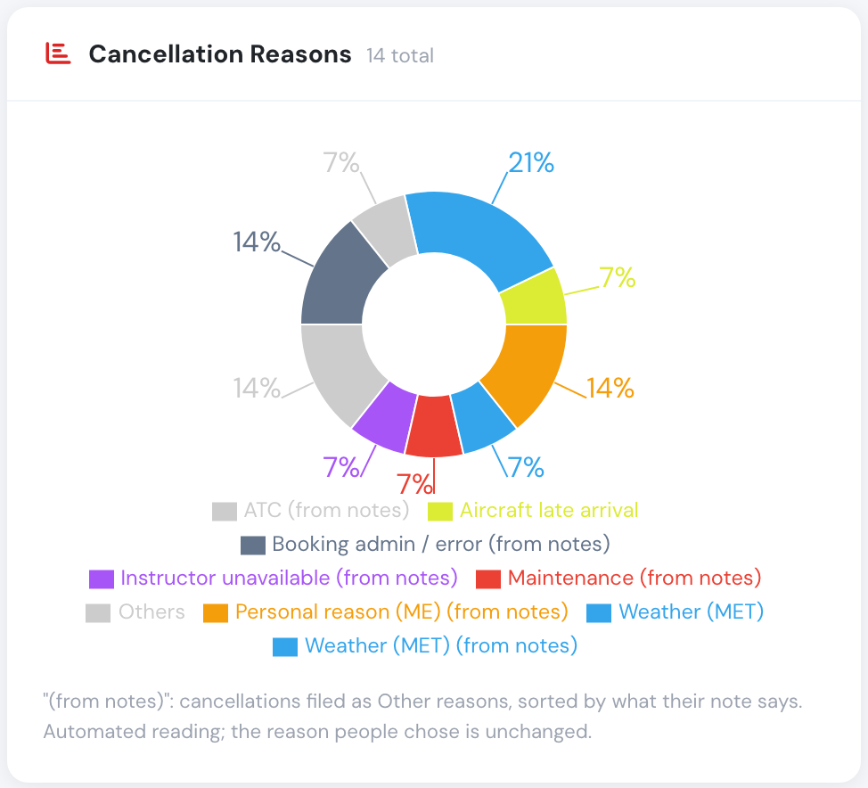
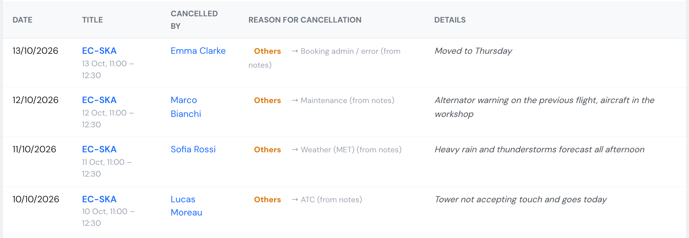
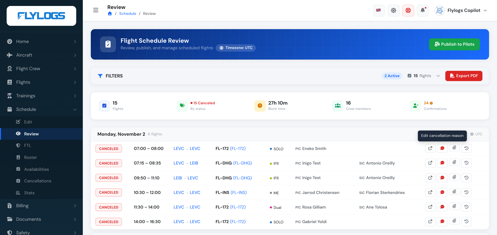
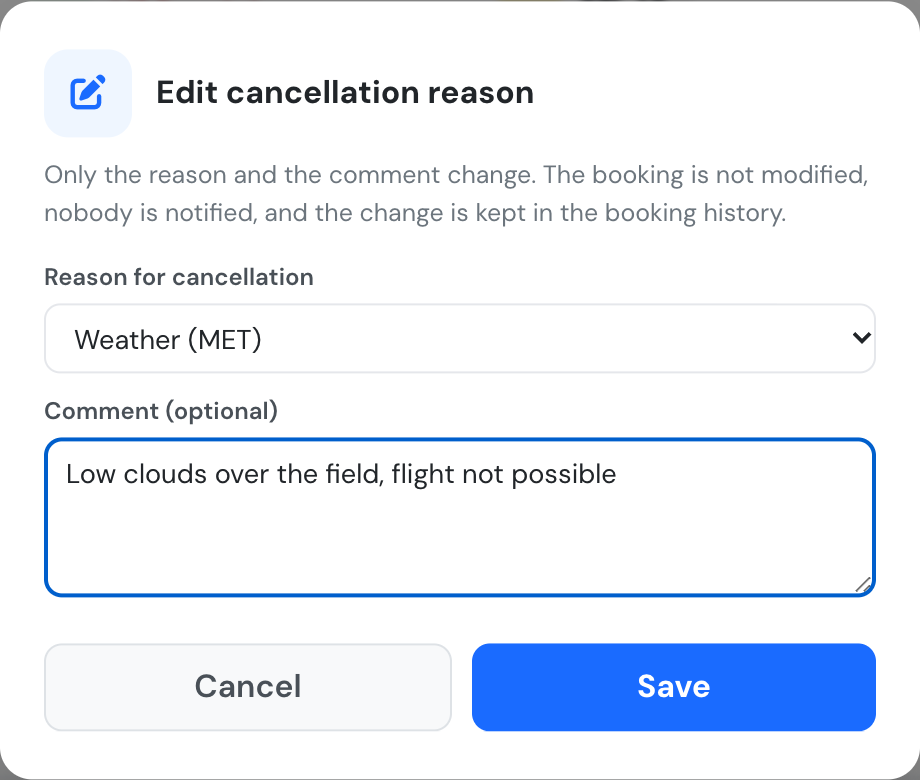
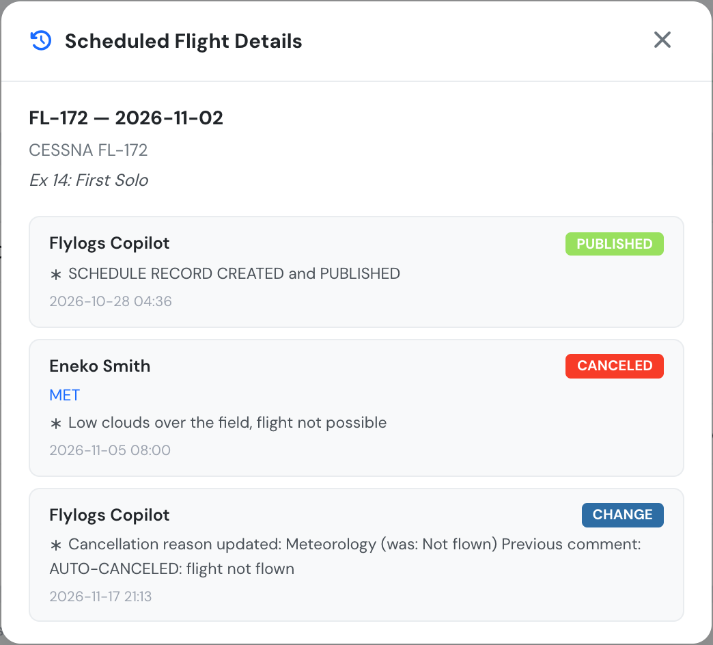
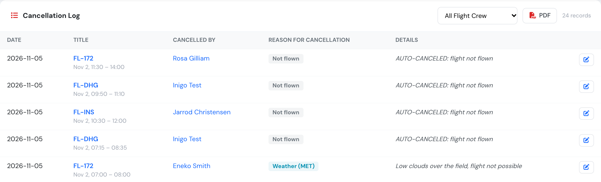

# Schedule cancellations

Flight cancellations are something we can not avoid. The important thing about them, is to keep a good track to analyze the factors and avoid the unnecessary events due to a lack of information about our own operations.

Flylogs is all about empowering you, the company manager, by giving you access to all the information in an easy to access and understand format.

The diagram below sums up the ways a booking gets canceled, described in detail on this page.

Each scheduled flight, if confirmed by the pilots, is due to happen. A scheduled flight that is never dispatched or logged is treated as **not flown**. Once the company's *not-flown grace window* passes after the scheduled end time, Flylogs automatically cancels the booking, attributes the cancellation to the **PIC**, and records the reason **"Not flown"**. These appear in the Schedule cancellation analytics alongside manual cancellations. In the flight's history the action is shown as performed by **Flylogs Autopilot** (the system), while the count still goes against the PIC. The auto-cancellation is silent — no notification is sent. Logging the flight (even without dispatching it from the schedule) prevents it. The grace window is set per company under **Company settings → Schedule → Schedule cancellations**, and can be disabled.

The PIC, SIC or supervisor can cancel their own booking manually, including a booking that has already been dispatched (its flight is cancelled with it), without having to dispatch it first. Aircraft, weather, maintenance and ATC cancellations are accepted at any time, even after departure. Personal and other reasons are accepted only until the company's **Dispatch Cancel Limit** (Company settings → Schedule → Schedule Cancellations) is reached; inside that window, crew should ask a scheduling manager to cancel for any other reason. If the Dispatch Cancel Limit is set to **Disabled**, crew cannot cancel their own bookings at all, for any reason (aircraft, weather, maintenance and ATC included); every cancellation then goes through a scheduling manager. See [Cancelling a flight](schedules-for-pilots-and-flight-instructors.md#cancelling-a-flight). Staff with scheduling rights are not subject to this limit and can always cancel any booking from the [Schedule Review page](schedule-review-page.md). Either way, the system asks for a cancellation reason.

<figure><figcaption>
Company settings → Schedule → Schedule Cancellations: the <strong>Dispatch Cancel Limit</strong>.
</figcaption></figure>

This information is stored and displayed in the Schedule cancellation analytics page so you can have a better understanding of why your flights are being cancelled.

### "Other reasons", read from the note



**Others** used to be one big grey slice, even though the note people write usually says exactly why: *"runway closed"*, *"instructor not available"*, *"I have a work trip"*, *"booked twice by mistake"*. Flylogs now reads those notes and shows them in the charts as their real reason, marked **(from notes)** — for example *Weather (from notes)* or *Instructor unavailable (from notes)*. In the cancellation log, an *Others* row shows the reason its note points to next to it.

Three reasons appear only this way, because nobody can choose them in the cancel dialog: **Personal**, **Instructor unavailable** and **Booking admin / error**.

<figure><figcaption>
"Others" split into the reasons its notes point to.
</figcaption></figure>

<figure><figcaption>
In the log, each Others row shows the reason read from its note.
</figcaption></figure>

This is an automated reading: the reason the person chose is never changed, and a note that does not clearly say why stays under *Others*.

### Completing a cancellation reason afterwards

Some cancellations have no useful reason: a booking cancelled automatically as **Not flown**, a booking cancelled together with its flight, or an older cancellation saved without a reason. You can give or correct the reason later, without changing anything else about the booking.

* In **Schedule → Review**, filter by status *Canceled* (or find the flight) and click **Edit cancellation reason** 💬 on its row.
* In **Schedule → Cancellations**, click the pencil next to a cancellation in the **Cancellation log**.

<figure><figcaption>
Schedule → Review: <strong>Edit cancellation reason</strong> on a canceled booking.
</figcaption></figure>

The dialog shows the same reasons as the cancel dialog, filled in with what is recorded today. Pick the reason and write a comment (required for the reasons that always ask for one, optional for aircraft and weather), then click **Save**.

<figure><figcaption>
The <strong>Edit cancellation reason</strong> dialog.
</figcaption></figure>

What happens when you save:

* Only the **reason** and the **comment** change. The booking (aircraft, crew, times, status) stays as it is and nobody is notified.
* The cancellation keeps its date and the person it is credited to, so it stays in the same month of the analytics, and the charts show the new reason.
* The booking **History** gets a *Change* entry with who edited the reason, when, and what the reason and comment were before.

<figure><figcaption>
The booking history keeps the previous reason in a <strong>Change</strong> entry.
</figcaption></figure>

<figure><figcaption>
Schedule → Cancellations: the pencil in the <strong>Cancellation log</strong>.
</figcaption></figure>

**Who can do this:** the same staff who can cancel a flight from the Schedule Review page. Flight Instructors, Theory Knowledge Instructors, pilots and students cannot, and do not see the button.

### Repeating bookings

Bookings created with **Repeat weekly** are linked. Cancelling one from the Schedule Manager (status *Canceled*) or deleting it asks whether to apply it to **this booking only** or **this and following**. See [Repeating flights](flight-schedule-records.md#repeating-flights).
