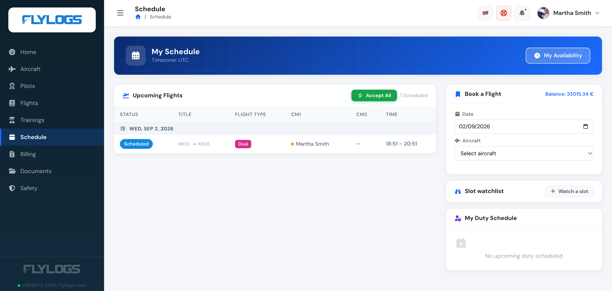
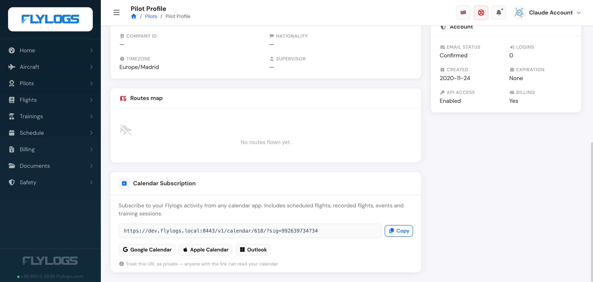

# Schedule notifications

Every time the flight schedule is published by your Roster Manager, Flylogs will deliver all flights to each pilot in a single email summarizing all flights.

Each pilot also gets an instant push notification for every booking published, changed or cancelled — with the callsign, aircraft, date and time — on the Flylogs app and on any browser where push is turned on. Pilots without push who switched on WhatsApp notifications receive the alert on WhatsApp instead. See [Notifications: push, WhatsApp and email](../first-steps/notifications.md).

## Receiving every booking as a manager

By default only the crew of a booking (PIC, SIC and supervisor) are notified. Company managers (Chief Pilot and above) can also receive the notification for **every** booking, change and cancellation in the company, even when they are not on the flight: open your profile, go to **Notifications** and switch on **All schedule changes**. The option is per company account and is off by default.

If you require your pilots to confirm, they will have the option to do so — the flight appears under **Upcoming Flights** on their Schedule page, awaiting **Accept** or **Reject**.

Each pilot can subscribe to their Flylogs activity — scheduled flights, recorded flights, events and training sessions — from a private calendar feed URL, addable to Google Calendar, Apple Calendar or Outlook. It's found on the **Calendar Subscription** card on their own profile page.

### Company calendar

Managers (Company Administrator, Operations Manager, Compliance & Safety Manager, Human Resources Manager, Financial Manager, Trainings Manager, Crew Scheduling, Flight Dispatcher and Chief Pilot) see a **My calendar / Company calendar** switch on the same card. **Company calendar** gives a second feed URL with every active booking of the company — all aircraft, all crew, not only the slots where they fly. Each event title starts with the aircraft registration.

- It covers the past 7 days and the next 3 months. Draft and canceled bookings are left out.
- It contains bookings only. Recorded flights, events, duty schedules and training sessions stay in the personal feed.
- Flight Instructors, pilots, students and other roles do not see the switch.
- The role is checked every time the calendar app refreshes the feed. If the user stops being a manager, the company feed stops returning data.
- Both feeds can be subscribed at the same time.

Treat the company feed URL as private: anyone with the link can read the whole company schedule, including crew names and phone numbers.

**API:** the feed is `GET /v1/calendar/{user_id}/?scope=company&sig={signature}`. `scope=company` returns 404 when the feed owner's group is above 150. Without `scope` the personal feed is returned as before.

The calendar feed does not allow to confirm or reject scheduled flights. To do so, the pilot still needs to login into Flylogs to manage the slots.
