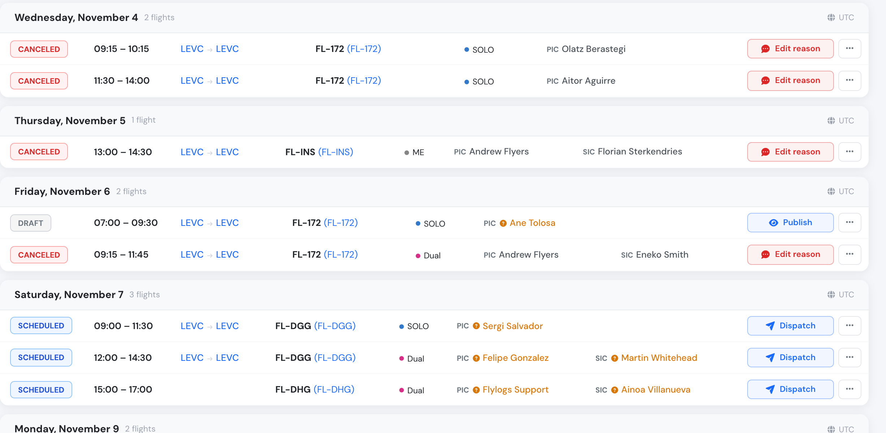
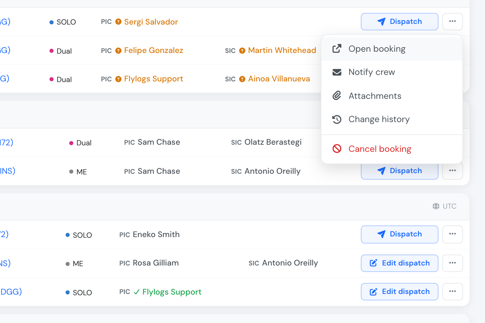

# Schedule Review page

The **Schedule Review** page is a list‑based companion to the [Schedule Manager calendar](schedule-edit-page.md). Instead of a grid, it shows your schedule records as a filterable, day‑grouped list with per‑flight actions — ideal for checking crew confirmations, publishing rosters, sending reminders, cancelling and dispatching flights.

<figure><figcaption>
Schedule records review page
</figcaption></figure>

### Access levels

What you can do on this page depends on your role:

* **Full management** — Company Administrators and the management roles up to Crew Scheduling (Operations, Compliance & Safety, Human Resources, Financial and Trainings managers). Full access shows every row action.
* **Read‑only** — Flight Dispatchers and Chief Pilots. They can browse and filter but see no action buttons.
* **No access** — everyone else, including Flight Instructors, Theory Knowledge Instructors, Captains, pilots, students and mechanics.

**Flight Instructor schedule management** opens the [Schedule Manager calendar](schedule-edit-page.md) to instructors, not this page. **All pilots see schedule** lets pilots read the master schedule on the **Schedule** page, not this one.

Some actions are further limited to **top‑level managers** (see each action below).


Times are shown in your **company time zone**, noted in the page header.


### Filters

Open the **Filters** bar to narrow the list by:

* **From / To** date range (defaults to today onward).
* **Status** — Scheduled, Landed or Canceled.
* **Aircraft**, **Pilot**, **Pilot group** and **Flight type**.

The bar shows how many filters are active and the total flight count. Results reload automatically as you change filters.

### Summary cards

Above the list, summary cards total the filtered results:

* **Flights** — total count.
* **By status** — a breakdown per status.
* **Block time** — combined scheduled hours and minutes.
* **Crew members** — distinct pilots involved.
* **Confirmations** — how many crew slots are **Accepted**, **Pending** or **Rejected**.

### The flight list

Records are grouped under date headers. Each row shows the **status**, **time**, **route** (departure → arrival), **callsign and aircraft**, **flight type**, and the **PIC / SIC** with their individual acceptance status (a tick for confirmed, a question mark for pending, a cross for rejected). Crew names and the aircraft link through to their records.

### Row actions

Each row ends with two buttons:

* A labelled button with the **next step for that flight's status**:

  | Status | Button |
  |--------|--------|
  | Draft | **Publish** — publishes the record to crew. *(Top‑level managers.)* |
  | Scheduled / Confirmed, no flight yet | **Dispatch** — opens the dispatch form to create the flight draft. Requires flight‑creation permission. See [Flight Dispatch Function](flight-dispatch-function.md). |
  | Dispatched | **Edit dispatch** — changes the dispatch data of the flight. |
  | Landed | **View flight** — opens the flight record. |
  | Canceled | **Edit reason** — gives or corrects the cancellation reason and comment afterwards, for example for a flight cancelled automatically as *Not flown*. Only the reason and comment change. See [Completing a cancellation reason afterwards](schedule-cancellations.md#completing-a-cancellation-reason-afterwards). |
  | Anything else, or a role without that action | **Open** — opens the booking. |

* **⋯ (more actions)** — every other action the flight offers:
  * **Open booking** and **View flight** (once a flight exists).
  * **Notify crew** — sends an email reminder to the crew of a **Scheduled** flight.
  * **Attachments** — view and add files to the record; the count of files is shown next to it.
  * **Change history** — the audit trail of status changes, with who made each change, the reason/notes and the timestamp.
  * **Export PDFs** — on dispatched and landed flights, the same documents as the flight's own Export menu. See [Exporting the flight's documents](flight-dispatch-function.md#5-exporting-the-flights-documents).
  * **Cancel booking** — cancels a **Scheduled** flight. You must pick a **cancellation reason**; some reasons require a short explanation. Unlike a crew member cancelling their own booking, this action is not restricted by the company's *Dispatch cancel limit* — staff with scheduling rights can cancel any flight at any time up to departure. See [Schedule cancellations](schedule-cancellations.md).

A record with attachments also shows a green 📎 button with the file count before the other two, so you can see at a glance which flights carry files.

Users with view‑only access to the page see **Open** and the read‑only items of the menu; actions that change a record are not shown to them. Without a connection, the actions that need the server (notify, attachments, history, exports, cancel, edit reason) are hidden.

<figure><figcaption>
The next step on each row, and the <strong>⋯</strong> menu of a scheduled flight.
</figcaption></figure>

### Dispatch form

Dispatching turns a schedule record into a flight draft. The form pre‑fills departure/arrival airports, callsign and flight type from the booking, and lets you add a **route** and **remarks**. For **AOC operators**, **passenger** and **cargo** fields are also shown. On success the record is marked **Dispatched** and you can open the new flight directly.

### Publish to pilots (bulk)

Top‑level managers see a **Publish to pilots** button in the header. It opens a modal where you select a date range and choose whether to notify **only newly added/pending** records or everyone in range, then sends the roster notifications in one step. See [Publishing multiple schedule records](publishing-multiple-schedule-records.md) and [Schedule notifications](schedule-notifications.md).

### Offline

The bookings of the next 7 days are kept on your device, so this page still lists them, read-only, without a connection. See [Schedules and classes offline](offline-schedules-and-classes.md).
