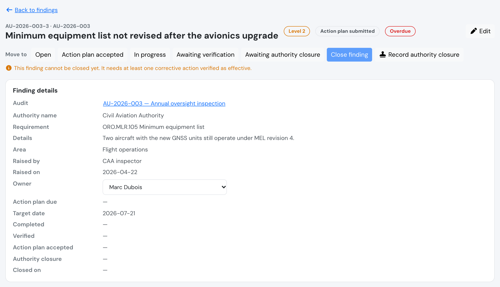
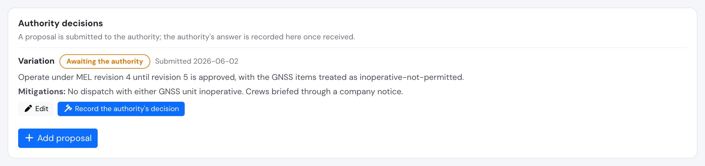
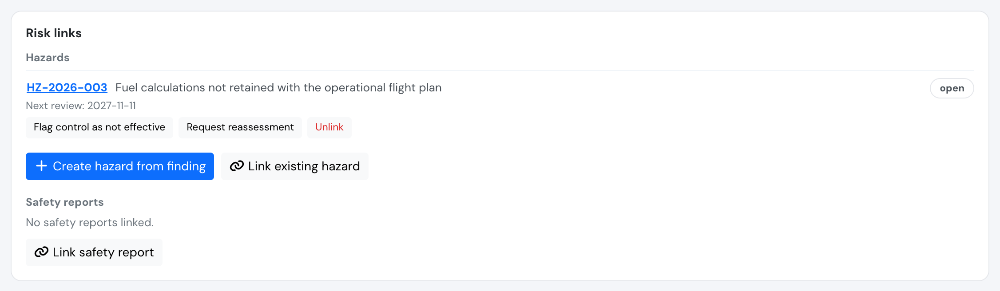
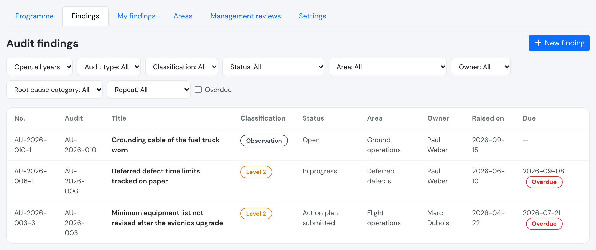
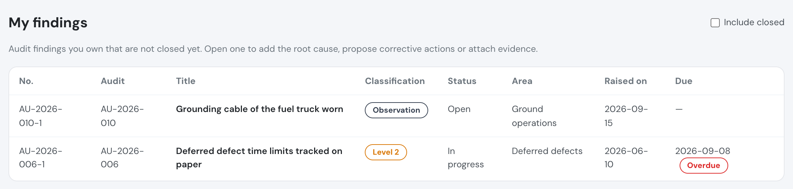

# Audit findings

An **audit finding** records something an [audit](audits.md) found, from an internal audit or from your competent authority, and follows it until it is closed. Every finding has an owner, a full set of dates, a root cause, [corrective actions](safety-actions.md) that must be verified as effective, and, where your authority is involved, the authority's decisions. Findings feed the causes of non-compliance back into your [hazard log](hazard-log.md). The tools **support** your compliance monitoring; they do not make the operator compliant by themselves.

> Classifications, deadlines and frequencies are **company configuration**, set in [Audit settings](audits.md#audit-settings). They are defaults to match your own procedures, not ICAO values.

## Who can do what

| Who | Findings |
| --- | --- |
| Compliance & Safety Manager and above (user group 110 or lower) | Everything: record findings (also on behalf of external auditors), set classification and dates, assign the owner, move the status, close, record authority decisions, link risks, create corrective actions and verify them |
| **Accountable manager** | **Read-only** on every finding. Can add resulting actions only on a [management review](management-review.md) |
| **Auditor** (user group 250) | **Read-only** on every finding and file. Never owns findings or actions |
| **Finding owner** (any group) | Their own findings only: see the finding and its audit's header, write the **root cause** and its category, **propose corrective actions** and **authority decision proposals**, attach and remove **their own** evidence. Cannot close, change the classification, the dates or the owner |
| **Action owner** (any group) | Only their own corrective actions: mark them done |
| Everyone else | No access |

* Requires the **Premium** or **Unlimited** plan.
* The owner must be an active user of your company and cannot be an auditor.
* A closed finding can no longer be changed by its owner.

## Recording a finding

A manager records a finding from the audit page (**Add finding**) or from **Safety > Audit findings > New finding**, or from the **Create finding** prompt of a *non-compliance* assessment.

| Field | Meaning |
| --- | --- |
| Audit | The audit the finding belongs to. A cancelled audit cannot get findings |
| Number | Assigned automatically (the audit number plus a sequence, for example `AU-2026-004-2`). You can change it; it must be unique within the audit |
| Classification | One of your [classifications](audits.md#audit-settings) |
| Requirement | The requirement concerned, with its revision |
| Title and details | What was found |
| Area | The audit area (optional, but needed for repeat detection and for the area's planning inputs) |
| Raised by, raised on | Defaults to today. For an external auditor, type their name |
| Owner | The person who will deal with it. They are notified |
| Linked assessment | The assessment it came from (optional) |

The **action plan due** and **target** dates are filled from the classification's default number of days, counted from the raised date. Leave a date empty to use the default, or enter your own: defaults are always overridable on each finding.

### Repeat findings

The finding page suggests **possible repeat findings**: earlier findings in the same area with the same requirement raised in the last 24 months. The manager confirms by choosing **Mark as repeat** (and can remove the link). Repeat findings are counted in the area's suggested frequency and have their own section in the management report.

## The dates of a finding

| Date | Meaning |
| --- | --- |
| Raised on | When the finding was raised |
| Action plan due | Target for submitting the corrective action plan |
| Target date | Target for implementing the corrective actions |
| Completed | When the last corrective action was done. Set automatically |
| Verified | When the corrective actions were verified as effective. Set automatically when the closing conditions are met |
| Action plan accepted (date and reference) | The authority accepted the plan. Authority audits |
| Authority closure (date and reference) | The authority closed the finding. Authority audits |
| Closed on | When the finding was closed in Flylogs. For authority findings it mirrors the authority's closure |

## Status

| Status | Meaning |
| --- | --- |
| **Open** | Recorded, nothing done yet |
| **Action plan submitted** | The plan was sent to the authority (authority audits only) |
| **Action plan accepted** | The authority accepted the plan (authority audits only) |
| **In progress** | At least one corrective action is open |
| **Awaiting verification** | All corrective actions are done and need to be verified |
| **Awaiting authority closure** | Corrective actions verified; the authority has to close it (authority audits only) |
| **Closed** | Closed in Flylogs or by the authority |
| **Closed by authority decision** | Closed because the authority accepted a variation or alternative means (see [Authority decisions](#authority-decisions)) |

### Moves that happen automatically

Corrective actions move the finding for you:

* The first corrective action takes it to **In progress**.
* When no action is open any more (all done or verified) it moves to **Awaiting verification** and the **Completed** date is set. On an authority finding that already meets the closing conditions it moves to **Awaiting authority closure**.
* A new open action, or an action re-verified as not effective, moves it back from those waiting states, and the dates they set are cleared so the next completion dates itself again.
* **Action plan submitted** is never left automatically: the authority's acceptance is a manual step.

### Moves a manager makes

Managers move the status with **Move to**. Internal findings offer **Open**, **In progress**, **Awaiting verification** and **Closed**; authority findings also offer **Action plan submitted**, **Action plan accepted** and **Awaiting authority closure**. Accepting the action plan records the date and the authority's reference.

* **Moving a finding back** needs a **note** and undoes what the later stages recorded (completion and verification dates, plan acceptance, closure).
* **Closed by authority decision** is never set by hand: it follows an accepted decision.
* Every move is stored in the history of the finding with who made it and the note.

### Closing rules

A finding is never closed without verified work. To **close** a finding whose classification is a **non-compliance**:

* at least one corrective action must be **verified as effective**, and
* no corrective action may still be **open or waiting for verification**. An action verified as *not effective* does not block, but its follow-up action must pass.

Cancelled actions are ignored. If the conditions are not met, the finding page says why ("It needs at least one corrective action verified as effective", "Some corrective actions are still open or waiting for verification").

An **observation** (a classification that is not a non-compliance) can be closed with a **closure note**, without corrective actions.

### Authority closure

For a finding of an **authority** audit, use **Record authority closure** with the date and reference the authority gave. The authority is the source of truth, so this can be recorded **from any status**, even while corrective actions are still open (they stay open) and even over a closure by decision.

### Observation to finding

A manager can turn an **observation** into a finding with **Convert to finding**: choose a non-compliance classification and give a **reason**. The dates are set again from the new classification, the finding restarts at **Open**, and the conversion is stored in the history with its reason. Only observations can be converted, and only to a non-compliance classification.

## Root cause

The owner (or a manager) writes the **root cause** and picks a **category**, which allows trends and recurring causes to be reported: procedures, documentation, training, human factors, supervision, resources, equipment and facilities, communication, contracted services, organisational or other.

## Corrective actions

Corrective actions are [safety actions](safety-actions.md) attached to the finding. Use **Add action** on the finding page: managers assign the owner and due date directly; the finding owner **proposes** actions, created open. Actions follow the usual lifecycle (open, done, verified as effective or not effective, cancelled) and appear in **My safety actions** and in the *overdue safety actions* indicator. A reminder email goes to the action owner 3 days before and on the due date.

Attach **evidence** (documents or photos showing the corrective work) in the finding's evidence area. Owners can add evidence and remove only the files they uploaded; managers can remove any. Auditors and the accountable manager can only open them.

## Authority decisions

Where your authority is involved, the finding records **authority decisions**. They are a finding-management procedure that may or may not exist under your authority, not an ICAO mechanism; use the types that apply.

| Type | Use |
| --- | --- |
| Variation | A proposal to vary from the requirement, with mitigations |
| Alternative means | A proposed alternative way to meet the requirement |
| Action plan acceptance | The authority's acceptance of your corrective action plan (authority audits only) |
| Other | Anything else the authority decides |

1. The finding owner or a manager adds a **proposal**: the type, the proposal text, the mitigating factors and the safety evidence, and the submission date. A pending proposal can be edited by its owner until the authority answers.
2. A manager records the **authority's decision**: accepted or rejected, the date, the reference and the authority's position. **A recorded decision is final** and its type and outcome cannot be changed afterwards.
3. When a **variation** or **alternative means** is **accepted**, the finding is **closed by authority decision** and the decision's closure date is the decision date. An accepted action plan acceptance records the plan acceptance date and reference and moves the finding to **Action plan accepted**.

### Accepted variations are reviewed

An accepted variation or alternative means is **not acceptable forever**, and it never makes the underlying risk acceptable by itself. To accept one you must:

* give a **review date** or an **expiry date**, and
* **link a hazard** (create one from the finding, or link an existing one) that is still open and whose **next review date is on or before** that review or expiry date.

The hazard keeps the risk visible and reviewed. Flylogs refuses to unlink the only hazard that covers an accepted decision, and managers receive a reminder **30 days before** the review or expiry date.

## Links to risk management

The finding page has a **Risk links** panel, managers only, so that the causes of non-compliance reach your [hazard log](hazard-log.md):

* **Create hazard from finding**: a new hazard is added to the hazard log, prefilled with the finding's title, the details and the root cause, and the department of the finding's area, and linked to the finding. You can adjust its type, owner, initial risk and review interval.
* **Link existing hazard**: link an open hazard. A hazard can be linked to many findings and a finding to many hazards.
* **Link safety report**: link a submitted safety report (managers can search by number or name) to bring its risk assessment into the finding.
* **Flag control as not effective**: mark a linked hazard's existing risk control as ineffective, with a note naming the control or action. The flag can be cleared.
* **Request reassessment**: the hazard's next review becomes due **today** (so it shows as due in the hazard log and counts as an *untracked risk* on the Assurance dashboard until reviewed) and the hazard owner is notified. A closed hazard cannot be reassessed: reopen it first.

Removing a link does not change the hazard or the report.

## Documents for the authority

From the finding page managers can preview and issue **PDFs** with the same preview, issue and [version](audits.md#issued-documents-and-versions) flow as the rest of the audit tools:

* **Corrective action response**: the finding, its dates, root cause and corrective actions.
* **Decision proposal**: one per authority decision, laid out as reference, status, introduction, description, mitigations and the authority's position.

Issued versions are immutable and listed in the finding's **Issued documents** panel.

## The findings list

**Safety > Audit findings** lists the findings of a year (by raised date). Filter by:

* **Year**, **audit type** (internal or authority), **classification**, **status**, **area** (an area includes its sub-areas) and **owner**;
* **Root cause category**;
* **Repeat findings only** or **Not repeat**;
* **Overdue**: every unfinished finding raised up to the end of the selected year that is past its dates.

### What counts as overdue

A finding is **overdue** when it is still being worked on (open, action plan submitted, action plan accepted or in progress) and it is **past its target date**, or it is still **open** and **past its action plan due date**. Findings that are *awaiting verification* or *awaiting authority closure* are shown separately and never count as overdue, and neither do closed findings.

## What a finding owner sees

Anyone can be made the owner of a finding, in any user group. The owner receives a message when a finding is assigned and sees only **their own** findings:

* the finding with all its dates, classification, status, root cause, corrective actions and decisions;
* the **header** of its audit (kind, authority name, title and dates), **never** the audit's results, attached files, assessments or its other findings;
* a history limited to entries about what they can see, with no risk-link entries and no repeat link.

They can write the root cause and category, propose corrective actions and authority decision proposals, and attach evidence. Everything else is read-only for them.

### My findings

**Safety > My findings** is available to every active user except auditors. It lists the findings you own that are **not closed**, of **any year**, so an open finding never disappears when the year changes. Use **Include closed** to see the closed ones too. Open a finding to add the root cause, propose corrective actions or attach evidence.

## Notifications

| Who | When |
| --- | --- |
| Finding owner | A finding is assigned or the owner is changed (in-app and email) |
| Finding owner | Reminders **14 days before**, **3 days before** and **on** the action plan due date (only while the finding is open) and the target date (while it is still being worked on) |
| Action owner | 3 days before and on the due date of a corrective action |
| Managers | 30 days before the review or expiry date of an accepted authority decision |
| Hazard owner | A reassessment is requested from a finding |

## Safety Assurance dashboard

Open and overdue findings, findings awaiting authority or verification and areas overdue for audit are summarised in the [Safety Assurance dashboard](safety-assurance.md#audits-and-findings), and every number opens the list behind it.

## API

See [Audits API](../API/audits.md#findings).
