# Audit findings



An **audit finding** records a compliance finding and follows it until it is closed. Most findings come from an [audit](audits.md), internal or by your competent authority, but a finding can also be raised **without an audit**: from a safety report or an occurrence investigation, a management review, a letter from the authority, or anything else (see [Findings without an audit](#findings-without-an-audit)). All of them sit in one register, with the same classifications, dates and closing rules. Every finding has an owner, a full set of dates, a root cause, [corrective actions](safety-actions.md) that must be verified as effective, and, where your authority is involved, the authority's decisions. Findings feed the causes of non-compliance back into your [hazard log](hazard-log.md). The tools **support** your compliance monitoring; they do not make the operator compliant by themselves.

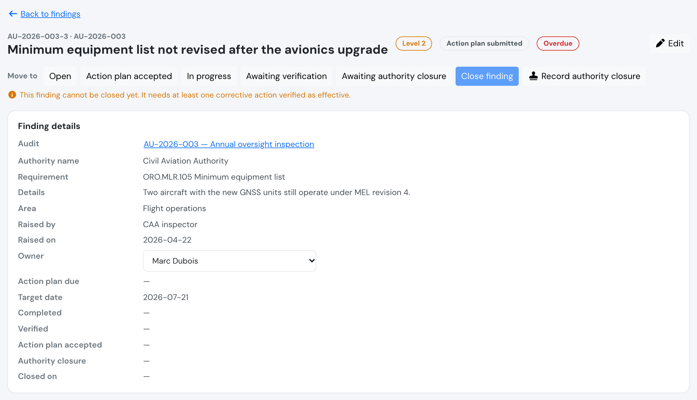

> Classifications, deadlines and frequencies are **company configuration**, set in [Audit settings](audits.md#audit-settings). They are defaults to match your own procedures, not ICAO values.

## Who can do what

| Who | Findings |
| --- | --- |
| Compliance & Safety Manager and above (user group 110 or lower) | Everything: record findings (also on behalf of external auditors), set classification and dates, assign the owner, move the status, close, record authority decisions, link risks, create corrective actions and verify them |
| **Accountable manager** | **Read-only** on every finding. Can add resulting actions only on a [management review](management-review.md) |
| **Auditor** (user group 250) | **Read-only** on every finding and file. Never owns findings or actions. On an audit they lead or are on the team of, while it is not completed or cancelled, they can raise findings, correct the ones they raised while **Open**, and add evidence (see [When the auditor records the audit](audits.md#when-the-auditor-records-the-audit)). On the internal findings they raised, they verify the corrective actions and close the finding (see [Independent verification](#independent-verification-by-the-auditor)). Their rights hang off an audit, so they cannot raise, correct or verify a [finding without an audit](#findings-without-an-audit) |
| **Finding owner** (any group) | Their own findings only: see the finding and its audit's header, write the **root cause** and its category, **propose corrective actions** and **authority decision proposals**, attach and remove **their own** evidence. Cannot close, change the classification, the dates or the owner |
| **Action owner** (any group) | Only their own corrective actions: mark them done |
| Everyone else | No access |

* Requires the **Premium** or **Unlimited** plan.
* The owner must be an active user of your company and cannot be an auditor.
* Once a finding is **closed** (or **closed by decision**), its owner can no longer change the root cause, propose authority decisions or propose new corrective actions: only a manager can add actions to it. The owner can still attach evidence and mark their own actions done.

## Recording a finding

A manager records a finding from the audit page (**Add finding**), from **Safety > Audits > Findings > New finding**, from the **Create finding** prompt of a *non-compliance* assessment, or from a safety report with **Raise finding** (see [Raising a finding from a safety report](#raising-a-finding-from-a-safety-report)).

| Field | Meaning |
| --- | --- |
| Audit | The audit the finding belongs to, or **No audit** for a finding raised on its own. A cancelled audit cannot get findings |
| Source | Where the finding came from: **Audit**, **Safety report**, **Management review**, **Authority correspondence** or **Other**. Required when there is no audit; on an audit it defaults to *Audit*. *Audit* is only possible on an audit |
| Source reference | Optional: the report number, the authority's letter reference, the review, your own reference |
| Number | Assigned automatically: on an audit, the audit number plus a sequence (for example `AU-2026-004-2`); without an audit, the company series `FN-YYYY-NNN` of the year it was raised (for example `FN-2026-001`). You can change it, for example to keep your own reference. It must be unique within the audit, or within the company for a finding without an audit |
| Classification | One of your [classifications](audits.md#audit-settings) |
| Requirement | The requirement concerned, with its revision |
| Title and details | What was found |
| Area | The audit area (optional, but needed for repeat detection and for the area's planning inputs) |
| Raised by, raised on | Defaults to today. For an external auditor, type their name |
| Owner | The person who will deal with it. They are notified |
| Linked assessment | The assessment it came from (optional, findings on an audit only) |

The **action plan due** and **target** dates are filled from the classification's default number of days, counted from the raised date. Leave a date empty to use the default, or enter your own: defaults are always overridable on each finding.

### Findings without an audit

Your management system may treat a finding the same way whatever found it. A finding raised from an occurrence investigation, a management review or the authority's correspondence is recorded with **No audit** and its **source**, and then works like any other finding:

* it has a **classification**, and its action plan due and target dates come from that classification;
* it is numbered in the company series **FN-YYYY-NNN**, so every finding has a number in one register;
* it counts in its **area's open findings** and so in the area's suggested audit frequency, appears in the findings list, the [management report](management-review.md), the reminders, the [Safety Assurance dashboard](safety-assurance.md) and **All safety actions**;
* it is **internal**: its statuses are Open, In progress, Awaiting verification and Closed. Authority statuses, [authority decisions](#authority-decisions) and the authority closure belong to findings of an authority audit;
* there is no audit report to approve, so changing it never withdraws an approval.

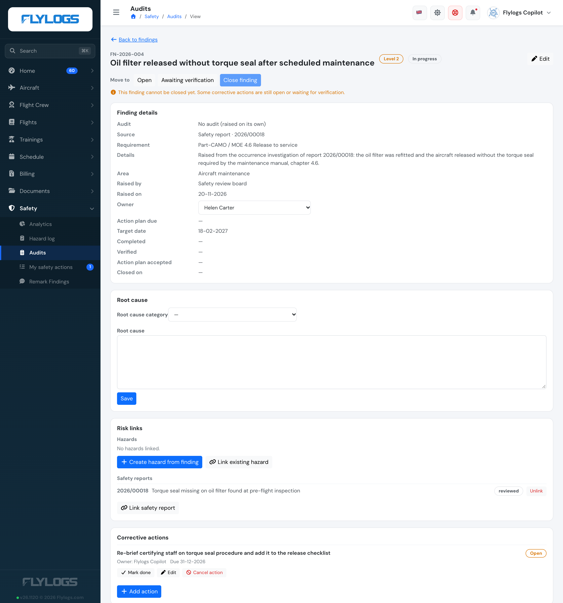

The finding page shows **Audit: No audit (raised on its own)** and the **Source** with its reference. If the finding later turns out to belong to an audit, [move it](#moving-a-finding-to-another-audit).

### Raising a finding from a safety report

On a submitted safety report, managers open **Manage > Raise finding**, or use **Raise finding** in the report's **Compliance findings** box.

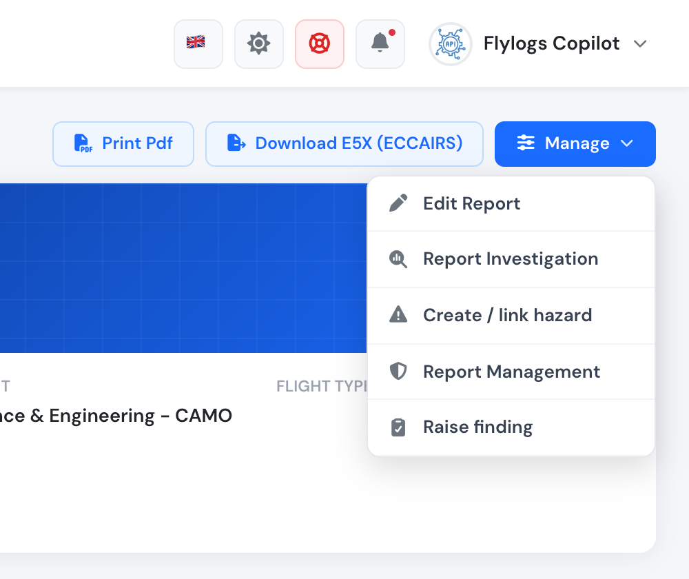

The new-finding form opens with the source set to **Safety report**, the report number as the source reference and the report's title as the finding title. Choose the classification, area and owner, and save. The report is **linked** to the finding (its risk assessment comes with it, as with [Link safety report](#links-to-risk-management)), and the finding is listed in the report's **Compliance findings** box.

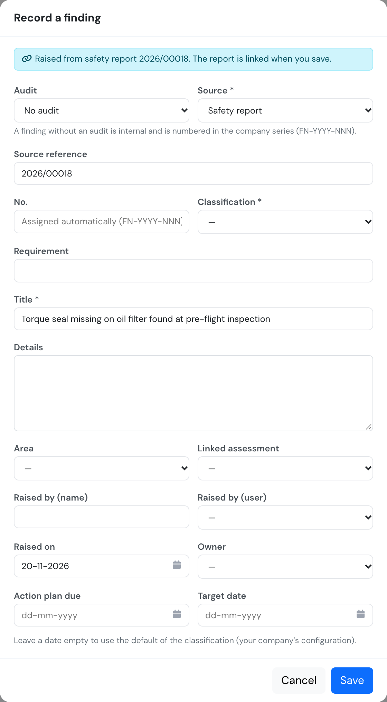

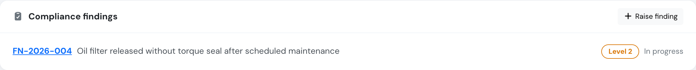

A report still in draft, or a follow-up statement, cannot raise a finding.

### Moving a finding to another audit

A finding filed against the wrong audit can be moved. Managers open **Edit** on the finding and choose another audit, or **No audit**, or an audit for a finding that had none. On save:

* the finding takes the **next number** of its new series (the audit's, or `FN-YYYY-NNN`), unless you type a number yourself. The previous number stays in the finding's history;
* its **linked assessment** is cleared, as it belonged to the old audit;
* the approval of **both** audit reports is withdrawn, as one loses the finding and the other gains it.

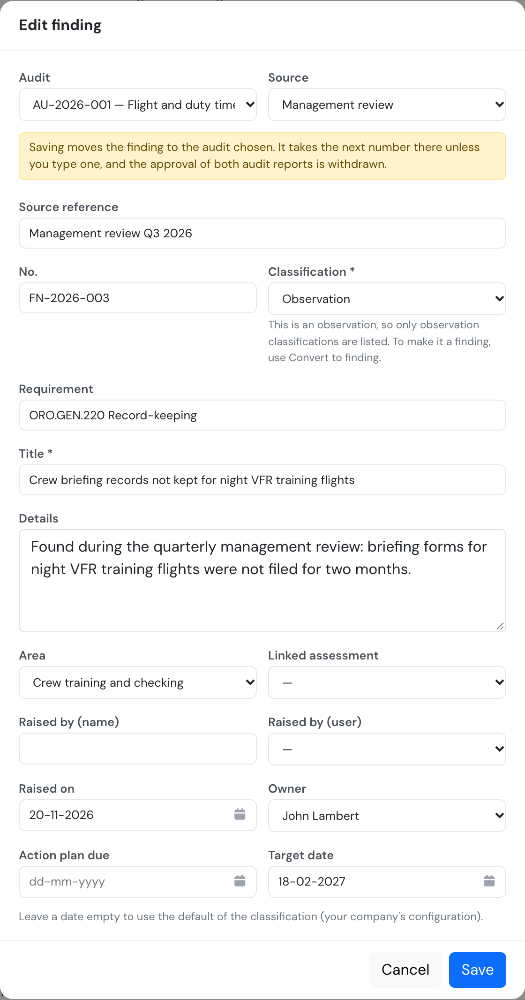

A finding at an authority stage (action plan submitted or accepted, awaiting authority closure, or closed by the authority) can only move to another authority audit. A finding with authority decisions stays on an audit, and a finding whose source is *Audit* needs a different source before it can leave its audit.

### Repeat findings

The finding page suggests **possible repeat findings**: earlier findings in the same area with the same requirement raised in the last 24 months. The manager confirms by choosing **Mark as repeat** (and can remove the link). Repeat findings are counted in the area's suggested frequency and have their own section in the management report.

## The dates of a finding

| Date | Meaning |
| --- | --- |
| Raised on | When the finding was raised |
| Action plan due | Target for submitting the corrective action plan |
| Target date | Target for implementing the corrective actions |
| Completed | When the last corrective action was done. Set automatically |
| Verified | When the corrective actions were verified as effective. Set automatically when the closing conditions are met |
| Action plan accepted (date and reference) | The authority accepted the plan. Authority audits |
| Authority closure (date and reference) | The authority closed the finding. Authority audits |
| Closed on | When the finding was closed in Flylogs. For authority findings it mirrors the authority's closure |

## Status

The usual path of a finding. The action plan steps and the authority closure apply to authority audits only:

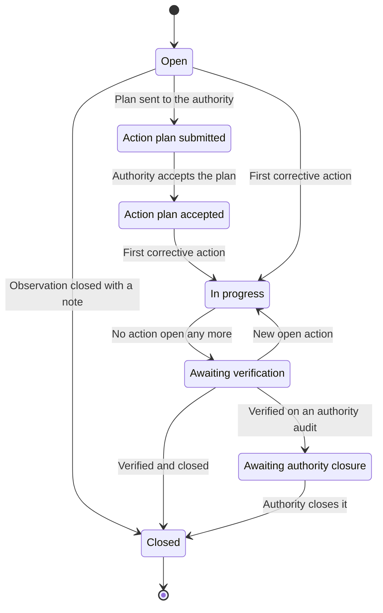

| Status | Meaning |
| --- | --- |
| **Open** | Recorded, nothing done yet |
| **Action plan submitted** | The plan was sent to the authority (authority audits only) |
| **Action plan accepted** | The authority accepted the plan (authority audits only) |
| **In progress** | At least one corrective action is open |
| **Awaiting verification** | All corrective actions are done and need to be verified |
| **Awaiting authority closure** | Corrective actions verified; the authority has to close it (authority audits only) |
| **Closed** | Closed in Flylogs or by the authority |
| **Closed by authority decision** | Closed because the authority accepted a variation or alternative means (see [Authority decisions](#authority-decisions)) |

### Moves that happen automatically

Corrective actions move the finding for you:

* The first corrective action takes it to **In progress**.
* When no action is open any more (all done or verified) it moves to **Awaiting verification** and the **Completed** date is set. On an authority finding that already meets the closing conditions it moves to **Awaiting authority closure**.
* A new open action, or an action re-verified as not effective, moves it back from those waiting states, and the dates they set are cleared so the next completion dates itself again.
* **Action plan submitted** is never left automatically: the authority's acceptance is a manual step.

### Moves a manager makes

Managers move the status with **Move to**. Internal findings offer **Open**, **In progress**, **Awaiting verification** and **Closed**; authority findings also offer **Action plan submitted**, **Action plan accepted** and **Awaiting authority closure**. Accepting the action plan records the date and the authority's reference.

* **Moving a finding back** needs a **note** and undoes what the later stages recorded (completion and verification dates, plan acceptance, closure).
* **Closed by authority decision** is never set by hand: it follows an accepted decision.
* Every move is stored in the history of the finding with who made it and the note.

### Independent verification by the auditor



Your procedures may require that corrective actions are not verified by the person who owns them, for example when the safety manager owns the actions of a finding. The auditor who raised a finding can then do the verification:

* An **Auditor**-role user (user group 250) who **raised** a finding of an **internal** audit can **Verify** its completed corrective actions (effective or not effective, with a note) and **Close finding** once the [closing rules](#closing-rules) are met.
* This stays available until the finding is closed, also after the audit itself is completed, because verification usually happens weeks after the audit.
* It is the only status change the auditor makes: they cannot reopen, cancel or edit actions, move the finding to another status or record the authority's closure. Findings of authority audits are closed by the authority as usual.
* The verification and the closure are stored under the auditor's name in the action and finding history.

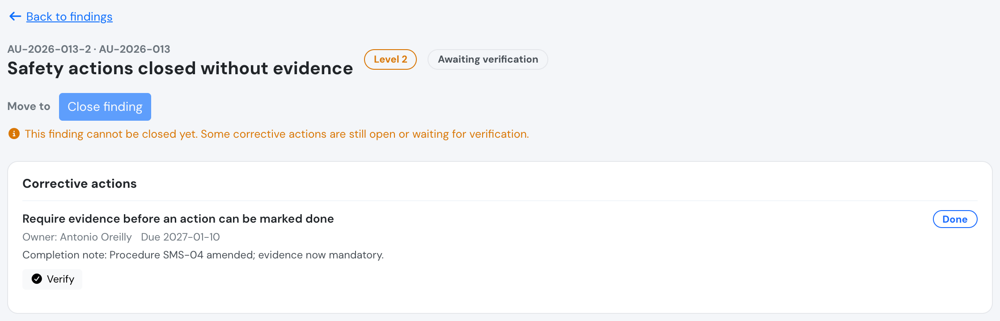

### Closing rules

A finding is never closed without verified work. To **close** a finding whose classification is a **non-compliance**:

* at least one corrective action must be **verified as effective**, and
* no corrective action may still be **open or waiting for verification**. An action verified as *not effective* does not block, but its follow-up action must pass.

Cancelled actions are ignored. If the conditions are not met, the finding page says why ("It needs at least one corrective action verified as effective", "Some corrective actions are still open or waiting for verification").

An **observation** (a classification that is not a non-compliance) can be closed with a **closure note**, without corrective actions.

### Authority closure

For a finding of an **authority** audit, use **Record authority closure** with the date and reference the authority gave. The authority is the source of truth, so this can be recorded **from any status**, even while corrective actions are still open (they stay open) and even over a closure by decision.

### Observation to finding

A manager can turn an **observation** into a finding with **Convert to finding**: choose a non-compliance classification and give a **reason**. The dates are set again from the new classification, the finding restarts at **Open**, and the conversion is stored in the history with its reason. Only observations can be converted, and only to a non-compliance classification.

## Root cause

The owner (or a manager) writes the **root cause** and picks a **category**, which allows trends and recurring causes to be reported: procedures, documentation, training, human factors, supervision, resources, equipment and facilities, communication, contracted services, organisational or other.

## Corrective actions

Corrective actions are [safety actions](safety-actions.md) attached to the finding. Use **Add action** on the finding page. Managers and the finding owner can both add actions, and whoever adds an action sets its owner and due date; a new action always starts **open**. On a closed finding only a manager can add actions. Actions follow the usual lifecycle (open, done, verified as effective or not effective, cancelled) and appear in **My safety actions** and in the *overdue safety actions* indicator. A reminder email goes to the action owner 3 days before and on the due date.

Attach **evidence** (documents or photos showing the corrective work) in the finding's evidence area. Owners can add evidence and remove only the files they uploaded; managers can remove any. The auditor conducting the finding's audit can do the same as an owner (add, and remove their own files). Other auditors and the accountable manager can only open them.

## Authority decisions

Where your authority is involved, the finding records **authority decisions**. They are a finding-management procedure that may or may not exist under your authority, not an ICAO mechanism; use the types that apply.

| Type | Use |
| --- | --- |
| Variation | A proposal to vary from the requirement, with mitigations |
| Alternative means | A proposed alternative way to meet the requirement |
| Action plan acceptance | The authority's acceptance of your corrective action plan (authority audits only) |
| Other | Anything else the authority decides |

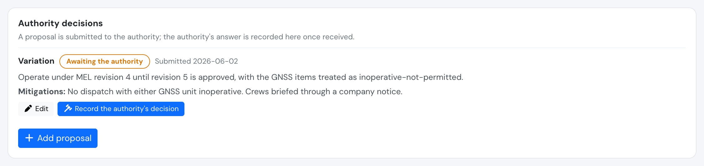

1. The finding owner or a manager adds a **proposal**: the type, the proposal text, the mitigating factors and the safety evidence, and the submission date. A pending proposal can be edited by its owner until the authority answers.
2. A manager records the **authority's decision**: accepted or rejected, the date, the reference and the authority's position. **A recorded decision is final** and its type and outcome cannot be changed afterwards.
3. When a **variation** or **alternative means** is **accepted**, the finding is **closed by authority decision** and the decision's closure date is the decision date. An accepted action plan acceptance records the plan acceptance date and reference and moves the finding to **Action plan accepted**.

### Accepted variations are reviewed

An accepted variation or alternative means is **not acceptable forever**, and it never makes the underlying risk acceptable by itself. To accept one you must:

* give a **review date** or an **expiry date**, and
* **link a hazard** (create one from the finding, or link an existing one) that is still open and whose **next review date is on or before** that review or expiry date.

The hazard keeps the risk visible and reviewed. Flylogs refuses to unlink the only hazard that covers an accepted decision, and managers receive a reminder **30 days before** the review or expiry date.

## Links to risk management

The finding page has a **Risk links** panel, managers only, so that the causes of non-compliance reach your [hazard log](hazard-log.md):

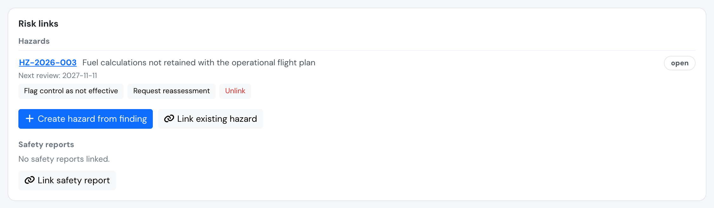

* **Create hazard from finding**: a new hazard is added to the hazard log, prefilled with the finding's title, the details and the root cause, and the department of the finding's area, and linked to the finding. You can adjust its type, owner, initial risk and review interval.
* **Link existing hazard**: link an open hazard. A hazard can be linked to many findings and a finding to many hazards.
* **Link safety report**: link a submitted safety report (managers can search by number or name) to bring its risk assessment into the finding.
* **Flag control as not effective**: mark a linked hazard's existing risk control as ineffective, with a note naming the control or action. The flag can be cleared.
* **Request reassessment**: the hazard's next review date is set to **today** and the hazard owner is notified. From the next day, until a review is recorded, the hazard shows as overdue for review in the hazard log and counts as an *untracked risk* on the Assurance dashboard. A closed hazard cannot be reassessed: reopen it first.

Removing a link does not change the hazard or the report.

## Documents for the authority

From the finding page managers can preview and issue **PDFs** with the same preview, issue and [version](audits.md#issued-documents-and-versions) flow as the rest of the audit tools:

* **Corrective action response**: the finding, its dates, root cause and corrective actions.
* **Decision proposal**: one per authority decision, laid out as reference, status, introduction, description, mitigations and the authority's position.

Issued versions are immutable and listed in the finding's **Issued documents** panel.

## The findings list

**Safety > Audits > Findings** opens on **Open, all years**: every finding that is not closed, whatever year it was raised in, so nothing still open drops out of view when the year changes. Pick a year instead to see all the findings raised in that year (by raised date), closed ones included. Filter by:

* **Open, all years** or a **year**, **audit type** (internal or authority; findings without an audit count as internal), **source** (or **No audit** for only the findings without one), **classification**, **status**, **area** (an area includes its sub-areas) and **owner**;
* **Root cause category**;
* **Repeat findings only** or **Not repeat**;
* **Overdue**: every unfinished finding past its dates, of any year with **Open, all years**, or raised up to the end of the selected year.

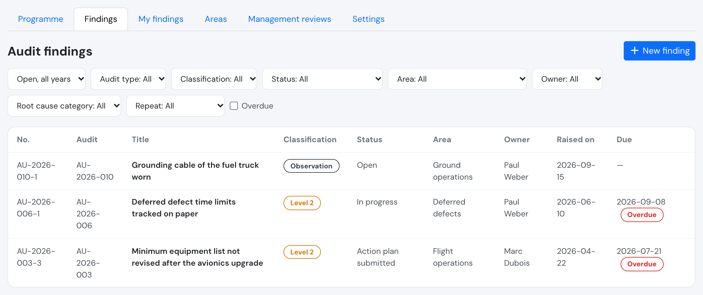

The **Audit / source** column shows the audit number, or, for a finding without an audit, its source and reference.

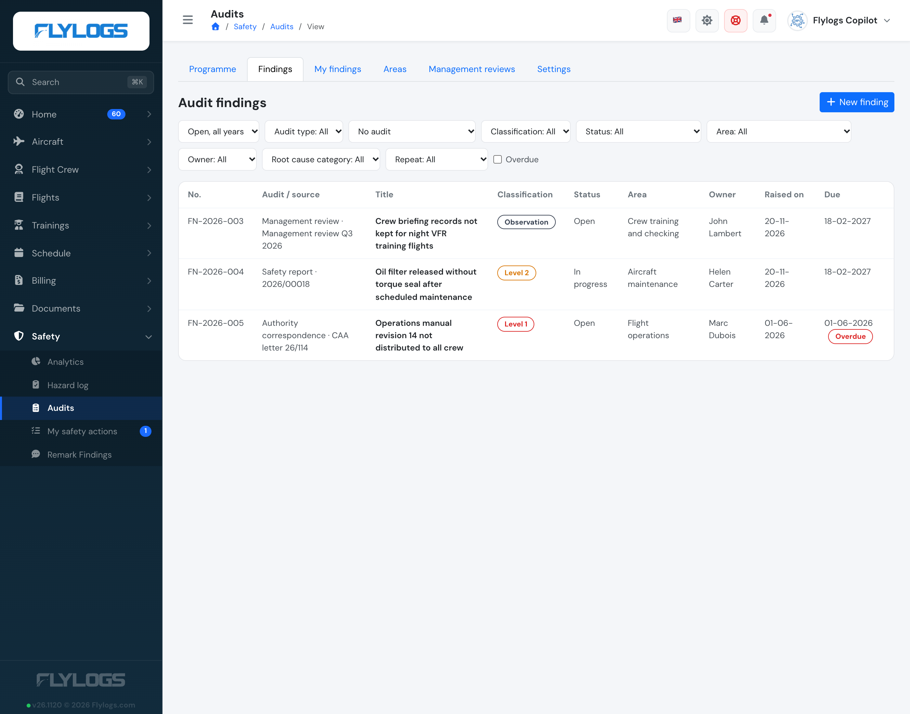

### What counts as overdue

A finding is **overdue** when it is still being worked on (open, action plan submitted, action plan accepted or in progress) and it is **past its target date**, or it is still **open** and **past its action plan due date**. Findings that are *awaiting verification* or *awaiting authority closure* are shown separately and never count as overdue, and neither do closed findings.

## What a finding owner sees

Anyone can be made the owner of a finding, in any user group. The owner receives a message when a finding is assigned and sees only **their own** findings:

* the finding with all its dates, classification, status, root cause, corrective actions and decisions;
* the **header** of its audit if it has one (kind, authority name, title and dates), **never** the audit's results, attached files, assessments or its other findings, and the finding's source;
* a history limited to entries about what they can see, with no risk-link entries and no repeat link.

They can write the root cause and category, propose corrective actions and authority decision proposals, and attach evidence. Everything else is read-only for them.

### My findings

**Safety > Audits > My findings** is available to every active user except auditors; users who are not managers land on it when they open **Safety > Audits**. It lists the findings you own that are **not closed**, of **any year**, so an open finding never disappears when the year changes. Use **Include closed** to see the closed ones too. Open a finding to add the root cause, propose corrective actions or attach evidence.

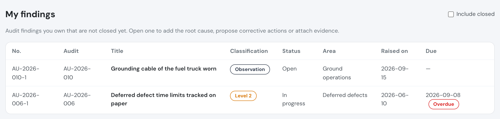

## Notifications

| Who | When |
| --- | --- |
| Finding owner | A finding is assigned or the owner is changed (in-app and email) |
| Finding owner | Reminders **14 days before**, **3 days before** and **on** the action plan due date (only while the finding is open) and the target date (while it is still being worked on) |
| Action owner | 3 days before and on the due date of a corrective action |
| Managers | 30 days before the review or expiry date of an accepted authority decision |
| Hazard owner | A reassessment is requested from a finding |

## Safety Assurance dashboard

Open and overdue findings, findings awaiting authority or verification and areas overdue for audit are summarised in the [Safety Assurance dashboard](safety-assurance.md#audits-and-findings), and every number opens the list behind it.

## API

See [Audits API](../API/audits.md#findings).
