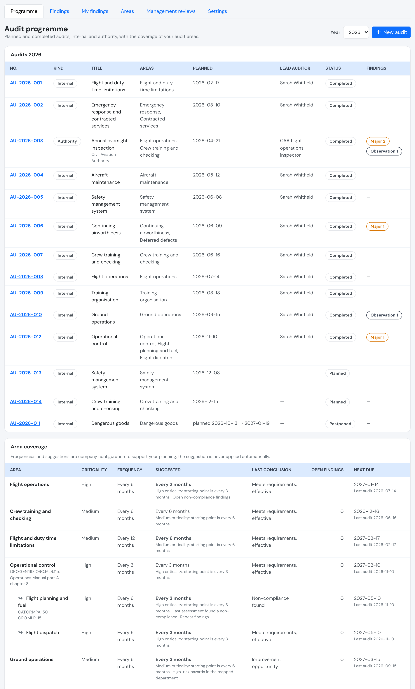
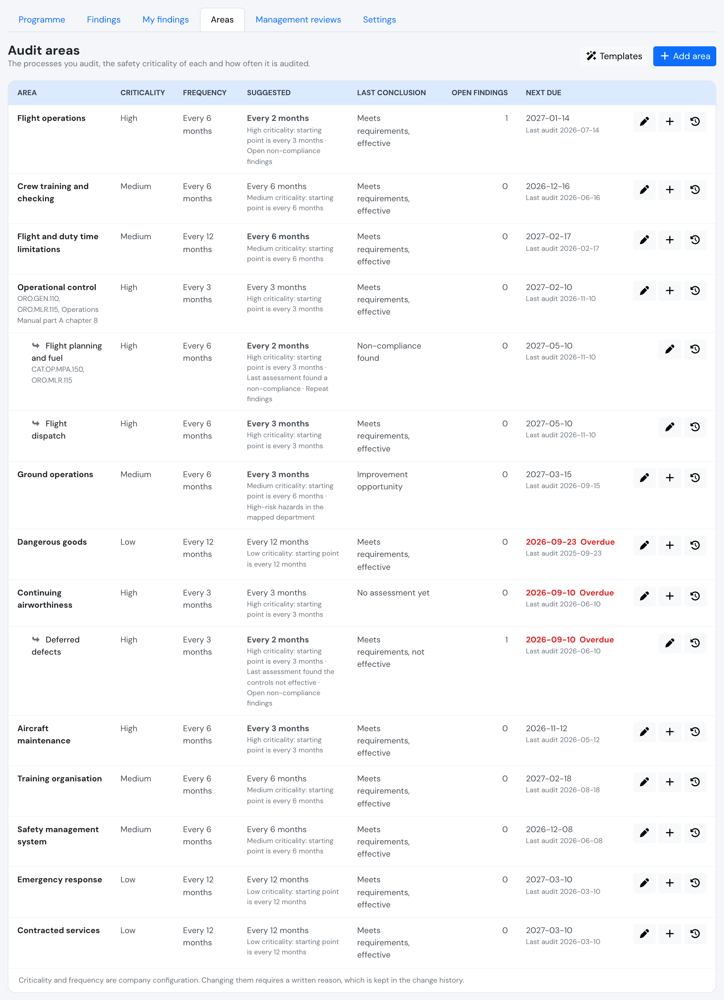
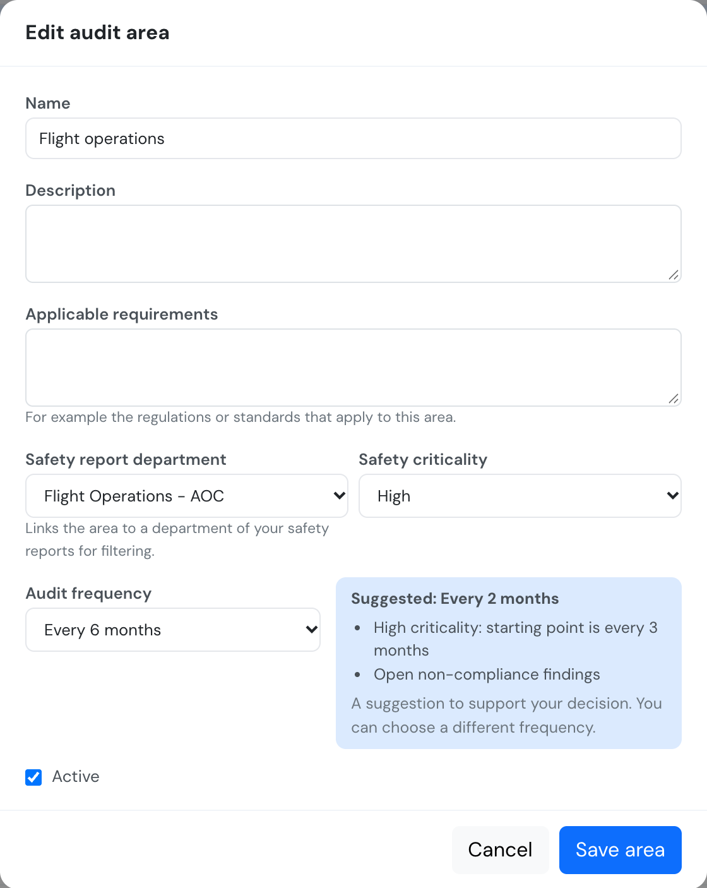
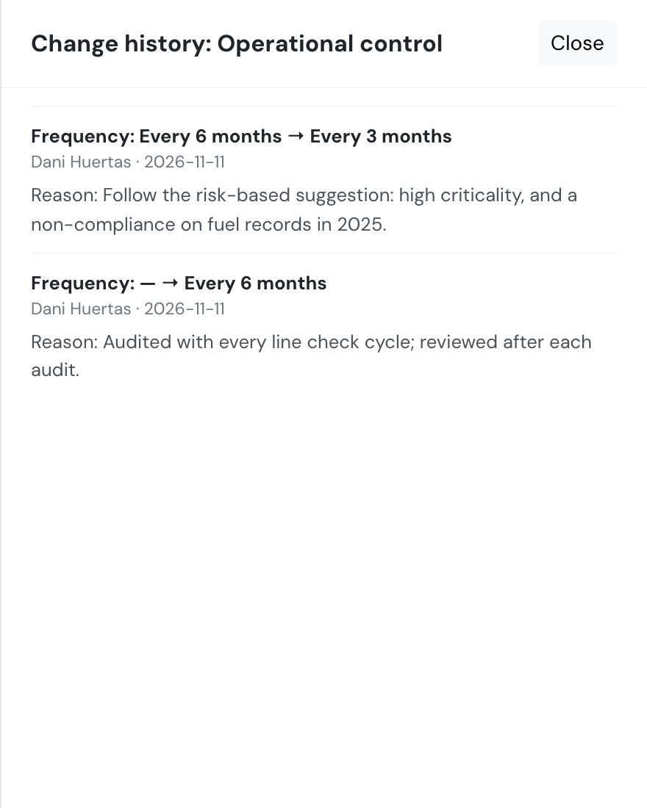
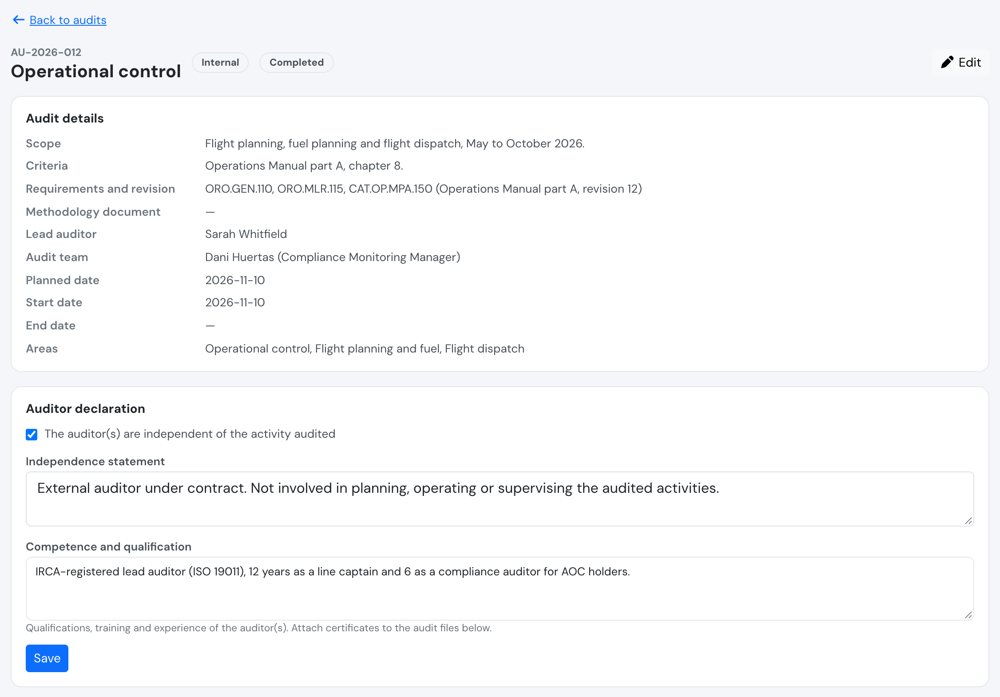
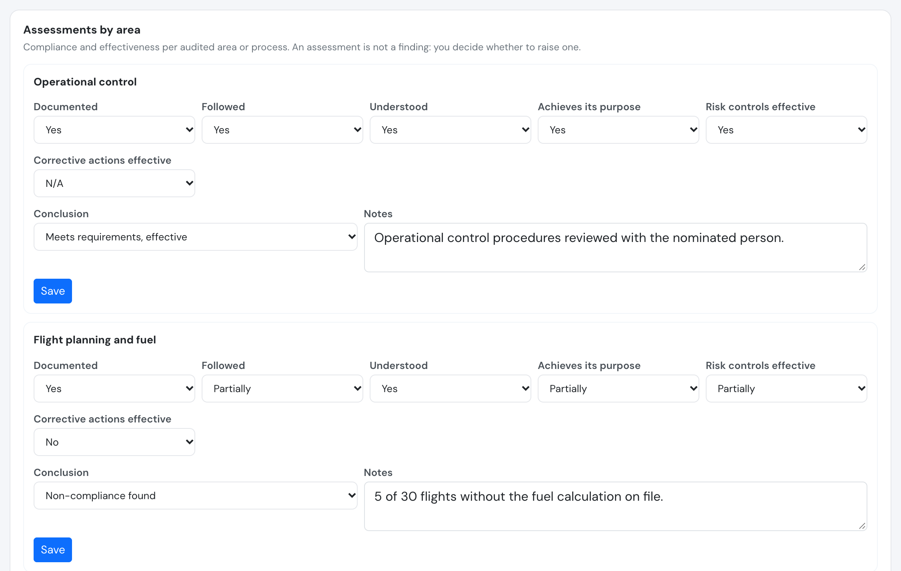
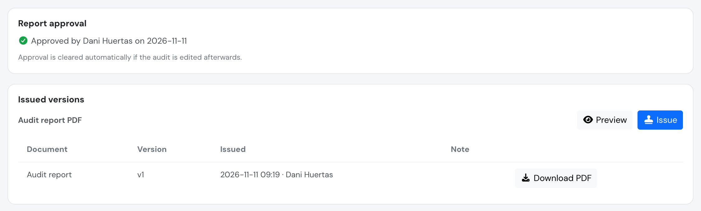
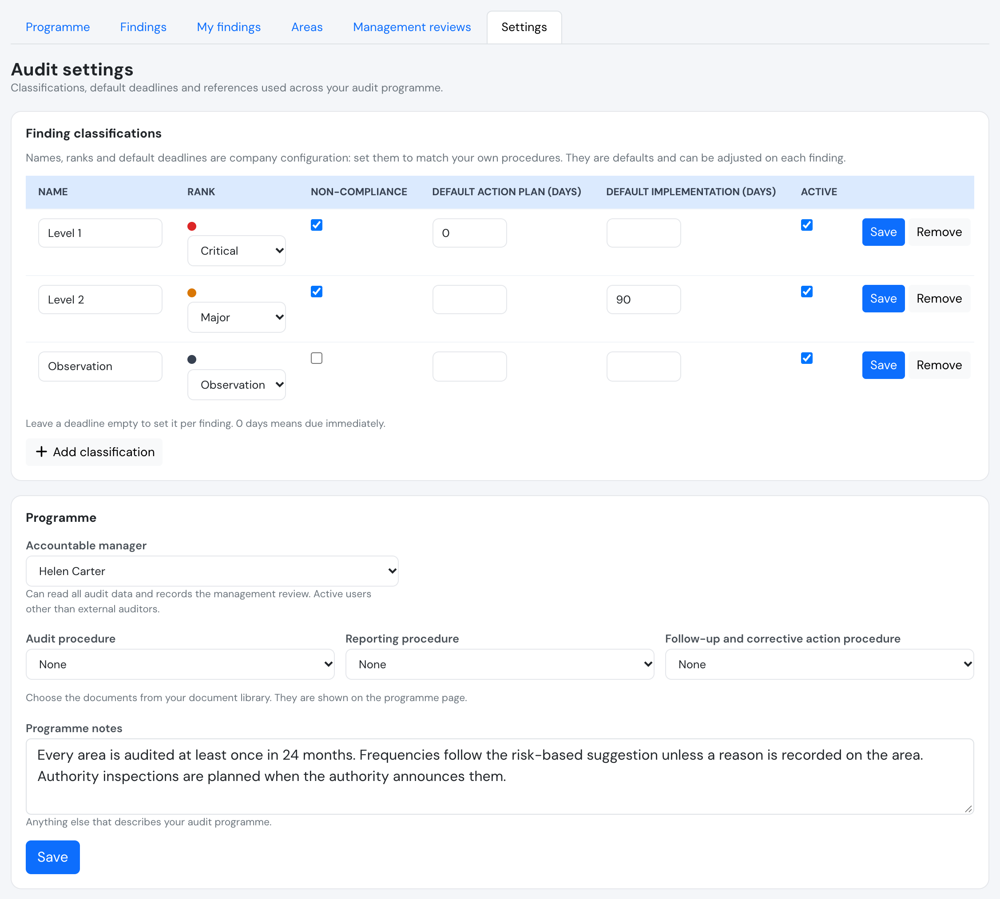

# Audit programme

**Safety > Audit programme** is where you plan and record the audits of your organisation: your own **internal audits** (compliance monitoring) and the audits carried out by your **competent authority**. It is built for any type of operation (AOC, SPO, ATO, CAMO or general aviation) and **supports** your compliance monitoring and safety assurance activities. It does not make an operator compliant by itself: it keeps the plan, the evidence, the findings and the decisions in one place so you can show them.

The audit tools have four parts, each with its own page:

* **Audit programme** (this page): the yearly plan, the audited areas and the audits themselves.
* [Audit findings](audit-findings.md): every finding tracked to closure, with root cause, corrective actions and authority decisions.
* [Management review](management-review.md): the management audit report and the accountable manager's review of it.
* **Audit settings**: the classifications, deadlines and references that make the tool match your own procedures.

## What is company configuration

Audit frequencies, finding classifications and finding deadlines are **company configuration**. Flylogs proposes sensible defaults so you can start quickly, but they are **not ICAO values** and not a regulatory requirement: you set them to match your own procedures, your approval and what your authority has agreed with you. Nothing in the audit tools assumes, for example, an annual authority audit; if your authority decides the frequency of its own audits, you simply plan them when they happen.

## Who can do what

| Who | Programme, areas, audits and settings |
| --- | --- |
| Compliance & Safety Manager and above (user group 110 or lower) | Full: set up areas and settings, plan, record and complete audits, enter assessments, approve and issue reports, record findings (also on behalf of external auditors) |
| **Accountable manager** (the user chosen in Audit settings, any group) | **Read-only** on the programme, areas, audits and issued documents. Records the [management review](management-review.md) |
| **Auditor** (user group 250) | **Read-only everywhere**, including attached files and issued PDFs. Auditors never enter, change or upload anything |
| Finding owner (any group) | No access to the programme or to audits. Sees their own [findings](audit-findings.md#what-a-finding-owner-sees) only |
| Everyone else | No access |

* Requires the **Premium** or **Unlimited** plan. On other plans the pages show the usual "disabled on your subscription" message. Files already attached stay readable after a downgrade; nothing new can be written.
* Read-only auditors do not stop you from using **external auditors**: a manager enters the external auditor's name as lead auditor, records their findings (raised by = the auditor's name) and attaches their report.
* The **accountable manager** has no entry in the Safety menu. They reach the audit pages from the notification they receive when a management report is issued, or by the address of the page.

## Audit areas

**Safety > Audit areas** lists the processes you audit, as a tree: an **area** can have one level of **sub-areas** (for example *Operational control* with *Flight planning* below it).

Each area has:

| Field | Meaning |
| --- | --- |
| Name and description | Free text |
| Applicable requirements | The regulations or standards that apply to this area, as free text |
| Safety report department | Optional link to a department of your safety reports. It lets the programme use the hazards of that department as a planning input and lets you filter by department |
| Safety criticality | Low, medium or high: how critical the process is for safety |
| Audit frequency | 1, 2, 3, 6, 12 or 24 months |
| Active | A retired area stays in the history but is never reported as overdue |

Use **Add starter areas** to start from a list of common operator areas (flight operations, crew training and checking, flight and duty time limitations, operational control, ground operations, dangerous goods, continuing airworthiness, aircraft maintenance, training organisation, safety management system, emergency response and contracted services). They are examples: rename or remove what does not apply to your approval. Adding the list again only adds the names you do not have yet.

### Risk-based frequency

Next to the frequency you choose, the area shows a **suggested frequency** and the reasons behind it, so your decision and its justification sit next to the evidence. The suggestion supports your planning and is **never applied automatically**.

How the suggestion is worked out:

1. It starts from the criticality: **high every 3 months, medium every 6, low every 12**.
2. It moves **one step more frequent** (steps are 1, 2, 3, 6, 12, 24 months) when any of these applies:
   * the last completed internal audit of the area concluded *non-compliance found* or *meets requirements, not effective*;
   * the area has **open non-compliance findings**;
   * the area has **repeat findings** raised in the last 24 months;
   * the mapped safety report department has **high-risk hazards** in the [hazard log](hazard-log.md).
3. Otherwise it moves **one step less frequent** after **two consecutive** internal audits concluded *meets requirements, effective*, with no open non-compliance findings.

The reasons are listed on the area, for example "Medium criticality: starting point is every 6 months" and "Open non-compliance findings".

### Changing frequency or criticality needs a reason

A manager must write a **reason** when:

* the **frequency** or the **criticality** of an area changes, or
* a new area is saved with a frequency that **differs from the suggestion**.

Every change is stored with who made it, when, the old and new value and the reason, in the append-only **Change history** of the area.

### Next due date

The next due date of an area is the date of its **last completed internal audit** plus its frequency. Only **completed internal audits** reset it: authority audits never do. An active area that has never been audited, or whose due date has passed, is **overdue**. Managers receive a reminder 30 days before the due date.

## The programme page

**Safety > Audit programme** opens the programme of one year (year selector at the top).

* **Audits of the year**: internal and authority audits by planned date, with kind, areas, lead auditor, status and the number of findings. An audit that was postponed out of the year stays listed with its original and new dates, so the postponement stays visible.
* **Area coverage**: for each area its criticality, chosen frequency, suggested frequency, last conclusion, open findings and next due date, with overdue areas flagged.
* **Procedures and notes**: the audit procedure, the reporting procedure and the follow-up and corrective action procedure, picked from your [document library](../documents/document-library.md) in Audit settings, plus free programme notes.
* **Issue programme PDF**: see [Issued documents](#issued-documents-and-versions).

## Audits

Use **New audit** to plan one. The plan and the executed audit are the same record, so the audit keeps its identity from planning to report. Each audit gets a number of the form `AU-YYYY-NNN`.

| Field | Meaning |
| --- | --- |
| Kind | **Internal** or **Authority**. For an authority audit also the authority's name |
| Title, scope, criteria | What is audited, how far, and against what |
| Requirements and revision | The applicable requirements and the edition or revision audited against |
| Methodology | A procedure from your document library and/or a note |
| Planned date, start and end date | Dates of the plan and of the audit as carried out |
| Areas | One or more audit areas covered |
| Lead auditor | A user, or a free-text name for an external auditor, plus the audit team |

### Status

An audit moves **Planned > In progress > Completed**.

* **Postpone** moves the planned date. A new date and a **reason** are required. The first planned date is kept as *Originally planned*, and the audit shows as *Postponed* until it starts.
* **Cancel** needs a reason and can be done until the audit is completed.
* A cancelled audit cannot be changed.

### Auditor independence and competence

Every audit, internal or authority, records:

* a **declaration that the auditor(s) are independent** of the activity audited (a checkbox plus a statement, for example that they are not responsible for the activity), and
* the **competence and qualification** of the auditor(s): qualifications, training and experience. Attach certificates to the audit files.

For an **authority audit** you can instead tick *Authority inspector: not applicable*. The option is not offered on an internal audit.

### Results and files

The **Results** field is free text for the audit report. Under **Result files** attach the audit report, the authority's letter or evidence, as many files as you need. Files are stored with the audit and are visible to managers, the accountable manager and auditors only, never to finding owners. They can be added and removed by managers only.

### Assessments by area

For every audited area (and optionally a specific process within it) a manager records an **assessment**. It answers six questions with *Yes*, *Partially*, *No* or *N/A*, so you assess both compliance and **effectiveness** (a procedure can be followed and still fail to control the risk):

1. Documented
2. Followed
3. Understood
4. Achieves its purpose
5. Risk controls effective
6. Corrective actions effective

and ends with a **conclusion**:

| Conclusion | Meaning |
| --- | --- |
| Meets requirements, effective | Compliance and effectiveness both satisfactory |
| Meets requirements, not effective | The procedure is followed but does not control the risk |
| Non-compliance found | A requirement is not met |
| Improvement opportunity | No non-compliance, but room to improve |
| Not applicable | Nothing to conclude |

An assessment is **not a finding**: you decide whether to raise one. Flylogs only prompts you: a *non-compliance found* conclusion offers **Create finding**, and *meets requirements, not effective* offers to link or raise a hazard and to trigger a risk reassessment (see [risk links](audit-findings.md#links-to-risk-management)). The latest conclusion also feeds the suggested frequency of the area.

### Approving the report

Once the audit is **completed**, a manager can **approve the report**. Approval needs:

* the audit to be completed, and
* the **independence declaration confirmed** and the **competence field filled in** (not needed for an authority audit marked *not applicable*).

Approval is **cleared automatically** if the audit is changed afterwards (including its areas, assessments or status), so an approved report always matches what was approved. Approve it again after a correction.

### Issued documents and versions

Documents you send to the authority or keep as the record of a period are issued as PDFs:

| Document | Where | Needs |
| --- | --- | --- |
| Programme PDF | Audit programme page | Nothing |
| Audit report PDF | Audit page | The audit report approved |
| Corrective action response and decision proposal PDFs | [Finding page](audit-findings.md#documents-for-the-authority) | Nothing |
| Management report PDF | [Management review](management-review.md) | A management review |

The flow is the same everywhere:

1. **Preview** shows exactly what would be issued now. Nothing is stored.
2. **Issue** stores the next **version** with a snapshot of the data and its PDF. An optional note can say why this version was issued.
3. Issued versions are listed in a **Versions** panel and can be downloaded at any time.

An issued version is **immutable**: it is never changed or deleted, not even its PDF, and it reproduces exactly what was issued even if the audit, the finding or the area is edited afterwards. To change the content, issue a new version. The PDF carries the company logo, the company date format and time zone, and a footer with the document kind, version, who issued it and when.

Flylogs does not send documents to the authority: download the issued PDF and send it yourself.

## Audit settings

**Safety > Audit settings** (managers only) holds the configuration of the audit tools.

* **Finding classifications**: a set of classes with a name, a rank (critical, major, minor or observation, which drives colours and indicators), whether it is a **non-compliance** (observations are not), and the default number of days to submit the corrective action plan and to implement it. Flylogs creates an editable starter set the first time you open the page: *Level 1* (critical, action plan due immediately), *Level 2* (major, 90 days to implement) and *Observation*. These are **your company defaults, not ICAO values**: change the names and deadlines to match your own procedures. A deadline left empty is set per finding. A classification that findings already use is **deactivated** instead of removed.
* **Accountable manager**: the active user who can read all audit data and records the [management review](management-review.md). Any group except auditors.
* **Procedure documents**: the audit procedure, the reporting procedure and the follow-up and corrective action procedure, chosen from the document library and shown on the programme page and on the programme PDF.
* **Programme notes**: anything else that describes your audit programme.

## Notifications

* Managers are reminded **30 days before** the next due date of an active area.
* Finding owners and managers receive the reminders described in [Audit findings](audit-findings.md#notifications).

## Safety Assurance dashboard

The **Audits and findings** section of the Assurance tab summarises the programme. See [Safety Assurance dashboard](safety-assurance.md#audits-and-findings).

## API

See [Audits API](../API/audits.md).
