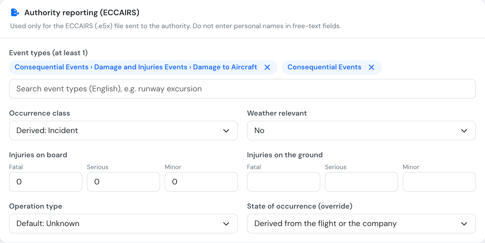
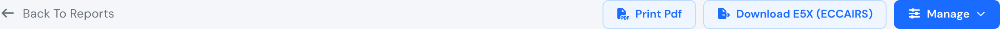
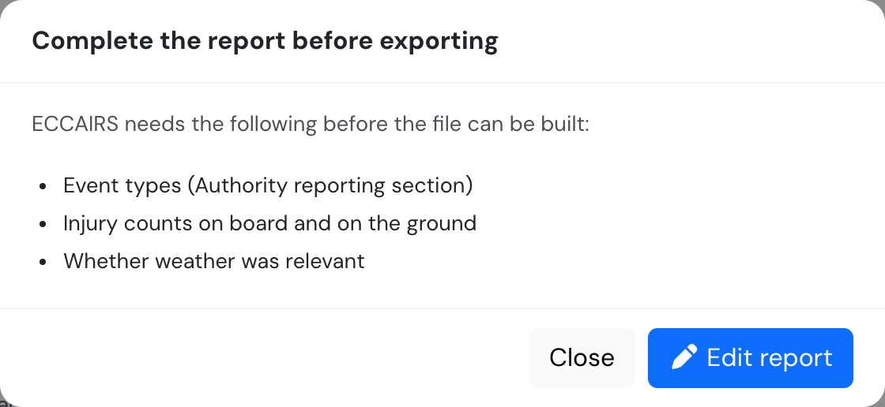
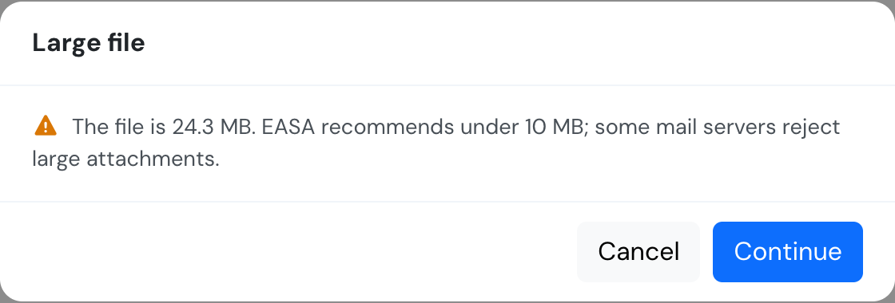
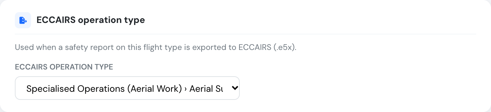

# Send a report to the authority (ECCAIRS / E5X)

Aviation authorities in Europe collect occurrence reports in **ECCAIRS**, the European Co-ordination Centre for Accident and Incident Reporting Systems. Flylogs can turn any submitted safety report into an **E5X file** (ECCAIRS Aviation 5.1.0.0) that you email to your authority or upload to the ECCAIRS portal, with no re-typing.

Under Regulation (EU) No 376/2014 a mandatory occurrence must be notified to the authority **within 72 hours** of becoming aware of it. In Spain, send the file to AESA: **sucesos.aesa@seguridadaerea.es**.

## Who can export

* **Managers** (Compliance & Safety Manager and above, `user_group_id` below 111).
* **The assigned reviewer** of that report, whatever their role.
* **Auditors never**: the Auditor role is read-only everywhere, so they cannot export or fill in the ECCAIRS section.

Everyone else (reporters, pilots, instructors) does not see the section or the button. Exporting is available on every plan. Drafts and deleted reports cannot be exported: submit the report first.

## 1. Complete the "Authority reporting (ECCAIRS)" section

Open the report and choose **Edit**. People who may export see an extra card, **Authority reporting (ECCAIRS)**, with the information ECCAIRS needs that a normal report does not capture.

| Field | What to enter |
| ----- | ------------- |
| **Event types** (at least 1) | Search the ECCAIRS event-type list (English) and add one or more, e.g. "runway excursion". Required. |
| **Occurrence class** | Optional. If left empty it is derived from the report severity (shown as "Derived: Incident"). |
| **Weather relevant** | Yes, No or Unknown. Required. |
| **Injuries on board / on the ground** | Fatal, serious and minor counts. Required: enter 0 when nobody was hurt. |
| **Operation type** | Optional. If empty, the [flight type mapping](#map-your-flight-types) is used, otherwise "Unknown". |
| **State of occurrence (override)** | Optional. By default it is derived from the flight's airports or your company's country. |

The aircraft, date, time, location, flight phase and description come from the report itself. When the report is linked to a flight, the aircraft model, mass category and number of engines are taken from the aircraft.


**Do not type people's names in free-text fields** (description, events, actions, comments, file names). The XML is name-redacted by the server, and the PDF leaves out every person-name field (reporter, crew), but neither can detect a name written inside a narrative. Free text is exported exactly as you wrote it.


## 2. Download the E5X

On the report page, click **Download E5X (ECCAIRS)** next to **Print Pdf**.

If something required is missing (event types, injury counts, weather, aircraft, location or date), a window lists exactly what to complete, with a shortcut to **Edit report**. A reviewer who is not a manager is asked to request the changes from a safety manager.

### What is inside the file

The `.e5x` file is a zip archive with:

* the occurrence data as ECCAIRS XML, validated against the official ECCAIRS schema before it is delivered;
* a **de-identified PDF** of the report (no reporter, crew or other person-name fields);
* **every attachment** uploaded to the report (photos, documents), referenced from the XML.

An attachment that is missing from storage is left out rather than blocking the export.

### Large files

EASA recommends keeping the file **under 10 MB**, and many mail servers reject larger attachments. If the file is bigger you are warned and can cancel (to remove heavy attachments) or continue.

### Send it

When the download completes you get a reminder with the AESA address. Email the `.e5x` file to your authority, or import it into the ECCAIRS 2 portal. **You do not need an `.e5f` file**: that is ECCAIRS's own storage format, created by the authority when they import your `.e5x`.

Each export marks the report as **reported** and is recorded in the report's change history ("Exported to ECCAIRS (E5X)"). You can export again at any time, for example after correcting the report.

## Map your flight types

In **Flights → Flight types**, edit a flight type and choose its **ECCAIRS operation type** (e.g. Specialised Operations › Aerial Survey). Every safety report on a flight of that type then uses this value, unless the report's own Operation type is set. Leave it as **None** to fall back to "Unknown". Only managers can edit flight types.

