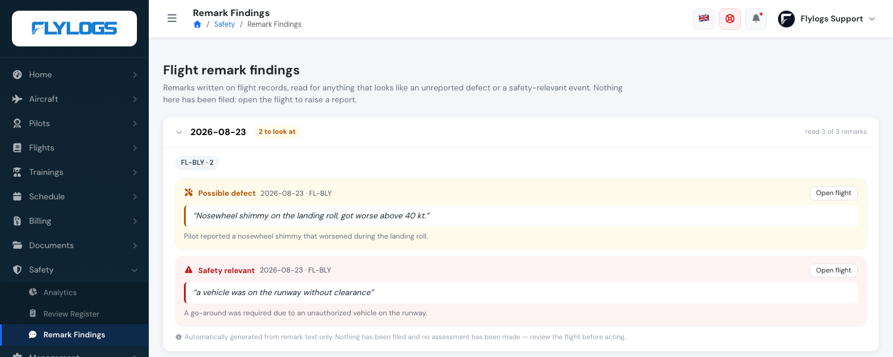
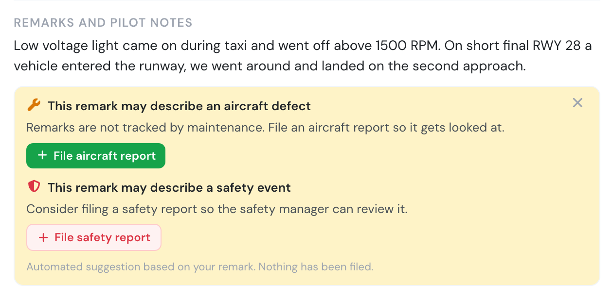
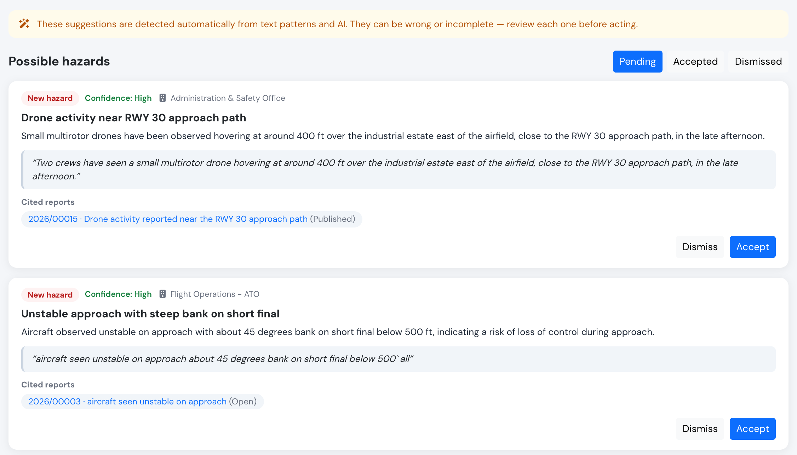
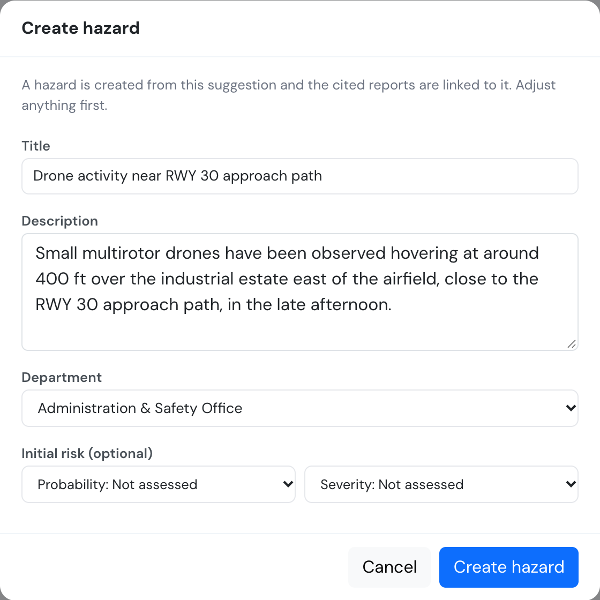
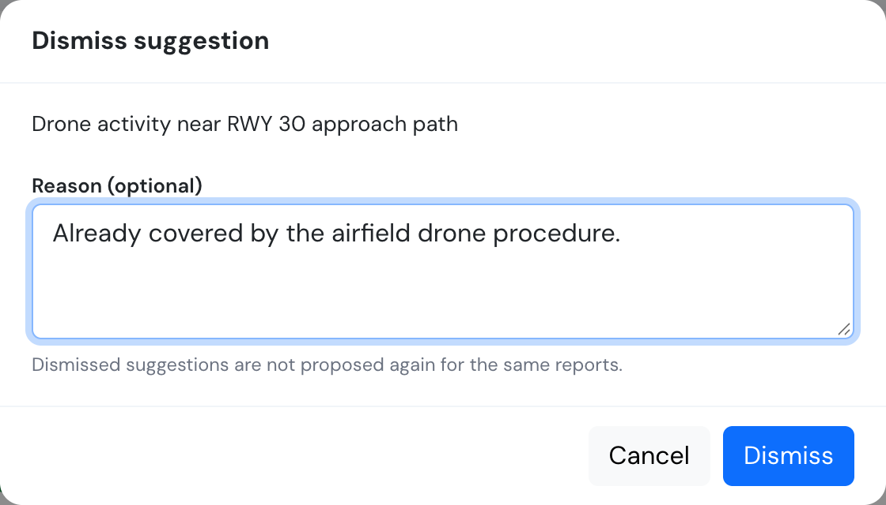

# Flight remark findings

Pilots write things on flight records that never become a report. A brake that felt odd, a go-around because something was on the runway, a warning light that came on and went out again — written in the remarks box at the end of a long day, read by nobody afterwards.

Flylogs now reads those remarks for you and points out the ones that look like they deserve a second look.

You will find it under **Safety → Remark Findings**.

## What it does

Once a day, Flylogs reads the remarks written on the previous day's flights and lists anything that reads like:

* **Possible defect** — a technical problem, malfunction, damage or unserviceability.
* **Safety relevant** — a conflict, an excursion, a go-around for cause, weather encountered, a procedural deviation.
* **Noteworthy** — clearly worth a look, but neither of the above.

Each finding shows the remark **exactly as the pilot wrote it**, the flight it came from, and a one-line note on why it stood out. **Open flight** takes you straight to the record.

## What it does *not* do

This is the important part.

**Nothing is reported.** No aircraft report is created, no safety report is opened, no maintenance job is raised, nobody is notified. The list is a reading aid, not a register. If a finding deserves a report, you open the flight and raise it the normal way — so what ends up in your registers is always something a person decided to put there.

**No assessment is made.** It will not tell you how serious something is, what caused it, or what to do about it. It points at a sentence a pilot wrote.

## Hints on the flight page



The same reading also happens **right after a flight is logged**, so the crew can act while they still remember the details. When a flight's remark looks like a defect or a safety event, the flight page shows a hint under the remarks with a button to open the matching form — **File aircraft report** (pre-filled with the remark, while the aircraft-report window is open after confirmation) or **File safety report** (the remark becomes the starting description).

<figure><figcaption>
A remark that reads like both a defect and a safety event offers both forms.
</figcaption></figure>

As with the daily list, nothing is filed automatically, and once a report of that kind exists for the flight it is no longer offered — file the defect, and the hint keeps only the safety report. It can be dismissed per flight. It is shown only to the **crew of that flight** (PIC, SIC, supervisor) and to **managers (user group 110 and below)**, only for flights logged in the last 7 days, and only while online.

## Reading the list

Each day shows a badge with how many findings it has, and on the right, how many remarks were actually read:

> read 3 of 3 remarks

That second number matters. Most remarks are not prose at all — `5T`, `NIL`, `Private flight`, a route repeated back — and those are skipped before anything is read, so the two numbers are usually different. A day that says **read 9 of 40** looked at nine of them. The rest were routine entries with nothing to find.

**Nothing flagged** is a normal and common result. On most days, on most fleets, nobody wrote anything that needs a second look.

The chips under the date, like `EC-ABC · 2`, count findings per aircraft for that day. They are counted from the records, not written by the assistant.

## Possible hazards

Below the findings, the page has a second section, **Possible hazards**. Where the findings above point at remarks that may deserve a report, this section points at **hazards that may deserve a place in your [hazard log](hazard-log.md)**: several reports describing the same thing, or a report that belongs with a hazard you already track.

> These suggestions are detected automatically from text patterns and AI. They can be wrong or incomplete — review each one before acting.

That notice is shown at the top of the page. Please take it literally: the assistant can misread a report, group together things that are not related, or miss a hazard altogether.

### When it runs and what it reads

Suggestions are prepared **once a night**, per company, and only when there is something new to read. If nothing new has come in, nothing is sent and nothing changes. A company on a busy night may be picked up the following night.

It looks at:

* **Safety reports** from the last 365 days that are not yet linked to any hazard and have not been looked at before (up to 40 per night, oldest first). Drafts, deleted reports and follow-up statements are left out.
* **Safety-relevant remark findings** from the last 90 days of daily findings (up to 20 per night).
* **Your open hazards**, so that it can propose linking to one instead of a duplicate.

What is sent to the AI is the text of those reports and remarks (title, category, department, classification, description) and the title and description of your open hazards. **Reporter names and ids are never sent**, whether the report is anonymous or not. The AI is not asked to rate risk; use **Suggest initial risk** on the hazard for that.

### What you see

Each suggestion is a card with:

* a badge: **New hazard**, or **Link to HZ-…** when it proposes adding the reports to an existing hazard;
* a title and description, the suggested department, and the **cited reports** (click to open) and **cited flight remarks** (**Open flight**), with the passage that prompted it;
* a **confidence** level (Low, Medium or High).

Nothing the assistant says is taken on trust. A suggestion that cites a report or hazard that was not in what it was given is discarded, a quote that is not really in the cited text is discarded, and so is anything it is less than half sure of. You can judge a suggestion by reading the quote and opening the cited reports.

Use the **Pending / Accepted / Dismissed** filter to see decided suggestions too. An empty list means nothing has been proposed yet; the page explains that suggestions are generated nightly.

### Accept, link or dismiss

* **Accept** (on a *New hazard* suggestion) opens a form prefilled with the title, description and department. Change anything you like, optionally set an initial risk, and press **Create hazard**. The hazard is added to the log and every cited report that is still live is linked to it.
* **Link** (on a *Link to HZ-…* suggestion) asks you to confirm, then adds the cited reports to that existing hazard. Reports already linked are skipped.
* **Dismiss** asks for an optional reason. The suggestion is kept in the *Dismissed* list and is not proposed again for the same reports.

After a decision the card shows what happened, with an **Open hazard** link. If someone else already decided the suggestion, or the hazard was closed or deleted, or none of the reports can be linked any more, Flylogs tells you so and changes nothing.

**Nothing is created or linked until a manager accepts.** Declining costs nothing, and a hazard you accept is an ordinary hazard: you own it, edit it and review it like any other.

### Access

Managers only, user groups **110 and below**, the same as the rest of this page. Auditors, pilots and students cannot see or act on suggestions. Possible hazards require the **Premium** or **Unlimited** plan. API: [Hazard suggestions](../API/hazard-suggestions.md).

## Who can see it

Managers only — user groups **110 and below** (management, safety and maintenance roles). Pilots and students cannot open the page and the API refuses them.

That restriction is deliberate. These are remarks your crews wrote, shown back with an interpretation attached. It is material for the person who triages, not feedback for the person who wrote it.

## Accuracy, honestly

The findings come from an automated reading of free text, and it will sometimes flag something ordinary or miss something real. Two things are built in to keep that manageable:

* The quote is always **copied verbatim** from the remark. If the quoted words are not really in the remark, the finding is thrown away rather than shown. So you can judge a finding by reading the quote, without trusting the interpretation.
* A finding that points at a flight that was not read is discarded, so **Open flight** always lands on the right record.

Treat the list the way you would treat a colleague saying "you might want to look at this one".

## If the page is empty

* **"No findings yet"** — each day is read once it has finished, so there is nothing to show until remarks have been written and the following day's run has happened.
* Your Flylogs installation may not have the assistant switched on. If the page stays empty while your crews are writing remarks, contact support.

## Related

* [Safety Reports](safety-reports.md) — raising a report from a flight
* [Create a Safety Report](create-a-safety-report.md)
