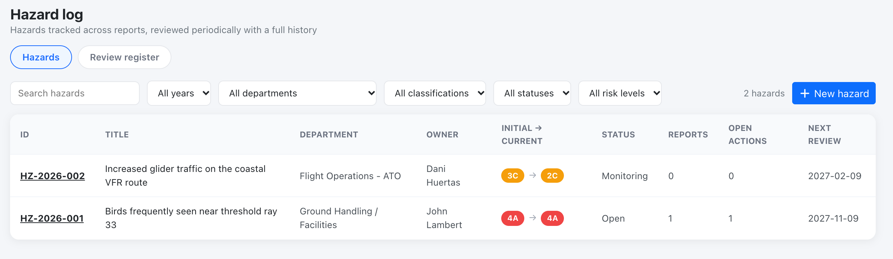
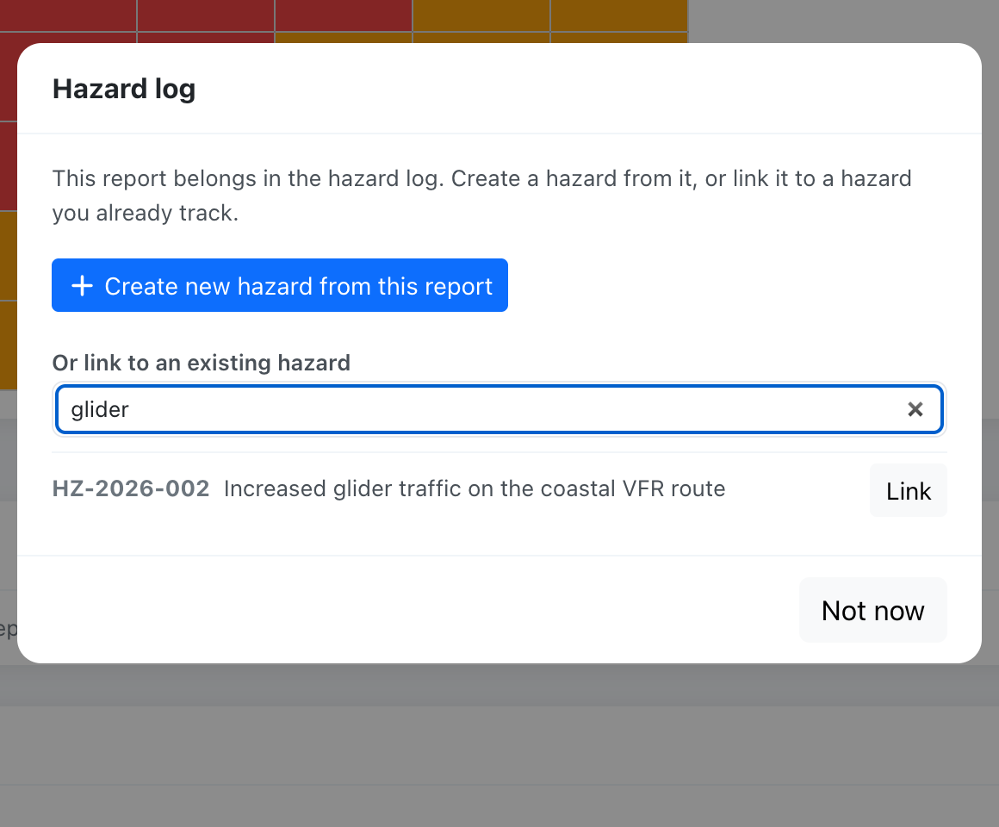
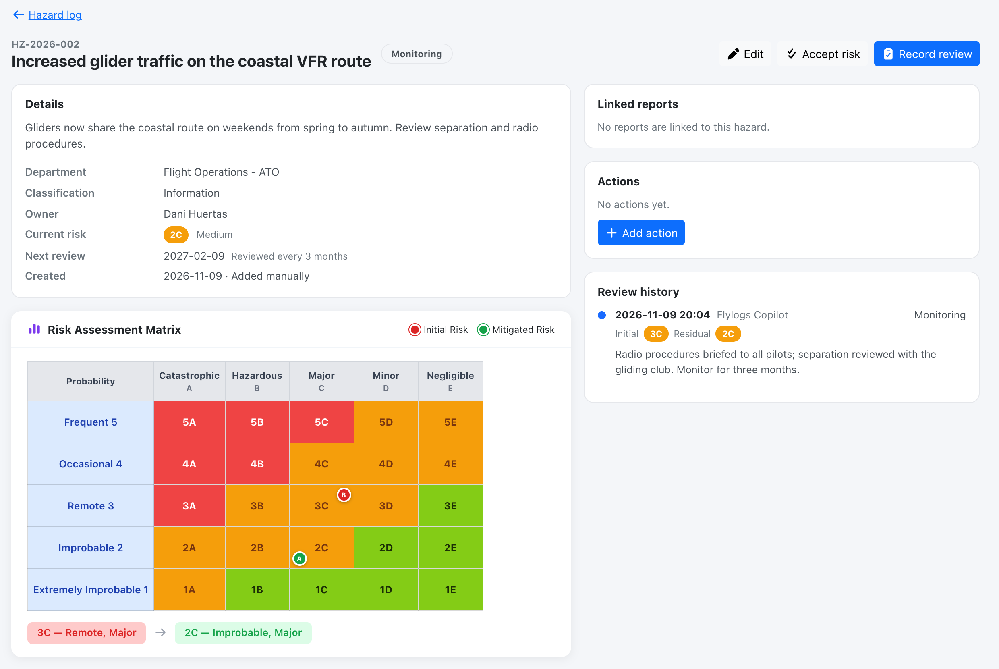
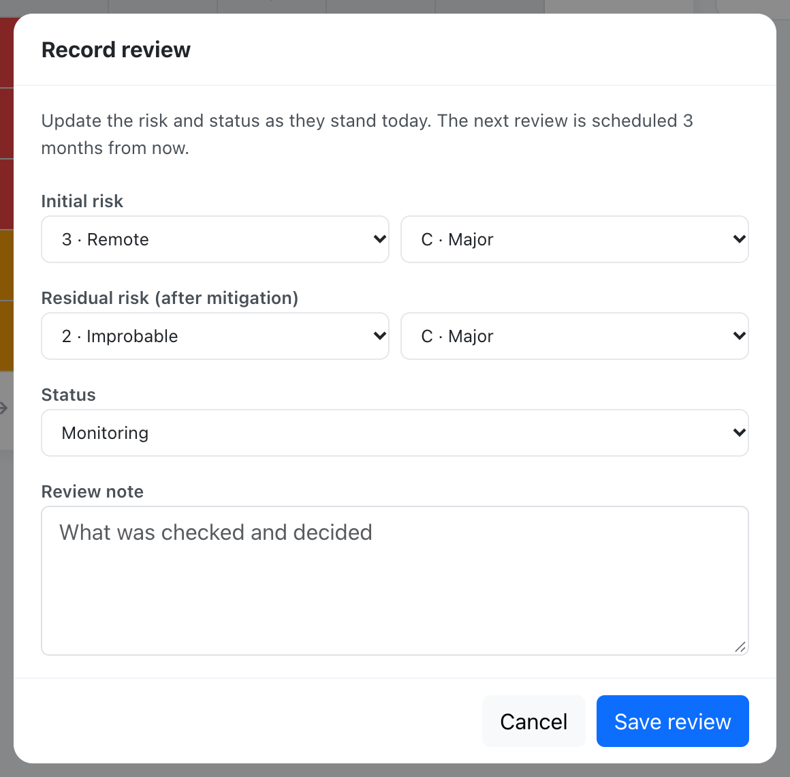

# Hazard log

The **Hazard log** (**Safety > Hazard log**) is where your organisation records hazards as records of their own, separate from the reports that revealed them. A hazard can be linked to many reports, has an owner, an initial and a residual risk, a review interval and an append-only review history. It supports the hazard identification and risk management processes of ICAO Annex 19 and Doc 9859.

The page has two tabs: **Hazards** (opens first) and **Review register**, the list of closed reports that used to be the Register page, unchanged.

## Who can do what

| Who | Hazard log |
| --- | --- |
| Compliance & Safety Manager and above (user group 110 or lower) | Create, edit, review, close, link, unlink, accept risk |
| **Auditor** (user group 250) | **Read-only** |
| Assigned reviewer **or author** of a report, any group | On **that report only**: create a hazard from it, or link it to an existing hazard. They find existing hazards by searching, which returns only the ID and title. **Unlinking** a report from a hazard is reserved to safety managers. |
| Everyone else | No access |

* Requires the **Premium** or **Unlimited** plan.
* The author of an **anonymous** report has no author rights on it.
* Auditors cannot create or change anything, including hazards, links, reviews and actions.
* The hazard **owner** must be an active user of your company, and cannot be an auditor.

## The hazard list

Columns: ID (`HZ-YYYY-NNN`, numbered per company), title, department, owner, initial to current risk, status, number of linked reports, open actions, and next review (shown red when overdue). Filter by year (created or reviewed in that year), department, classification, status and risk level, or search by ID or title.

**Statuses:** Open, Mitigated, Monitoring, Closed. A closed hazard cannot be linked to new reports and is excluded from *Unmitigated risks*.

## Two ways to create a hazard

1. **From a report.** When a manager or the report's reviewer sets the reviewer outcome to *risk register* and saves, Flylogs offers **Create new hazard from this report** (title, description, department, classification and initial risk are prefilled) or **Link to an existing hazard**. The same options are always available from the report's manage actions (**Create / link hazard**). A report can be linked to more than one hazard, and the report view lists its linked hazards.
2. **Manually**, with **New hazard**: for hazards that did not come from a report, such as a new route, aircraft type, base or season.

## The hazard page

Details and a mini risk matrix (initial and residual), the linked reports, the [safety actions](safety-actions.md) with an **Add action** button, and the review history.

### Reviews

Managers use **Record review** to update the risk and status as they stand today and add a note. Each review is stored permanently with a snapshot of the risk values, the status, who reviewed it and when. The **next review date** is then set to the review date plus the hazard's **review interval** (1, 3, 6 or 12 months, 12 by default). Changing the interval re-schedules the next review from the last review.

A hazard whose next review date has passed counts as an *untracked risk* on the [Safety Assurance dashboard](safety-assurance.md).

### Risk acceptance

A hazard in the medium (tolerable) band can have a risk acceptance recorded by a manager, with a rationale. The hazard page shows who accepted the risk, when, and the rationale. Editing any of its four risk values afterwards clears the acceptance. High-band risk cannot be accepted. See [ICAO risk matrix (Doc 9859)](icao-8951-risk-matrix.md#risk-tolerability-and-risk-acceptance).

## API

See [Safety Assurance API](../API/safety-assurance.md#hazard-log).
