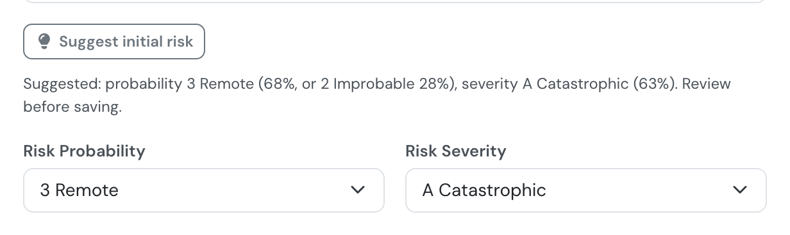
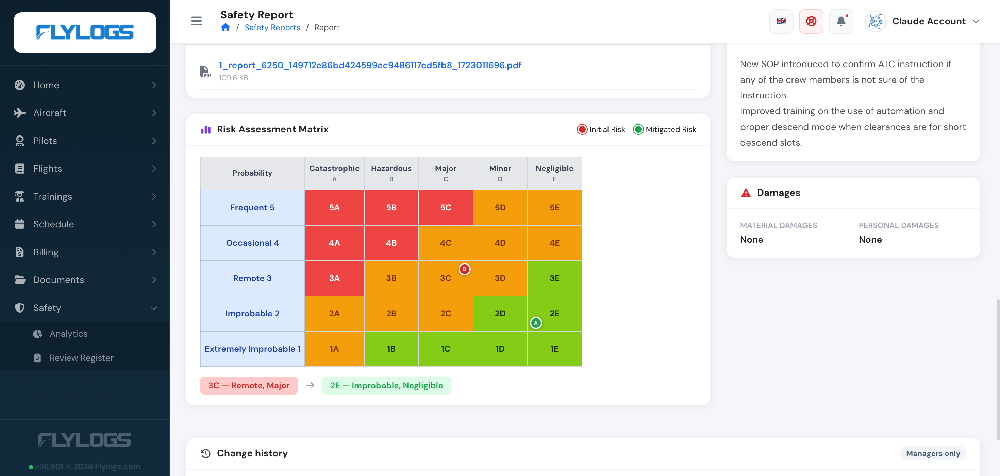

# ICAO risk matrix (Doc 9859)

### When Is the Risk Matrix Used?

The ICAO risk matrix (Doc 9859) is set from the **Manage** action on a safety report. From there, the safety manager can:

* Select the **initial risk severity**
* Select the **initial risk probability**
* Define **mitigation actions or corrective measures**
* (Optionally) Select the **mitigated risk severity** and **probability**

> **Access:** the Manage action, and the risk fields inside it, are only available to **managers (user group 110 or lower)** and to the report's **assigned reviewer**, for the investigation and risk fields. Report authors and other users cannot set them.

Once saved, a visual risk matrix will be automatically generated and attached to the report for reference.

> **Note:** this is a different value from the report's own **severity** (Incident/Accident for a Safety Occurrence, or General Information/Hazard for Safety Information — see [Create a Safety Report](create-a-safety-report.md#report-classification)). The risk matrix's severity is the A–E ICAO scale below, used specifically to grade the assessed risk, independently of how the report itself was classified.

***

### How to Use the Risk Matrix



1. **Navigate to a safety report**\
   Open any report from the Safety menu that is ready to be closed or published.
2. **Select risk values**\
   Under the "Risk Assessment" section, choose:
   * **Risk Severity**: A Catastrophic, B Hazardous, C Major, D Minor, E Negligible
   * **Risk Probability**: 5 Frequent, 4 Occasional, 3 Remote, 2 Improbable, 1 Extremely Improbable (per ICAO Doc 9859: 5 = most likely, 1 = least likely)
   You can click **Suggest initial risk** to have Flylogs propose both values from the report's description, damage and injuries, and from how many reports in the same category your organisation filed in the last 12 months. It fills the two selectors and shows how sure it is — for example *Severity: B Hazardous (35%, or A Catastrophic 33%)* when the reading is split. Nothing is saved until you save the form, and the assessment remains yours. The button is available to managers (user group 110 and below) and to the report's assigned reviewer.

   <figure><figcaption>
Suggest initial risk fills both selectors and shows how sure it is, including a close second.
</figcaption></figure>
3. **Enter corrective actions**\
   Clearly describe any actions taken to mitigate the risk.
4. **(Optional) Define mitigated risk**\
   If actions were effective, update the post-mitigation severity and probability.
5. **Save and close the report**\
   A dynamic matrix will be displayed on the report, showing both initial and mitigated risk levels.

***

### Understanding the Matrix

The matrix follows the ICAO Doc 9859 risk matrix: **severity** (A Catastrophic → E Negligible) across the columns, **probability** (5 Frequent → 1 Extremely Improbable) down the rows. Every one of the 25 cells is pre-colored to its ICAO risk tolerability band:

* 🟩 Green: Low risk
* 🟨 Yellow/Orange: Medium risk
* 🟥 Red: High risk

Your report's assessed risk is then marked on top of that reference grid — a red badge for the **initial risk** cell, and a green badge for the **mitigated risk** cell once mitigation has been recorded. When both are set, a before → after summary is shown underneath the grid.

#### Who can see it

* The matrix is hidden entirely while the report is **Open** — it only appears once a risk assessment has actually been recorded.
* While the report is **Reviewed**, only staff (group level 150 or lower) see the matrix; other users who can view the report see the rest of it without the matrix.
* Once the report is **Closed** or **Published**, the matrix is visible to everyone who can view the report.

***

### Why It Matters

The ICAO risk matrix helps:

* Standardize risk assessment across all reports
* Improve visibility for management decisions
* Support the safety risk management process described in ICAO Annex 19 / Doc 9859

***

### Risk tolerability and risk acceptance

ICAO Doc 9859 groups the three colours of the matrix into **tolerability regions**. Flylogs applies them as follows:

| Band | ICAO tolerability | What Flylogs does |
| --- | --- | --- |
| Red (high) | Intolerable | The risk can **never be accepted**. It stays an *unmitigated risk* on the [Safety Assurance](safety-assurance.md) dashboard until mitigation brings it down. |
| Yellow/Orange (medium) | Tolerable | Counts as an *unmitigated risk* until a safety manager records a **risk acceptance**: who accepted it, when, and a written rationale. |
| Green (low) | Acceptable | Acceptable as is. It never counts as unmitigated. |

* The **current risk** of a report or hazard is its mitigated (residual) risk when one is recorded, otherwise its initial risk.
* **Changing the risk afterwards clears the acceptance.** If a report or hazard is re-assessed, the earlier decision no longer applies and a new one is needed.
* A probability of **4 Occasional** or **5 Frequent** is treated as frequent and turns the indicator red even when the severity has not been assessed yet.
* There is **no automatic acceptance** of reports that were closed before this feature existed. Closed reports that sit at a medium residual risk appear as unmitigated until a manager accepts them, which is the truthful state of the register. Managers can accept several at once from the list behind the *Unmitigated risks* tile, with one shared rationale that is stored on each item.
* Risk acceptance is available only to the **Compliance & Safety Manager and above** (user group 110 or lower). Auditors can read the decision but not make it.
* The decision is shown on the record: a safety report displays a **Risk acceptance** block under its risk matrix (who, when and the rationale) to everyone who can see the matrix, and a hazard shows who accepted its risk and when.
