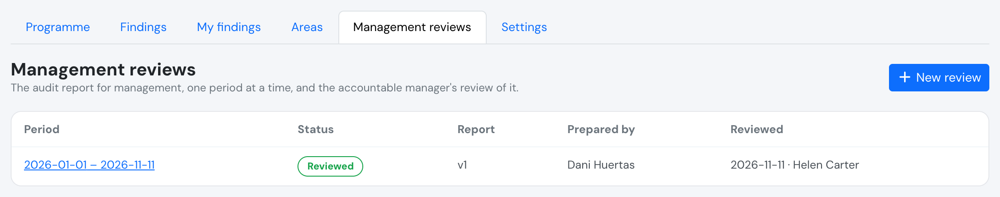
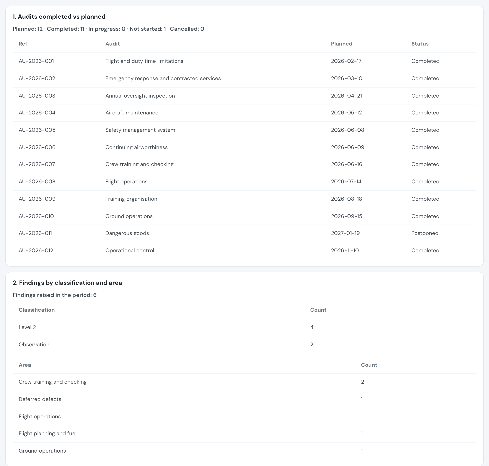
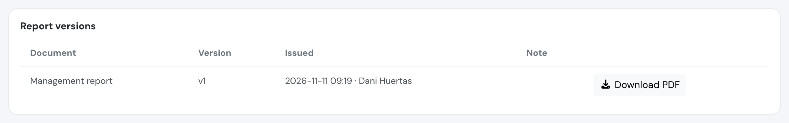
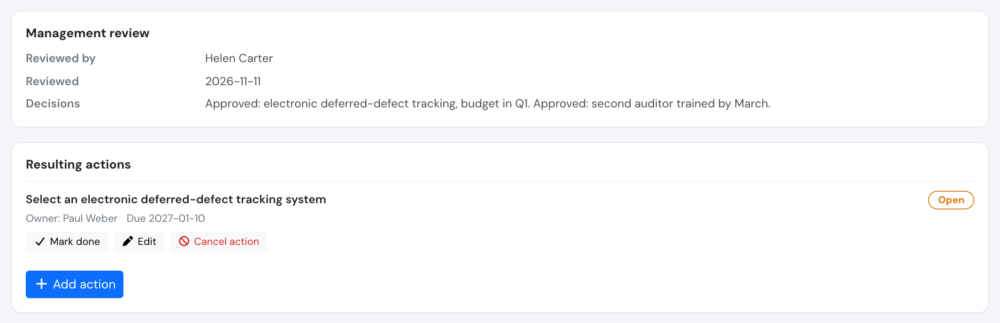

# Management review

The **management audit report** gives the accountable manager one view of how the audit programme, the findings and the corrective actions performed over a period. The **management review** records that the accountable manager read it, what they decided, and the actions that follow. Both **support** your compliance monitoring and safety assurance; they are evidence you can show, not a statement that the operator is compliant.

**Safety > Management reviews** lists the reviews, newest period first, with their status.

## Who can do what

| Who | Management review |
| --- | --- |
| Compliance & Safety Manager and above (user group 110 or lower) | Prepare a review (period and recommendations), preview and issue the report, add resulting actions |
| **Accountable manager** (the user chosen in [Audit settings](audits.md#audit-settings), any group) | Read everything. **Only they can record the review.** Can add resulting actions |
| **Auditor** (user group 250) | **Read-only**, including the issued report |
| Everyone else | No access |

* Requires the **Premium** or **Unlimited** plan.
* The accountable manager has no entry in the Safety menu. They receive an in-app message and an email when a report is issued for their review, with a link to the review page.
* If no accountable manager is chosen in Audit settings, nobody can record a review.

## The report

A review covers a **period** (from and to). The report has nine sections, generated from your audit programme, findings and corrective actions:

| # | Section | What it shows |
| --- | --- | --- |
| 1 | Audits completed vs planned | The audits of the period (internal and authority) with how many were planned, completed, in progress, not started and cancelled. An audit postponed out of the period still counts against it |
| 2 | Findings by classification and area | Findings raised in the period |
| 3 | Repeat findings | Findings raised in the period that repeat an earlier one |
| 4 | Overdue findings | Findings past their dates **as of the end of the period**. Findings awaiting verification or the authority are not counted as overdue |
| 5 | Corrective actions awaiting verification | Actions done and not yet verified as of the end of the period |
| 6 | Effectiveness of corrective actions | Actions verified in the period, effective against not effective |
| 7 | Trends and recurring root causes | Root-cause categories of the period against the previous period of the same length |
| 8 | Areas where risk controls are ineffective | Assessments concluded *meets requirements, not effective* in the period, plus the risk controls flagged as not effective on findings |
| 9 | Recommendations requiring management decisions | The free text written by the person preparing the review, one recommendation per line |

Counts that describe what happened (audits, findings raised, actions verified, root causes) use the dates inside the period. Counts that describe a backlog (overdue findings, actions awaiting verification) are taken as of the end of the period.

## Preparing and issuing

1. A manager chooses **New review**, picks the **period** and writes the **recommendations requiring management decisions**. The review starts as a **Draft**.
2. While it is a draft, the report on screen shows the data as it stands **now**. A draft can still be edited (period and recommendations); save before issuing, because the report uses the saved values.
3. **Issue management report** stores the report as a numbered **version** with a snapshot of the data and its PDF, sets the status to **Issued, awaiting review** and notifies the accountable manager.
4. If something changes before the review is recorded, a manager can issue a **new version**. Each version is immutable and listed under **Report versions**; the accountable manager reviews the **latest** one.

The report PDF is issued **before** the review, so its review block reads *To be recorded by the accountable manager in Flylogs*: the recorded review (who, when, decisions and actions) lives in the Management review page. Flylogs does not send the report anywhere; download the issued PDF and share it yourself.

## The accountable manager's review

When the report has been issued, the accountable manager opens the review, reads the report version and uses **Record review**:

* They enter their **decisions**. Decisions are required.
* The review stores **who** recorded it and **when**, and **which version of the report** was reviewed.

If a manager issued a newer version while the accountable manager was reading, recording is refused and the newer version is shown, so the decisions are never attached to a report the accountable manager has not seen. Read it and record the review again.

Once recorded, the review is **closed**: its decisions cannot be edited and no new report version can be issued for it. A new period needs a new review.

### Resulting actions

Decisions usually lead to work. The accountable manager and managers can add **resulting actions** to the review at any time, before or after recording it. They are normal [safety actions](safety-actions.md): they have an owner and a due date, show in **My safety actions**, are reminded by email and count in the *overdue safety actions* indicator. The review page lists them.

## Last review on the dashboard

The date of the last recorded review is shown in the **Audits and findings** section of the [Safety Assurance dashboard](safety-assurance.md#audits-and-findings). It turns red when no review has been recorded, or the last one is older than 12 months. This is a display hint only; it is not a deadline Flylogs enforces.

## API

See [Audits API](../API/audits.md#management-reviews).
