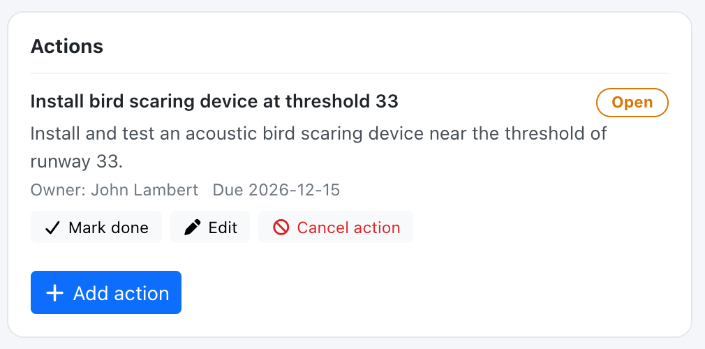
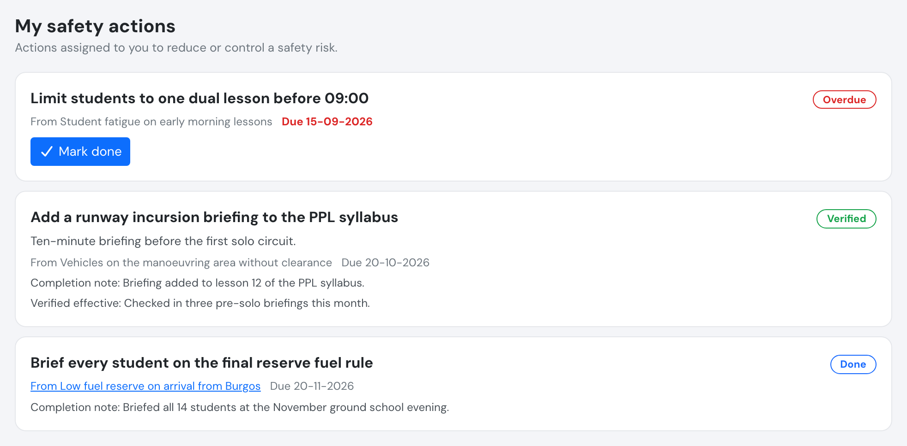
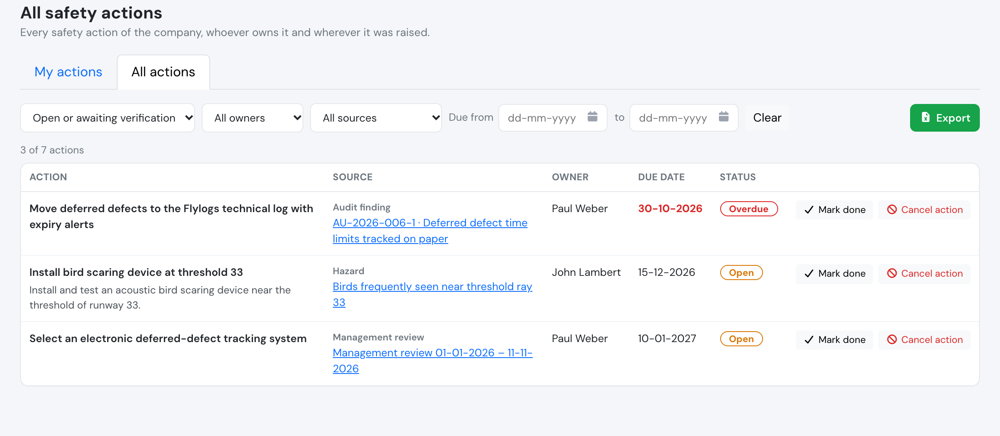
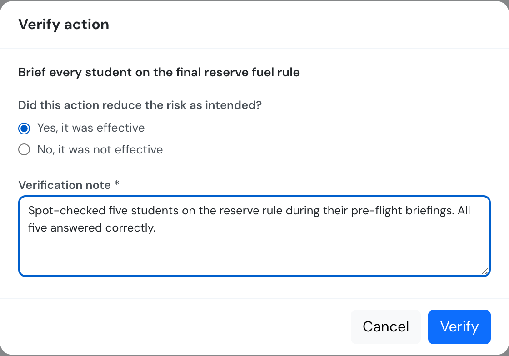

# Safety actions



A **safety action** is a tracked corrective or preventive measure with an owner, a due date and a lifecycle that ends with a check that it worked. Actions attach to a [safety report](create-a-safety-report.md), to a [hazard](hazard-log.md), to an [audit finding](audit-findings.md) (its corrective actions) or to a [management review](management-review.md) (the actions that result from the accountable manager's decisions). The free-text *corrective measures* field of a report still exists and is still shown; it is not converted into actions.

## Who can do what

| Who | Safety actions |
| --- | --- |
| Compliance & Safety Manager and above (user group 110 or lower) | Create on reports and hazards, assign, edit, verify, cancel, reopen. See **every action of the company** in [All safety actions](#all-safety-actions) |
| **Auditor** (user group 250) | **Read-only**, including [All safety actions](#all-safety-actions). Cannot own actions or mark them done. The one exception: they **verify** the completed corrective actions of an audit finding they raised (see [Independent verification](audit-findings.md#independent-verification-by-the-auditor)) |
| Assigned reviewer **or author** of a report, any group | **Propose** actions on that report only (created as *open*, owner chosen by them) and see every action on it |
| **Finding owner** (any group) | **Propose** corrective actions on **their own audit finding** (created as *open*) and see every action on it |
| **Accountable manager** (set in Company settings), any group | Add resulting actions to a **management review**; read-only on findings. See **every action of the company** in [All safety actions](#all-safety-actions) |
| Action owner, any group | See and update **only their own** actions: mark done with a note |
| Everyone else | No access |

* Requires the **Premium** or **Unlimited** plan.
* The owner can be any active user of the company except an auditor.
* Owners see the action's title and description and the title of its source, never the reporter of an anonymous report.
* The author of an **anonymous** report has no author rights on it.

## Lifecycle

| Status | Meaning | Who moves it there |
| --- | --- | --- |
| **Open** | Created and waiting for the owner. | Created open; a manager can reopen a *done* action. |
| **Done** | The owner reports it as carried out, optionally with a note. | The owner or a manager. |
| **Verified** | A manager checked it and recorded whether it was **effective** or **not effective**, with a note (both required). | Managers only. |
| **Cancelled** | No longer needed. A reason is required. | Managers only. |

* A **not effective** verification closes the action but flags it. The manager is offered **New action from this one** to follow up.
* Verified and cancelled actions cannot be edited.
* An open action past its due date counts as an *overdue safety action* on the [Safety Assurance dashboard](safety-assurance.md), and the tile turns red when an action is more than 30 days late or its source report or hazard is in the high band.
* Verifying an action does not change any risk value. When an effective action lowers the risk, a manager records the lower residual risk on the report or hazard, which is how an item leaves the high band.

## Actions from audit findings and management reviews

* **Audit findings**: the corrective actions of a finding are safety actions whose source is the finding. They keep the finding moving: the first action puts it **In progress**, and when none is open any more the finding moves to **Awaiting verification**. A finding that is a non-compliance can only be closed once at least one action is **verified as effective** and none is still open or waiting for verification (see the [closing rules](audit-findings.md#closing-rules)). A *not effective* verification flags the action and offers the follow-up action as usual.
* **Management reviews**: the actions resulting from the accountable manager's decisions are safety actions whose source is the review. Managers and the accountable manager can add them before or after the review is recorded.
* Both appear in **My safety actions** with the finding number and title, or the period of the review, as source. The link opens the finding or the review for the people who can see them, and is plain text for everyone else.
* They count in the *overdue safety actions* indicator and trigger the same reminders as any other action.
* Owners are notified and can be any active user except an auditor.

## Adding actions

Managers use **Add action** on a report or a hazard. A report's reviewer or author sees **Propose action** instead.

## Notifications

When an action is assigned, or its owner changed, the new owner receives an in-app message and an email. A daily reminder email goes to the owner **3 days before** the due date and **on** the due date.

## My safety actions

Everyone with an active account sees **Safety > My safety actions**: the actions assigned to them, open ones first, ordered by due date. Safety managers, auditors and the accountable manager find this list under the **My actions** tab, next to [All actions](#all-safety-actions). Owners use **Mark done** to complete an action with an optional note. Each action names its source report or hazard; a hazard source is a link only for safety managers and auditors (the hazard log is theirs), everyone else sees its title as plain text.

## All safety actions

Safety managers (user group 110 or lower), auditors and the company's accountable manager see a second tab on the same page, **All actions**: every safety action of the company, whoever owns it and wherever it was raised. It is the working list for monitoring whether corrective and preventive actions are carried out and effective, and for a Safety Review Board paper. Everyone else sees only the **My actions** list.

* **Columns**: the action with its completion and verification notes, the source type (safety report, hazard, audit finding or management review) and the source record, the owner, the due date and the status. Open actions past their due date show **Overdue** in red.
* **Order**: open first, then awaiting verification (*done*), verified and cancelled; within each, the earliest due date first.
* **Filters**: status (*All statuses*, *Open or awaiting verification*, *Open*, *Overdue*, *Done*, *Verified*, *Cancelled*), owner (including *No owner*), source type and a due date range. Actions without a due date are left out when a date range is set. The filters are kept in the page address, so a filtered view can be bookmarked; **Clear** removes them all.
* **Export** downloads the list exactly as filtered to Excel: action, description, source type and record, owner, due date, status, done and verified dates, completion note, whether it was effective, verification note and creation date. The header records who exported it, when, and which filters were applied.
* **From the list**, safety managers mark done, verify, reopen and cancel actions without opening each source; owners mark their own actions done. Editing an action (title, owner, due date) is still done on its source.
* The source is a link for safety managers and auditors. For an accountable manager who is not a safety manager, audit findings and management reviews are links and reports and hazards are plain text.
* The **Overdue safety actions** tile of the [Safety Assurance dashboard](safety-assurance.md#built-in-indicators) opens this list filtered to *Overdue*.

## Verifying an action

## API

See [Safety Assurance API](../API/safety-assurance.md#safety-actions).
