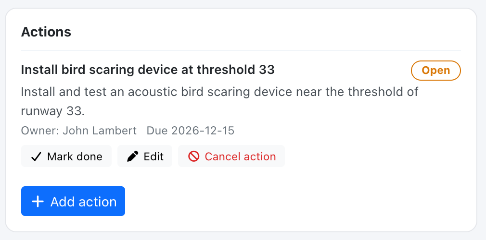
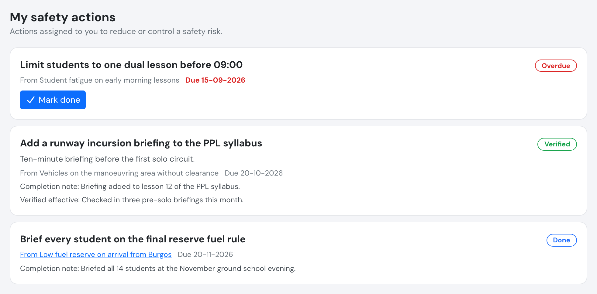
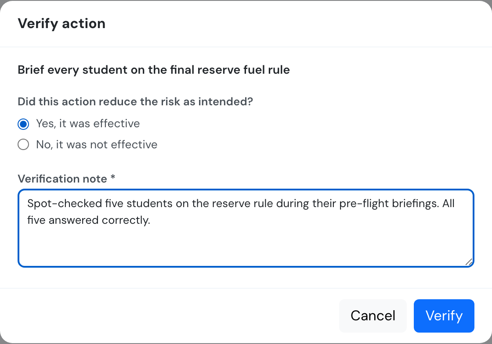

# Safety actions



A **safety action** is a tracked corrective or preventive measure with an owner, a due date and a lifecycle that ends with a check that it worked. Actions attach to a [safety report](create-a-safety-report.md) or to a [hazard](hazard-log.md). The free-text *corrective measures* field of a report still exists and is still shown; it is not converted into actions.

## Who can do what

| Who | Safety actions |
| --- | --- |
| Compliance & Safety Manager and above (user group 110 or lower) | Create on reports and hazards, assign, edit, verify, cancel, reopen |
| **Auditor** (user group 250) | **Read-only**. Cannot own actions or mark them done. |
| Assigned reviewer **or author** of a report, any group | **Propose** actions on that report only (created as *open*, owner chosen by them) and see every action on it |
| Action owner, any group | See and update **only their own** actions: mark done with a note |
| Everyone else | No access |

* Requires the **Premium** or **Unlimited** plan.
* The owner can be any active user of the company except an auditor.
* Owners see the action's title and description and the title of its source, never the reporter of an anonymous report.
* The author of an **anonymous** report has no author rights on it.

## Lifecycle

| Status | Meaning | Who moves it there |
| --- | --- | --- |
| **Open** | Created and waiting for the owner. | Created open; a manager can reopen a *done* action. |
| **Done** | The owner reports it as carried out, optionally with a note. | The owner or a manager. |
| **Verified** | A manager checked it and recorded whether it was **effective** or **not effective**, with a note (both required). | Managers only. |
| **Cancelled** | No longer needed. A reason is required. | Managers only. |

* A **not effective** verification closes the action but flags it. The manager is offered **New action from this one** to follow up.
* Verified and cancelled actions cannot be edited.
* An open action past its due date counts as an *overdue safety action* on the [Safety Assurance dashboard](safety-assurance.md), and the tile turns red when an action is more than 30 days late or its source report or hazard is in the high band.
* Verifying an action does not change any risk value. When an effective action lowers the risk, a manager records the lower residual risk on the report or hazard, which is how an item leaves the high band.

## Adding actions

Managers use **Add action** on a report or a hazard. A report's reviewer or author sees **Propose action** instead.

## Notifications

When an action is assigned, or its owner changed, the new owner receives an in-app message and an email. A daily reminder email goes to the owner **3 days before** the due date and **on** the due date.

## My safety actions

Everyone with an active account sees **Safety > My safety actions**: the actions assigned to them, open ones first, ordered by due date. Owners use **Mark done** to complete an action with an optional note. Each action names its source report or hazard; a hazard source is a link only for safety managers and auditors (the hazard log is theirs), everyone else sees its title as plain text.

## Verifying an action

## API

See [Safety Assurance API](../API/safety-assurance.md#safety-actions).
