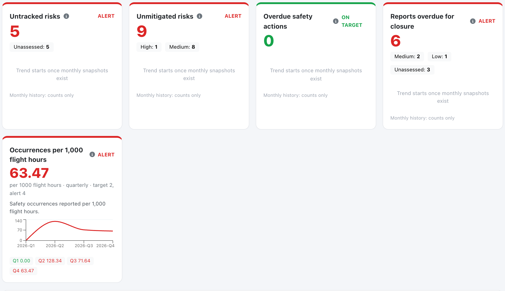
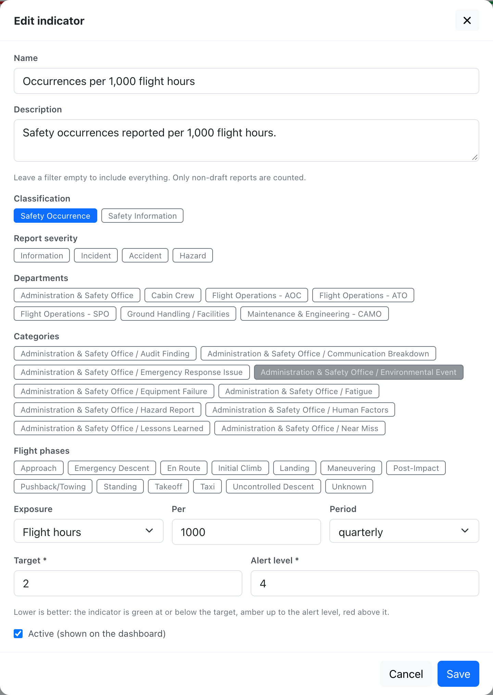
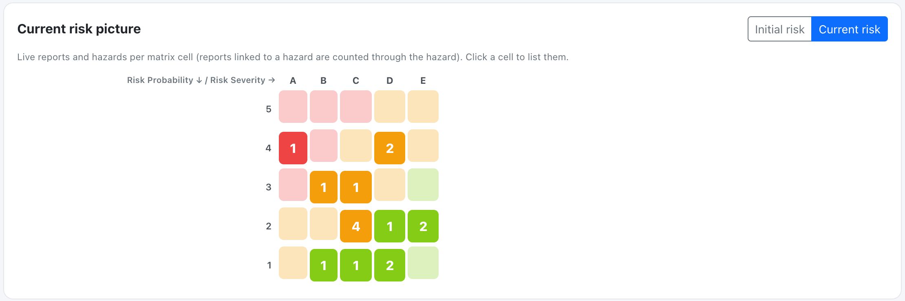
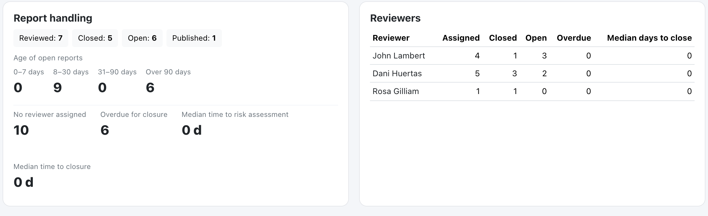
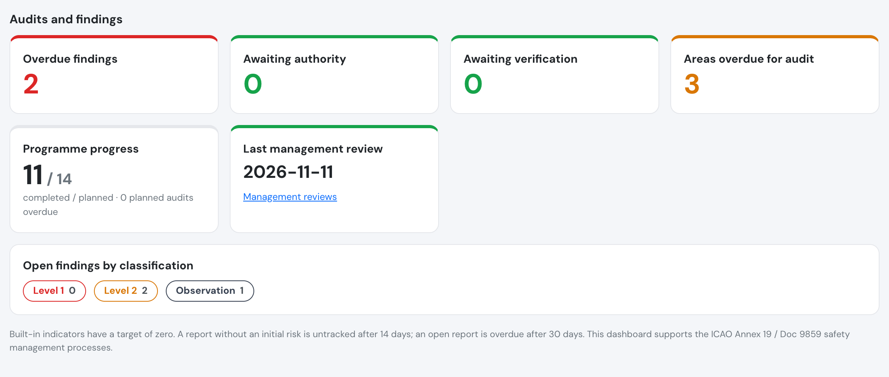
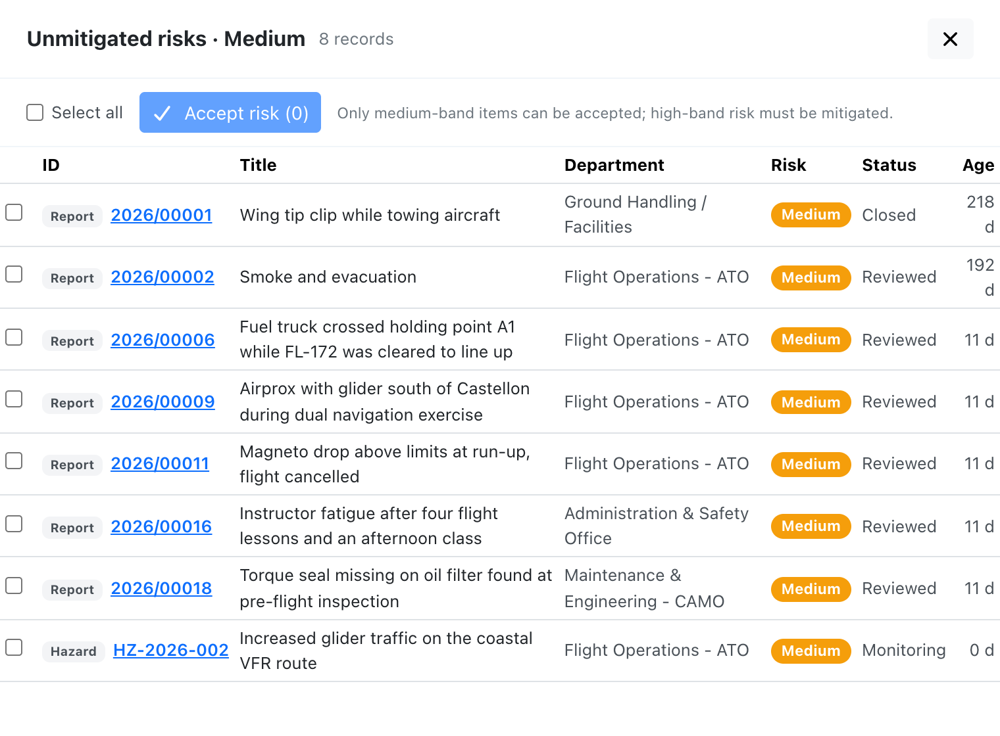
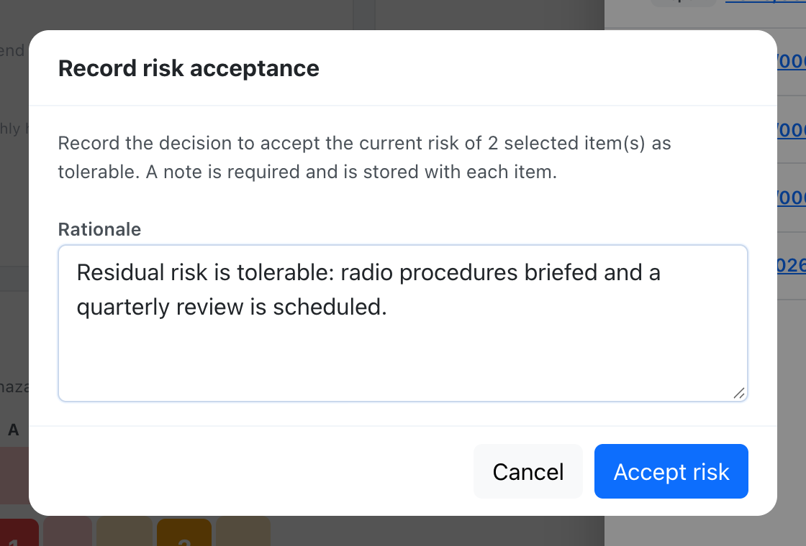

# Safety Assurance dashboard



The **Safety Assurance** dashboard is the first tab of **Safety > Analytics**. It is designed to be put in front of an inspector or an auditor, whatever type of operation you run (AOC, SPO, ATO, CAMO or general aviation), and it supports the safety assurance processes of ICAO Annex 19 and Doc 9859 (safety performance monitoring and measurement).

It answers four questions:

* Which risks are we carrying right now, especially the ones that are **not mitigated** and the **new and emerging** ones?
* Are safety reports being taken care of, and by whom?
* How are we doing against our safety performance **targets and alert levels**?
* Where is the evidence? **Every number opens the list of records behind it.**

## Who can see it

| Who | Dashboard | Manage indicators, accept risks |
| --- | --- | --- |
| Compliance & Safety Manager and above (user group 110 or lower) | Full | Yes |
| **Auditor** (user group 250) | **Read-only** | No |
| Everyone else | No | No |

* Requires the **Premium** or **Unlimited** plan, the same as safety reports. On other plans the page shows the usual "disabled on your subscription" message.
* **Auditors** read every submitted safety report, hazard and action of the company, but cannot file or edit reports, create hazards, own actions, accept risks or change indicators. The reporter of an anonymous report is never shown to anyone on this dashboard.
* Draft reports stay private to their author and are never counted.

## Filters

The header has three filters, and every section respects them:

* **Year** (current year by default). Values are always compared with the previous year.
* **Department**.
* **Classification**: Occurrence or Information (see [Create a Safety Report](create-a-safety-report.md#report-classification)).

### What the year means

The year filter works in two ways, depending on whether a number describes **what is still pending** or **what happened during the year**:

| Kind of number | Items counted | Where |
| --- | --- | --- |
| **Pending work** (backlog) | Unresolved items dated **in or before** the selected year | The four built-in indicators, the risk heat map, the age of open reports, reports with no reviewer, reports overdue for closure, each reviewer's open and overdue reports, and the lists behind them |
| **Activity in the year** | Items dated **in** the selected year | Reports by status, median days to assessment and to closure, each reviewer's assigned, closed and median days, emerging risks and your own indicators |

So a report from last December that is still open, or a safety action due on 15 December that is still not done, keeps counting in January: pending work does not disappear when the year changes. The dates used are the report's event date, the hazard's creation date and the action's due date.

## Counting rules

* **Follow-up crew statements** (the sub-reports attached to a parent report) are never counted. Only the parent report counts.
* **For risk, a report linked to a hazard is represented by that hazard.** It is not counted on its own in *Untracked risks*, *Unmitigated risks*, the risk heat map or *New high or frequent risks*; the hazard's risk and actions stand for it. Reports that are not linked to a hazard count on their own.
* **For report handling, every report counts, linked or not.** Linking a report to a hazard does not close it: it still appears in *Reports overdue for closure*, report handling, the reviewer table and *Categories rising* until it is closed.
* The **current risk** of a report or hazard is its mitigated (residual) risk when one is recorded, otherwise its initial risk.
* A risk is **high or frequent** when its current risk is in the red band, or when its probability is 4 Occasional or 5 Frequent. A known frequent probability counts even if the severity is not assessed yet.

## Built-in indicators

The four built-in indicators have a target of **zero**. They are computed live from your records, so the number you see is the number you can list.

| Indicator | What it counts |
| --- | --- |
| **Untracked risks** | Open or reviewed reports that still have no initial risk assessment after the configured number of days (14 by default), plus hazards whose next review date has passed (closed hazards are excluded). A closed or published report is never counted as untracked. |
| **Unmitigated risks** | Items whose current risk is in the **high** band, plus items in the **medium** band that have no recorded [risk acceptance](icao-8951-risk-matrix.md#risk-tolerability-and-risk-acceptance). Low-band risk is acceptable as is. Closed hazards are excluded. |
| **Overdue safety actions** | [Safety actions](safety-actions.md) that are still open after their due date. |
| **Reports overdue for closure** | Reports that are still open or reviewed after the configured number of days (30 by default), including reports linked to a hazard. |

### Colours

* **Green**: the count is zero.
* **Amber**: the count is above zero, but none of the red conditions below applies.
* **Red**: at least one counted item is in the high band or has an occasional or frequent probability, **or** is badly overdue: more than twice its deadline for reports (assessment and closure deadlines), or more than 30 days late for hazard reviews and safety actions. A safety action also turns red when its source report or hazard is in the high band.

Each tile shows the count, the colour, a breakdown by band (high, medium, low, unassessed) and a monthly trend line for the selected year with the previous year overlaid.

> **History starts when the feature is switched on.** A daily job records each month's value, so earlier months show **No data** rather than a misleading zero. The trend points show counts only; the tile number itself opens the list. A month's value is the one recorded on its last day. Each trend point uses the same year rule as the tile: the current-year line counts pending items dated in or before the selected year, the previous-year line those dated in or before the year before, so the latest point matches the tile.

### The 14 and 30 day deadlines

The two deadlines are the only built-in settings a company changes. A manager edits them in **Company settings > Safety management**:

| Setting | Default | Effect |
| --- | --- | --- |
| Days to assess a report | 14 | A report without an initial risk after this many days counts as *untracked*. |
| Days to close a report | 30 | An open or reviewed report older than this counts as *overdue for closure*. |

## Your own indicators

Managers (user group 110 or lower) use **Manage indicators** to define indicators that fit your operation. Each one is a rate, and **lower is always better**:

* **Filters**: classification, report severity, departments, categories and flight phases. Leave a filter empty to include everything. Only submitted reports are counted.
* **Exposure** (optional): divide by flight hours, flights or landings of confirmed flights, expressed *per* a number you choose, for example "occurrences per 1,000 flight hours".
* **Period**: monthly, quarterly or yearly.
* **Target and alert level**: green at or below the target, amber up to the alert level, red above it. The alert level cannot be below the target.

A period with no flights shows **No exposure**, never infinity or zero. Periods that have not started yet (for example December while it is still November, in your company's time zone) show as **future**: they are greyed out, have no value and cannot be opened, and the tile shows the latest period that has started. Custom indicators are computed from the source records, so their full history is available from the first day. The department and classification filters of the dashboard apply to the reported events only, because flights have no department.

## Current risk picture

A 5x5 heat map of the live risk picture in each probability/severity cell, dated in or before the selected year: reports that are still open or reviewed, closed or published reports whose risk is still unmitigated (high, or medium without a risk acceptance), and hazards that are not closed. Resolved reports (closed or published with a low or accepted medium risk) drop out, and reports linked to a hazard are represented by the hazard. Switch between **Initial risk** and **Current risk**, and click any cell to list its records.

## Emerging risks

* **New hazards** created in the selected year.
* **Categories rising** against the previous year (same period of the year), with the change.
* **New high or frequent risks.**

## Report handling

Counts of reports by status, the age of open reports (0-7, 8-30, 31-90 and over 90 days), how many open reports have **no reviewer assigned**, how many are **overdue for closure**, and the **median days** to risk assessment and to closure. Reports linked to a hazard are included. Status counts and medians cover reports dated in the selected year; the age, no-reviewer and overdue numbers cover every open report dated in or before it.

Median times for reports that existed before this feature are approximate, because the assessment and closure dates were reconstructed from each report's last modification.

## Reviewers

For each reviewer: reports assigned in the year, how many of those are closed and the median days to close; plus every report assigned to them in or before the year that is still open, and how many of those are overdue. A reviewer who only has older open reports is listed with 0 assigned. Reassigning a report credits the current reviewer.

## Audits and findings

The **Audits and findings** section sits under the safety sections of the Assurance tab. It summarises the [audit programme](audits.md), the [findings](audit-findings.md) and the [management review](management-review.md), and helps you check that compliance monitoring itself is working: audits done on time, findings closed and areas covered. Companies that do not use the audit tools see **No audit data yet** and a link to the programme.

| Tile | What it counts |
| --- | --- |
| **Overdue findings** | Findings still being worked on (open, action plan submitted or accepted, in progress) that are past their target date, or still open and past their action plan due date. Findings awaiting verification or the authority are not overdue |
| **Awaiting authority** | Findings whose corrective actions are verified and that wait for the authority to close them |
| **Awaiting verification** | Findings whose corrective actions are all done and need to be verified |
| **Areas overdue for audit** | Active audit areas past their next due date, or never audited |
| **Programme progress** | Audits completed out of audits planned in the selected year, and how many planned audits are overdue |
| **Last management review** | Date of the last recorded [management review](management-review.md). Red when there is none, or the last one is older than 12 months (a display hint, not a deadline) |

* **Overdue findings** is **red** when an overdue finding is critical or major, or when any critical finding is still open, even with nothing overdue; **amber** when anything is overdue; **green** otherwise. **Areas overdue** is amber when above zero.
* **Open findings by classification** lists the open findings per class of your company's classifications.
* Overdue findings and areas overdue also have a **monthly trend**, with the same rules as the other indicators: history starts when the feature is switched on.
* Every tile opens the list of findings or areas behind it, with a link to the record. Lists never show who owns a finding.

The year and department filters apply like everywhere else: open findings, overdue, awaiting and areas overdue are **pending work** (findings dated in or before the year, by their raised date; the department is that of the finding's audit area), and programme progress is **activity in the year**. The Occurrence/Information classification filter does not apply to audits.

Auditors (group 250) read this section too; the finding owner and the accountable manager do not have the dashboard unless they are also managers or auditors, and use the audit pages instead.

## Drilling down and accepting risk

Every number on the dashboard, except the built-in trend points, opens a list: type (report, hazard or action), ID, title, department, risk badge, status and age, with a link to the record. The audit tiles list findings and areas instead; see [Audits and findings](#audits-and-findings). Lists can be filtered by band.

A **safety action** has no page of its own: in the list its title starts with the number of the report or hazard it belongs to (for example `HZ-2026-004 · Trim the grass near the threshold`), its risk badge is the current risk of that report or hazard, and the link opens that report or hazard, where the action is listed.

From the list behind **Unmitigated risks**, managers can select several medium-band items and choose **Accept risk**. The rationale is required and is stored on each item together with who accepted it and when. High-band items cannot be accepted and are reported back as refused, as are unassessed items.

The acceptance is visible afterwards on the record itself: a safety report shows a **Risk acceptance** block under its risk matrix (who accepted it, when, and the rationale) to everyone who can see the matrix, and a hazard shows who accepted it and when in its details. Any later change to the risk assessment voids the acceptance.

See [ICAO risk matrix (Doc 9859)](icao-8951-risk-matrix.md#risk-tolerability-and-risk-acceptance) for the tolerability rules.

## API

All of this is available through the [Safety Assurance API](../API/safety-assurance.md). The audit data itself is in the [Audits API](../API/audits.md).
