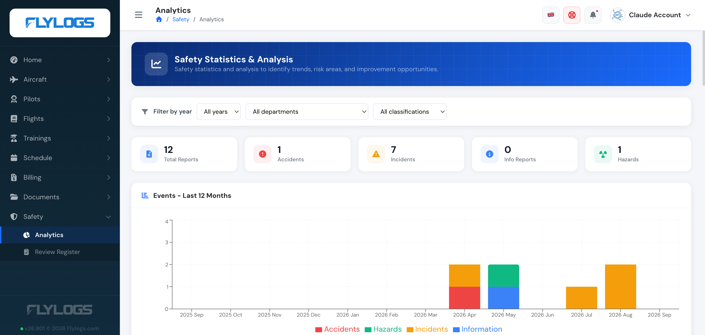
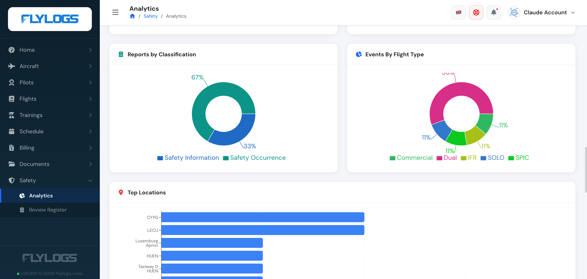

# Safety report analytics

The Analytics page has two tabs:

* **Assurance** (opens first): the [Safety Assurance dashboard](safety-assurance.md) with safety performance indicators, the current risk picture, report handling and reviewers.
* **Statistics**: the charts described below, unchanged.

> **Access:** the page is visible to the Compliance & Safety Manager and above (user group 110 or lower) and to **auditors** (group 250, read-only). Auditors see every submitted safety report of the company in the lists and charts, but never the identity of the reporter of an anonymous report, and they cannot create or change anything. Requires a Premium or Unlimited plan.

## Statistics tab

An important part of the safety implementation in aviation, is about understanding where the safety risks are and mitigating them before they lead to any incident or accident.

In order to do so, information management and understanding is key, which is the key benefit that Flylogs brings into your company.

For that reason, our [SMS tool ](https://www.flylogs.com/features/safety-management)displays all relevant data, in a few charts that automatically summarize your safety events categorized by type, phase of flight, type of flight and other important categorizations.

Having this amount of information in just one click is a great value and a huge pusher for the implementation of this kind of systems in any flight operator.

 

Flylogs offers this tool with no extra cost in order to empower flight safety in all organizations, no matter its size.

