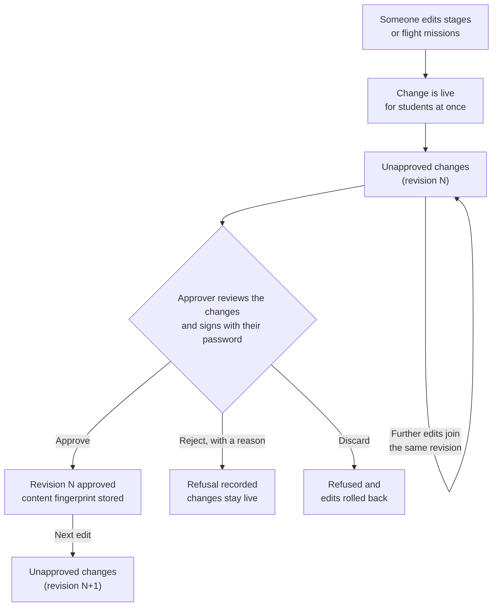
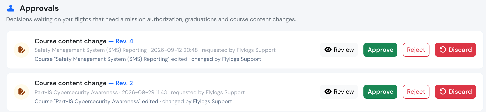
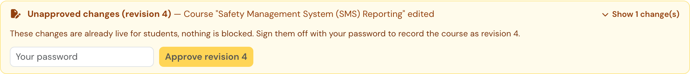

# Course Approvals

Three decisions on a course get recorded rather than just happening: graduating a student, changing the course content, and designating who may instruct or run checks on it.

Only the first of these **blocks** anything, and only on courses with [stage checks](stage-checks.md) enabled. The other two record and inform — they never stop a save.

### Graduating a student

On a course with stage checks on, passing the last stage does not complete the course by itself. Once every stage check is passed, the student appears as **waiting for approval** on their Flight missions tab and in **Trainings → Approvals**, and an approver decides. The request is raised when the student's progress is saved with [**Auto-finish training**](student-management.md#marking-a-training-as-completed-and-the-completion-date) on, or when someone chooses **Mark as completed** for the student.

* **Approve** — the course completes and the certificate becomes available. If a lesson, exam or flight mission is still outstanding, the approval is kept and the course completes once the last one is done (automatically with **Auto-finish training** on, otherwise with **Mark as completed**).
* **Reject** — the enrollment stays active and the reason is kept on the record. The student is put back in the queue the next time their progress is saved or someone chooses **Mark as completed**.

Both are signed with your password, and a rejection needs a reason.

On a course **without** stage checks no graduation approval is needed: the course completes on its own when **Auto-finish training** is on, or when you mark it completed.

### Approving content changes

How a content change travels from the edit to its sign-off:

Any change to a course's stages or flight missions opens a **revision**. The course then shows *Unapproved changes (revision N)* until someone signs it off.

Editing a course fifty times before anyone approves produces **one** revision, not fifty — the revision stays open and simply records who touched it last.

**You can see what you are approving.** The badge lists every recorded change in that revision — what was added, edited or deleted, the old and new value of each field, and who made it. Expand it before signing.

Approving stores a fingerprint of the content as it stood at that moment, so the approval can later be shown to have covered exactly that version.

An edit that changes nothing records nothing: re-saving a stage without touching a field does not open a revision or ask anyone to approve it.

Pushing changes from a linked subject to a live course (see [Subject Bank](subject-bank.md)) counts as an edit of that course: it opens a revision like any manual change, summarised as *Subject "…" synced from "…"*.

This never blocks anything. Students always run the live content; the revision is a record of what was approved and when, not a draft that has to be published. The one exception is a [draft course revision](edit-a-training.md#course-revisions-minor-and-major-changes): while its changes are waiting for approval it cannot be published with **Publish course revision**, and approving them publishes it.

### Approve, Reject or Discard

Pending content changes are decided in **Trainings → Approvals**. Each one has a **Review** button that opens the course, and three decisions, all signed with your password:

<figure><figcaption>
Trainings → Approvals: each course content change can be reviewed, approved, rejected or discarded.
</figcaption></figure>

| Decision | What happens |
| -------- | ------------ |
| **Approve** | The revision is signed off and the content fingerprint stored. Everyone accountable for the course is told what was approved. If the course is a draft course revision, it is published. |
| **Reject** | You record that you refused the changes, with a reason. **The changes stay live on the course.** To take them off the course as well, use Discard. |
| **Discard** | Rejects the changes, with a reason, **and rolls the course back** to how it stood before them, newest change first. Anything a student has already used, such as a mission they have flown, stays as it is. Flylogs then tells you how many changes were rolled back and lists the ones that stayed. |

### Signing off from the course page

You don't have to go to **Trainings → Approvals** to approve. When you can approve, the **Unapproved changes** badge on the course page is the sign-off itself: type your password in the badge and choose **Approve revision N**. No extra window opens. This suits a small school where the person who edits the course is the same person who approves it: make your changes, then sign them off right there.

<figure><figcaption>
An approver signs off the open revision straight from the course page.
</figcaption></figure>

The badge also explains that the changes are already live and that nothing is blocked while they wait. Someone who cannot approve sees the same badge without the password field; it tells them an approver still has to sign the changes off.

Signing from the badge is the same signature as **Approve** in **Trainings → Approvals**: same password check, same content fingerprint, same notification. Rejecting and discarding are done from **Trainings → Approvals**.

### Undoing a change

Because changes go live immediately, the change log gives an approver an **Undo** on each entry. What can be undone faithfully differs by the kind of change:

| Change | Undo |
| ------ | ---- |
| A field was edited | The previous values are written back. Exact. |
| Stages or missions reordered | The previous sequence is restored. Exact. |
| Something was created | It is removed — **unless** it is already in use (a mission a student has flown, a stage with missions in it). |
| Something was deleted | It is restored from the stored copy. Deletions recorded before this feature existed cannot be restored, and say so rather than guessing. |

Two rules keep undo from making a mess:

* **Newest first.** If someone edited the same item again afterwards, that later change has to be undone first. Undoing an older one would silently discard the newer edit.
* **An undo is itself a change.** It appears in the log and opens a revision like any other edit, so the record never shows an edit that quietly stopped being true.

### Who may sign a stage check

Stage checks are signed by pilots at **Chief Pilot level or above**.

This is deliberately wider than who may *approve* a graduation: signing a check is an instructional act, approving a graduation is a management one.

### Who can approve

Approvals are decided by a Company Administrator, Operations Manager, Compliance & Safety Manager, Human Resources Manager, Financial Manager or Trainings Manager (`user_group_id <= 135`). Being named as a course's training manager does not on its own allow someone to approve.

These roles see every course in **Trainings → Approvals**. A Chief Pilot who is named as a course's training manager sees that course's items in the queue, but the decision is taken by one of the roles above.
