# Course migrations

Students do not always finish on the course they started. A student on the LAPL(A) decides to go for the PPL(A), a syllabus change publishes a new course revision, or a licence holder comes back for the next course. A course migration carries their training across, so they keep credit for what they have already done.



## Which one do you need?

| Situation | Use | The old record |
| --------- | --- | -------------- |
| One student **in progress** changes course, or changes to another course revision | [**Move to another course**](#move-one-student), on the student's record | Closes as **Moved** and is frozen |
| A group **in progress** on a previous course revision | [**Review who can move**](#move-a-group-to-a-new-course-revision), on the course | Each one closes as **Moved** and is frozen |
| A record that is already **completed, stopped or not passed** | [**Credit into another course**](#credit-a-closed-record), on the student's record | Stays exactly as it is |

A student who brings training from another school has no record to migrate. Use [Recording previous experience](student-management.md#recording-previous-experience) instead.


**Who can do this.** Staff up to and including Trainings Manager (`user_group_id <= 135`): Company Manager, Chief Pilot and Head of Training roles. Instructors, students and external auditors do not see these buttons, and the server answers 404 for them. A migration always stays inside your own company.


## Move one student

Open the student's training record. In the **Student Training Management** panel, click **Move to another course**.

<figure>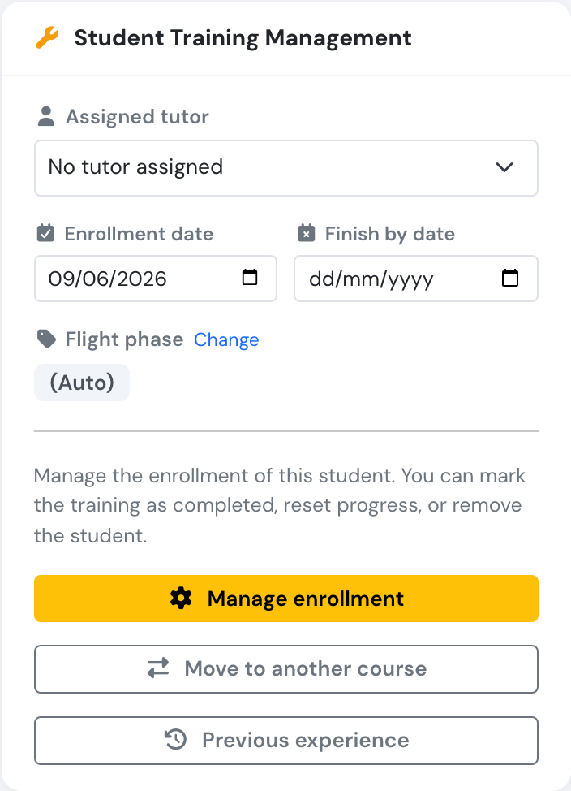<figcaption>
The button appears while the enrollment is in progress.
</figcaption></figure>

### Step 1: choose the course

The list holds the current course revision of every other course, and the current course revision of this course if the student is on an older one. Draft and previous course revisions cannot be chosen.

<figure>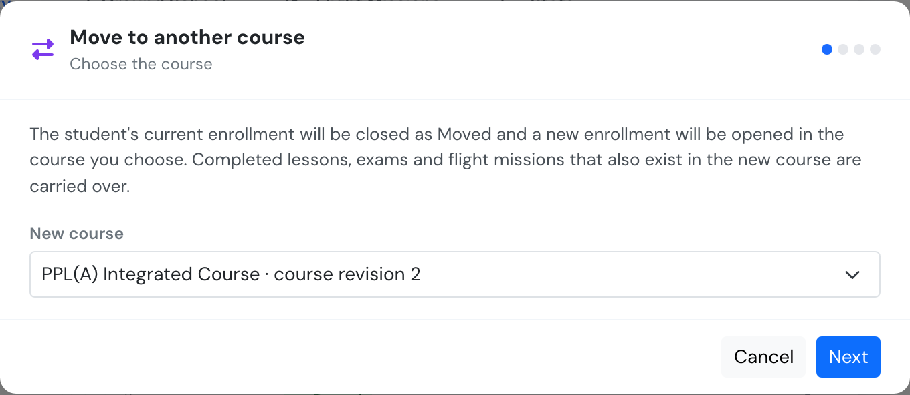<figcaption>
Students always move to a current course revision.
</figcaption></figure>

### Step 2: what carries over

Flylogs draws both courses side by side, with one line for each item that carries over. Green ticks on the left show what the student has completed. The blue box at the top counts the completed items that will follow them.

<figure>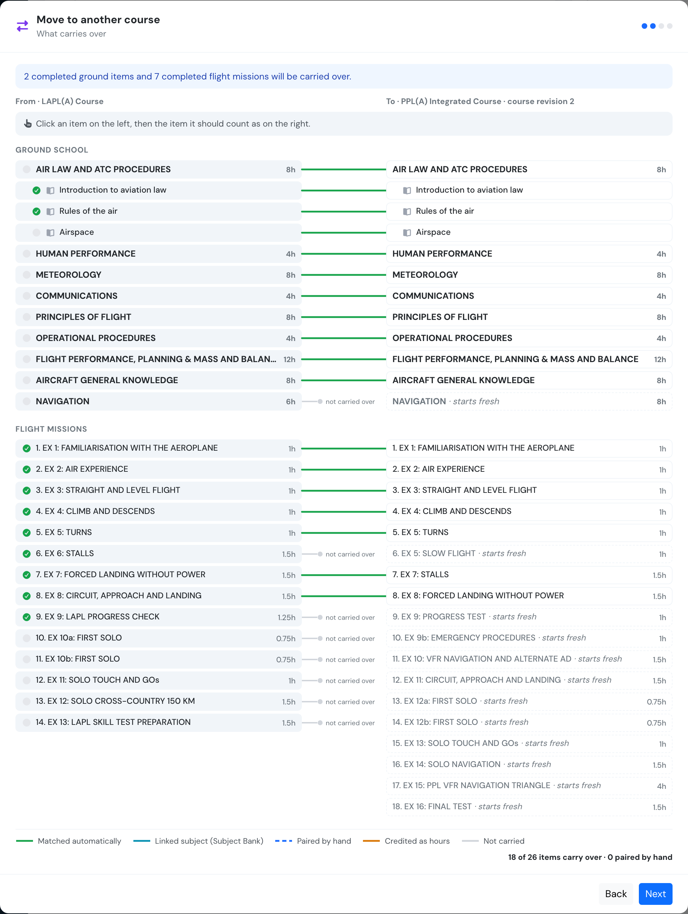<figcaption>
Before any pairing by hand. Check the missions: from mission 6 the two syllabi no longer line up, and position alone paired the LAPL(A) forced landing with the PPL(A) stalls.
</figcaption></figure>

| Line | Meaning |
| ---- | ------- |
| Green | Matched automatically (see the rules below). |
| Teal | A subject linked through the [Subject Bank](subject-bank.md). Linked subjects and their lessons pair up even when their names or hours differ. |
| Blue dashed | Your own pairing, or one from a saved [course pathway](course-pathways.md#3-course-pathways-and-the-pathway-map). |
| Amber | Hours from unpaired missions that will be credited by flight type (step 3). |
| Grey stub | Not carried. On the right, items with no line are marked **starts fresh**. |

**How items match automatically:**

* A **ground subject** matches when it has the same name and the same planned hours, or when both are linked through the Subject Bank.
* Inside a matched subject, **lessons and exams** match in the same position with the same name.
* A **flight mission** matches when it is in the **same position** in the course, with the same flight type and the same planned hours.


**Always check the missions.** One extra mission in either syllabus shifts every later position. Two different exercises in the same position, with the same flight type and hours, are paired even though they are not the same exercise.


**To pair an item by hand**, click it on the left, then click the item it should count as on the right. Only items of the same kind can be paired: subject with subject, lesson with lesson, exam with exam, mission with mission. Two missions may count as one, while subjects, lessons and exams pair one to one. The bar above the diagram offers **Don't carry**, for an item that should not count, and **Back to automatic**, to remove your pairing.

<figure>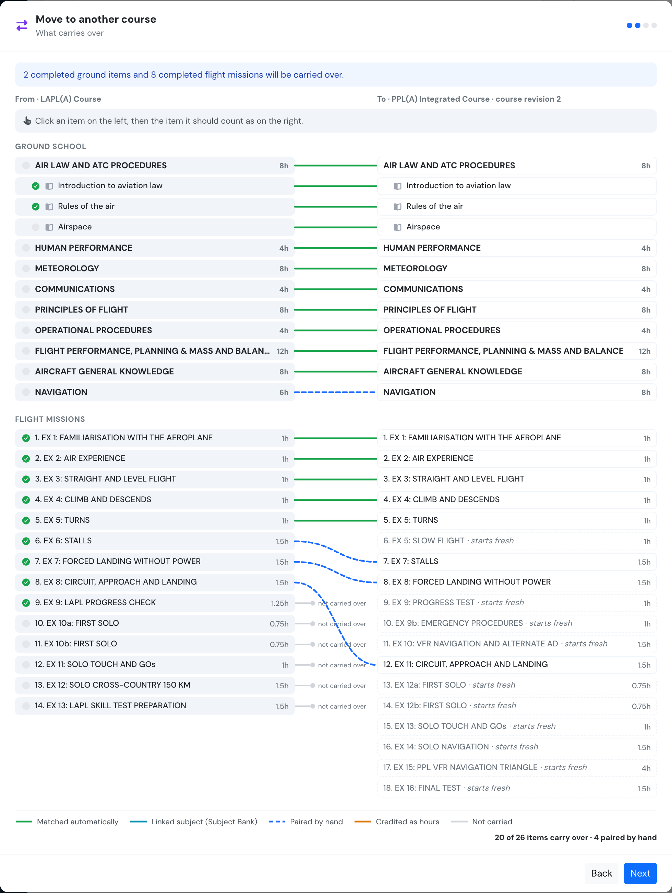<figcaption>
After pairing Navigation and three missions by hand. The summary at the bottom counts what carries over.
</figcaption></figure>

If a course pathway is saved for these two courses, its pairings are already applied when the diagram opens.

### Step 3: unmatched flight hours

Hours flown on missions with no counterpart are listed by flight type. **Nothing is credited unless you tick it.** A flight type the new course does not use cannot be credited.

<figure>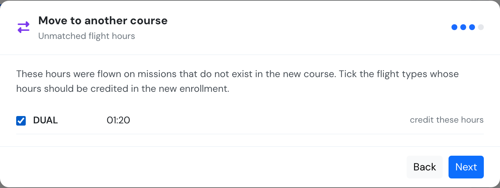<figcaption>
The LAPL(A) progress check has no counterpart, so its 1:20 can be credited as DUAL hours.
</figcaption></figure>

Two more things can appear in this step:

* **Experience after this change**, when the new course has [experience requirements](course-pathways.md#1-set-the-courses-experience-requirements). It shows how the student would stand, counting the flights of both courses.
* **A credit limit warning**, when previous-experience hours the student would carry break the new course's [credit limits](course-pathways.md#limits-on-previous-experience-credit). The move can still go ahead.

<figure>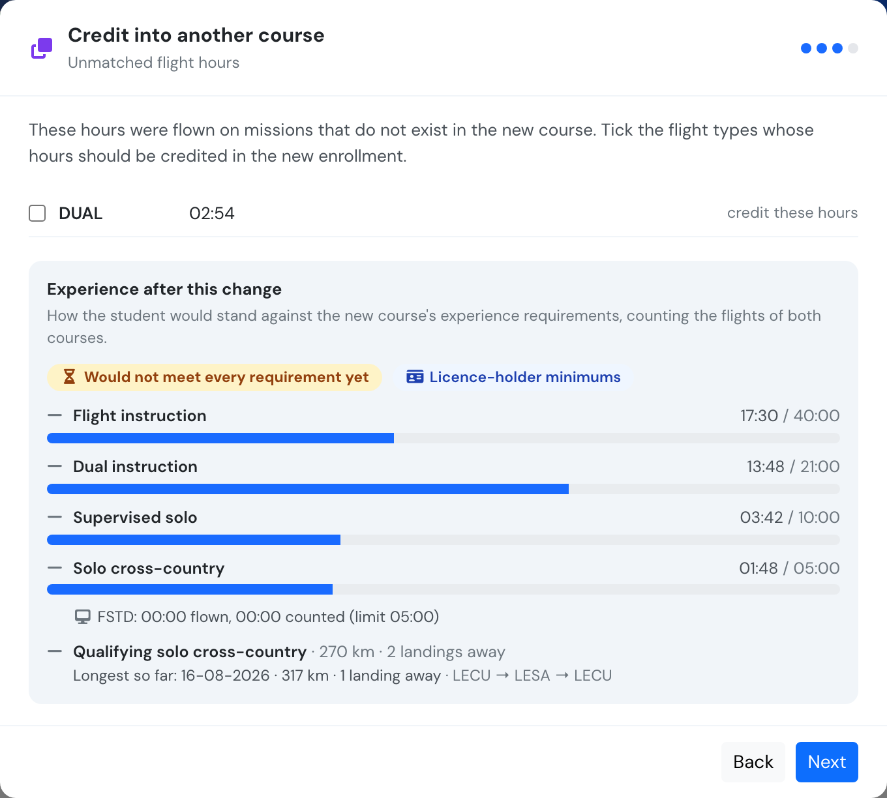<figcaption>
Experience after this change, on a course that has requirements.
</figcaption></figure>

### Step 4: confirm

A **reason** is required, and it stays on the training record. If you paired anything by hand, **Save these pairings as the course pathway** is ticked, with an optional label, so the next student moved or credited between these two courses starts with the same pairings. A pathway that cannot be saved never undoes the move.

<figure>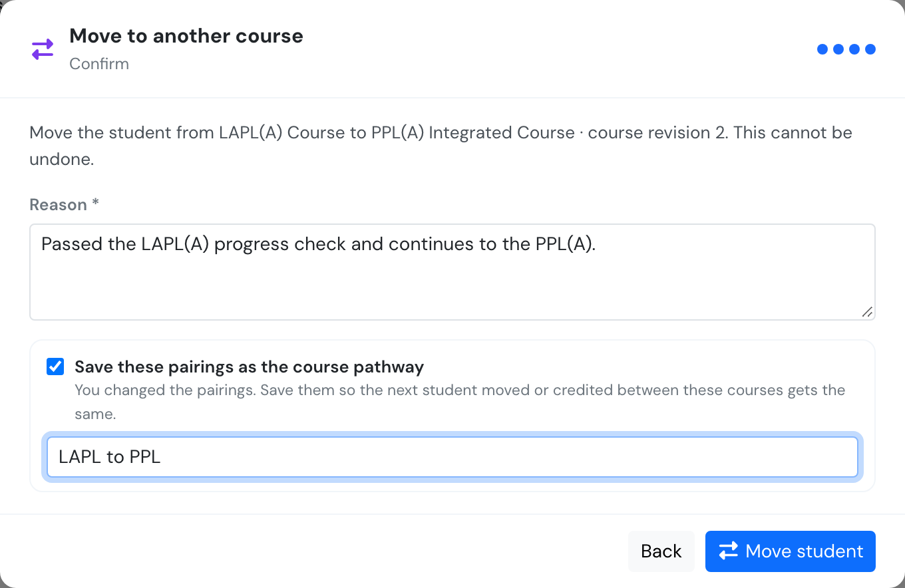<figcaption>
The last step before the move.
</figcaption></figure>


**A move cannot be undone.** Check the pairings and the course before you click **Move student**.


### After the move

The new record opens straight away, with the matching lessons, exams and missions already done, and a link back to where the student came from.

<figure>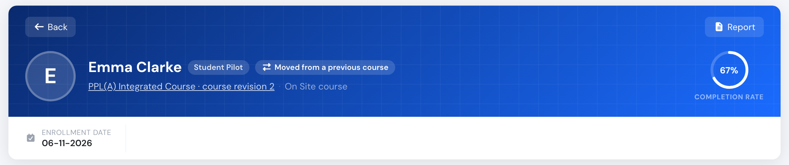<figcaption>
The new enrollment on the PPL(A), course revision 2.
</figcaption></figure>

Carried missions keep the flights the student really flew, because they point at the same logbook flights. Hours credited by flight type appear in amber on the **Flight Hours by Type** chart.

<figure>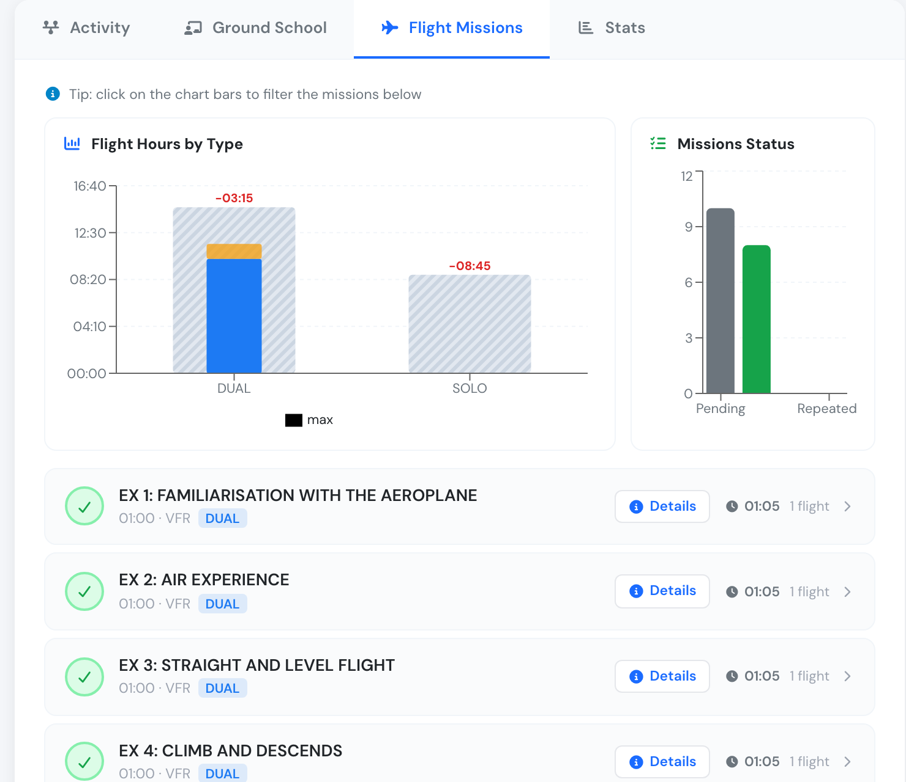<figcaption>
Carried missions are ticked, with the flights they were flown on. The credited hours sit in amber on top of the DUAL bar.
</figcaption></figure>

The old record stays on file, with the status **Moved** and a link to the new one.

<figure>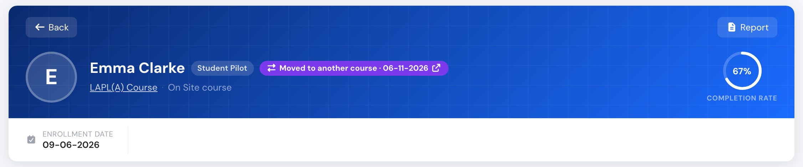<figcaption>
The old LAPL(A) enrollment.
</figcaption></figure>

Both records show the move in their **Activity** timeline, with the date, the reason and who made it.

<figure>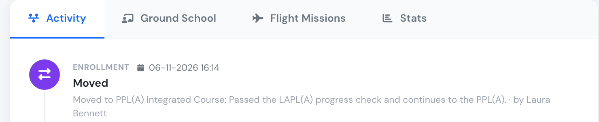<figcaption>
The move on the old record's timeline.
</figcaption></figure>

A **Moved** record is frozen. It:

* cannot be reopened, reset or completed
* does not issue a certificate
* does not count as a completed course for another course's entry requirements
* frees its seat in a dated intake
* is not counted as a drop-out in the audit analytics

To list these records, choose the **Moved** status in **Trainings → Students**.

<figure>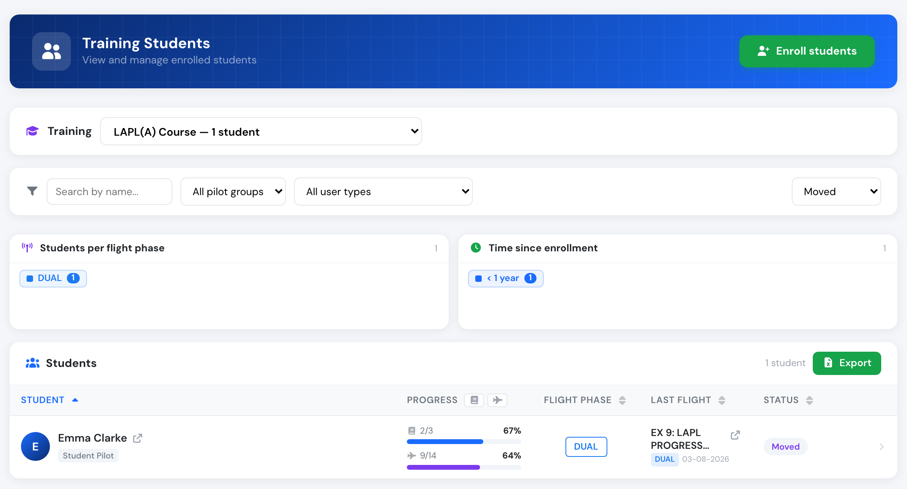<figcaption>
The Moved filter in the students list.
</figcaption></figure>

Flylogs does not send the student a message about a move or a credit, so let them know yourself.

## Move a group to a new course revision

Publishing a [course revision](edit-a-training.md#course-revisions-minor-and-major-changes) moves nobody. Students on the previous course revision stay there until you decide.

Open the current course revision. The **Course revisions** bar says how many students a previous course revision still has. Click **Review who can move**. You can also open the previous course revision and click **Move students to course revision N**.

<figure>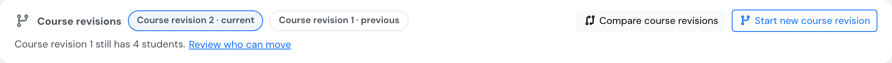<figcaption>
The reminder on the current course revision.
</figcaption></figure>

Every student in progress on the previous course revision is listed, with what would carry over. **Nobody is ticked by default.**

<figure>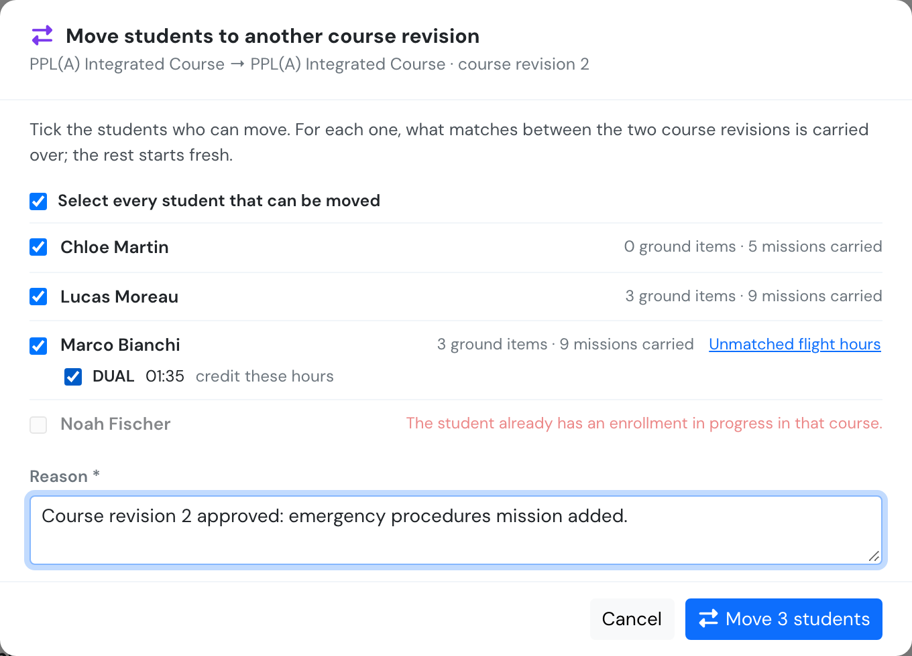<figcaption>
Three students ticked. Marco's unmatched hours are open and ticked, and Noah cannot move because he already has an enrollment in progress on course revision 2.
</figcaption></figure>

1. Tick the students who should move, or **Select every student that can be moved**. Anyone you leave unticked finishes on the course revision they started.
2. For a ticked student with unmatched hours, click **Unmatched flight hours** and tick the flight types to credit.
3. Write one reason for the group, and click **Move N students**.

Each student moves separately, so a refusal for one does not stop the others. The result says how many moved and lists anyone refused, with the reason.

<figure>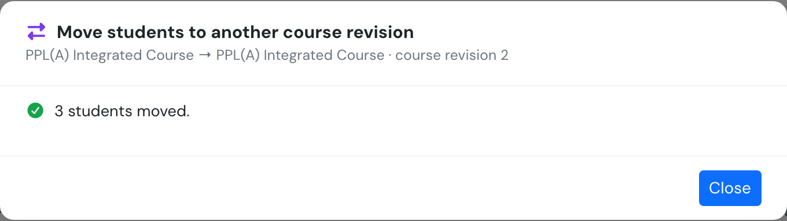<figcaption>
The result of the group move.
</figcaption></figure>

The matching rules are the ones above, but this list has no diagram to pair items on. If a mission inserted in the new course revision shifts later missions, save a course pathway **before** moving the group. Open the **Pathways** tab of the new course revision, click **New pathway**, and choose the previous course revision as the source. Its pairings then apply to every student you move from that course revision. Unmatched flight hours are still ticked here, student by student. See [Course pathways](course-pathways.md#3-course-pathways-and-the-pathway-map).

## Credit a closed record

A record that is **Completed**, **Stopped** or **Not passed** cannot be moved. Its management panel offers **Credit into another course** instead. A typical case is an LAPL(A) holder coming back for the PPL(A).

<figure>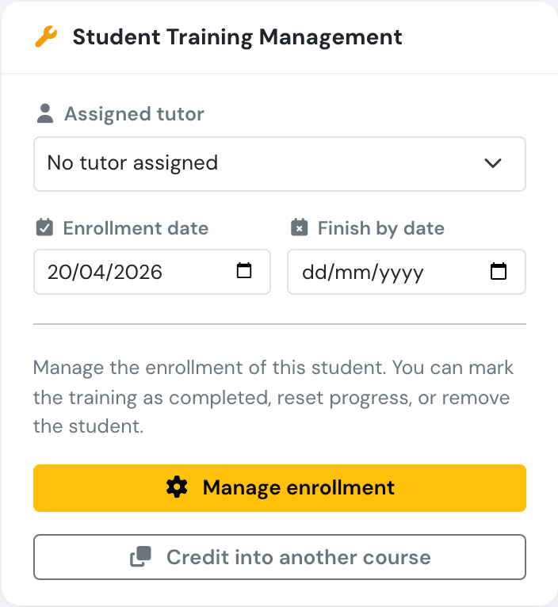<figcaption>
The button on a completed record.
</figcaption></figure>

The same four-step wizard opens. Any saved course pathway is applied, and its label shows at the top of the diagram.

<figure>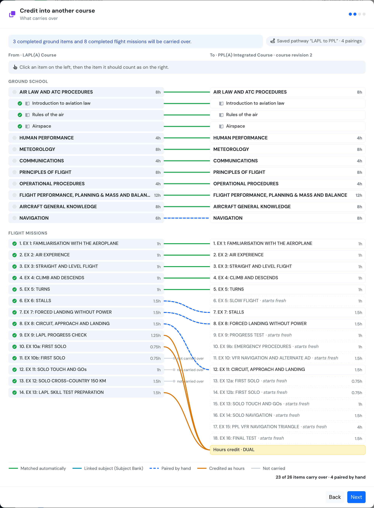<figcaption>
The pairings saved with an earlier move are already there. Hours from the unpaired missions go to a DUAL hours credit, in amber, because the pathway ticked that flight type.
</figcaption></figure>

Clicking **Credit and enrol** opens a new enrollment with **copies** of everything that matches. The closed record is **not changed**: its status, certificate, progress and notes stay exactly as they are. Into another course revision of the same course is allowed, for example a stopped student restarting on the new course revision. Into the very same course revision is not. Use **Reopen enrollment** for that.

<figure>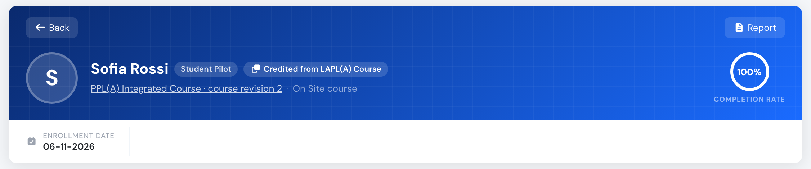<figcaption>
The new enrollment shows <strong>Credited from …</strong>.
</figcaption></figure>

<figure>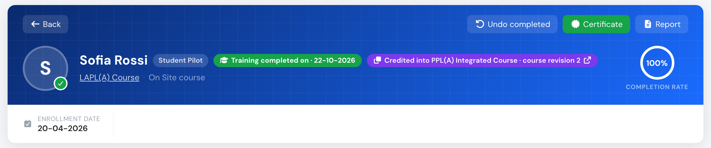<figcaption>
The closed record stays completed and shows <strong>Credited into …</strong> for every course it was credited into.
</figcaption></figure>

This is the route to use when LAPL(A) training counts towards the PPL(A) under FCL.210.A(b). [Course pathways (LAPL to PPL)](course-pathways.md) covers that case and the experience check across both courses.

## What travels with the student

| Item | Move | Credit |
| ---- | ---- | ------ |
| Lessons and exams that match, completed or with time spent, with their grade, number of attempts, signature and remarks | Copied | Copied |
| Flight missions that match | Copied, pointing at the same logbook flights | Copied, pointing at the same logbook flights |
| Hours on unmatched missions | Only the flight types you tick, and only confirmed flights | Only the flight types you tick, and only confirmed flights |
| Previous-experience hours | Follow when the new course has the same flight type or the subject matched | Follow when the new course has the same flight type or the subject matched |
| Previous-experience reason and pre-entry assessment | Carried | Carried |
| Assigned tutor and finish-by date | Carried | Carried |
| Enrollment notes | Carried | Stay on the closed record only |
| Individual exam attempts | Stay on the old record | Stay on the old record |
| Intake | The new enrollment is not on an intake | The new enrollment is not on an intake |

A flight is never counted twice. If one flight was split across a matched and an unmatched mission, it travels with the matched mission and adds nothing to the unmatched hours. The [experience requirements](course-pathways.md#how-the-experience-is-counted) also count each flight once across every course of the student's pathway.

If everything a course requires has been carried over and the course completes automatically, the new enrollment completes straight away, unless a stage check or a blocking experience requirement still holds it.

When the student later completes the course, the [completion certificate](student-management.md#the-course-completion-certificate) gets a second page, **Credited training**, listing the earlier courses and the hours carried over.

## When a migration is refused

| Message | What it means |
| ------- | ------------- |
| *Only enrollments in progress can be moved.* | The record is already closed. Credit it instead. |
| *Only a completed, stopped or not passed record can be credited into another course.* | A **Moved** record is frozen, and an **Expelled** record is not credited. |
| *The student is already in this course.* | You chose the course revision the record is on. |
| *The student already has an enrollment in progress in that course.* | Close or remove the other enrollment first. |
| *Students can only be moved to the current course revision.* | The target is a draft or a previous course revision. |
| *Please write the reason for the move.* | The reason is required. |

## Related

* [Course pathways (LAPL to PPL)](course-pathways.md): saved pairings, the pathway map and experience requirements.
* [Edit a training](edit-a-training.md#course-revisions-minor-and-major-changes): starting, comparing and publishing course revisions.
* [Student management](student-management.md#recording-previous-experience): previous experience from another school.
* [Subject Bank (linked subjects)](subject-bank.md): linked subjects pair automatically.
* API: [Moving a student to another course](../API/trainings.md#moving-a-student-to-another-course).
