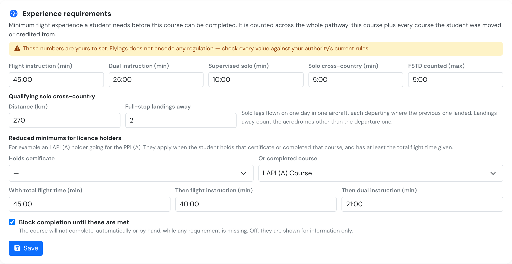
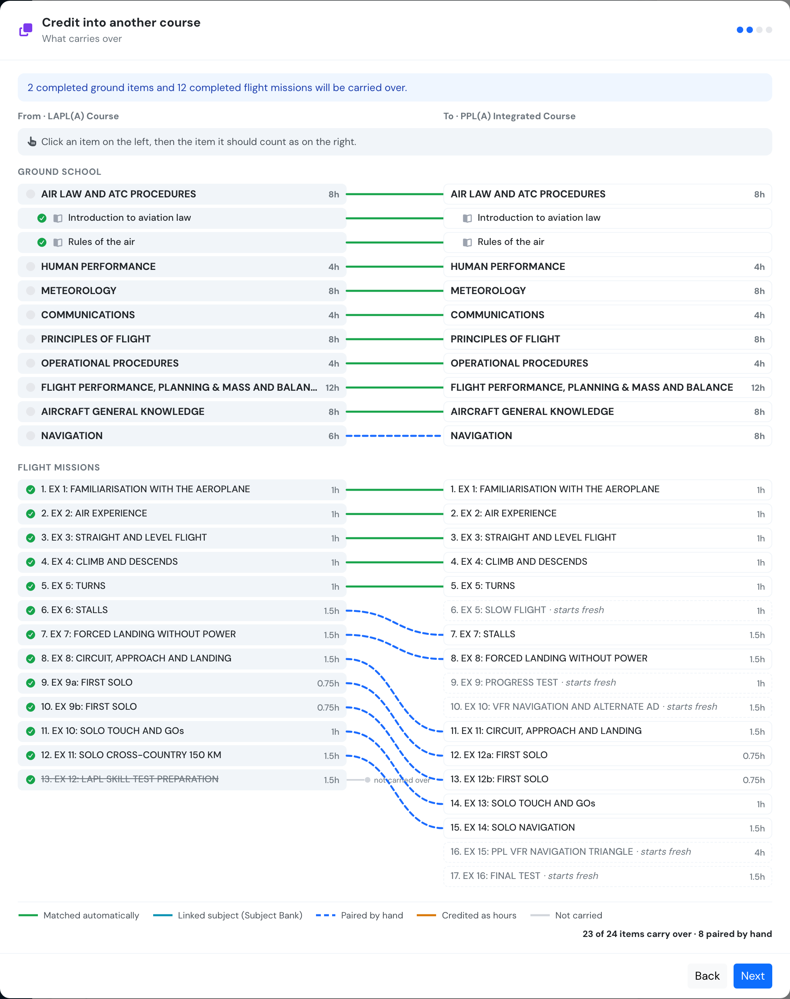
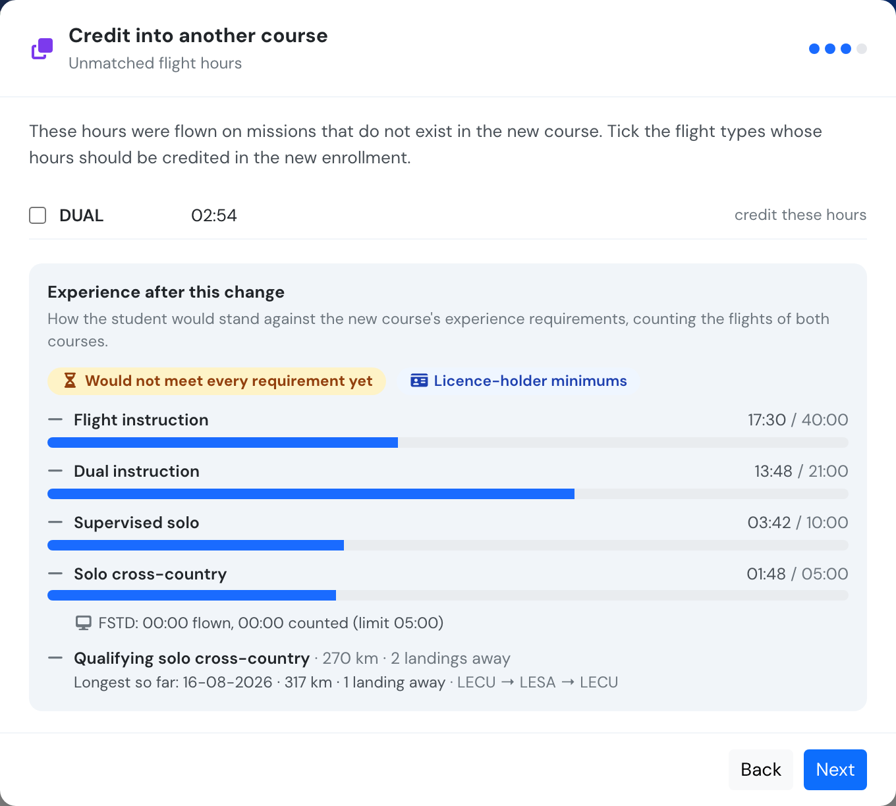
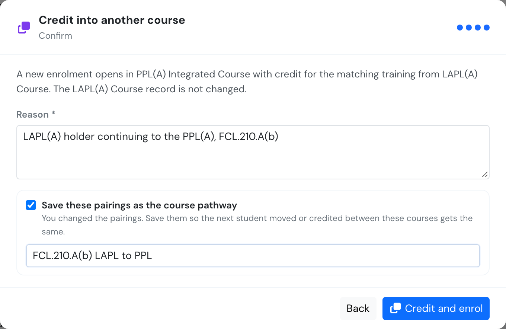
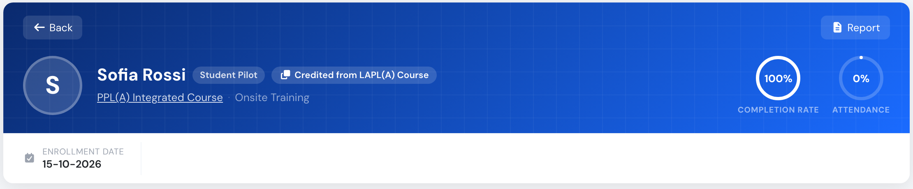
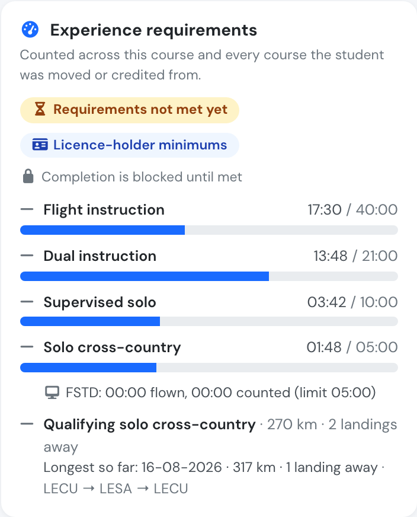
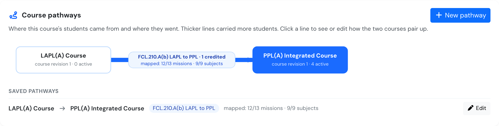
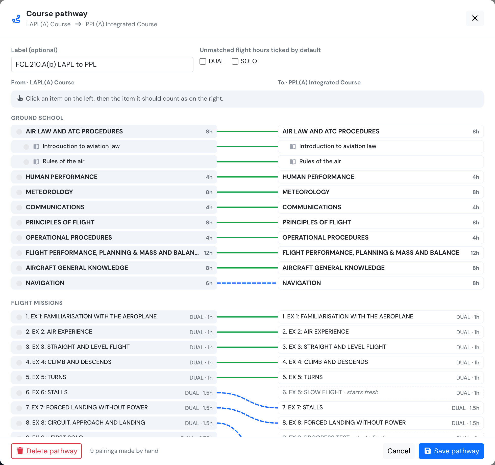

# Course pathways (LAPL to PPL)

Students do not always finish where they started. An LAPL(A) holder comes back for the PPL(A), a student on one course moves to another, or a new course revision replaces the one they enrolled on. Course pathways let you carry their training across, so they get credit for what they have already done.

The case that prompted this is Commission Implementing Regulation (EU) 2024/2076, which amended FCL.210.A. Applicants for a PPL(A) now **receive credit for the LAPL(A) training they have already done**, provided that the LAPL(A) and PPL(A) training together meet the PPL(A) experience requirements.



This page covers three things that work together:

1. **Crediting a closed course.** Start a student on another course with credit for a course they completed, stopped or did not pass. The old record stays exactly as it is.
2. **Course pathways.** A drawing of how two courses pair up, item by item. Pair any item by hand, and save the pairings so every later student gets the same credit.
3. **Experience requirements.** The flight experience a student must reach before a course can be completed, counted across every course of their pathway.


**Who can do this.** Staff up to and including Trainings Manager (`user_group_id <= 135`): Company Manager, Chief Pilot and Head of Training roles. Instructors, students and external auditors do not see the Pathways tab or the credit button, and the server answers 404 for them. Everything stays inside your own company.


## 1. Set the course's experience requirements

Open the course (for example your PPL(A)), go to the new **Pathways** tab and scroll to **Experience requirements**.

<figure><figcaption>
The experience requirements of a course. Leave a field empty for no rule.
</figcaption></figure>

| Field | What it means |
| ----- | ------------- |
| **Flight instruction (min)** | All training flights in an aircraft, plus FSTD time up to the limit below, plus hours credited as previous experience. |
| **Dual instruction (min)** | Flights where the student's seat counts as dual instruction. |
| **Supervised solo (min)** | Flights where the student was PIC with nobody else on board. |
| **Solo cross-country (min)** | Supervised solo flights marked as cross-country. |
| **Instructor certificates** | Which certificates qualify an instructor for this course, for example the instructor rating needed to teach the PPL. Holding any one of them, valid on the day of the flight, is enough. |
| **Dual, qualified instructor (min)** / **Supervised solo, qualified instructor (min)** | Like dual and supervised solo above, but only flights where the instructor qualified count. Needs at least one instructor certificate ticked. |
| **FSTD counted (max)** | The most simulator time that counts towards flight instruction. Time flown above it is shown but not counted. |
| **Distance (km)** / **Full-stop landings away** | One qualifying solo cross-country trip: solo legs flown on the same day in the same aircraft, each departing from where the previous one landed. The distance is the sum of the legs. Landings away count the aerodromes landed at other than the one the trip started from. |

**Reduced minimums for licence holders.** Some students need less: for example an LAPL(A) holder with 45 hours of total flight time needs 40 hours of instruction and 21 hours of dual. Choose **Holds certificate** (the exact certificate type on the pilot's documents), **Or completed course** (a student who completed any course revision of that course here), and a **total flight time**. When a student qualifies, the alternative flight instruction and dual minimums replace the normal ones, and their gauges show **Licence-holder minimums**. Total flight time is the pilot's logged aircraft time (simulators excluded) plus the career hours declared on their profile.

**Block completion until these are met.** When ticked, the course cannot be completed, either automatically or with **Mark as completed**, while any requirement is missing. When not ticked, the requirements are shown for information only.


**These numbers are yours to set.** Flylogs does not encode any regulation and does not fill these fields for you. Check every value against your authority's current rules and your approved training programme before relying on it.


As an example only, the values a school might type for a PPL(A) under FCL.210.A (Dec 2024 Easy Access Rules) are:

| Field | Example |
| ----- | ------- |
| Flight instruction | 45:00 |
| Dual instruction | 25:00 |
| Supervised solo | 10:00 |
| Solo cross-country | 5:00 |
| FSTD counted (max) | 5:00 |
| Distance / landings away | 270 km / 2 |
| Reduced minimums | LAPL(A) course completed · total 45:00 → instruction 40:00, dual 21:00 |

FCL.210.A(b)(2) also requires 5 hours of dual and the full solo requirement to be flown with an instructor qualified for the PPL(A). Tick the certificates that qualify an instructor for your PPL(A) course and type those two minimums (for example 5:00 and 10:00 in the fields marked *qualified instructor*); the experience card then shows them as their own gauges.

### Instructor qualification

When a mission flight is saved, Flylogs records who the instructor was (the other pilot on board for dual flights, the supervisor for supervised solo) and keeps a **snapshot of their licences, ratings and training certificates at that moment**. Editing or renewing a certificate later does not change flights already logged. If the flight is edited and the instructor stays the same, the snapshot is kept.

* A flight counts as flown with a qualified instructor when the snapshot holds one of the course's instructor certificates, valid on the day of the flight. The check uses the course's **current** list, so changing the list re-judges past flights.
* Dual and supervised solo flights where the instructor did **not** qualify are listed on the experience card ("Flown with an instructor who did not hold a qualifying certificate that day"), with the date, time and instructor.
* Flights logged before this was recorded have no snapshot. They are not counted towards the qualified minimums and are not flagged; the card shows how much time is affected.
* Previous-experience credits have no instructor and never count towards the qualified minimums.
* The flags are information only. The course is blocked from completing, with **Block completion** ticked, only while a qualified-instructor minimum is not met.

### How the experience is counted

* **Across the whole pathway.** A record's experience includes its own flights and the flights of every record it was moved or credited from. A student credited from LAPL(A) into PPL(A) is checked on both courses' flights together.
* **Each flight once.** Only confirmed flights logged on a training mission count. A flight copied by a move or a credit, or split across two missions, counts once and never for more than its block time. The time used is what the flight gave the missions, as everywhere else in Trainings.
* **Dual or solo comes from the flight type.** The student's seat on the flight (PIC or SIC) and the time classification of that seat in the flight type decide the role. **Dual** means the seat logs dual. **Solo** means the student is PIC (or PICUS) with no other pilot on board. PICUS with an instructor on board counts as dual. Any other seat counts towards flight instruction only.
* **FSTD** is any flight on an aircraft marked as a simulator.
* **Previous experience** credited by flight type adds to flight instruction, and to dual or solo according to the flight type's seats. It never counts towards cross-country, because there is no flight to measure.
* An aerodrome without coordinates counts 0 km for its legs, and the trip is marked as incomplete.

## 2. Credit a student from a closed course

Open the student's record on the course they finished (for example their LAPL(A)). If the record is **Completed**, **Stopped** or **Not passed**, the management panel shows **Credit into another course**.

The wizard is the same as [Moving a student to another course](student-management.md#moving-a-student-to-another-course), with two differences:

* The closed record is **not changed**. Its status, certificate, progress and notes stay exactly as they are. A new enrolment opens on the target course with **copies** of everything that matches.
* The two records link to each other: the new one shows **Credited from …**, and the old one shows **Credited into …** for every course it was credited into.

### Step 2: the pathway diagram

Both courses are drawn side by side, with one line for each item that carries over. Green ticks show what the student completed.

<figure><figcaption>
LAPL(A) on the left, PPL(A) on the right. Green: matched automatically. Blue dashed: paired by hand.
</figcaption></figure>

| Line | Meaning |
| ---- | ------- |
| Green | Matched automatically: a subject with the same name and planned hours, its lessons and exams in the same position, or a mission in the same position with the same flight type and hours. |
| Teal | A subject linked through the [Subject Bank](subject-bank.md). Linked subjects and their lessons pair up even when their names or hours differ. |
| Blue dashed | Your own pairing. |
| Grey stub | Not carried. On the right, items with no line are marked **starts fresh**. |

To **pair an item by hand**, click it on the left, then click the item it should count as on the right. Only items of the same kind can be paired: subject with subject, lesson with lesson, exam with exam, mission with mission. Two missions may count as one (for example two 1-hour LAPL missions as one 2-hour PPL mission). Subjects, lessons and exams pair one to one.

The bar above the diagram offers **Don't carry**, for an item that should not count (for example the LAPL skill test preparation), and **Back to automatic**, to remove your pairing.

Missions are matched by position, so one extra mission in either syllabus shifts every later position. Check the missions after the first difference. Position alone may pair two different exercises that happen to have the same flight type and hours.

### Step 3: hours and experience

Hours flown on missions with no counterpart can still be credited by flight type, as for a move. If the target course has experience requirements, the wizard also shows **Experience after this change**: how the student would stand, counting the flights of both courses.

<figure><figcaption>
A student who completed the LAPL(A) course and has 45 hours in total gets the licence-holder minimums. A 317 km trip with one landing away does not qualify yet.
</figcaption></figure>

### Step 4: confirm and save the pathway

A reason is required. If you paired anything by hand, **Save these pairings as the course pathway** is ticked, with an optional label (for example *FCL.210.A(b) LAPL to PPL*). The next student moved or credited between the same two courses then starts with the same pairings.

<figure><figcaption>
The reason is recorded on the new enrolment's activity timeline.
</figcaption></figure>

The new record opens straight away, showing where it came from and the experience card.

<figure><figcaption>
The new PPL(A) enrolment, credited from the LAPL(A) record.
</figcaption></figure>

<figure><figcaption>
The experience card on the student's record, counted across both courses.
</figcaption></figure>

**What can be credited**

* Only a **Completed**, **Stopped** or **Not passed** record. A record in progress is moved instead, a **Moved** record is frozen, and an **Expelled** record is not credited.
* Only into a course's **current course revision**, and not into a course where the student already has an enrolment in progress.
* Into another course revision of the same course: allowed (for example a stopped student restarting on the new revision). Into the very same course revision: no. Use **Reopen enrollment** instead.

## 3. Course pathways and the pathway map

The top of the **Pathways** tab draws the course in the middle, the courses its students came from on the left and the courses they went to on the right.

<figure><figcaption>
The pathway map of the PPL(A) course: one student credited from the LAPL(A) course, along a saved pathway.
</figcaption></figure>

* Thicker lines carried more students (moved or credited).
* A **solid** line has a saved pathway. Its label shows how much of the source course has a counterpart, for example *mapped: 12/13 missions · 9/9 subjects*.
* A **dashed grey** line has no pathway saved, or one saved against an older course revision of the target (**saved for an older course revision**).
* Moves between course revisions of the same course are not drawn as lines. They are counted under the course.

**Click a line** to open the pathway, or use **New pathway** to prepare one before any student moves. Choose whether students come **into** this course or go **from** it, and pick the other course.

<figure><figcaption>
The pathway editor uses the same diagram as the wizard, without a student.
</figcaption></figure>

In the editor you can:

* pair items or mark them **Don't carry**, exactly as in the wizard
* give the pathway a label
* choose which unmatched flight types are ticked by default in step 3 of the wizard
* **Delete pathway**. Students already moved or credited keep their records.

A pathway belongs to one **course revision** of the source course, because an older revision has different items. When the target course publishes a new course revision, its pathways become **stale**: they are shown, but not applied, until you review them and save again.

Pathways also apply to [bulk moves](student-management.md#moving-a-student-to-another-course) to a new course revision.

## Related

* [Student management](student-management.md#moving-a-student-to-another-course) covers moving a student in progress, and recording previous experience.
* [Subject Bank (linked subjects)](subject-bank.md): linked subjects pair automatically on the pathway diagram.
* [Course approvals](course-approvals.md) covers course revisions.
* API: [Course pathways and experience requirements](../API/trainings.md#course-pathways-and-experience-requirements).
